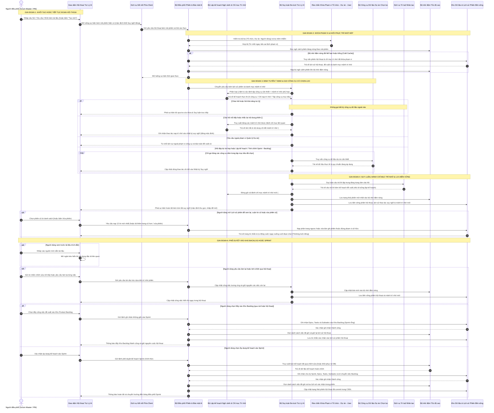
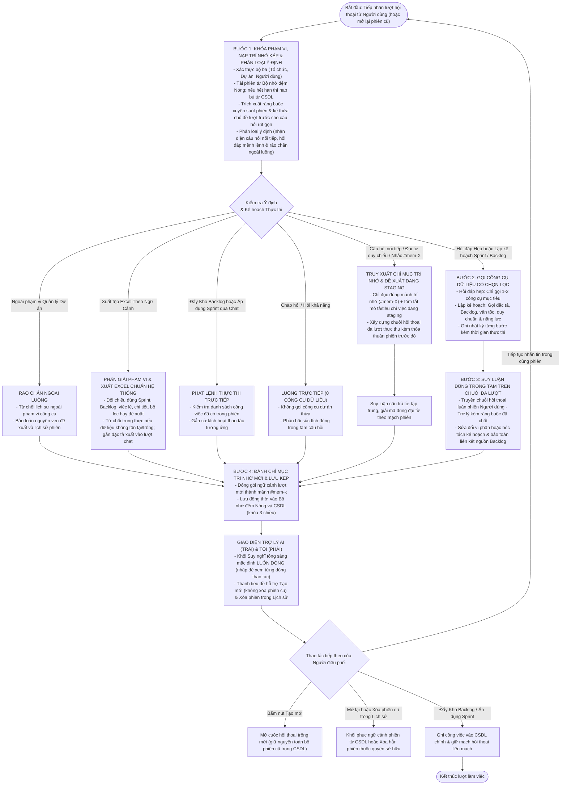

# CHUYÊN ĐỀ 2: SƠ ĐỒ TUẦN TỰ & SƠ ĐỒ HOẠT ĐỘNG CỦA MODULE AI AGENT

---

## 1. Tổng quan Kiến trúc Vận hành & Luồng Dữ liệu
Trong hệ thống Quản lý Dự án Scrum Agile, **Trợ Lý AI** vận hành theo mô hình **Đoạn Hội thoại Có Trạng thái kết hợp Định tuyến Ngữ cảnh Chọn lọc & Quy trình Agentic (Stateful Hermes Agentic Workflow)**:

Module này đảm bảo 5 tiêu chí cốt lõi:
1. **Minh bạch Thời gian thực & Mặc định Đóng Gọn (Default-Collapsed Thinking Log)**: Người dùng nhìn thấy trạng thái AI đang suy nghĩ theo từng giây (`Đang suy nghĩ · X.Xs — ...`) và kết quả hoàn tất tông sáng gọn nhẹ (`Đã suy nghĩ xong trong X.Xs · N thao tác`). Mặc định khung suy nghĩ **luôn đóng** để giữ không gian hội thoại sạch sẽ; khi mở rộng sẽ hiện rõ từng bước thực thi (`actionVerb`, `target`, `durationMs`, chi tiết mở/đóng từng dòng) và các mảnh trí nhớ `#mem-X` vừa nạp.
2. **Định tuyến Ý định Thông minh & Gọi MCP Có Chọn Lọc (Selective MCP Routing)**: Tự động phân loại 8 nhóm ý định và chỉ kích hoạt các công cụ MCP thực sự cần thiết cho nội dung câu hỏi (0 MCP cho lời chào/hỏi khả năng; chỉ `memory_recall` cho câu hỏi nối tiếp `#mem-X`; tập công cụ khu trú cho hỏi đáp dự án hẹp; đầy đủ công cụ khi lập kế hoạch Sprint/Backlog).
3. **Ngăn chặn triệt để ảo giác (Zero Hallucination Grounding)**: Khi cần số liệu dự án, AI buộc phải truy vấn dữ liệu thực tế từ hệ thống trước khi suy luận.
4. **Phê duyệt Staging & Lưu trữ Bền vững Kết hợp Redis + MySQL**: Bản đề xuất và toàn bộ lịch sử hội thoại, log thao tác, các mảnh trí nhớ đánh chỉ mục (`#mem-1..#mem-n`) được giữ nóng trên Redis đồng thời ghi bền vững vào cơ sở dữ liệu theo khóa phạm vi **`(OrganizationId, ProjectId, UserId)`**.
5. **Tạo mới Không Phá Hủy & Xóa Phiên Có Kiểm Soát**: Nút **"Tạo mới"** bắt đầu đoạn chat mới mà không xóa phiên cũ; người dùng có thể mở lại phiên cũ (kể cả khi Redis đã hết hạn nhờ tự động nạp lại từ MySQL) hoặc xóa chủ động phiên cũ khi cần.

---

## 2. Sơ đồ Tuần tự Toàn diện (Sequence Diagram)

Sơ đồ tuần tự dưới đây mô tả chi tiết luồng xử lý từ thời điểm người dùng gửi thông điệp trong Trợ Lý AI, định tuyến ngữ cảnh chọn lọc, nạp trí nhớ đánh chỉ mục, hiển thị nhật ký suy nghĩ mặc định đóng cho đến khi lưu phiên bền vững hoặc ghi nhận vào Sprint/Backlog (tuân thủ chuẩn kiến trúc không lộ tên thành phần mã nguồn):



---

## 3. Sơ đồ Hoạt động (Activity Diagram) của Pipeline Đa lượt Có Trạng thái & Định tuyến MCP Chọn lọc

Quy trình xử lý nội bộ của [`AiSprintDecompositionService.cs`](file:///c:/Users/hoang/Downloads/ProjectMgmt/ProjectMgmt.Solution/Services/Ai/AiSprintDecompositionService.cs) kết hợp [`AiIndexedMemoryEngine.cs`](file:///c:/Users/hoang/Downloads/ProjectMgmt/ProjectMgmt.Solution/Services/Ai/AiIndexedMemoryEngine.cs) được mô hình hóa theo sơ đồ hoạt động dưới đây:



---

## 4. Giao thức Server-Sent Events (SSE) & Cơ chế Truyền dữ liệu Thời gian thực

### 4.1. Tại sao lựa chọn Server-Sent Events (SSE) thay vì WebSocket hay Polling?
Trong tác vụ AI Agent suy luận dài (từ 5 đến 45 giây tùy quy mô tài liệu):
- **Short/Long Polling**: Tạo áp lực cực lớn lên Web Server do gửi hàng chục HTTP request thừa thãi, gây lãng phí tài nguyên và độ trễ cao.
- **WebSocket**: Quá phức tạp cho tác vụ một chiều (server truyền tiến trình về client), đòi hỏi duy trì kết nối TCP song công toàn phần (Full-duplex) và dễ bị proxy/firewall doanh nghiệp chặn.
- **Server-Sent Events (SSE - `text/event-stream`)**: Chuẩn HTTP/1.1 và HTTP/2 gốc của trình duyệt, truyền tải một chiều nhẹ nhàng, hỗ trợ streaming văn bản mượt mà, vượt qua tường lửa dễ dàng và tích hợp sẵn cơ chế auto-reconnect.

### 4.2. Cấu trúc Message SSE & Metadata Thao tác Suy nghĩ
Mỗi gói tin SSE phát đi từ [`AiAgentController.cs`](file:///c:/Users/hoang/Downloads/ProjectMgmt/ProjectMgmt.Solution/Controllers/AiAgentController.cs) được chuẩn hóa theo [`AiSsePayloads.cs`](file:///c:/Users/hoang/Downloads/ProjectMgmt/ProjectMgmt.Solution/Dtos/Ai/AiSsePayloads.cs), trong đó sự kiện gọi công cụ bổ sung `ActionVerb`, `TargetLabel` và `DetailPreview` để hiển thị trực quan trong khung **Thinking** khi người dùng mở rộng:

```http
HTTP/1.1 200 OK
Content-Type: text/event-stream
Cache-Control: no-cache
Connection: keep-alive
Transfer-Encoding: chunked

data: {"type":"step","step":1,"title":"Phân loại ý định & lập kế hoạch ngữ cảnh","status":"completed"}

data: {"type":"tool_call","toolName":"memory_recall","actionVerb":"Recalled","targetLabel":"#mem-1","summary":"Nạp mảnh trí nhớ #mem-1 về quy trình Workflow","detailPreview":"Quy trình 4 bước: Open -> In Dev -> QA Testing -> Released","latencyMs":4}

data: {"type":"tool_call","toolName":"project_get_active_config","actionVerb":"Analyzed","targetLabel":"Cấu hình Workflow & Priority","summary":"Đọc cấu hình Workflow đang áp dụng của dự án QLDA","detailPreview":"Priorities: Urgent, High, Normal, Low | InitialStatus: Open","latencyMs":12}

data: {"type":"step","step":4,"title":"Đang tổng hợp câu trả lời tập trung...","status":"running"}

data: {"type":"proposal","stagingId":"a8f3b2e1-4c5d-6e7f-8a9b-0c1d2e3f4a5b","payload":{...}}

data: {"type":"done"}
```

### 4.3. Cơ chế Tự động Làm mới Access Token (JWT Token Auto-Refresh on 401)
Khi phiên làm việc kéo dài, JWT Access Token có thể hết hạn ngay trong lúc người dùng đang thao tác. Angular Service [`ai-agent.service.ts`](file:///c:/Users/hoang/Downloads/ProjectMgmt/frontend/projectmgmt-web/src/app/core/services/ai-agent.service.ts) được trang bị cơ chế tự phục hồi thông minh:
1. Khi request SSE nhận HTTP status `401 Unauthorized`, interceptor hoặc hàm streaming bắt lỗi ngay lập tức.
2. Tự động kích hoạt luồng gọi `AuthService.refreshToken()` bằng Refresh Token lưu an toàn.
3. Nhận Access Token mới và tự động mở lại kết nối stream mà không ngắt quãng trải nghiệm của người dùng.

### 4.4. Phân Tách Tuyệt Đối Luồng Tư Duy (Native Thoughts) và Dữ Liệu Nội Dung (Clean Content Streaming)
Một vấn đề thường gặp ở các hệ thống AI phân rã công việc là luồng streaming trả về cấu trúc JSON bị "xả thô" (raw dump) các đoạn ngoặc nhọn `{ "storyPoints": 2, ... }` vào hộp hiển thị suy luận tư duy (Chain-of-Thought) của người dùng, gây rối mắt và làm giảm chất lượng trải nghiệm.

Hệ thống giải quyết triệt để thông qua bộ phân tách loại chunk trong [`AiSprintDecompositionService.cs`](file:///c:/Users/hoang/Downloads/ProjectMgmt/ProjectMgmt.Solution/Services/Ai/AiSprintDecompositionService.cs):
- **Chunk suy luận (`AiStreamChunkType.Thought`)**: Được chuyển tiếp trực tiếp vào `onThoughtDelta(chunk.DeltaThought)` để người dùng đọc được từng bước suy nghĩ tự nhiên của mô hình trong hộp Thinking khi mở rộng.
- **Chunk nội dung (`AiStreamChunkType.Content`)**: Chỉ được nối vào bộ đệm nội bộ `responseContentBuilder.Append(chunk.DeltaContent)`, **tuyệt đối không gửi vào `onThoughtDelta`**.
- **Nhật ký Trace & Tóm tắt Suy nghĩ (`TraceItems` & `ThinkingSummary`)**: Sau mỗi lượt, toàn bộ thao tác thực tế và tóm tắt được lưu kèm vào từng `AiConversationTurnDto` trong MySQL/Redis để dù khôi phục lại phiên cũ, người dùng vẫn xem lại được quá trình làm việc của Agent (mặc định luôn ở trạng thái đóng).

---

## 5. Danh mục Tệp Mã Nguồn Tham Chiếu Chuyên Đề 2

| Thành phần | Vai trò kỹ thuật | Liên kết mã nguồn |
| :--- | :--- | :--- |
| **AiAgentController** | Tiếp nhận SSE theo `sessionId`, khóa phạm vi 3 chiều, khôi phục/xóa phiên & commit Sprint/Kho Backlog | [`AiAgentController.cs`](file:///c:/Users/hoang/Downloads/ProjectMgmt/ProjectMgmt.Solution/Controllers/AiAgentController.cs) |
| **AiSprintDecompositionService** | Trợ Lý AI có trạng thái: định tuyến ý định, Selective MCP, Thinking trace & prompt engineering | [`AiSprintDecompositionService.cs`](file:///c:/Users/hoang/Downloads/ProjectMgmt/ProjectMgmt.Solution/Services/Ai/AiSprintDecompositionService.cs) |
| **AiExcelExportResolver** | Phân giải thông minh phạm vi xuất Excel (Sprint, Backlog, Việc lẻ, Chi tiết, Đề xuất, Bộ lọc) & kiểm tra tồn tại thực thể | [`AiExcelExportResolver.cs`](file:///c:/Users/hoang/Downloads/ProjectMgmt/ProjectMgmt.Solution/Services/Ai/AiExcelExportResolver.cs) |
| **ExcelDataService** | Bộ sinh OpenXML `.xlsx` bảng sạch chuẩn ProjectMgmt (màu trạng thái động + bảng Chú thích + hồ sơ chi tiết) | [`excel-data.service.ts`](file:///c:/Users/hoang/Downloads/ProjectMgmt/frontend/projectmgmt-web/src/app/core/services/excel-data.service.ts) |
| **AiIndexedMemoryEngine** | Lập kế hoạch gọi MCP chọn lọc và truy xuất chỉ mục trí nhớ `#mem-1..#mem-n` | [`AiIndexedMemoryEngine.cs`](file:///c:/Users/hoang/Downloads/ProjectMgmt/ProjectMgmt.Solution/Services/Ai/AiIndexedMemoryEngine.cs) |
| **AiConversationSessionStore** | Lưu trữ & khôi phục phiên đa lượt trong MySQL kèm khóa `(OrganizationId, ProjectId, UserId)` | [`AiConversationSessionStore.cs`](file:///c:/Users/hoang/Downloads/ProjectMgmt/ProjectMgmt.Solution/Services/Ai/AiConversationSessionStore.cs) |
| **AiSsePayloads & Proposal DTOs** | Lược đồ SSE `tool_call` (`ActionVerb`, `TargetLabel`, `DetailPreview`) và `AiTurnTraceItemDto` | [`AiSsePayloads.cs`](file:///c:/Users/hoang/Downloads/ProjectMgmt/ProjectMgmt.Solution/Dtos/Ai/AiSsePayloads.cs) |
| **AiTokenUsageTracker** | Ghi nhận token, latency và thống kê lịch sử các phiên Trợ Lý AI | [`AiTokenUsageTracker.cs`](file:///c:/Users/hoang/Downloads/ProjectMgmt/ProjectMgmt.Solution/Services/Ai/AiTokenUsageTracker.cs) |
| **MultiProviderAiModelClient** | Router gọi API mô hình ngoài (Gemini, Claude, OpenAI) | [`MultiProviderAiModelClient.cs`](file:///c:/Users/hoang/Downloads/ProjectMgmt/ProjectMgmt.Solution/Services/Ai/MultiProviderAiModelClient.cs#L25-L120) |
| **SpecHubTools** | Công cụ trích xuất đặc tả yêu cầu phục vụ Grounding | [`SpecHubTools.cs`](file:///c:/Users/hoang/Downloads/ProjectMgmt/ProjectMgmt.Solution/McpServers/SpecHubTools.cs#L15-L80) |
| **ai-agent.service.ts** | Xử lý SSE theo `sessionId`, đẩy Kho Backlog, áp dụng Sprint, **xóa phiên cũ (`deleteSession`)** & 401 refresh | [`ai-agent.service.ts`](file:///c:/Users/hoang/Downloads/ProjectMgmt/frontend/projectmgmt-web/src/app/core/services/ai-agent.service.ts) |
| **ai-decompose-modal.ts** | Giao diện **Trợ Lý AI** hội thoại 2 phía, **Thinking mặc định luôn đóng**, nút **Tạo mới**, khôi phục & xóa phiên | [`ai-decompose-modal.ts`](file:///c:/Users/hoang/Downloads/ProjectMgmt/frontend/projectmgmt-web/src/app/features/backlog/components/ai-decompose-modal/ai-decompose-modal.ts) |

