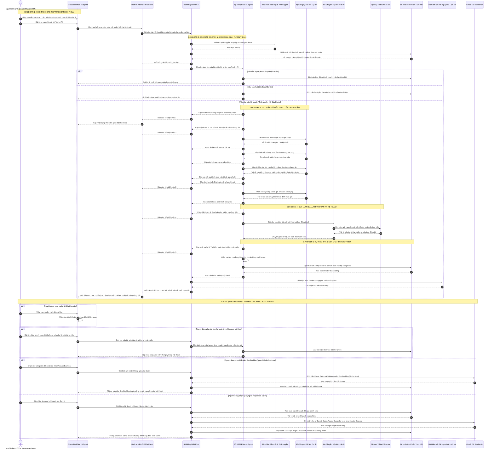
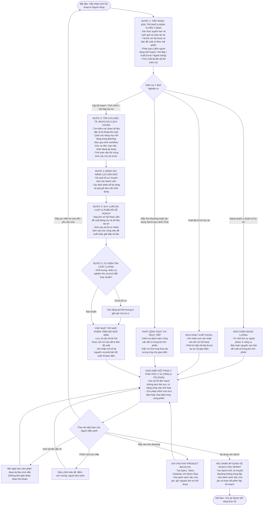

# CHUYÊN ĐỀ 2: SƠ ĐỒ TUẦN TỰ & SƠ ĐỒ HOẠT ĐỘNG CỦA MODULE AI AGENT

---

## 1. Tổng quan Kiến trúc Vận hành & Luồng Dữ liệu
Trong hệ thống Quản lý Dự án Scrum Agile, **Trợ Lý AI** không chỉ chạy một lệnh phân rã đơn lẻ không trạng thái, mà vận hành theo mô hình **Đoạn Hội thoại Có Trạng thái kết hợp Định tuyến Ý định & Quy trình Agentic 5 Giai đoạn (Stateful Hermes Agentic Workflow)**:

Module này đảm bảo 4 tiêu chí cốt lõi:
1. **Phản hồi tức thì thời gian thực (Realtime Transparency)**: Người dùng nhìn thấy rõ ràng AI đang chạy công cụ nào, tra cứu tài liệu nào, mất bao nhiêu mili-giây thông qua bảng công cụ thu gọn ngay phía trên câu trả lời.
2. **Định tuyến Ý định Thông minh & Rào chắn Ngoài luồng (Intent Classification & Domain Guardrail)**: Tự động phân biệt 8 nhóm ý định (*lập kế hoạch Sprint*, *lập kế hoạch kho Backlog*, *tinh chỉnh kế hoạch đang lưu*, *hỏi đáp số liệu dự án*, *xuất tệp Excel*, *đẩy vào Kho Backlog*, *áp dụng vào Sprint*, và *từ chối yêu cầu ngoài phạm vi quản lý dự án*).
3. **Ngăn chặn triệt để ảo giác (Zero Hallucination Grounding)**: AI buộc phải truy vấn dữ liệu thực tế thông qua các MCP Tools trước khi suy luận.
4. **Phê duyệt Staging Có Trạng thái (Stateful Redis Staging Memory)**: Cả bản đề xuất công việc lẫn toàn bộ lịch sử hội thoại nhiều lượt (`ConversationHistory`) được lưu bền vững theo `sessionId` trên Redis để người dùng thoải mái trao đổi tiếp, tinh chỉnh, xuất Excel, hoặc chọn **Đẩy vào Kho Backlog** / **Áp dụng vào Sprint**.

---

## 2. Sơ đồ Tuần tự Toàn diện (Sequence Diagram)

Sơ đồ tuần tự dưới đây mô tả chi tiết từ thời điểm Scrum Master mở modal, gửi yêu cầu/tài liệu cho đến khi Sprint và các Task chính thức được tạo trong cơ sở dữ liệu:



---

## 3. Sơ đồ Hoạt động (Activity Diagram) của Pipeline Đa lượt Có Trạng thái

Quy trình xử lý nội bộ của [`AiSprintDecompositionService.cs`](file:///c:/Users/hoang/Downloads/ProjectMgmt/ProjectMgmt.Solution/Services/Ai/AiSprintDecompositionService.cs) được mô hình hóa theo sơ đồ hoạt động chặt chẽ dưới đây:



---

## 4. Giao thức Server-Sent Events (SSE) & Cơ chế Truyền dữ liệu Thời gian thực

### 4.1. Tại sao lựa chọn Server-Sent Events (SSE) thay vì WebSocket hay Polling?
Trong tác vụ AI Agent suy luận dài (từ 5 đến 45 giây tùy quy mô tài liệu):
- **Short/Long Polling**: Tạo áp lực cực lớn lên Web Server do gửi hàng chục HTTP request thừa thãi, gây lãng phí tài nguyên và độ trễ cao.
- **WebSocket**: Quá phức tạp cho tác vụ một chiều (server truyền tiến trình về client), đòi hỏi duy trì kết nối TCP song công toàn phần (Full-duplex) và dễ bị proxy/firewall doanh nghiệp chặn.
- **Server-Sent Events (SSE - `text/event-stream`)**: Chuẩn HTTP/1.1 và HTTP/2 gốc của trình duyệt, truyền tải một chiều nhẹ nhàng, hỗ trợ streaming văn bản mượt mà, vượt qua tường lửa dễ dàng và tích hợp sẵn cơ chế auto-reconnect.

### 4.2. Cấu trúc Message SSE được chuẩn hóa trong API
Mỗi gói tin SSE phát đi từ [`AiAgentController.cs`](file:///c:/Users/hoang/Downloads/ProjectMgmt/ProjectMgmt.Solution/Controllers/AiAgentController.cs) tuân theo định dạng:

```http
HTTP/1.1 200 OK
Content-Type: text/event-stream
Cache-Control: no-cache
Connection: keep-alive
Transfer-Encoding: chunked

data: {"type":"step","step":1,"title":"Tiếp nhận & Guardrail tài liệu","status":"completed"}

data: {"type":"tool","name":"SpecHubTools.SearchRelevantSpecs","latencyMs":7,"summary":"Tìm thấy 3 phân đoạn trong Cam-nang-ky-thuat.md"}

data: {"type":"tool","name":"BacklogTools.GetBacklogStories","latencyMs":13,"summary":"Lấy 8 User Stories đang chờ xử lý"}

data: {"type":"tool","name":"SprintTools.GetSprintHistoryAndVelocity","latencyMs":37,"summary":"Vận tốc trung bình 3 Sprint gần nhất: 32 SP"}

data: {"type":"tool","name":"TeamTools.GetTeamDevCapacities","latencyMs":25,"summary":"3 Lập trình viên, tổng dung lượng: 120 giờ"}

data: {"type":"step","step":4,"title":"Mô hình AI đang suy luận cấu trúc Sprint, chia nhỏ Epic và Task...","status":"running"}

data: {"type":"proposal","stagingId":"a8f3b2e1-4c5d-6e7f-8a9b-0c1d2e3f4a5b","payload":{...}}

data: {"type":"done"}
```

### 4.3. Cơ chế Tự động Làm mới Access Token (JWT Token Auto-Refresh on 401)
Khi phiên làm việc kéo dài, JWT Access Token có thể hết hạn ngay trong lúc người dùng đang thao tác. Angular Service [`ai-agent.service.ts`](file:///c:/Users/hoang/Downloads/ProjectMgmt/frontend/projectmgmt-web/src/app/core/services/ai-agent.service.ts) được trang bị cơ chế tự phục hồi thông minh:
1. Khi request SSE nhận HTTP status `401 Unauthorized`, interceptor hoặc hàm streaming bắt lỗi ngay lập tức.
2. Tự động kích hoạt luồng gọi `AuthService.refreshToken()` bằng Refresh Token lưu an toàn.
3. Nhận Access Token mới và tự động mở lại kết nối stream mà không ngắt quãng trải nghiệm của người dùng.

### 4.4. Phân Tách Tuyệt Đối Luồng Tư Duy (Native Thoughts) và Dữ Liệu Nội Dung (Clean Content Streaming)
Một vấn đề thường gặp ở các hệ thống AI phân rã công việc là luồng streaming trả về cấu trúc JSON bị "xả thô" (raw dump) các đoạn ngoặc nhọn `{ "storyPoints": 2, ... }` vào hộp hiển thị suy luận tư duy (Chain-of-Thought) của người dùng, gây rối mắt và làm giảm chất lượng trải nghiệm.

Hệ thống giải quyết triệt để thông qua bộ phân tách loại chunk trong [`AiSprintDecompositionService.cs`](file:///c:/Users/hoang/Downloads/ProjectMgmt/ProjectMgmt.Solution/Services/Ai/AiSprintDecompositionService.cs):
- **Chunk suy luận (`AiStreamChunkType.Thought`)**: Được chuyển tiếp trực tiếp vào `onThoughtDelta(chunk.DeltaThought)` để người dùng đọc được từng bước suy nghĩ tự nhiên của mô hình.
- **Chunk nội dung (`AiStreamChunkType.Content`)**: Chỉ được nối vào bộ đệm nội bộ `responseContentBuilder.Append(chunk.DeltaContent)`, **tuyệt đối không gửi vào `onThoughtDelta`**.
- Nếu mô hình không hỗ trợ Native Thinking, hệ thống tự động phát luồng suy luận tổng hợp (Synthesized Thought Milestones) bằng tiếng Việt mạch lạc, giúp người dùng nắm bắt tiến trình mà không thấy code thô.

---

## 5. Danh mục Tệp Mã Nguồn Tham Chiếu Chuyên Đề 2

| Thành phần | Vai trò kỹ thuật | Liên kết mã nguồn |
| :--- | :--- | :--- |
| **AiAgentController** | Tiếp nhận SSE kèm `sessionId`, điều phối stream, tái tạo task và commit Sprint/Kho Backlog | [`AiAgentController.cs`](file:///c:/Users/hoang/Downloads/ProjectMgmt/ProjectMgmt.Solution/Controllers/AiAgentController.cs#L25-L160) |
| **AiSprintDecompositionService** | Trợ Lý AI có trạng thái Redis: phân loại ý định, rào chắn ngoài luồng, pipeline 5 bước & prompt engineering | [`AiSprintDecompositionService.cs`](file:///c:/Users/hoang/Downloads/ProjectMgmt/ProjectMgmt.Solution/Services/Ai/AiSprintDecompositionService.cs#L45-L250) |
| **AiTokenUsageTracker** | Ghi nhận token, latency và lịch sử các phiên Trợ Lý AI | [`AiTokenUsageTracker.cs`](file:///c:/Users/hoang/Downloads/ProjectMgmt/ProjectMgmt.Solution/Services/Ai/AiTokenUsageTracker.cs) |
| **MultiProviderAiModelClient** | Router gọi API mô hình ngoài (Gemini, Claude, OpenAI) | [`MultiProviderAiModelClient.cs`](file:///c:/Users/hoang/Downloads/ProjectMgmt/ProjectMgmt.Solution/Services/Ai/MultiProviderAiModelClient.cs#L25-L120) |
| **SpecHubTools** | Công cụ trích xuất đặc tả yêu cầu phục vụ Grounding | [`SpecHubTools.cs`](file:///c:/Users/hoang/Downloads/ProjectMgmt/ProjectMgmt.Solution/McpServers/SpecHubTools.cs#L15-L80) |
| **ai-agent.service.ts** | Xử lý SSE theo `sessionId`, đẩy Kho Backlog, áp dụng Sprint và 401 refresh token | [`ai-agent.service.ts`](file:///c:/Users/hoang/Downloads/ProjectMgmt/frontend/projectmgmt-web/src/app/core/services/ai-agent.service.ts#L40-L150) |
| **ai-decompose-modal.ts** | Giao diện **Trợ Lý AI** hội thoại 2 phía, bảng công việc tích hợp, xuất Excel & khôi phục Redis | [`ai-decompose-modal.ts`](file:///c:/Users/hoang/Downloads/ProjectMgmt/frontend/projectmgmt-web/src/app/features/backlog/components/ai-decompose-modal/ai-decompose-modal.ts#L80-L280) |

