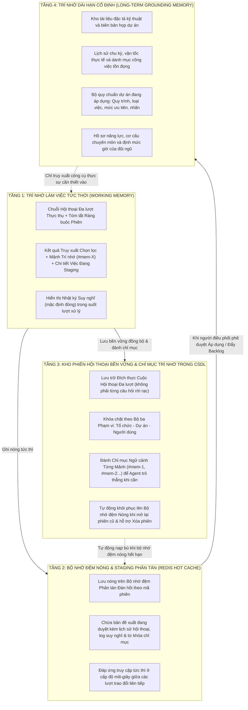
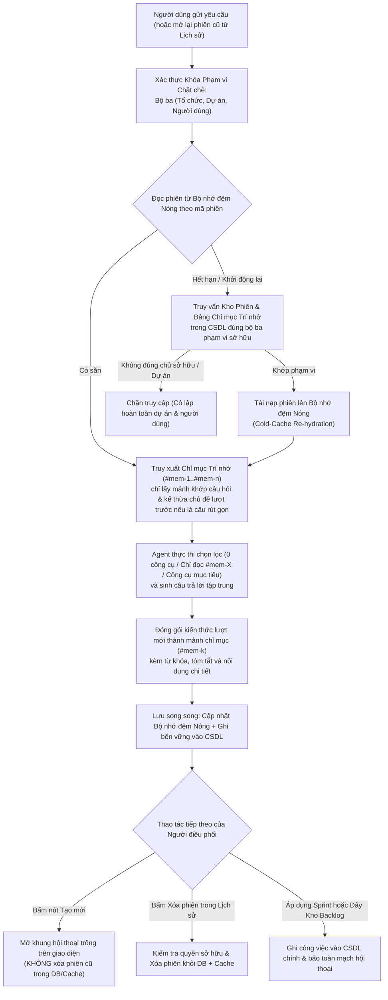

# CHUYÊN ĐỀ 3: CƠ CHẾ TRÍ NHỚ & BỘ NHỚ ĐỆM PHÂN TÁN REDIS (REDIS MEMORY ENGINE)

---

## 1. Bản chất & Kiến trúc Trí nhớ Đa tầng Kết hợp Redis + MySQL
Trong kỹ thuật phần mềm tích hợp AI, một Trợ lý thông minh thực thụ không thể chỉ lưu ngữ cảnh tạm bợ trong RAM hay để mất cuộc hội thoại khi hết TTL. Nếu chỉ dùng Redis thuần không có tầng lưu bền vững, người dùng sẽ mất phiên làm việc cũ khi cache hết hạn; mặt khác, nếu nạp nguyên văn hàng chục lượt chat cũ vào prompt thì mô hình sẽ tốn token và suy luận loãng.

Dự án triển khai **Kiến trúc Trí nhớ 4 Tầng Kết hợp Chỉ mục Hóa Ngữ cảnh & Lưu trữ Kép (Hybrid Redis + MySQL + Indexed Memory `#mem-X`)**:



---

## 2. Sơ đồ Hoạt động của Cơ chế Trí nhớ Kép, Chỉ mục `#mem-X` & Khóa Phạm vi

Sơ đồ dưới đây minh họa vòng đời đọc/ghi phiên hội thoại, cơ chế khôi phục khi Redis lạnh (Cold-Redis Fallback), đánh chỉ mục trí nhớ `#mem-X` và thao tác **"Tạo mới"** không phá hủy:



---

## 3. Cấu trúc Khóa, Định dạng Lưu trữ & Thời gian Sống (TTL)

### 3.1. Cấu trúc Khóa Redis (Keyspace Convention)
Khóa được định danh theo tiền tố cấu hình (`InstanceName = "ProjectMgmt:Ai:"`) kết hợp định danh phiên ngẫu nhiên (Session Guid):

```text
ProjectMgmt:Ai:staging:{stagingGuid}
```
*Ví dụ thực tế:*
`ProjectMgmt:Ai:staging:e7c4f1a2-8b3d-4e9a-9c12-3456789abcde`

### 3.2. Cấu trúc Payload JSON Lưu trữ
Toàn bộ đề xuất phân rã kèm trạng thái đoạn hội thoại đa lượt được tuần tự hóa (serialize) thành chuỗi JSON tối ưu:

```json
{
  "stagingId": "sprint_ai_e7c4f1a28b3d4e9a9c123456789abcde",
  "projectId": 12,
  "sprintId": 5,
  "intent": "sprint_plan",
  "assistantReply": "Tôi đã phân tích tài liệu đặc tả cùng kho Backlog và đề xuất kế hoạch gồm 2 công việc chính (8 SP).",
  "recommendedTarget": "sprint",
  "triggerAction": null,
  "sprintGoal": "Xây dựng lõi xác thực đa yếu tố và đồng bộ dữ liệu thời gian thực cho hệ thống",
  "suggestedSprintName": "Sprint 5 - Bảo mật & Realtime Engine",
  "targetVelocity": 32,
  "totalStoryPoints": 28,
  "conversationHistory": [
    {
      "id": "turn-1-u",
      "role": "user",
      "content": "Phân rã tính năng xác thực RBAC và realtime SSE",
      "attachmentName": "Kien-truc-realtime.docx",
      "intent": "sprint_plan",
      "toolSteps": [],
      "timestamp": "2026-11-14T08:15:20Z"
    },
    {
      "id": "turn-1-a",
      "role": "assistant",
      "content": "Tôi đã phân tích tài liệu đặc tả cùng kho Backlog và đề xuất kế hoạch gồm 2 công việc chính.",
      "intent": "sprint_plan",
      "toolSteps": ["spec_hub_search: 7ms", "backlog_get_stories: 13ms"],
      "timestamp": "2026-11-14T08:15:30Z"
    }
  ],
  "epics": [
    {
      "id": "epic-1",
      "title": "Hệ thống Xác thực Nâng cao & Phân quyền RBAC",
      "description": "Bao gồm đăng nhập, cấp JWT và phân quyền theo cấp bậc Scrum",
      "color": "#3B82F6"
    }
  ],
  "tasks": [
    {
      "id": "task-1",
      "epicId": "epic-1",
      "title": "Thiết kế Middleware kiểm tra quyền theo cấp bậc Scrum",
      "description": "Ngăn chặn vượt cấp từ Developer/QA lên cấp quản lý",
      "storyPoints": 3,
      "estimatedHours": 8,
      "assignedUserId": "u-dev-01",
      "assignedUserName": "Lê Văn A (Backend)",
      "status": "Ready",
      "tags": ["Security", "Middleware", "RBAC"],
      "citations": [
        "Tài liệu Spec Hub: Cam-nang-ky-thuat.md - Mục 4.1",
        "Ghi chú cuộc họp: Biên bản họp Sprint Planning - Đoạn 2"
      ],
      "subtasks": []
    },
    {
      "id": "task-2",
      "epicId": "epic-1",
      "title": "Tích hợp giao thức Server-Sent Events cho luồng AI Stream",
      "description": "Xử lý kết nối streaming một chiều, reconnect và tự động refresh token khi nhận 401",
      "storyPoints": 5,
      "estimatedHours": 16,
      "assignedUserId": "u-dev-02",
      "assignedUserName": "Nguyễn Thị B (Frontend)",
      "status": "Ready",
      "tags": ["SSE", "Realtime", "Auth"],
      "citations": [
        "Tài liệu Spec Hub: Kien-truc-realtime.docx - Trang 12"
      ],
      "subtasks": [
        {
          "id": "subtask-2-1",
          "title": "Cấu hình Controller phát event-stream trong .NET 10",
          "role": "Backend",
          "estimatedHours": 6,
          "storyPoints": 2,
          "priority": "High",
          "status": "To Do",
          "acceptanceCriteria": [
            "Controller trả về text/event-stream chuẩn SSE",
            "Đóng kết nối an toàn khi Client disconnect"
          ],
          "documentCitations": [
            "Tài liệu Spec Hub: Kien-truc-realtime.docx - Trang 12"
          ]
        },
        {
          "id": "subtask-2-2",
          "title": "Xây dựng Angular Service bắt lỗi 401 và gọi Refresh Token",
          "role": "Frontend",
          "estimatedHours": 6,
          "storyPoints": 2,
          "priority": "High",
          "status": "To Do",
          "acceptanceCriteria": [
            "Interceptor bắt lỗi 401 và gọi Refresh Token tự động",
            "Kết nối stream được mở lại không làm mất phiên"
          ],
          "documentCitations": [
            "Tài liệu Spec Hub: Kien-truc-realtime.docx - Trang 12"
          ]
        },
        {
          "id": "subtask-2-3",
          "title": "Viết kiểm thử tự động giả lập mất mạng đột ngột",
          "role": "QA",
          "estimatedHours": 4,
          "storyPoints": 1,
          "priority": "Medium",
          "status": "To Do",
          "acceptanceCriteria": [
            "Kịch bản kiểm thử giả lập ngắt mạng và tự kết nối lại",
            "Không phát sinh ngoại lệ chưa được xử lý"
          ],
          "documentCitations": [
            "Tài liệu Spec Hub: Kien-truc-realtime.docx - Trang 12"
          ]
        }
      ]
    }
  ],
  "warnings": [
    "Tổng Story Points (28 SP) nằm trong ngưỡng an toàn so với vận tốc trung bình (32 SP)."
  ],
  "createdAt": "2026-11-11T00:15:30Z",
  "expiresAt": "2026-11-12T00:15:30Z"
}
```

### 3.3. Thời gian Sống (TTL), Lưu trữ Bền vững MySQL & Chính sách Vòng đời Phiên
- **Lưu trữ Kép (Redis Hot Cache + MySQL Durable Persistence)**:
  - **Redis Hot Cache**: Giữ nóng bản đề xuất và hội thoại hiện hành để phục vụ phản hồi, tinh chỉnh và chỉnh sửa từng ô tức thì (cùng cơ chế Circuit Breaker fallback sang RAM).
  - **MySQL Persistent Tables (`AiConversationSessions` & `AiConversationMemoryEntries`)**: Mọi phiên hội thoại hoàn chỉnh (gồm `ProposalJson`, `ConversationHistoryJson` chứa cả `TraceItems`, `ThinkingSummary`, `DurationMs`, `Thoughts`, `ReferencedMemoryAnchors`, cùng danh sách các mảnh trí nhớ `#mem-1..#mem-n`) đều được lưu bền vững vào MySQL bởi [`AiConversationSessionStore.cs`](file:///c:/Users/hoang/Downloads/ProjectMgmt/ProjectMgmt.Solution/Services/Ai/AiConversationSessionStore.cs).
- **Khóa chặt Phạm vi Đa chiều (`OrganizationId`, `ProjectId`, `UserId`)**: Toàn bộ API liệt kê lịch sử, khôi phục phiên, tiếp tục chat, chỉnh sửa staging, commit Backlog/Sprint và xóa phiên đều đối chiếu nghiêm ngặt bộ ba `(OrganizationId, ProjectId, UserId)`. Người dùng dự án/tổ chức khác hoặc thành viên khác tuyệt đối không thể đọc hoặc ghi đè phiên của nhau.
- **Khôi phục khi Redis lạnh (Cold-Redis Fallback & Re-hydration)**: Nếu phiên cũ đã trôi khỏi Redis (hết TTL hoặc máy chủ khởi động lại), khi người dùng mở lại hoặc nhắn tiếp trong phiên đó, hệ thống tự động nạp phiên từ MySQL (kèm kiểm tra khóa 3 chiều) và tái nạp ngay lên Redis.
- **Bảo toàn Hội thoại Sau Khi Commit (`ApplyProposal` / `PushToBacklog`)**: Khi người dùng bấm **"Áp dụng vào Sprint"** hoặc **"Đẩy vào Kho Backlog"**, hệ thống ghi nhận công việc vào MySQL, xóa danh sách `Tasks` đã commit (tránh áp dụng trùng lặp nhiều lần), đồng thời **bổ sung tin nhắn xác nhận của Trợ Lý AI vào `ConversationHistory` và cập nhật đồng bộ cả Redis lẫn MySQL** để đoạn hội thoại được giữ nguyên mạch tiếp tục.
- **Nút "Tạo mới" Không Phá Hủy vs Xóa Phiên Cũ Chủ Động**:
  - Nút **"Tạo mới"** trên UI chỉ mở cuộc hội thoại trống mới (reset trạng thái local) và **tuyệt đối không gọi `clear-cache` hay xóa các phiên cũ trong cơ sở dữ liệu**.
  - Việc xóa phiên cũ được thực hiện chủ động từ danh sách **Lịch sử phiên** thông qua `DELETE /api/ai/agent/sessions/{sessionId}?projectId=...`.

---

## 4. Kiến trúc Chống Sập & Khả năng Phục hồi Cao (Resilience & Circuit Breaker)

Dự án áp dụng mẫu thiết kế **Composite Provider kết hợp Circuit Breaker** trong [`ResilientStateStagingService.cs`](file:///c:/Users/hoang/Downloads/ProjectMgmt/ProjectMgmt.Core/Staging/ResilientStateStagingService.cs):

```csharp
// ProjectMgmt.Core/Staging/ResilientStateStagingService.cs
public async Task SaveProposalAsync<T>(string sessionId, T proposal, TimeSpan ttl, CancellationToken ct = default)
{
    if (!_redisEnabled || _primaryProvider == null)
    {
        await _memoryFallback.SaveProposalAsync(sessionId, proposal, ttl, ct).ConfigureAwait(false);
        return;
    }

    var json = JsonSerializer.Serialize(proposal, _jsonOptions);

    await _circuitBreaker.ExecuteWithFallbackAsync(
        primaryAction: async token =>
        {
            await _primaryProvider.SetAsync(sessionId, json, ttl, token).ConfigureAwait(false);
        },
        fallbackAction: async token =>
        {
            await _memoryFallback.SaveProposalAsync(sessionId, proposal, ttl, token).ConfigureAwait(false);
        },
        ct: ct,
        onFallback: (reason, ex) =>
        {
            _logger.LogWarning(ex, "[ResilientStaging] {Reason} SessionId={SessionId}", reason, sessionId);
        }).ConfigureAwait(false);
}
```

### Các trạng thái của Circuit Breaker:
1. **Closed (Bình thường)**: Mọi yêu cầu ghi/đọc đều đi vào Redis.
2. **Open (Ngắt mạch)**: Nếu Redis gặp lỗi 3 lần liên tiếp (do mạng chậm quá 2000ms hoặc server Redis tắt), mạch tự động mở trong **60 giây**. Trong thời gian này, mọi thao tác chuyển hướng trực tiếp sang RAM (`MemoryStateStagingService`) mà **không hề gửi request đến Redis**, loại bỏ hoàn toàn độ trễ chờ đợi cho người dùng.
3. **Half-Open (Thử nghiệm hồi phục)**: Sau 60 giây, hệ thống cho phép 1 request đi thử vào Redis. Nếu thành công, mạch đóng lại bình thường; nếu thất bại, mạch tiếp tục mở thêm 60 giây.

---

## 5. Hướng dẫn Kiểm tra & Chứng minh Trí nhớ Redis (Verification Guide)

### 5.1. Kiểm tra Dịch vụ Redis Đang Chạy
Mở PowerShell trên máy tính chủ và thực hiện kiểm tra port kết nối:

```powershell
# Kiểm tra port 6379 đang lắng nghe
Test-NetConnection -ComputerName 127.0.0.1 -Port 6379
# Kết quả: TcpTestSucceeded : True

# Kiểm tra tiến trình redis-server trên Windows Task Manager
Get-Process -Name *redis*
```

### 5.2. Kiểm tra Dữ liệu Staging trong Redis CLI
Khi AI vừa phân rã xong một Sprint trên giao diện, mở terminal Redis CLI để tra cứu dữ liệu thực tế:

```bash
# 1. Kết nối vào Redis CLI cục bộ
redis-cli -h 127.0.0.1 -p 6379

# 2. Kiểm tra kết nối
127.0.0.1:6379> PING
PONG

# 3. Liệt kê các khóa Staging đang được AI lưu giữ
127.0.0.1:6379> KEYS ProjectMgmt:Ai:staging:*
1) "ProjectMgmt:Ai:staging:e7c4f1a2-8b3d-4e9a-9c12-3456789abcde"

# 4. Kiểm tra thời gian tồn tại còn lại (TTL - tính bằng giây)
127.0.0.1:6379> TTL ProjectMgmt:Ai:staging:e7c4f1a2-8b3d-4e9a-9c12-3456789abcde
(integer) 86340

# 5. Đọc nội dung JSON đề xuất đang được giữ trong trí nhớ
127.0.0.1:6379> GET ProjectMgmt:Ai:staging:e7c4f1a2-8b3d-4e9a-9c12-3456789abcde
"{\"stagingId\":\"e7c4f1a2...\",\"sprintGoal\":\"Xây dựng lõi xác thực...\"}"
```

### 5.3. Chứng minh Tính Độc lập với Cơ sở Dữ liệu & Hội thoại Liên tục
1. **Trước khi bấm "Đẩy vào Kho Backlog" hoặc "Áp dụng vào Sprint"**: Kiểm tra trong MySQL: bảng `Issues` chưa có bất kỳ bản ghi nào mới từ AI. Dữ liệu kế hoạch và `conversationHistory` chỉ tồn tại duy nhất trên Redis (`ProjectMgmt:Ai:staging:*`).
2. **Sau khi bấm "Đẩy vào Kho Backlog" hoặc "Áp dụng vào Sprint"**:
   - Nếu chọn **Đẩy vào Kho Backlog** (`PushToBacklog = true`): MySQL ghi nhận các Issue mới với `SprintId = null` (nằm trực tiếp trong kho Product Backlog) mà không tạo Sprint mới.
   - Nếu chọn **Áp dụng vào Sprint**: MySQL ghi nhận Sprint mới cùng các Issue tương ứng và di chuyển các Story từ kho Backlog (nếu có) không trùng lặp.
   - Kiểm tra lại Redis CLI: Trường `tasks` trong bản Staging đã được dọn sạch (`[]`) nhưng `conversationHistory` vẫn được cập nhật thêm tin nhắn xác nhận để tiếp tục cuộc hội thoại; khi bấm **"Làm mới & Phiên mới"**, khóa `ProjectMgmt:Ai:staging:...` được xóa hoàn toàn (`nil`).

---

## 6. Bộ Nhớ Lịch Sử Phiên & Quản Trị Tiêu Thụ Token (Cross-Session Project Memory & Token Analytics)

Bên cạnh bộ nhớ đề xuất tức thời (Staging Session), hệ thống được trang bị hệ thống quản trị phiên làm việc và đo lường tài nguyên AI độc lập thông qua giao diện [`IAiTokenUsageTracker`](file:///c:/Users/hoang/Downloads/ProjectMgmt/ProjectMgmt.Solution/Services/Ai/IAiTokenUsageTracker.cs) và lớp triển khai [`AiTokenUsageTracker`](file:///c:/Users/hoang/Downloads/ProjectMgmt/ProjectMgmt.Solution/Services/Ai/AiTokenUsageTracker.cs):

### 6.1. Quản lý Lịch sử Phiên Phân rã Dự án (Project Session Memory)
- **Cơ chế hoạt động**: Mỗi phiên hội thoại hoàn chỉnh được lưu đồng bộ vào bảng `AiConversationSessions` (gắn chặt `OrganizationId`, `ProjectId`, `UserId`, `Title`, `TurnCount`, `MemoryCount`, `LastIntent`, `UpdatedAtUtc`) và các mảnh trí nhớ đánh chỉ mục `AiConversationMemoryEntries` (`#mem-1`, `#mem-2`, ...). Bản tóm tắt phiên [`AiSessionSummary`](file:///c:/Users/hoang/Downloads/ProjectMgmt/ProjectMgmt.Solution/Services/Ai/IAiTokenUsageTracker.cs) trả về đầy đủ số lượt trao đổi và số mảnh trí nhớ đã lập chỉ mục.
- **Hệ thống Đánh Chỉ Mục Trí Nhớ (`AiIndexedMemoryEngine.cs` & `#mem-X`)**:
  - Mỗi lượt hội thoại hoặc câu trả lời phân tích quan trọng được tách thành nút trí nhớ có mã định danh (`AnchorKey = "#mem-1"`, `Category`, `Title`, `Keywords`, `Summary`, `DetailContent`).
  - Ở các lượt hỏi nối tiếp, thay vì nhồi toàn bộ lịch sử trò chuyện thô vào Prompt gây loãng suy luận, [`AiIndexedMemoryEngine.SelectRelevantMemories`](file:///c:/Users/hoang/Downloads/ProjectMgmt/ProjectMgmt.Solution/Services/Ai/AiIndexedMemoryEngine.cs) đối chiếu từ khóa câu hỏi (hoặc tham chiếu trực tiếp `#mem-1`) để **trỏ thẳng vào đúng 1–3 mảnh trí nhớ liên quan nhất**.
- **Khôi phục & Xóa Phiên Cũ (Session History Restore, Messenger Reverse Pagination & Delete)**:
  - Trên thanh tiêu đề của Modal AI có biểu tượng **Lịch sử phiên (đồng hồ)**.
  - Khi nhấp vào, popover hiển thị danh sách các cuộc hội thoại thực sự thuộc đúng **người dùng + dự án + tổ chức hiện tại** từ API `GET /api/ai/agent/sessions?projectId=...` (kèm số lượt trao đổi `TurnCount` và số mảnh trí nhớ `MemoryCount`).
  - Nhấp vào phiên bất kỳ để nạp cửa sổ 12 lượt hội thoại mới nhất qua `GET /api/ai/agent/proposal/{sessionId}?tailLimit=12` (tự động đọc từ MySQL và nạp bù lên Redis nếu cache đã hết hạn), đồng thời **tự động cuộn tức thì xuống tin nhắn mới nhất** cuối phiên với khối Thinking mặc định ở trạng thái đóng.
  - Khi người dùng cuộn lên gần đỉnh danh sách (hoặc bấm nút **"Tải thêm tin nhắn cũ hơn"**), giao diện gọi `GET /api/ai/agent/sessions/{sessionId}/messages?projectId=...&beforeIndex=...&limit=12` để tải nối tiếp các lượt cũ hơn theo cơ chế phân trang ngược kiểu Messenger và **bảo toàn chính xác vị trí đang đọc** (scroll anchor preservation); đồng thời xuất hiện nút nổi **"Xuống mới nhất"** khi cuộn xa đáy và chỉ lưu tối đa 12 lượt đuôi vào `localStorage` để chống tràn RAM trình duyệt với các cuộc hội thoại dài hàng trăm lượt.
  - Bấm biểu tượng thùng rác cạnh từng phiên để gọi `DELETE /api/ai/agent/sessions/{sessionId}?projectId=...` (kiểm tra chặt quyền sở hữu 3 chiều trước khi xóa cả bảng MySQL lẫn khóa Redis tương ứng).

### 6.2. Đo lường & Giám sát Tiêu thụ Token (Token Consumption Management)
- **Bộ ghi nhận mức tiêu thụ**: Ghi nhận `AiUsageRecord` theo từng phiên làm việc (Prompt Tokens, Completion Tokens, Latency mili-giây, Model, trạng thái Success/Failed).
- **Dashboard Quản trị trên Trang Cá nhân (Profile - Tab "Mức tiêu thụ Token AI")**:
  - **4 Thẻ Chỉ số (KPIs)**: Tổng Token tiêu thụ, Tổng cuộc gọi AI, Tỷ lệ hoàn tất thành công, Chi phí ước tính (USD).
  - **Phân bổ theo Mô hình**: Tỷ lệ phần trăm và số lượng token giữa `gemini-3.6-flash`, `gemini-3.5-flash`, `gemini-3-flash-preview`.
  - **Bảng Nhật ký Thực thi**: Hiển thị chi tiết 15 lượt gọi gần nhất với thời gian thực thi, số token vào/ra và trạng thái.

### 6.3. Nút "Tạo mới" Không Phá Hủy & Giải Phóng Cache Chọn Lọc
- **Nút "Tạo mới" (`startNewSession`)**: Trên thanh tiêu đề của Modal **Trợ Lý AI**, nút **"Tạo mới"** chỉ dọn khung soạn thảo và khởi tạo một đoạn hội thoại mới sạch sẽ trên UI mà **không phá hủy hoặc xóa các phiên cũ đã lưu trong DB**.
- **Xóa phiên cụ thể hoặc Clear-Cache Quản trị**: Endpoint `DELETE /api/ai/agent/sessions/{sessionId}?projectId=...` xóa an toàn từng phiên cũ do chính người dùng sở hữu; trong khi `POST /api/ai/agent/clear-cache` chỉ dùng cho thao tác xóa nóng khóa staging trên Redis khi cần quản trị kỹ thuật.

---

## 7. Danh mục Tệp Mã Nguồn Tham Chiếu Chuyên Đề 3

| Thành phần | Vai trò kỹ thuật | Liên kết mã nguồn |
| :--- | :--- | :--- |
| **AiConversationSessionStore** | Kho lưu trữ phiên bền vững trên MySQL, khóa phạm vi `(OrganizationId, ProjectId, UserId)` & re-hydrate Redis | [`AiConversationSessionStore.cs`](file:///c:/Users/hoang/Downloads/ProjectMgmt/ProjectMgmt.Solution/Services/Ai/AiConversationSessionStore.cs) |
| **AiIndexedMemoryEngine** | Động cơ đánh chỉ mục trí nhớ `#mem-1..#mem-n` và lập kế hoạch Selective MCP | [`AiIndexedMemoryEngine.cs`](file:///c:/Users/hoang/Downloads/ProjectMgmt/ProjectMgmt.Solution/Services/Ai/AiIndexedMemoryEngine.cs) |
| **AiConversationSession & MemoryEntry** | Thực thể DB & Migration lưu phiên hội thoại và mảnh trí nhớ đánh chỉ mục | [`AiConversationSession.cs`](file:///c:/Users/hoang/Downloads/ProjectMgmt/ProjectMgmt.Modules.DeliveryIntelligence/Domain/Entities/AiConversationSession.cs) |
| **StackExchangeRedisStagingProvider** | Adapter kết nối Redis, quản lý connection pool & key operations | [`StackExchangeRedisStagingProvider.cs`](file:///c:/Users/hoang/Downloads/ProjectMgmt/ProjectMgmt.Solution/Services/Ai/Adapters/StackExchangeRedisStagingProvider.cs#L8-L115) |
| **ResilientStateStagingService** | Wrapper chống sập, điều phối Redis và In-Memory fallback | [`ResilientStateStagingService.cs`](file:///c:/Users/hoang/Downloads/ProjectMgmt/ProjectMgmt.Core/Staging/ResilientStateStagingService.cs#L15-L110) |
| **MemoryStateStagingService** | Bộ nhớ đệm Fallback lưu trên ConcurrentDictionary của RAM | [`MemoryStateStagingService.cs`](file:///c:/Users/hoang/Downloads/ProjectMgmt/ProjectMgmt.Core/Staging/MemoryStateStagingService.cs#L10-L60) |
| **AiTokenUsageTracker** | Quản lý lịch sử phiên dự án và đo lường tiêu thụ token AI | [`AiTokenUsageTracker.cs`](file:///c:/Users/hoang/Downloads/ProjectMgmt/ProjectMgmt.Solution/Services/Ai/AiTokenUsageTracker.cs) |
| **IAiTokenUsageTracker** | Hợp đồng interface theo dõi token và lịch sử phiên | [`IAiTokenUsageTracker.cs`](file:///c:/Users/hoang/Downloads/ProjectMgmt/ProjectMgmt.Solution/Services/Ai/IAiTokenUsageTracker.cs) |
| **CircuitBreakerPolicy** | Thuật toán ngắt mạch bảo vệ hệ thống khi Redis gián đoạn | [`CircuitBreakerPolicy.cs`](file:///c:/Users/hoang/Downloads/ProjectMgmt/ProjectMgmt.Core/Resilience/CircuitBreakerPolicy.cs#L10-L70) |
| **ProfilePageComponent** | Dashboard giám sát Token AI trên giao diện người dùng | [`profile-page.html`](file:///c:/Users/hoang/Downloads/ProjectMgmt/frontend/projectmgmt-web/src/app/features/identity/profile-page.html) |
| **Cấu hình Redis** | Khai báo Host, Port, Database, InstanceName | [`appsettings.json`](file:///c:/Users/hoang/Downloads/ProjectMgmt/ProjectMgmt.Solution/appsettings.json#L40-L55) |

