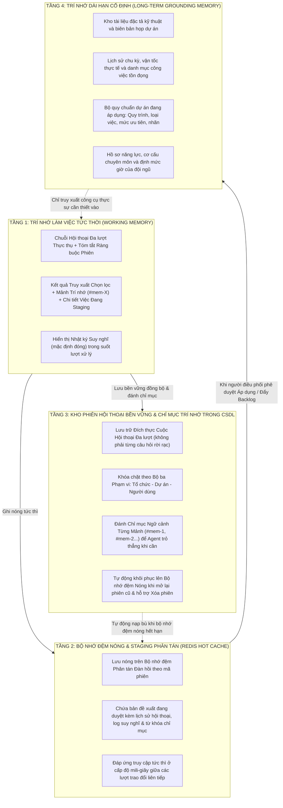
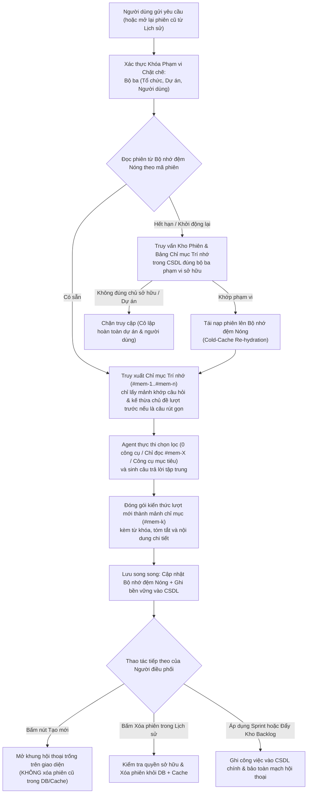
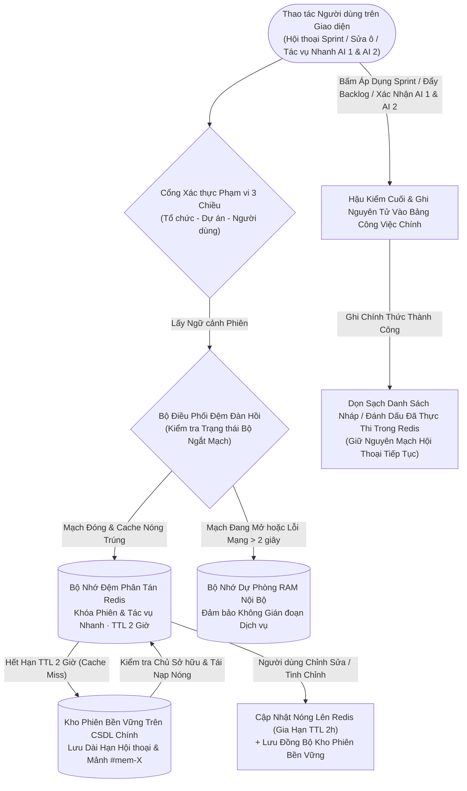
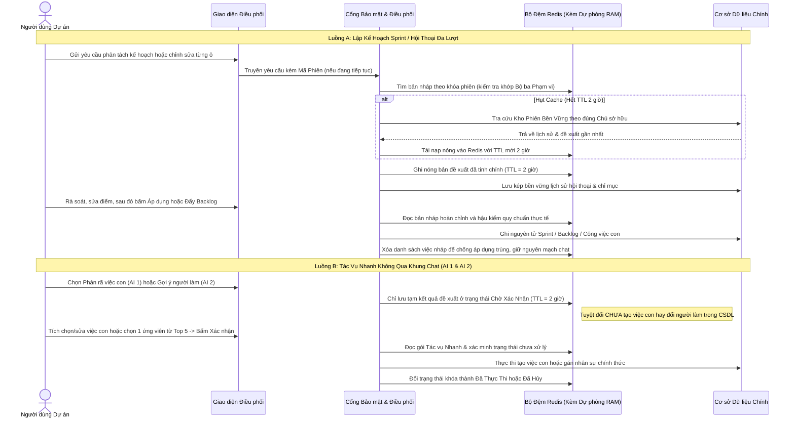
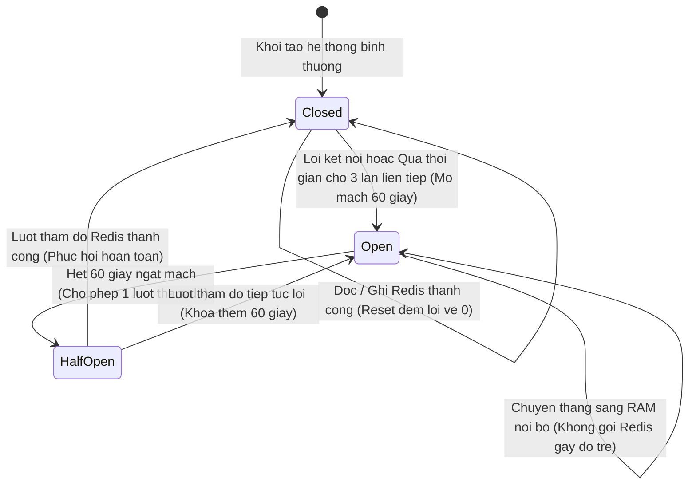

# CHUYÊN ĐỀ 3: CƠ CHẾ TRÍ NHỚ & BỘ NHỚ ĐỆM PHÂN TÁN REDIS (REDIS MEMORY ENGINE)

---

## 1. Bản chất & Kiến trúc Trí nhớ Đa tầng Kết hợp Redis + MySQL
Trong kỹ thuật phần mềm tích hợp AI, một Trợ lý thông minh thực thụ không thể chỉ lưu ngữ cảnh tạm bợ trong RAM hay để mất cuộc hội thoại khi hết TTL. Nếu chỉ dùng Redis thuần không có tầng lưu bền vững, người dùng sẽ mất phiên làm việc cũ khi cache hết hạn; mặt khác, nếu nạp nguyên văn hàng chục lượt chat cũ vào prompt thì mô hình sẽ tốn token và suy luận loãng.

Dự án triển khai **Kiến trúc Trí nhớ 4 Tầng Kết hợp Chỉ mục Hóa Ngữ cảnh & Lưu trữ Kép (Hybrid Redis + MySQL + Indexed Memory `#mem-X`)**:

---

## 2. Sơ đồ Hoạt động của Cơ chế Trí nhớ Kép, Chỉ mục `#mem-X` & Khóa Phạm vi

Sơ đồ dưới đây minh họa vòng đời đọc/ghi phiên hội thoại, cơ chế khôi phục khi Redis lạnh (Cold-Redis Fallback), đánh chỉ mục trí nhớ `#mem-X` và thao tác **"Tạo mới"** không phá hủy:

---

## 3. Bản Thiết Kế Chi Tiết Bộ Nhớ Đệm Phân Tán Redis (Từ Ý Tưởng Đến Triển Khai)

### 3.1. Redis là gì?
**Redis (Remote Dictionary Server)** là hệ quản trị cơ sở dữ liệu lưu trữ dữ liệu trực tiếp trên **bộ nhớ chính (RAM)** theo mô hình **Khóa – Giá trị (Key–Value)** với độ trễ đọc/ghi ở mức dưới một mili-giây (`< 1 ms`). Khác với cơ sở dữ liệu quan hệ trên đĩa cứng dùng để lưu trữ giao dịch vĩnh viễn và truy vấn bảng liên kết phức tạp, Redis sinh ra để xử lý dữ liệu nóng tức thời và hỗ trợ sẵn cơ chế **Tự Hủy Theo Thời Gian Sống (TTL – Time To Live)**.

### 3.2. Công dụng Tổng quát & Tính Ứng dụng Thực tế Trong Dự án
Trong thiết kế hệ thống doanh nghiệp tích hợp AI, Redis giải quyết triệt để **4 bài toán sống còn** mà cơ sở dữ liệu chính đơn thuần không thể đáp ứng tối ưu:

| Công dụng Tổng quát của Redis | Ứng dụng Cụ thể Trong Dự án ProjectMgmt | Giá trị Thực tế Mang Lại |
| :--- | :--- | :--- |
| **1. Vùng Đệm Nháp (Staging Area)** | Lưu toàn bộ **Bản Đề xuất Kế hoạch Sprint/Backlog**, **Kế hoạch Gỡ/Xóa Công việc** và kết quả **Tác vụ Nhanh Không Qua Chat (AI 1 Phân rã việc con & AI 2 Đề xuất phân công)** ở trạng thái chờ duyệt. | Ngăn AI ghi thẳng dữ liệu chưa kiểm chứng vào bảng công việc chính. Nếu người dùng hủy bỏ hoặc đóng trình duyệt, CSDL chính hoàn toàn sạch sẽ, không phát sinh dữ liệu rác. |
| **2. Chỉnh Sửa Tức Thời (Low-Latency Mutation)** | Cho phép người điều phối sửa trực tiếp tiêu đề, điểm Story Points, mức ưu tiên, người phụ trách, hoặc yêu cầu AI tinh chỉnh lại 1 công việc / toàn bảng trực tiếp trên vùng đệm nóng. | Phản hồi thao tác chỉnh sửa dưới vài mili-giây, không khóa hàng hay gây tải ghi lặp đi lặp lại lên CSDL quan hệ chính. |
| **3. Bộ Nhớ Đệm Phiên Đọc Nhanh (Hot Read-Through Cache)** | Lưu nóng trạng thái phiên hội thoại đa lượt, lịch sử bước suy nghĩ, từ khóa chỉ mục `#mem-X` và đặc tả xuất Excel đang hoạt động. | Rút ngắn thời gian nạp ngữ cảnh giữa các lượt trao đổi liên tiếp, giảm truy vấn lặp xuống CSDL chính. |
| **4. Khóa Trạng Thái & Vòng Đời Tự Dọn (TTL & Idempotency)** | Áp đặt **Thời gian sống (TTL) tiêu chuẩn 2 giờ (7,200 giây)** cho mỗi khóa nháp và cập nhật cờ trạng thái (`chờ duyệt -> đã thực thi / đã hủy`). | Tự động giải phóng bộ nhớ đối với các bản nháp bị bỏ dở, đồng thời chống lỗi bấm đúp hoặc áp dụng trùng lặp nhiều lần trên Tác vụ Nhanh. |

### 3.3. Sơ Đồ Thiết Kế Vùng Đệm & Lưu Trữ Kép Redis Trong Dự Án

### 3.4. Sơ Đồ Luồng Phê Duyệt Con Người Qua Vùng Đệm Redis (Sprint & Tác Vụ Nhanh)

### 3.5. Quy Trình Thiết Kế & Triển Khai Redis Chi Tiết Qua 6 Bước (Từ Ý Tưởng Đến Vận Hành)

Đây là lộ trình thiết kế chuẩn theo kiến trúc từ bài toán gốc đến hệ thống hoàn chỉnh, giúp dễ dàng xây dựng, mở rộng và kiểm soát rủi ro:

1. **Bước 1 — Hình Thành Ý Tưởng & Phân Định Ranh Giới Lưu Trữ (Bài toán Nháp vs. Thật)**:
   - *Vấn đề xuất phát*: AI có thể tạo ra 10–30 công việc hoặc thay đổi danh sách phân công chỉ sau một câu lệnh. Nếu ghi thẳng xuống bảng công việc chính khi chưa duyệt, bảng Backlog/Sprint sẽ bị làm bẩn bởi dữ liệu nháp; còn nếu chỉ giữ trong biến cục bộ trên trình duyệt hay RAM một máy chủ đơn lẻ, mọi thay đổi sẽ mất sạch khi tải lại trang hoặc chạy nhiều tiến trình.
   - *Quyết định thiết kế*: Đặt **Redis** làm lớp **Đệm Trung Gian Phê Duyệt (Human-in-the-Loop Buffer)** nằm giữa Bộ Suy luận AI và Cơ sở Dữ liệu Chính. Toàn bộ dữ liệu nháp sống trên Redis; **chỉ khi con người xác nhận** mới đi qua Cổng Điều phối Ghi để chạm vào CSDL chính.

2. **Bước 2 — Thiết Kế Cấu Trúc Không Gian Khóa (Keyspace & Naming Convention)**:
   - *Nguyên tắc*: Mọi khóa Redis của phân hệ AI đều bắt buộc dùng **Tiền tố Cách ly Hệ thống** (`ProjectMgmt:Ai:`) ở đầu để không bao giờ đụng độ với các phân hệ khác khi dùng chung cụm Redis.
   - *Phân chia 2 nhánh khóa tách biệt theo mục đích*:

| Nhánh Luồng Nghiệp Vụ | Quy Ước Tên Khóa Trong Redis | Dữ Liệu Được Lưu Giữ | Vòng Đời & Ý Nghĩa |
| :--- | :--- | :--- | :--- |
| **Phiên Hội thoại & Kế hoạch Sprint/Backlog** | `ProjectMgmt:Ai:sprint_ai_{MãĐịnhDanhNgẫuNhiên}` | Bản đề xuất Epics/Tasks/Subtasks, Mục tiêu Sprint, Kế hoạch Gỡ việc chờ xác nhận, Chuỗi hội thoại đa lượt, Nhật ký thao tác, Chỉ mục `#mem-X`, Dấu vết Phạm vi 3 Chiều | **TTL = 2 giờ** (tự làm mới mỗi lượt chat, mỗi lần sửa ô hoặc mỗi lần mở lại phiên cũ từ lịch sử). |
| **Tác vụ Nhanh Công Việc (AI 1 & AI 2)** | `ProjectMgmt:Ai:ai_quick_{MãĐịnhDanhNgẫuNhiên}` | Danh sách việc con đề xuất kèm vai trò/kỹ năng/giờ ước lượng (AI 1), hoặc Bảng xếp hạng Top 5 ứng viên kèm điểm Kỹ năng/Tải/Giờ rảnh/Lịch sử (AI 2), Cờ trạng thái (`pending`, `executed`, `cancelled`) | **TTL = 2 giờ**. Hoàn toàn không chạm vào CSDL chính cho tới khi người dùng bấm Xác nhận hoặc Hủy trên Khay Tác vụ Nhanh. |

3. **Bước 3 — Thiết Kế Cấu Trúc Gói Dữ Liệu (Payload Schema) & Bảo Mật Phạm Vi**:
   - Toàn bộ gói trạng thái được đóng gói dạng chuỗi JSON gọn nhẹ (không format thừa khoảng trắng để tiết kiệm RAM trên Redis).
   - **Quy tắc Chống Lộ Lọt Chéo (Zero-Trust Payload)**: Mỗi gói dữ liệu đặt trên Redis đều nhúng chặt bộ ba định danh sở hữu: **Mã Tổ chức**, **Mã Dự án**, và **Mã Người dùng**. Trước khi cho phép đọc, chỉnh sửa hay xác nhận bất kỳ khóa nào, cổng điều phối luôn đối chiếu bộ ba này với phiên đăng nhập hiện tại để chặn đứng nguy cơ truy cập chéo bằng mã phiên đoán mò.
   - **Quản lý Vòng đời Sạch sẽ**:
     - Sau khi áp dụng kế hoạch Sprint hoặc đẩy Backlog thành công, hệ thống **dọn rỗng danh sách công việc đề xuất** trong khóa Redis để tránh áp dụng trùng lặp nhiều lần, nhưng **bảo toàn lịch sử hội thoại** kèm tin nhắn xác nhận để người dùng tiếp tục trò chuyện liền mạch.
     - Đối với Tác vụ Nhanh, hệ thống chuyển trạng thái sang *Đã Thực Thi* hoặc *Đã Hủy* nhằm từ chối tự động mọi thao tác bấm lại trùng lặp.
     - Khi người dùng bấm **Xóa phiên** trong mục Lịch sử, hệ thống kiểm tra quyền sở hữu rồi **xóa đồng thời** cả bản ghi CSDL lẫn khóa nóng trên Redis.

4. **Bước 4 — Thiết Kế Cơ Chế Đọc Ưu Tiên & Tái Nạp Cache Lạnh (Read-Through & Cold-Cache Re-hydration)**:
   - *Tại sao cần lưu kép?* Redis giữ dữ liệu với TTL 2 giờ để tiết kiệm RAM; nếu lưu thuần túy trên Redis, người dùng quay lại vào hôm sau sẽ mất trắng cuộc trò chuyện hôm trước.
   - *Cách vận dụng kết hợp*:
     - **Ghi Kép (Dual-Save)**: Kết thúc mỗi lượt hội thoại hoặc chỉnh sửa kế hoạch lớn, hệ thống ghi nóng lên Redis (để lượt tiếp theo phản hồi tức thì) đồng thời ghi bền vững vào hai bảng phiên và mảnh trí nhớ trong CSDL chính.
     - **Đọc Ưu Tiên Redis (Redis-First Read-Through)**: Khi nhận yêu cầu khôi phục phiên, tinh chỉnh hoặc tiếp tục chat, hệ thống luôn thử đọc từ Redis trước. Nếu trúng (*Cache Hit*) và khớp khóa 3 chiều -> phục vụ ngay lập tức.
     - **Tự Động Nạp Lại Cache Lạnh (Cold-Cache Re-hydration)**: Nếu Redis không còn khóa đó do đã hết TTL 2 giờ hoặc khởi động lại dịch vụ (*Cache Miss*), hệ thống tự động tra cứu từ Kho Phiên CSDL theo đúng bộ ba sở hữu, dựng lại đầy đủ trạng thái đề xuất lẫn các mảnh trí nhớ `#mem-X`, rồi **nạp nóng ngược trở lại vào Redis với TTL 2 giờ mới** cho những lượt tương tác tiếp theo.

5. **Bước 5 — Thiết Kế Lớp Phòng Thủ Chống Sập (Circuit Breaker & Fallback RAM)**:
   - *Nguyên tắc thiết kế cốt lõi*: Redis là bộ nhớ đệm tăng tốc — **nếu dịch vụ Redis gặp sự cố mạng hoặc tạm ngưng, hệ thống Trợ Lý AI tuyệt đối không được chết theo hoặc treo 30 giây chờ timeout**.
   - Áp dụng **Mẫu Thiết kế Bọc Đàn Hồi kết hợp Bộ Ngắt Mạch 3 Trạng Thái (Circuit Breaker)**:

   - **Thông số vận hành thực tế**:
     - Ngưỡng thời gian chờ tối đa mỗi thao tác đọc/ghi đệm: **2,000 – 3,000 mili-giây** (kết nối tối đa 5,000 ms).
     - Ngưỡng kích hoạt ngắt mạch: **3 lỗi liên tiếp**.
     - Thời gian cách ly bảo vệ (`Open`): **60 giây** — trong suốt 60 giây này, toàn bộ thao tác lưu nháp, chỉnh sửa và Tác vụ Nhanh tự động chuyển mượt sang **Bộ Nhớ Đệm Dự Phòng Trên RAM Nội Bộ** của ứng dụng, giúp trải nghiệm người dùng hoàn toàn liền mạch không giật lag.
     - Tự động hồi phục (`Half-Open`): sau 60 giây, hệ thống tự thử 1 yêu cầu sang Redis; nếu thành công sẽ đóng mạch trở lại chế độ phân tán ngay lập tức.

6. **Bước 6 — Quản Trị Kết Nối Đa Luồng, Bảo Mật Cấu Hình & Kiểm Chứng Vận Hành**:
   - **Kết nối Đa kênh Tập trung (Connection Multiplexing)**: Khởi tạo một bộ ghép kênh kết nối dùng chung xuyên suốt vòng đời ứng dụng (kết hợp khóa đồng bộ an toàn đa luồng khi tạo kết nối lần đầu và tự phục hồi khi rớt mạng), tránh lỗi tạo tràn cổng kết nối TCP khi hàng trăm yêu cầu SSE chạy đồng thời.
   - **An toàn Bí mật Cấu hình (Zero-Secret-Leakage)**: Toàn bộ thông số máy chủ, cổng, mật khẩu truy cập Redis, chỉ số Database và cờ mã hóa SSL được tách khỏi tệp cấu hình công khai (chỉ để placeholder an toàn trên Git) và nạp từ tệp cấu hình bí mật cục bộ được bảo vệ.
   - **Kịch bản Kiểm chứng Thiết kế Thực tế (Không Cần Đụng Mã Nguồn)**:
     1. *Kiểm chứng Cô lập Chưa Commit*: Gửi yêu cầu AI lập kế hoạch Sprint hoặc kích hoạt Phân rã Sub-task (AI 1) -> kiểm tra kho đệm xuất hiện khóa mang tiền tố phiên / tác vụ nhanh với thời gian đếm ngược khoảng `7,200 giây`, trong khi bảng công việc chính hoàn toàn chưa có dòng dữ liệu mới nào.
     2. *Kiểm chứng Chỉnh Sửa Nóng & Xác Nhận*: Sửa tiêu đề hoặc chọn ứng viên -> quan sát thay đổi tức thì; bấm **Áp dụng** hoặc **Xác nhận** -> kiểm tra bảng công việc chính xuất hiện bản ghi thật, còn khóa đệm đã dọn danh sách nháp hoặc chuyển sang trạng thái đã thực thi.
     3. *Kiểm chứng Chịu Lỗi (Fault Tolerance)*: Tạm dừng dịch vụ Redis -> thao tác Trợ Lý AI và Tác vụ Nhanh vẫn tạo, sửa, xác nhận thành công nhờ cơ chế Ngắt mạch tự chuyển dự phòng sang RAM trong vòng 60 giây, không sập giao diện.

---

---

## 6. Bộ Nhớ Lịch Sử Phiên & Quản Trị Tiêu Thụ Token (Cross-Session Project Memory & Token Analytics)

Bên cạnh bộ nhớ đề xuất tức thời (Staging Session), hệ thống được trang bị hệ thống quản trị phiên làm việc và đo lường tài nguyên AI độc lập thông qua giao diện [`IAiTokenUsageTracker`](file:///c:/Users/hoang/Downloads/ProjectMgmt/ProjectMgmt.Solution/Services/Ai/IAiTokenUsageTracker.cs) và lớp triển khai [`AiTokenUsageTracker`](file:///c:/Users/hoang/Downloads/ProjectMgmt/ProjectMgmt.Solution/Services/Ai/AiTokenUsageTracker.cs):

### 6.1. Quản lý Lịch sử Phiên Phân rã Dự án (Project Session Memory)
- **Cơ chế hoạt động**: Mỗi phiên hội thoại hoàn chỉnh được lưu đồng bộ vào bảng `AiConversationSessions` (gắn chặt `OrganizationId`, `ProjectId`, `UserId`, `Title`, `TurnCount`, `MemoryCount`, `LastIntent`, `UpdatedAtUtc`) và các mảnh trí nhớ đánh chỉ mục `AiConversationMemoryEntries` (`#mem-1`, `#mem-2`, ...). Bản tóm tắt phiên [`AiSessionSummary`](file:///c:/Users/hoang/Downloads/ProjectMgmt/ProjectMgmt.Solution/Services/Ai/IAiTokenUsageTracker.cs) trả về đầy đủ số lượt trao đổi và số mảnh trí nhớ đã lập chỉ mục.
- **Hệ thống Đánh Chỉ Mục Trí Nhớ (`AiIndexedMemoryEngine.cs` & `#mem-X`) & Chống Nhiễm Chéo Ngữ Cảnh**:
  - Mỗi lượt hội thoại hoặc câu trả lời phân tích quan trọng được tách thành nút trí nhớ có mã định danh (`AnchorKey = "#mem-1"`, `Category`, `Title`, `Keywords`, `Summary`, `DetailContent`). Các lượt xuất Excel còn lưu kèm đặc tả phạm vi riêng (`ExportSpec` trong `AiConversationTurnDto`) để nút tải lại tệp hoặc lệnh nối tiếp đổi tên file (ví dụ *"xuất và đặt tên là tài liệu"*) giữ đúng phạm vi gốc của lượt đó; đồng thời các lượt hỏi đáp tài liệu đính kèm danh sách `DocumentCitations` để hiển thị trực tiếp thẻ mở ngăn kéo xem tài liệu ngay dưới câu trả lời.
  - Ở các lượt hỏi nối tiếp hoặc khi người dùng hỏi trực tiếp về nội dung các công việc vừa đề xuất trong phiên (`AsksAboutCurrentProposalOrSession`, ví dụ: *"nội dung của các task bạn đề xuất là gì"*), [`AiIndexedMemoryEngine.PlanContextExecution`](file:///c:/Users/hoang/Downloads/ProjectMgmt/ProjectMgmt.Solution/Services/Ai/AiIndexedMemoryEngine.cs) kết hợp [`ContainsTrueExportVerb`](file:///c:/Users/hoang/Downloads/ProjectMgmt/ProjectMgmt.Solution/Services/Ai/AiSprintDecompositionService.cs) loại bỏ hoàn toàn hiện tượng nhận diện nhầm từ ghép tiếng Việt (*"đề xuất"*, *"truy xuất"*, *"sản xuất"*, *"đột xuất"*) sang xuất Excel, đồng thời kích hoạt chế độ `UseMemoryOnly = true` (0 lệnh gọi MCP thừa) và nạp trọn vẹn mô tả, tiêu chí nghiệm thu, việc con của bản đề xuất hiện hành để trả lời chính xác.
  - **Cơ chế Chính xác Tuyệt đối Chống Nhiễm Chéo Sprint & Công việc (`ExtractSprintNumbers`, `ExtractNonProposalIssueKeys`, `MentionsSpecificWorkItemLookup`)**: Khi câu hỏi nêu rõ số Sprint (ví dụ *"nội dung sprint 3"*), mã công việc thực tế (`QLDA-1`) hoặc hỏi đích danh công việc/người làm trong dự án (*"phân tích task có tên là ..."*, *"ai là người làm ..."*), `SelectRelevantMemories` **tự động loại trừ** các mảnh trí nhớ gắn với số Sprint/mã việc xung đột (ví dụ `#mem-5` của Sprint 2 không bao giờ tràn sang câu trả lời Sprint 3) trừ khi người dùng chỉ định `#mem-X`, tắt fallback mù `#mem-latest`, và `PlanContextExecution` **bắt buộc** vô hiệu hóa `UseMemoryOnly` để truy xuất trực tiếp dữ liệu thực tế từ `AllSprints`, `Product Backlog`, `TeamTools` và danh mục công việc toàn dự án (`GetProjectWorkItemsDigestAsync`). Đồng thời [`AiSprintDecompositionService.StripLeakedMetaPrefix`](file:///c:/Users/hoang/Downloads/ProjectMgmt/ProjectMgmt.Solution/Services/Ai/AiSprintDecompositionService.cs) tự động tước bỏ mọi nhãn định tuyến nội bộ (`[Intent: ...]`) khỏi lịch sử hội thoại và câu trả lời.
- **Khôi phục & Xóa Phiên Cũ (Session History Restore, Messenger Reverse Pagination & Delete)**:
  - Trên thanh tiêu đề của Modal AI có biểu tượng **Lịch sử phiên (đồng hồ)**.
  - Khi nhấp vào, popover hiển thị danh sách các cuộc hội thoại thực sự thuộc đúng **người dùng + dự án + tổ chức hiện tại** từ API `GET /api/ai/agent/sessions?projectId=...` (kèm số lượt trao đổi `TurnCount` và số mảnh trí nhớ `MemoryCount`).
  - Nhấp vào phiên bất kỳ để nạp cửa sổ 12 lượt hội thoại mới nhất qua `GET /api/ai/agent/proposal/{sessionId}?tailLimit=12` (tự động đọc từ MySQL và nạp bù lên Redis nếu cache đã hết hạn), đồng thời **tự động cuộn tức thì xuống tin nhắn mới nhất** cuối phiên với khối Thinking mặc định ở trạng thái đóng.
  - Khi người dùng cuộn lên gần đỉnh danh sách (hoặc bấm nút **"Tải thêm tin nhắn cũ hơn"**), giao diện gọi `GET /api/ai/agent/sessions/{sessionId}/messages?projectId=...&beforeIndex=...&limit=12` để tải nối tiếp các lượt cũ hơn theo cơ chế phân trang ngược kiểu Messenger và **bảo toàn chính xác vị trí đang đọc** (scroll anchor preservation); đồng thời xuất hiện nút nổi **"Xuống mới nhất"** khi cuộn xa đáy và chỉ lưu tối đa 12 lượt đuôi vào `localStorage` để chống tràn RAM trình duyệt với các cuộc hội thoại dài hàng trăm lượt.
  - Bấm biểu tượng thùng rác cạnh từng phiên để gọi `DELETE /api/ai/agent/sessions/{sessionId}?projectId=...` (kiểm tra chặt quyền sở hữu 3 chiều trước khi xóa cả bảng MySQL lẫn khóa Redis tương ứng).

### 6.2. Đo lường & Giám sát Tiêu thụ Token (Token Consumption Management)
- **Bộ ghi nhận mức tiêu thụ**: Ghi nhận `AiUsageRecord` theo từng phiên làm việc (Prompt Tokens, Completion Tokens, Latency mili-giây, Model, trạng thái Success/Failed).
- **Dashboard Quản trị trên Trang Cá nhân (Profile - Tab "Mức tiêu thụ Token AI")**:
  - **4 Thẻ Chỉ số (KPIs)**: Tổng Token tiêu thụ, Tổng cuộc gọi AI, Tỷ lệ hoàn tất thành công, Chi phí ước tính (USD).
  - **Phân bổ theo Mô hình**: Tỷ lệ phần trăm và số lượng token giữa `gemini-3.6-flash`, `gemini-3.5-flash`, `gemini-3-flash-preview`.
  - **Bảng Nhật ký Thực thi**: Hiển thị chi tiết 15 lượt gọi gần nhất với thời gian thực thi, số token vào/ra và trạng thái.

### 6.3. Nút "Tạo mới" Không Phá Hủy & Giải Phóng Cache Chọn Lọc
- **Nút "Tạo mới" (`startNewSession`)**: Trên thanh tiêu đề của Modal **Trợ Lý AI**, nút **"Tạo mới"** chỉ dọn khung soạn thảo và khởi tạo một đoạn hội thoại mới sạch sẽ trên UI mà **không phá hủy hoặc xóa các phiên cũ đã lưu trong DB**.
- **Xóa phiên cụ thể hoặc Clear-Cache Quản trị**: Endpoint `DELETE /api/ai/agent/sessions/{sessionId}?projectId=...` xóa an toàn từng phiên cũ do chính người dùng sở hữu; trong khi `POST /api/ai/agent/clear-cache` chỉ dùng cho thao tác xóa nóng khóa staging trên Redis khi cần quản trị kỹ thuật.

---

## 7. Danh mục Tệp Mã Nguồn Tham Chiếu Chuyên Đề 3

| Thành phần | Vai trò kỹ thuật | Liên kết mã nguồn |
| :--- | :--- | :--- |
| **AiConversationSessionStore** | Kho lưu trữ phiên bền vững trên MySQL, khóa phạm vi `(OrganizationId, ProjectId, UserId)` & re-hydrate Redis | [`AiConversationSessionStore.cs`](file:///c:/Users/hoang/Downloads/ProjectMgmt/ProjectMgmt.Solution/Services/Ai/AiConversationSessionStore.cs) |
| **AiIndexedMemoryEngine** | Động cơ đánh chỉ mục trí nhớ `#mem-1..#mem-n` và lập kế hoạch Selective MCP | [`AiIndexedMemoryEngine.cs`](file:///c:/Users/hoang/Downloads/ProjectMgmt/ProjectMgmt.Solution/Services/Ai/AiIndexedMemoryEngine.cs) |
| **AiConversationSession & MemoryEntry** | Thực thể DB & Migration lưu phiên hội thoại và mảnh trí nhớ đánh chỉ mục | [`AiConversationSession.cs`](file:///c:/Users/hoang/Downloads/ProjectMgmt/ProjectMgmt.Modules.DeliveryIntelligence/Domain/Entities/AiConversationSession.cs) |
| **StackExchangeRedisStagingProvider** | Adapter kết nối Redis, quản lý connection pool & key operations | [`StackExchangeRedisStagingProvider.cs`](file:///c:/Users/hoang/Downloads/ProjectMgmt/ProjectMgmt.Solution/Services/Ai/Adapters/StackExchangeRedisStagingProvider.cs#L8-L115) |
| **ResilientStateStagingService** | Wrapper chống sập, điều phối Redis và In-Memory fallback | [`ResilientStateStagingService.cs`](file:///c:/Users/hoang/Downloads/ProjectMgmt/ProjectMgmt.Core/Staging/ResilientStateStagingService.cs#L15-L110) |
| **MemoryStateStagingService** | Bộ nhớ đệm Fallback lưu trên ConcurrentDictionary của RAM | [`MemoryStateStagingService.cs`](file:///c:/Users/hoang/Downloads/ProjectMgmt/ProjectMgmt.Core/Staging/MemoryStateStagingService.cs#L10-L60) |
| **AiTokenUsageTracker** | Quản lý lịch sử phiên dự án và đo lường tiêu thụ token AI | [`AiTokenUsageTracker.cs`](file:///c:/Users/hoang/Downloads/ProjectMgmt/ProjectMgmt.Solution/Services/Ai/AiTokenUsageTracker.cs) |
| **IAiTokenUsageTracker** | Hợp đồng interface theo dõi token và lịch sử phiên | [`IAiTokenUsageTracker.cs`](file:///c:/Users/hoang/Downloads/ProjectMgmt/ProjectMgmt.Solution/Services/Ai/IAiTokenUsageTracker.cs) |
| **CircuitBreakerPolicy** | Thuật toán ngắt mạch bảo vệ hệ thống khi Redis gián đoạn | [`CircuitBreakerPolicy.cs`](file:///c:/Users/hoang/Downloads/ProjectMgmt/ProjectMgmt.Core/Resilience/CircuitBreakerPolicy.cs#L10-L70) |
| **ProfilePageComponent** | Dashboard giám sát Token AI trên giao diện người dùng | [`profile-page.html`](file:///c:/Users/hoang/Downloads/ProjectMgmt/frontend/projectmgmt-web/src/app/features/identity/profile-page.html) |
| **Cấu hình Redis** | Khai báo Host, Port, Database, InstanceName | [`appsettings.json`](file:///c:/Users/hoang/Downloads/ProjectMgmt/ProjectMgmt.Solution/appsettings.json#L40-L55) |

