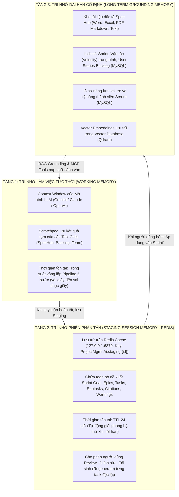
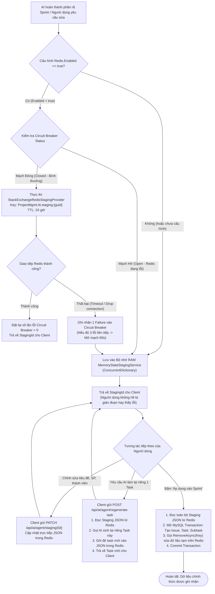

# CHUYÊN ĐỀ 3: CƠ CHẾ TRÍ NHỚ & BỘ NHỚ ĐỆM PHÂN TÁN REDIS (REDIS MEMORY ENGINE)

---

## 1. Bản chất & Phân loại Trí nhớ AI trong Hệ thống
Trong kỹ thuật phần mềm tích hợp AI, một Agent thông minh không thể chỉ tồn tại dưới dạng "Stateless" (không lưu trạng thái). Nếu không có cơ chế trí nhớ, Agent sẽ quên sạch ngữ cảnh ngay sau khi hoàn thành một lượt suy luận, không thể duy trì phiên hội thoại để người dùng chỉnh sửa, và có nguy cơ ghi dữ liệu rác trực tiếp vào cơ sở dữ liệu sản xuất.

Dự án thiết kế một **Kiến trúc Trí nhớ 3 Tầng (Three-Tier AI Memory Architecture)**:



---

## 2. Sơ đồ Hoạt động của Chức năng Trí nhớ Redis (Memory Context Flowchart)

Sơ đồ dưới đây minh họa chi tiết cách dữ liệu đề xuất AI được ghi, đọc, cập nhật cục bộ và giải phóng trên Redis thông qua cơ chế bọc đàn hồi (Resilient Wrapper):



---

## 3. Cấu trúc Khóa, Định dạng Lưu trữ & Thời gian Sống (TTL)

### 3.1. Cấu trúc Khóa Redis (Keyspace Convention)
Khóa được định danh theo tiền tố cấu hình (`InstanceName = "ProjectMgmt:Ai:"`) kết hợp định danh phiên ngẫu nhiên (Session Guid):

```text
ProjectMgmt:Ai:staging:{stagingGuid}
```
*Ví dụ thực tế:*
`ProjectMgmt:Ai:staging:e7c4f1a2-8b3d-4e9a-9c12-3456789abcde`

### 3.2. Cấu trúc Payload JSON Lưu trữ
Toàn bộ đề xuất phân rã được tuần tự hóa (serialize) thành chuỗi JSON tối ưu, chứa đầy đủ ngữ cảnh nghiệp vụ Scrum:

```json
{
  "stagingId": "e7c4f1a2-8b3d-4e9a-9c12-3456789abcde",
  "projectId": 12,
  "sprintId": 5,
  "sprintGoal": "Xây dựng lõi xác thực đa yếu tố và đồng bộ dữ liệu thời gian thực cho hệ thống",
  "suggestedSprintName": "Sprint 5 - Bảo mật & Realtime Engine",
  "targetVelocity": 32,
  "totalStoryPoints": 28,
  "epics": [
    {
      "id": "epic-1",
      "title": "Hệ thống Xác thực Nâng cao & Phân quyền RBAC",
      "description": "Bao gồm đăng nhập, cấp JWT và phân quyền theo cấp bậc Scrum",
      "color": "#3B82F6"
    }
  ],
  "tasks": [
    {
      "id": "task-1",
      "epicId": "epic-1",
      "title": "Thiết kế Middleware kiểm tra quyền theo cấp bậc Scrum",
      "description": "Ngăn chặn vượt cấp từ Developer/QA lên cấp quản lý",
      "storyPoints": 3,
      "estimatedHours": 8,
      "assignedUserId": "u-dev-01",
      "assignedUserName": "Lê Văn A (Backend)",
      "status": "Ready",
      "tags": ["Security", "Middleware", "RBAC"],
      "citations": [
        "Tài liệu Spec Hub: Cam-nang-ky-thuat.md - Mục 4.1",
        "Ghi chú cuộc họp: Biên bản họp Sprint Planning - Đoạn 2"
      ],
      "subtasks": []
    },
    {
      "id": "task-2",
      "epicId": "epic-1",
      "title": "Tích hợp giao thức Server-Sent Events cho luồng AI Stream",
      "description": "Xử lý kết nối streaming một chiều, reconnect và tự động refresh token khi nhận 401",
      "storyPoints": 5,
      "estimatedHours": 16,
      "assignedUserId": "u-dev-02",
      "assignedUserName": "Nguyễn Thị B (Frontend)",
      "status": "Ready",
      "tags": ["SSE", "Realtime", "Auth"],
      "citations": [
        "Tài liệu Spec Hub: Kien-truc-realtime.docx - Trang 12"
      ],
      "subtasks": [
        {
          "id": "subtask-2-1",
          "title": "Cấu hình Controller phát event-stream trong .NET 8",
          "estimatedHours": 6
        },
        {
          "id": "subtask-2-2",
          "title": "Xây dựng Angular Service bắt lỗi 401 và gọi Refresh Token",
          "estimatedHours": 6
        },
        {
          "id": "subtask-2-3",
          "title": "Viết kiểm thử tự động giả lập mất mạng đột ngột",
          "estimatedHours": 4
        }
      ]
    }
  ],
  "warnings": [
    "Tổng Story Points (28 SP) nằm trong ngưỡng an toàn so với vận tốc trung bình (32 SP)."
  ],
  "createdAt": "2026-11-11T00:15:30Z",
  "expiresAt": "2026-11-12T00:15:30Z"
}
```

### 3.3. Thời gian Sống (TTL) & Chính sách Giải phóng (Eviction Policy)
- **TTL Mặc định**: `24 giờ` (`TimeSpan.FromHours(24)`).
- **Lý do thiết kế**: Đủ dài để Scrum Master đóng laptop, trao đổi nội bộ với nhóm và quay lại duyệt vào ngày hôm sau mà không bị mất dữ liệu; đồng thời tự động biến mất sau 24h để giải phóng dung lượng RAM của Redis.
- **Xóa chủ động (Explicit Invalidation)**: Khi người dùng bấm **"Áp dụng vào Sprint"** hoặc **"Hủy bỏ"**, phương thức `RemoveAsync(key)` được gọi để thu hồi bộ nhớ ngay lập tức.

---

## 4. Kiến trúc Chống Sập & Khả năng Phục hồi Cao (Resilience & Circuit Breaker)

Dự án áp dụng mẫu thiết kế **Composite Provider kết hợp Circuit Breaker** trong [`ResilientStateStagingService.cs`](file:///c:/Users/hoang/Downloads/ProjectMgmt/ProjectMgmt.Core/Staging/ResilientStateStagingService.cs):

```csharp
// ProjectMgmt.Core/Staging/ResilientStateStagingService.cs
public async Task SaveProposalAsync<T>(string sessionId, T proposal, TimeSpan ttl, CancellationToken ct = default)
{
    if (!_redisEnabled || _primaryProvider == null)
    {
        await _memoryFallback.SaveProposalAsync(sessionId, proposal, ttl, ct).ConfigureAwait(false);
        return;
    }

    var json = JsonSerializer.Serialize(proposal, _jsonOptions);

    await _circuitBreaker.ExecuteWithFallbackAsync(
        primaryAction: async token =>
        {
            await _primaryProvider.SetAsync(sessionId, json, ttl, token).ConfigureAwait(false);
        },
        fallbackAction: async token =>
        {
            await _memoryFallback.SaveProposalAsync(sessionId, proposal, ttl, token).ConfigureAwait(false);
        },
        ct: ct,
        onFallback: (reason, ex) =>
        {
            _logger.LogWarning(ex, "[ResilientStaging] {Reason} SessionId={SessionId}", reason, sessionId);
        }).ConfigureAwait(false);
}
```

### Các trạng thái của Circuit Breaker:
1. **Closed (Bình thường)**: Mọi yêu cầu ghi/đọc đều đi vào Redis.
2. **Open (Ngắt mạch)**: Nếu Redis gặp lỗi 3 lần liên tiếp (do mạng chậm quá 2000ms hoặc server Redis tắt), mạch tự động mở trong **60 giây**. Trong thời gian này, mọi thao tác chuyển hướng trực tiếp sang RAM (`MemoryStateStagingService`) mà **không hề gửi request đến Redis**, loại bỏ hoàn toàn độ trễ chờ đợi cho người dùng.
3. **Half-Open (Thử nghiệm hồi phục)**: Sau 60 giây, hệ thống cho phép 1 request đi thử vào Redis. Nếu thành công, mạch đóng lại bình thường; nếu thất bại, mạch tiếp tục mở thêm 60 giây.

---

## 5. Hướng dẫn Kiểm tra & Chứng minh Trí nhớ Redis (Verification Guide)

### 5.1. Kiểm tra Dịch vụ Redis Đang Chạy
Mở PowerShell trên máy tính chủ và thực hiện kiểm tra port kết nối:

```powershell
# Kiểm tra port 6379 đang lắng nghe
Test-NetConnection -ComputerName 127.0.0.1 -Port 6379
# Kết quả: TcpTestSucceeded : True

# Kiểm tra tiến trình redis-server trên Windows Task Manager
Get-Process -Name *redis*
```

### 5.2. Kiểm tra Dữ liệu Staging trong Redis CLI
Khi AI vừa phân rã xong một Sprint trên giao diện, mở terminal Redis CLI để tra cứu dữ liệu thực tế:

```bash
# 1. Kết nối vào Redis CLI cục bộ
redis-cli -h 127.0.0.1 -p 6379

# 2. Kiểm tra kết nối
127.0.0.1:6379> PING
PONG

# 3. Liệt kê các khóa Staging đang được AI lưu giữ
127.0.0.1:6379> KEYS ProjectMgmt:Ai:staging:*
1) "ProjectMgmt:Ai:staging:e7c4f1a2-8b3d-4e9a-9c12-3456789abcde"

# 4. Kiểm tra thời gian tồn tại còn lại (TTL - tính bằng giây)
127.0.0.1:6379> TTL ProjectMgmt:Ai:staging:e7c4f1a2-8b3d-4e9a-9c12-3456789abcde
(integer) 86340

# 5. Đọc nội dung JSON đề xuất đang được giữ trong trí nhớ
127.0.0.1:6379> GET ProjectMgmt:Ai:staging:e7c4f1a2-8b3d-4e9a-9c12-3456789abcde
"{\"stagingId\":\"e7c4f1a2...\",\"sprintGoal\":\"Xây dựng lõi xác thực...\"}"
```

### 5.3. Chứng minh Tính Độc lập với Cơ sở Dữ liệu
1. **Trước khi bấm "Áp dụng vào Sprint"**: Kiểm tra trong MySQL: bảng `Issues` chưa có bất kỳ bản ghi nào mới từ AI. Dữ liệu chỉ tồn tại duy nhất trên Redis (`ProjectMgmt:Ai:staging:*`).
2. **Sau khi bấm "Áp dụng vào Sprint"**: 
   - MySQL ghi nhận các Issue mới kèm SprintId tương ứng.
   - Kiểm tra lại Redis CLI: Khóa `ProjectMgmt:Ai:staging:...` đã bị xóa tự động (`nil`).

---

## 6. Danh mục Tệp Mã Nguồn Tham Chiếu Chuyên Đề 3

| Thành phần | Vai trò kỹ thuật | Liên kết mã nguồn |
| :--- | :--- | :--- |
| **StackExchangeRedisStagingProvider** | Adapter kết nối Redis, quản lý connection pool & key operations | [`StackExchangeRedisStagingProvider.cs`](file:///c:/Users/hoang/Downloads/ProjectMgmt/ProjectMgmt.Solution/Services/Ai/Adapters/StackExchangeRedisStagingProvider.cs#L8-L115) |
| **ResilientStateStagingService** | Wrapper chống sập, điều phối Redis và In-Memory fallback | [`ResilientStateStagingService.cs`](file:///c:/Users/hoang/Downloads/ProjectMgmt/ProjectMgmt.Core/Staging/ResilientStateStagingService.cs#L15-L110) |
| **MemoryStateStagingService** | Bộ nhớ đệm Fallback lưu trên ConcurrentDictionary của RAM | [`MemoryStateStagingService.cs`](file:///c:/Users/hoang/Downloads/ProjectMgmt/ProjectMgmt.Core/Staging/MemoryStateStagingService.cs#L10-L60) |
| **CircuitBreakerPolicy** | Thuật toán ngắt mạch bảo vệ hệ thống khi Redis gián đoạn | [`CircuitBreakerPolicy.cs`](file:///c:/Users/hoang/Downloads/ProjectMgmt/ProjectMgmt.Core/Resilience/CircuitBreakerPolicy.cs#L10-L70) |
| **Cấu hình Redis** | Khai báo Host, Port, Database, InstanceName | [`appsettings.json`](file:///c:/Users/hoang/Downloads/ProjectMgmt/ProjectMgmt.Solution/appsettings.json#L40-L55) |
