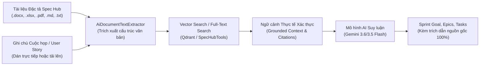
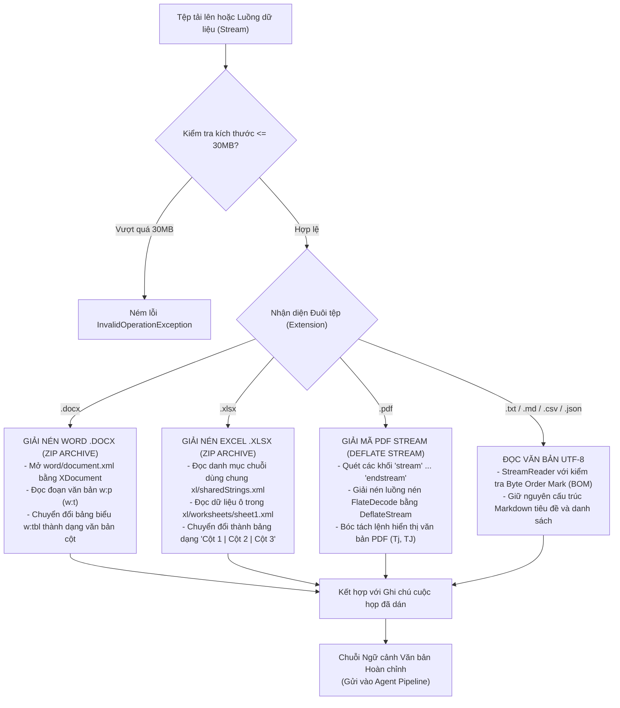
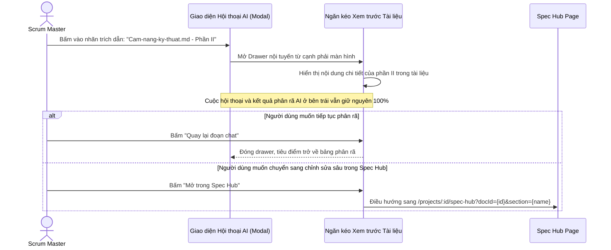

# CHUYÊN ĐỀ 4: CƠ CHẾ RAG & GROUNDING VỚI KHO TÀI LIỆU ĐẶC TẢ SPEC HUB

---

## 1. Khái niệm RAG & Giải quyết Triệt để Ảo giác (Hallucination)

### 1.1. Hiện tượng Ảo giác trong Mô hình Ngôn ngữ Lớn (LLM)
Khi yêu cầu một mô hình AI thông thường (Zero-shot Prompting) lập kế hoạch cho một Sprint, AI thường mắc phải các lỗi nghiêm trọng:
- Tự "bịa" ra các thư viện công nghệ không có trong dự án (ví dụ: dự án dùng Angular và .NET 8, nhưng AI lại sinh task cấu hình React và Django).
- Đặt tiêu chí nghiệm thu chung chung, không gắn liền với các ràng buộc bảo mật hay quy tắc nghiệp vụ nội bộ của tổ chức.
- Không biết được tiến độ thực tế: việc nào đã làm ở Sprint trước, việc nào còn dở dang.

### 1.2. Giải pháp RAG (Retrieval-Augmented Generation)
**RAG (Tạo sinh có Tăng cường Truy xuất)** là kỹ thuật kết hợp giữa:
1. **Truy xuất thông tin (Information Retrieval)**: Tìm kiếm các đoạn tài liệu đặc tả thực tế (SRS, BRD, ghi chú cuộc họp, bảng phân công) từ kho lưu trữ dự án.
2. **Tăng cường ngữ cảnh (Augmented Context)**: Nạp các đoạn trích này vào câu lệnh chỉ đạo (System/User Prompt) của AI.
3. **Tạo sinh có căn cứ (Grounded Generation)**: Buộc mô hình AI chỉ được phép lập luận và phân rã công việc dựa trên các sự thật đã được kiểm chứng.

---

## 2. Bộ Trích xuất Văn bản Vạn năng (AiDocumentTextExtractor)

Để phục vụ RAG đa định dạng, lớp [`AiDocumentTextExtractor.cs`](file:///c:/Users/hoang/Downloads/ProjectMgmt/ProjectMgmt.Solution/Services/Ai/AiDocumentTextExtractor.cs) xử lý bóc tách nội dung từ tất cả các định dạng tài liệu phổ biến trong môi trường doanh nghiệp:

### 2.1. Sơ đồ Xử lý Đa Định dạng

### 2.2. Điểm đặc sắc trong Kỹ thuật Trích xuất:
- **Xử lý tài liệu Word không phụ thuộc Office COM**: Sử dụng thư viện gốc `System.IO.Compression` và LINQ to XML (`System.Xml.Linq`), chạy mượt mà trên cả Linux container và Windows Server mà không cần cài đặt Microsoft Office.
- **Bảo toàn bảng biểu Excel**: Biến các sheet phân công nhân sự, ma trận trách nhiệm RACI thành văn bản có định dạng `Cột A | Cột B | Cột C`, giúp AI hiểu chính xác mối quan hệ giữa người làm và đầu việc.
- **An toàn bộ nhớ**: Giới hạn cứng 30MB và cơ chế stream một chiều ngăn chặn tấn công từ chối dịch vụ (Zip Bomb / OOM Denial of Service).

---

## 3. Kiến trúc Spec Hub & Giao thức Truy vấn MCP

Kho tài liệu đặc tả **Spec Hub** là "kho lưu trữ tri thức" của dự án. Lớp [`SpecHubTools.cs`](file:///c:/Users/hoang/Downloads/ProjectMgmt/ProjectMgmt.Solution/McpServers/SpecHubTools.cs) cung cấp 3 công cụ chuẩn MCP:

1. `spec_hub_list_documents(projectId)`: Quét toàn bộ cây thư mục tài liệu đặc tả của dự án.
2. `spec_hub_read_document(documentId)`: Đọc toàn văn nội dung một tài liệu đã chọn kèm tiêu chí nghiệm thu.
3. `spec_hub_search(projectId, keyword)`: Tìm kiếm toàn văn xuyên suốt mọi tài liệu trong dự án.

### Cơ chế Kết hợp Vector Search (Qdrant) và Fallback:
- Khi cấu hình `Qdrant:Enabled = true`: Hệ thống nhúng (Embed) các đoạn tài liệu thành vector 768 chiều bằng `gemini-embedding-001` và lưu trên Qdrant Vector Database để tìm kiếm theo độ tương đồng ngữ nghĩa (Cosine Similarity).
- Khi cấu hình `Qdrant:Enabled = false`: Hệ thống tự động chuyển sang cơ chế tìm kiếm toàn văn Full-Text Search trong SQL và lọc theo từ khóa, đảm bảo hệ thống hoạt động ổn định trong mọi điều kiện triển khai.

---

## 4. Cơ chế Trích dẫn Nguồn gốc (Citation Grounding) & Trải nghiệm Người dùng

Mỗi Task do AI sinh ra bắt buộc phải có thuộc tính `citations` chỉ rõ nguồn gốc xuất xứ:
- Ví dụ: `Tài liệu Spec Hub: Cam-nang-ky-thuat.md - Phần II`
- Ví dụ: `Ghi chú cuộc họp: Biên bản họp Sprint Planning - Mục 3`

### Lợi ích Trải nghiệm Vượt trội:
1. **Không ngắt quãng luồng tư duy (Zero Context Loss)**: Người dùng vừa xem kết quả AI đề xuất, vừa đọc lại đoạn đặc tả gốc trong tài liệu để đối chiếu xem AI có hiểu đúng ý mình không.
2. **Deep Linking chính xác**: Đường dẫn `?docId=...&section=...` tự động cuộn đến đúng vị trí đề mục cần xem trong Spec Hub.

---

## 5. Hướng dẫn Thực nghiệm & Kiểm chứng RAG Grounding

### 5.1. Kiểm tra Độ trễ (Latency) Gọi Công Cụ trên Giao diện
Khi AI bắt đầu suy luận, giao diện hiển thị danh sách các Tool Call kèm thời gian thực thi chính xác từ máy chủ:
- `Running Tìm kiếm tài liệu đặc tả liên quan trong Spec Hub > 7ms`
- `Running Lấy danh sách các User Story đang có trong Backlog > 13ms`
- `Running Truy xuất vận tốc Scrum và các hạng mục dở dang > 37ms`
- `Running Phân tích kỹ năng và số giờ khả dụng của thành viên đội Scrum > 25ms`

### 5.2. Kiểm tra Tính Xác thực của Nguồn Trích dẫn
1. Tải lên một tệp tài liệu đặc tả mang tên đặc biệt (ví dụ: `Bản đặc tả về quản lý dự án.txt`).
2. Gõ yêu cầu phân rã Sprint.
3. Quan sát kết quả đề xuất:
   - Các task sinh ra có nhãn tài liệu đúng tên `Bản đặc tả về quản lý dự án.txt`.
   - Tiêu đề và mô tả task chứa đúng thuật ngữ kỹ thuật chỉ có trong tệp đó.
   - Nhấp vào nhãn trích dẫn để mở Drawer nội tuyến và thấy đúng đoạn văn bản trích xuất từ tệp.

---

## 6. Danh mục Tệp Mã Nguồn Tham Chiếu Chuyên Đề 4

| Thành phần | Vai trò kỹ thuật | Liên kết mã nguồn |
| :--- | :--- | :--- |
| **AiDocumentTextExtractor** | Trích xuất toàn văn từ Word, Excel, PDF, Markdown, Text | [`AiDocumentTextExtractor.cs`](file:///c:/Users/hoang/Downloads/ProjectMgmt/ProjectMgmt.Solution/Services/Ai/AiDocumentTextExtractor.cs#L10-L120) |
| **SpecHubTools** | Các MCP tool tra cứu tài liệu đặc tả trong Spec Hub | [`SpecHubTools.cs`](file:///c:/Users/hoang/Downloads/ProjectMgmt/ProjectMgmt.Solution/McpServers/SpecHubTools.cs#L45-L100) |
| **ai-decompose-modal.html** | Template giao diện Drawer nội tuyến xem trước tài liệu trích dẫn | [`ai-decompose-modal.html`](file:///c:/Users/hoang/Downloads/ProjectMgmt/frontend/projectmgmt-web/src/app/features/backlog/components/ai-decompose-modal/ai-decompose-modal.html#L380-L450) |
| **ai-decompose-modal.ts** | Điều khiển mở/đóng drawer xem tài liệu, deep link sang Spec Hub | [`ai-decompose-modal.ts`](file:///c:/Users/hoang/Downloads/ProjectMgmt/frontend/projectmgmt-web/src/app/features/backlog/components/ai-decompose-modal/ai-decompose-modal.ts#L450-L520) |
| **spec-hub-page.ts** | Đón nhận queryParams (docId, section) để cuộn đến đúng vị trí | [`spec-hub-page.ts`](file:///c:/Users/hoang/Downloads/ProjectMgmt/frontend/projectmgmt-web/src/app/features/spec-hub/spec-hub-page.ts#L35-L65) |

