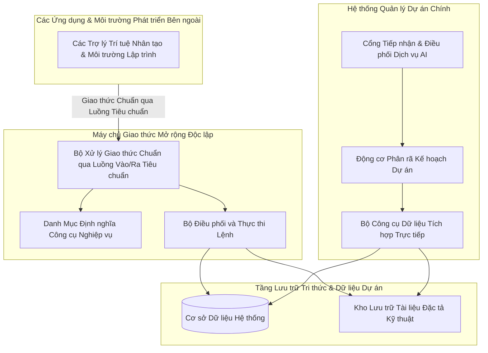

# CHUYÊN ĐỀ 5: KIẾN TRÚC MCP SERVER & HỆ THỐNG MCP TOOLS (MODEL CONTEXT PROTOCOL)

---

## 1. Bản chất Chuẩn Model Context Protocol (MCP)

### 1.1. Model Context Protocol (MCP) là gì?
**Model Context Protocol (MCP)** là chuẩn giao thức công nghiệp mở (Open Protocol) sử dụng cơ chế truyền tin **JSON-RPC 2.0**. Giao thức này đóng vai trò như một "cổng cắm USB-C" phổ quát, cho phép các mô hình trí tuệ nhân tạo (LLM / AI Agents) kết nối an toàn và truy xuất dữ liệu từ các hệ thống phần mềm nghiệp vụ (Database, File System, Git, API) mà không cần viết mã kết nối riêng cho từng mô hình.

### 1.2. Tại sao Dự án áp dụng Chuẩn MCP & Cơ chế Gọi MCP Có Chọn Lọc (Selective Invocation)?
1. **Chuẩn hóa công cụ (Tool Standardisation)**: Mọi công cụ AI trong dự án đều có lược đồ tham số (`inputSchema`) định dạng JSON Schema rõ ràng, giúp AI tự hiểu cách gọi hàm với xác suất chính xác cao.
2. **Kiến trúc Lưỡng hình (Dual-Form Deployment)**:
   - **Hình thái In-Process**: Chạy trực tiếp trong tiến trình ASP.NET Core để phục vụ người dùng trên Web với độ trễ cực thấp (mili-giây).
   - **Hình thái Standalone Stdio**: Chạy dưới dạng tiến trình Console độc lập, cho phép các Agent bên ngoài (Claude Desktop, Cursor IDE, Roo Code, Gemini CLI) kết nối và thao tác với dự án qua luồng Stdio.
3. **Gọi MCP Có Chọn Lọc Theo Ý Định & Ngữ Cảnh (Selective MCP Invocation)**:
   - Trợ Lý AI **không gọi đồng loạt toàn bộ MCP Tools ở mọi tin nhắn** nhằm tránh độ trễ thừa, tránh tốn token và giữ câu trả lời tập trung đúng vào câu hỏi của người dùng.
   - Cơ chế lập kế hoạch ngữ cảnh phân tách thành 4 chế độ rõ ràng:
     - **Chào hỏi / Hỏi khả năng trợ lý**: `0` lời gọi MCP bên ngoài — trả lời trực tiếp tức thì.
     - **Câu hỏi nối tiếp / Nhắc lại `#mem-X`**: Chỉ thực thi thao tác nội bộ **`memory_recall`** để đọc đúng các mảnh trí nhớ đánh chỉ mục liên quan (`0` lời gọi MCP dữ liệu dự án).
     - **Hỏi đáp dự án phạm vi hẹp** (ví dụ: *"Workflow hiện tại có trạng thái nào?"* hay *"Còn việc gì trong Backlog?"*): Chỉ gọi đúng 1–2 MCP Tool mục tiêu (`project_get_active_config`, `backlog_get_stories`, v.v.).
     - **Lập kế hoạch / Tinh chỉnh Sprint hoặc Backlog**: Gọi đầy đủ chuỗi MCP cần thiết để đảm bảo kiểm chứng toàn diện quy chuẩn và năng lực.



---

## 2. Danh mục Chi tiết Toàn bộ Hệ thống MCP Tools

Hệ thống cung cấp **8 công cụ cốt lõi** phục vụ lập kế hoạch, truy xuất cấu hình thực tế của dự án và phân rã Sprint:

### 2.1. Bảng Tổng Hợp Thông Số & Chức Năng

| Tên Công Cụ (Tool Name) | Tham Số Đầu Vào (Input Schema) | Dữ Liệu Trả Về (Return Model) | Tệp Mã Nguồn Triển Khai |
| :--- | :--- | :--- | :--- |
| **spec_hub_list_documents** | `projectId` (string, required) | Danh sách cây thư mục, tên file, định dạng (.docx, .pdf, .xlsx, .md) và kích thước tệp | [`SpecHubTools.cs`](file:///c:/Users/hoang/Downloads/ProjectMgmt/ProjectMgmt.Solution/McpServers/SpecHubTools.cs) |
| **spec_hub_read_document** | `documentId` (string, required) | Toàn văn nội dung tài liệu đã bóc tách, tiêu chí nghiệm thu (AC) và bảng biểu | [`SpecHubTools.cs`](file:///c:/Users/hoang/Downloads/ProjectMgmt/ProjectMgmt.Solution/McpServers/SpecHubTools.cs) |
| **spec_hub_search** | `projectId` (string), `keyword` (string) | Các phân đoạn văn bản khớp từ khóa, tên file gốc và chỉ số tương đồng | [`SpecHubTools.cs`](file:///c:/Users/hoang/Downloads/ProjectMgmt/ProjectMgmt.Solution/McpServers/SpecHubTools.cs) |
| **project_get_active_config** | `projectId` (string, required) | Cấu hình thực tế đang áp dụng của dự án: Quy trình `Workflow` (Board, cột `Statuses`, cờ `IsInitial`/`IsDone`, luồng chuyển tiếp `Transitions`), bộ `Priorities` đang dùng (riêng dự án hoặc mặc định), `IssueTypes` và `Labels` | [`BacklogTools.cs`](file:///c:/Users/hoang/Downloads/ProjectMgmt/ProjectMgmt.Solution/McpServers/BacklogTools.cs) |
| **backlog_get_stories** | `projectId` (string, required) | Toàn bộ hạng mục trong Product Backlog (`SprintId = null`): `Id`, `IssueKey`, `Title`, `IssueType`, `IsUserStory`, `Priority`, `StatusName`, `Labels`, `EpicTitle`, `StoryPoints`, `EstimatedHours`, `ExistingSubtasks` và `AcceptanceCriteria` | [`BacklogTools.cs`](file:///c:/Users/hoang/Downloads/ProjectMgmt/ProjectMgmt.Solution/McpServers/BacklogTools.cs) |
| **sprint_get_history_and_velocity** | `projectId` (string, required) | Vận tốc trung bình (Velocity), các hạng mục dở dang từ Sprint trước (đối chiếu trạng thái `IsDone` thực tế của dự án) và khuyến nghị Rollover | [`SprintTools.cs`](file:///c:/Users/hoang/Downloads/ProjectMgmt/ProjectMgmt.Solution/McpServers/SprintTools.cs) |
| **team_get_dev_capacities** | `projectId` (string, required) | Danh sách kỹ sư (Developers, QA), chuyên môn (Frontend, Backend, Tester), số giờ khả dụng | [`TeamTools.cs`](file:///c:/Users/hoang/Downloads/ProjectMgmt/ProjectMgmt.Solution/McpServers/TeamTools.cs) |
| **ai_sprint_plan_propose** | `projectId` (string), `meetingNotes` (string), `targetStoryIds` (array) | Đề xuất Sprint Goal, Epics, Tasks độc lập hoặc kèm Subtasks, liên kết hạng mục Backlog (`sourceBacklogIssueId`) và trích dẫn tài liệu | [`Program.cs`](file:///c:/Users/hoang/Downloads/ProjectMgmt/ProjectMgmt.McpServer/Program.cs) |

---

## 3. Chi Tiết Lược Đồ Tham Số JSON-RPC (Schema Specifications)

### 3.1. Tool: `spec_hub_search`
- **Mục đích**: Tìm kiếm quy tắc nghiệp vụ hoặc kiến trúc xuyên suốt kho tài liệu.
- **Request JSON-RPC mẫu**:
```json
{
  "jsonrpc": "2.0",
  "id": 1,
  "method": "tools/call",
  "params": {
    "name": "spec_hub_search",
    "arguments": {
      "projectId": "12",
      "keyword": "quy định xác thực JWT và refresh token"
    }
  }
}
```
- **Response JSON-RPC mẫu**:
```json
{
  "jsonrpc": "2.0",
  "id": 1,
  "result": {
    "content": [
      {
        "type": "text",
        "text": "Tìm thấy 2 phân đoạn trong tài liệu 'Cam-nang-ky-thuat.md':\n- Mục 3.2: Access Token có thời hạn 15 phút, Refresh Token có thời hạn 30 ngày.\n- Mục 3.3: Thuật toán mã hóa HMAC-SHA256, khóa ký tối thiểu 32 bytes."
      }
    ]
  }
}
```

### 3.2. Tool: `team_get_dev_capacities`
- **Mục đích**: Cung cấp số liệu chính xác để AI không giao việc quá tải hoặc sai chuyên môn.
- **Request JSON-RPC mẫu**:
```json
{
  "jsonrpc": "2.0",
  "id": 2,
  "method": "tools/call",
  "params": {
    "name": "team_get_dev_capacities",
    "arguments": {
      "projectId": "12"
    }
  }
}
```
- **Response JSON-RPC mẫu**:
```json
{
  "jsonrpc": "2.0",
  "id": 2,
  "result": {
    "content": [
      {
        "type": "text",
        "text": "Danh sách nhân sự dự án (Tổng khả dụng: 120 giờ):\n1. Hoàng Văn A - Backend Lead (C#, .NET, MySQL) - Khả dụng: 40 giờ\n2. Trần Thị B - Frontend Dev (Angular, TypeScript, SCSS) - Khả dụng: 40 giờ\n3. Lê Văn C - QA / Tester (Playwright, Postman, Automation) - Khả dụng: 40 giờ"
      }
    ]
  }
}
```

### 3.3. Tool: `sprint_get_history_and_velocity`
- **Mục đích**: Cung cấp vận tốc lịch sử (Velocity), danh sách User Story & Bug dở dang kèm khuyến nghị phân loại hành động kế thừa (Sprint Rollover) dựa trên cấu hình trạng thái hoàn tất (`IsDone`) và mức ưu tiên cao nhất (`Level = 1`) đang áp dụng của dự án.
- **Lược đồ dữ liệu trả về**:
  - `AverageVelocity`: Vận tốc trung bình qua các Sprint đã hoàn thành.
  - `CompletedSprintsCount`: Số lượng Sprint đã đóng.
  - `UnfinishedItemsFromSprint`: Danh sách các công việc chưa hoàn thành từ Sprint liền kề:
    - `Key`, `Title`, `Type` (Bug, Story, Task), `Priority`, `Status`, `DueDate`, `IsOverdue`, `TimeSpentHours`.
    - `RecommendedAction`:
      - `Rollover_Hotfix_Highest`: Bug quá hạn hoặc dở dang, bắt buộc kế thừa vào Sprint mới với mức ưu tiên khẩn cấp cao nhất của dự án.
      - `Rollover_Continue_WIP`: Task dở dang (`IsActiveWork`) có công sức đã bỏ ra (`TimeSpent > 0`), kế thừa vào Sprint mới để bảo vệ tiến độ.
      - `Backlog_Reevaluate`: Task chưa làm (`IsInitial`) nhưng đã quá hạn, tự động chuyển về Product Backlog (`SprintId = null`) để PO đánh giá lại.
      - `Candidate_Rollover`: Các hạng mục khác để AI và PO xem xét.
- **Request JSON-RPC mẫu**:
```json
{
  "jsonrpc": "2.0",
  "id": 3,
  "method": "tools/call",
  "params": {
    "name": "sprint_get_history_and_velocity",
    "arguments": {
      "projectId": "12"
    }
  }
}
```

### 3.4. Tool: `project_get_active_config`
- **Mục đích**: Đọc chính xác cấu hình quản trị đang được **áp dụng thực tế** của dự án, bao gồm:
  - `Workflow`: Tên bảng (`Name`), loại quy trình (`Type`), trạng thái khởi tạo (`InitialStatus`), danh sách `Statuses` theo đúng thứ tự cột `BoardColumns` (kèm `IsInitial`, `IsActiveWork`, `IsDone`, `IsCanceled`, `WipLimit`) và danh sách `Transitions` (`FromStatus -> ToStatus`).
  - `Priorities`: Chỉ lấy bộ mức ưu tiên tùy chỉnh của dự án (`ProjectId == projectId`) nếu dự án có cấu hình riêng (`IsCustomProjectConfiguration = true`); chỉ khi không có mới lấy mặc định hệ thống (`ProjectId == null`).
  - `IssueTypes`: Tách rõ `ParentWorkItems` (`Story`, `Task`, `Bug`), `Subtasks` (`Sub-task`) và `Epic`.
  - `Labels`: Danh sách nhãn đang sử dụng trong dự án.
- **Request JSON-RPC mẫu**:
```json
{
  "jsonrpc": "2.0",
  "id": 4,
  "method": "tools/call",
  "params": {
    "name": "project_get_active_config",
    "arguments": {
      "projectId": "12"
    }
  }
}
```

### 3.5. Tool: `backlog_get_stories`
- **Mục đích**: Truy xuất toàn bộ các hạng mục đang nằm trong kho Product Backlog (`SprintId = null`), làm giàu đầy đủ `IssueKey`, `IssueType`, `IsUserStory`, `Priority`, `StatusName`, `Labels`, `EpicTitle`, `StoryPoints`, `EstimatedHours`, `ExistingSubtasks` và `AcceptanceCriteria` để AI vừa chuyển hóa các User Story thành đầu việc kỹ thuật hợp lý, vừa gắn `sourceBacklogIssueId` / `sourceBacklogIssueKey` giúp di chuyển hạng mục từ kho Backlog vào Sprint mà không bị trùng lặp.

---

## 4. Hướng Dẫn Cấu Hình Kết Nối cho AI Agents Bên Ngoài

Máy chủ Stdio MCP Server của dự án được biên dịch tại [`ProjectMgmt.McpServer`](file:///c:/Users/hoang/Downloads/ProjectMgmt/ProjectMgmt.McpServer). Bất kỳ AI Client nào hỗ trợ chuẩn MCP đều có thể kết nối trực tiếp.

### 4.1. Cấu hình cho Claude Desktop
Mở tệp cấu hình của Claude Desktop: `%APPDATA%\Claude\claude_desktop_config.json`:

```json
{
  "mcpServers": {
    "projectmgmt-scrum": {
      "command": "dotnet",
      "args": [
        "run",
        "--project",
        "C:\\Users\\hoang\\Downloads\\ProjectMgmt\\ProjectMgmt.McpServer\\ProjectMgmt.McpServer.csproj"
      ],
      "env": {
        "ASPNETCORE_ENVIRONMENT": "Development",
        "PROJECTMGMT_MCP_USER_ID": "YOUR_USER_ID",
        "PROJECTMGMT_MCP_ORG_ID": "YOUR_ORG_ID",
        "PROJECTMGMT_MCP_ALLOWED_PROJECTS": "YOUR_ALLOWED_PROJECT_IDS",
        "PROJECTMGMT_API_TOKEN": "YOUR_API_TOKEN"
      }
    }
  }
}
```

### 4.2. Cấu hình cho Cursor IDE / Roo Code
Thêm vào tệp cấu hình MCP của Cursor / Roo Code (`.cursor/mcp.json`):

```json
{
  "mcpServers": {
    "projectmgmt-ai-planner": {
      "command": "dotnet",
      "args": [
        "C:\\Users\\hoang\\Downloads\\ProjectMgmt\\ProjectMgmt.McpServer\\bin\\Debug\\net10.0\\ProjectMgmt.McpServer.dll"
      ],
      "env": {
        "ASPNETCORE_ENVIRONMENT": "Development",
        "PROJECTMGMT_MCP_USER_ID": "YOUR_USER_ID",
        "PROJECTMGMT_MCP_ORG_ID": "YOUR_ORG_ID",
        "PROJECTMGMT_MCP_ALLOWED_PROJECTS": "YOUR_ALLOWED_PROJECT_IDS",
        "PROJECTMGMT_API_TOKEN": "YOUR_API_TOKEN"
      }
    }
  }
}
```

---

## 5. Hướng Dẫn Chạy & Kiểm Thử Tương Tác Qua Terminal Stdio

Người dùng hoặc kiểm thử viên có thể chạy trực tiếp MCP Server từ terminal PowerShell để xác minh giao thức JSON-RPC:

### Bước 1: Khởi động Server
```powershell
cd C:\Users\hoang\Downloads\ProjectMgmt\ProjectMgmt.McpServer
dotnet run
```

### Bước 2: Gửi lệnh Khởi tạo (Initialize)
Dán dòng JSON sau vào terminal và nhấn Enter:
```json
{"jsonrpc":"2.0","id":1,"method":"initialize","params":{"protocolVersion":"2024-11-05","capabilities":{},"clientInfo":{"name":"ManualTester","version":"1.0"}}}
```
**Kết quả phản hồi ngay lập tức từ server:**
```json
{"jsonrpc":"2.0","id":1,"result":{"protocolVersion":"2024-11-05","capabilities":{"tools":{}},"serverInfo":{"name":"ProjectMgmt-AiSprintPlanner-McpServer","version":"1.0.0"}}}
```

### Bước 3: Lấy danh sách Công cụ (tools/list)
```json
{"jsonrpc":"2.0","id":2,"method":"tools/list","params":{}}
```
**Kết quả:** Server trả về đầy đủ 8 công cụ kèm `inputSchema` chuẩn xác.

---

## 6. Danh mục Tệp Mã Nguồn Tham Chiếu Chuyên Đề 5

| Thành phần | Vai trò kỹ thuật | Liên kết mã nguồn |
| :--- | :--- | :--- |
| **AiIndexedMemoryEngine** | Bộ lập kế hoạch gọi MCP có chọn lọc (`PlanContextExecution` & `memory_recall`), tránh gọi dư thừa ở các lượt chào hỏi/hỏi đáp ngắn | [`AiIndexedMemoryEngine.cs`](file:///c:/Users/hoang/Downloads/ProjectMgmt/ProjectMgmt.Solution/Services/Ai/AiIndexedMemoryEngine.cs) |
| **ProjectMgmt.McpServer** | Ứng dụng Console phục vụ kết nối JSON-RPC 2.0 Stdio ngoài | [`Program.cs`](file:///c:/Users/hoang/Downloads/ProjectMgmt/ProjectMgmt.McpServer/Program.cs) |
| **McpToolRegistry** | Bộ đăng ký và thực thi 8 công cụ MCP In-Process | [`McpToolRegistry.cs`](file:///c:/Users/hoang/Downloads/ProjectMgmt/ProjectMgmt.Solution/McpServers/McpToolRegistry.cs) |
| **ProjectActiveConfigResolver** | Bộ phân giải cấu hình thực tế đang áp dụng của dự án (Workflow, Priorities, IssueTypes, Labels) | [`ProjectActiveConfigResolver.cs`](file:///c:/Users/hoang/Downloads/ProjectMgmt/ProjectMgmt.Solution/Services/Ai/ProjectActiveConfigResolver.cs) |
| **SpecHubTools** | Công cụ đọc và tìm kiếm tài liệu đặc tả Spec Hub | [`SpecHubTools.cs`](file:///c:/Users/hoang/Downloads/ProjectMgmt/ProjectMgmt.Solution/McpServers/SpecHubTools.cs) |
| **BacklogTools** | Công cụ truy vấn cấu hình dự án (`project_get_active_config`), hạng mục Backlog (`backlog_get_stories`) & siêu dữ liệu thực thể phục vụ đối chiếu xuất Excel (`GetExportMetadataAsync`) | [`BacklogTools.cs`](file:///c:/Users/hoang/Downloads/ProjectMgmt/ProjectMgmt.Solution/McpServers/BacklogTools.cs) |
| **SprintTools** | Công cụ tính toán vận tốc (Velocity) và hạng mục dở dang theo trạng thái `IsDone` thực tế | [`SprintTools.cs`](file:///c:/Users/hoang/Downloads/ProjectMgmt/ProjectMgmt.Solution/McpServers/SprintTools.cs) |
| **TeamTools** | Công cụ phân tích hồ sơ chuyên môn, số giờ làm việc & ánh xạ tên hiển thị an toàn không lộ bí mật (`GetProjectMemberDisplayNamesAsync`) | [`TeamTools.cs`](file:///c:/Users/hoang/Downloads/ProjectMgmt/ProjectMgmt.Solution/McpServers/TeamTools.cs) |
| **AiExcelExportResolver** | Bộ phân giải phạm vi xuất Excel thông minh từ siêu dữ liệu MCP/DB & từ chối xuất khống khi thiếu dữ liệu | [`AiExcelExportResolver.cs`](file:///c:/Users/hoang/Downloads/ProjectMgmt/ProjectMgmt.Solution/Services/Ai/AiExcelExportResolver.cs) |
