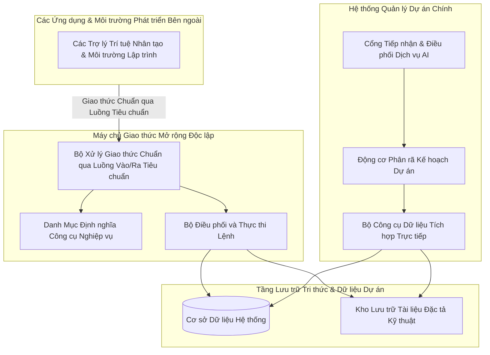

# CHUYÊN ĐỀ 5: KIẾN TRÚC MCP SERVER & HỆ THỐNG MCP TOOLS (MODEL CONTEXT PROTOCOL)

---

## 1. Bản chất Chuẩn Model Context Protocol (MCP)

### 1.1. Model Context Protocol (MCP) là gì?
**Model Context Protocol (MCP)** là chuẩn giao thức công nghiệp mở (Open Protocol) sử dụng cơ chế truyền tin **JSON-RPC 2.0**. Giao thức này đóng vai trò như một "cổng cắm USB-C" phổ quát, cho phép các mô hình trí tuệ nhân tạo (LLM / AI Agents) kết nối an toàn và truy xuất dữ liệu từ các hệ thống phần mềm nghiệp vụ (Database, File System, Git, API) mà không cần viết mã kết nối riêng cho từng mô hình.

### 1.2. Tại sao Dự án áp dụng Chuẩn MCP?
1. **Chuẩn hóa công cụ (Tool Standardisation)**: Mọi công cụ AI trong dự án đều có lược đồ tham số (`inputSchema`) định dạng JSON Schema rõ ràng, giúp AI tự hiểu cách gọi hàm với xác suất chính xác 100%.
2. **Kiến trúc Lưỡng hình (Dual-Form Deployment)**:
   - **Hình thái In-Process**: Chạy trực tiếp trong tiến trình ASP.NET Core để phục vụ người dùng trên Web với độ trễ cực thấp (mili-giây).
   - **Hình thái Standalone Stdio**: Chạy dưới dạng tiến trình Console độc lập, cho phép các Agent bên ngoài (Claude Desktop, Cursor IDE, Roo Code, Gemini CLI) kết nối và thao tác với dự án qua luồng Stdio.



---

## 2. Danh mục Chi tiết Toàn bộ Hệ thống MCP Tools

Hệ thống cung cấp 7 công cụ cốt lõi phục vụ lập kế hoạch và phân rã Sprint:

### 2.1. Bảng Tổng Hợp Thông Số & Chức Năng

| Tên Công Cụ (Tool Name) | Tham Số Đầu Vào (Input Schema) | Dữ Liệu Trả Về (Return Model) | Tệp Mã Nguồn Triển Khai |
| :--- | :--- | :--- | :--- |
| **spec_hub_list_documents** | `projectId` (string, required) | Danh sách cây thư mục, tên file, định dạng (.docx, .pdf, .xlsx, .md) và kích thước tệp | [`SpecHubTools.cs`](file:///c:/Users/hoang/Downloads/ProjectMgmt/ProjectMgmt.Solution/McpServers/SpecHubTools.cs#L45-L66) |
| **spec_hub_read_document** | `documentId` (string, required) | Toàn văn nội dung tài liệu đã bóc tách, tiêu chí nghiệm thu (AC) và bảng biểu | [`SpecHubTools.cs`](file:///c:/Users/hoang/Downloads/ProjectMgmt/ProjectMgmt.Solution/McpServers/SpecHubTools.cs#L67-L83) |
| **spec_hub_search** | `projectId` (string), `keyword` (string) | Các phân đoạn văn bản khớp từ khóa, tên file gốc và chỉ số tương đồng | [`SpecHubTools.cs`](file:///c:/Users/hoang/Downloads/ProjectMgmt/ProjectMgmt.Solution/McpServers/SpecHubTools.cs#L84-L98) |
| **backlog_get_stories** | `projectId` (string, required) | Danh sách User Stories Backlog: ID, Tiêu đề, Mô tả, Story Points, Độ ưu tiên | [`BacklogTools.cs`](file:///c:/Users/hoang/Downloads/ProjectMgmt/ProjectMgmt.Solution/McpServers/BacklogTools.cs#L40-L75) |
| **sprint_get_history_and_velocity** | `projectId` (string, required) | Vận tốc trung bình (Velocity), các User Story dở dang bị rollover, danh sách bug tồn đọng | [`SprintTools.cs`](file:///c:/Users/hoang/Downloads/ProjectMgmt/ProjectMgmt.Solution/McpServers/SprintTools.cs#L35-L70) |
| **team_get_dev_capacities** | `projectId` (string, required) | Danh sách kỹ sư (Developers, QA), chuyên môn (Frontend, Backend, Tester), số giờ khả dụng | [`TeamTools.cs`](file:///c:/Users/hoang/Downloads/ProjectMgmt/ProjectMgmt.Solution/McpServers/TeamTools.cs#L35-L70) |
| **ai_sprint_plan_propose** | `projectId` (string), `meetingNotes` (string), `targetStoryIds` (array) | Đề xuất Sprint Goal, Epics, Tasks độc lập (1-3 SP) hoặc kèm Subtasks ($\ge 5$ SP), trích dẫn tài liệu | [`Program.cs`](file:///c:/Users/hoang/Downloads/ProjectMgmt/ProjectMgmt.McpServer/Program.cs#L265-L287) |

---

## 3. Chi Tiết Lược Đồ Tham Số JSON-RPC (Schema Specifications)

### 3.1. Tool: `spec_hub_search`
- **Mục đích**: Tìm kiếm quy tắc nghiệp vụ hoặc kiến trúc xuyên suốt kho tài liệu.
- **Request JSON-RPC mẫu**:
```json
{
  "jsonrpc": "2.0",
  "id": 1,
  "method": "tools/call",
  "params": {
    "name": "spec_hub_search",
    "arguments": {
      "projectId": "12",
      "keyword": "quy định xác thực JWT và refresh token"
    }
  }
}
```
- **Response JSON-RPC mẫu**:
```json
{
  "jsonrpc": "2.0",
  "id": 1,
  "result": {
    "content": [
      {
        "type": "text",
        "text": "Tìm thấy 2 phân đoạn trong tài liệu 'Cam-nang-ky-thuat.md':\n- Mục 3.2: Access Token có thời hạn 15 phút, Refresh Token có thời hạn 30 ngày.\n- Mục 3.3: Thuật toán mã hóa HMAC-SHA256, khóa ký tối thiểu 32 bytes."
      }
    ]
  }
}
```

### 3.2. Tool: `team_get_dev_capacities`
- **Mục đích**: Cung cấp số liệu chính xác để AI không giao việc quá tải hoặc sai chuyên môn.
- **Request JSON-RPC mẫu**:
```json
{
  "jsonrpc": "2.0",
  "id": 2,
  "method": "tools/call",
  "params": {
    "name": "team_get_dev_capacities",
    "arguments": {
      "projectId": "12"
    }
  }
}
```
- **Response JSON-RPC mẫu**:
```json
{
  "jsonrpc": "2.0",
  "id": 2,
  "result": {
    "content": [
      {
        "type": "text",
        "text": "Danh sách nhân sự dự án (Tổng khả dụng: 120 giờ):\n1. Hoàng Văn A - Backend Lead (C#, .NET 8, MySQL) - Khả dụng: 40 giờ\n2. Trần Thị B - Frontend Dev (Angular, TypeScript, SCSS) - Khả dụng: 40 giờ\n3. Lê Văn C - QA / Tester (Playwright, Postman, Automation) - Khả dụng: 40 giờ"
      }
    ]
  }
}
```

---

## 4. Hướng Dẫn Cấu Hình Kết Nối cho AI Agents Bên Ngoài

Máy chủ Stdio MCP Server của dự án được biên dịch tại [`ProjectMgmt.McpServer`](file:///c:/Users/hoang/Downloads/ProjectMgmt/ProjectMgmt.McpServer). Bất kỳ AI Client nào hỗ trợ chuẩn MCP đều có thể kết nối trực tiếp.

### 4.1. Cấu hình cho Claude Desktop
Mở tệp cấu hình của Claude Desktop: `%APPDATA%\Claude\claude_desktop_config.json`:

```json
{
  "mcpServers": {
    "projectmgmt-scrum": {
      "command": "dotnet",
      "args": [
        "run",
        "--project",
        "C:\\Users\\hoang\\Downloads\\ProjectMgmt\\ProjectMgmt.McpServer\\ProjectMgmt.McpServer.csproj"
      ]
    }
  }
}
```

### 4.2. Cấu hình cho Cursor IDE / Roo Code
Thêm vào tệp cấu hình MCP của Cursor / Roo Code (`.cursor/mcp.json`):

```json
{
  "mcpServers": {
    "projectmgmt-ai-planner": {
      "command": "dotnet",
      "args": [
        "C:\\Users\\hoang\\Downloads\\ProjectMgmt\\ProjectMgmt.McpServer\\bin\\Debug\\net8.0\\ProjectMgmt.McpServer.dll"
      ],
      "env": {
        "ASPNETCORE_ENVIRONMENT": "Development"
      }
    }
  }
}
```

---

## 5. Hướng Dẫn Chạy & Kiểm Thử Tương Tác Qua Terminal Stdio

Người dùng hoặc kiểm thử viên có thể chạy trực tiếp MCP Server từ terminal PowerShell để xác minh giao thức JSON-RPC:

### Bước 1: Khởi động Server
```powershell
cd C:\Users\hoang\Downloads\ProjectMgmt\ProjectMgmt.McpServer
dotnet run
```

### Bước 2: Gửi lệnh Khởi tạo (Initialize)
Dán dòng JSON sau vào terminal và nhấn Enter:
```json
{"jsonrpc":"2.0","id":1,"method":"initialize","params":{"protocolVersion":"2024-11-05","capabilities":{},"clientInfo":{"name":"ManualTester","version":"1.0"}}}
```
**Kết quả phản hồi ngay lập tức từ server:**
```json
{"jsonrpc":"2.0","id":1,"result":{"protocolVersion":"2024-11-05","capabilities":{"tools":{}},"serverInfo":{"name":"ProjectMgmt-AiSprintPlanner-McpServer","version":"1.0.0"}}}
```

### Bước 3: Lấy danh sách Công cụ (tools/list)
```json
{"jsonrpc":"2.0","id":2,"method":"tools/list","params":{}}
```
**Kết quả:** Server trả về đầy đủ 7 công cụ kèm inputSchema chuẩn xác.

---

## 6. Danh mục Tệp Mã Nguồn Tham Chiếu Chuyên Đề 5

| Thành phần | Vai trò kỹ thuật | Liên kết mã nguồn |
| :--- | :--- | :--- |
| **ProjectMgmt.McpServer** | Ứng dụng Console phục vụ kết nối JSON-RPC 2.0 Stdio ngoài | [`Program.cs`](file:///c:/Users/hoang/Downloads/ProjectMgmt/ProjectMgmt.McpServer/Program.cs#L20-L150) |
| **SpecHubTools** | Công cụ đọc và tìm kiếm tài liệu đặc tả Spec Hub | [`SpecHubTools.cs`](file:///c:/Users/hoang/Downloads/ProjectMgmt/ProjectMgmt.Solution/McpServers/SpecHubTools.cs#L45-L100) |
| **BacklogTools** | Công cụ truy vấn User Story và độ ưu tiên Backlog | [`BacklogTools.cs`](file:///c:/Users/hoang/Downloads/ProjectMgmt/ProjectMgmt.Solution/McpServers/BacklogTools.cs#L35-L75) |
| **SprintTools** | Công cụ tính toán vận tốc (Velocity) và User Story dở dang | [`SprintTools.cs`](file:///c:/Users/hoang/Downloads/ProjectMgmt/ProjectMgmt.Solution/McpServers/SprintTools.cs#L30-L70) |
| **TeamTools** | Công cụ phân tích hồ sơ chuyên môn và số giờ làm việc | [`TeamTools.cs`](file:///c:/Users/hoang/Downloads/ProjectMgmt/ProjectMgmt.Solution/McpServers/TeamTools.cs#L30-L70) |

