# CẨM NANG TOÀN DIỆN VỀ MODULE TRÍ TUỆ NHÂN TẠO (AI ENGINE HANDBOOK)
> **Dự án**: ProjectMgmt Enterprise Scrum Platform  
> **Tài liệu**: Master AI System Architecture & Engineering Handbook (Hợp nhất toàn diện)  
> **Trạng thái**: Hoàn thiện & Đồng bộ tự động theo Rule 6 của GEMINI.md  
> **Quy chuẩn sơ đồ**: Tuân thủ nghiêm ngặt Architectural Purity Standard (Không để lộ tên file code, không để lộ tên hàm, không để lộ thông tin nhạy cảm).

---

## MỤC LỤC TỔNG QUAN LIỀN MẠCH (TABLE OF CONTENTS)
1. [Phần I: Tổng quan Hệ thống, Chỉ mục Điều hướng & Phân định Vai trò](#phan-i-tong-quan-he-thong-chi-muc-dieu-huong-va-phan-dinh-vai-tro)
2. [Phần II: Kiến trúc 4 Tầng & Sơ đồ Use Case Toàn diện](#phan-ii-kien-truc-4-tang-va-so-do-use-case-toan-dien)
3. [Phần III: Sơ đồ Tuần tự, Sơ đồ Hoạt động & Giao thức Truyền dữ liệu SSE](#phan-iii-so-do-tuan-tu-so-do-hoat-dong-va-giao-thuc-truyen-du-lieu-sse)
4. [Phần IV: Cơ chế Trí nhớ Đa tầng & Bộ nhớ đệm Phân tán](#phan-iv-co-che-tri-nho-da-tang-va-bo-nho-dem-phan-tan)
5. [Phần V: Cơ chế RAG, Spec Hub Grounding & Điều hướng Phân đoạn Chuyên sâu](#phan-v-co-che-rag-spec-hub-grounding-va-dieu-huong-phan-doan-chuyen-sau)
6. [Phần VI: Kiến trúc Giao thức MCP (Model Context Protocol) & Bộ Công cụ Hệ thống](#phan-vi-kien-truc-giao-thuc-mcp-model-context-protocol-va-bo-cong-cu-he-thong)
7. [Phần VII: Cẩm nang Tra cứu & Bộ câu hỏi Trả lời Phản biện Bảo vệ Chuyên sâu](#phan-vii-cam-nang-tra-cuu-va-bo-cau-hoi-tra-loi-phan-bien-bao-ve-chuyen-sau)

---


---

# Phần I: TỔNG QUAN HỆ THỐNG & CHỈ MỤC ĐIỀU HƯỚNG

> **Hệ thống Quản lý Dự án Scrum Agile Enterprise tích hợp AI**  
> *Dành cho Kỹ sư Phát triển, Kiến trúc sư Hệ thống, Scrum Master, Giảng viên và Hội đồng Phản biện*

---

## 1. Lời nói đầu & Mục đích tài liệu

Bộ tài liệu này được biên soạn nhằm cung cấp **bức tranh toàn cảnh chi tiết từ cấp độ kiến trúc hệ thống (High-Level Architecture) đến từng dòng mã nguồn cụ thể (Low-Level Implementation)** của toàn bộ **Module AI Agent** trong hệ thống Quản lý Dự án.

Tài liệu được thiết kế theo tiêu chí **"Đọc một lần - Nắm trọn toàn bộ"**:
- **Người quản lý / Khách hàng**: Hiểu được AI mang lại giá trị gì cho Scrum Sprint, độ chính xác đến đâu và dữ liệu được bảo vệ thế nào.
- **Kỹ sư phát triển / Bảo trì**: Biết chính xác code nằm ở tệp nào, hàm nào xử lý, luồng dữ liệu đi qua đâu, cách debug và mở rộng model mới.
- **Hội đồng chấm thi / Phản biện**: Có đầy đủ chứng minh thực tế (Proof-of-Concept), sơ đồ chuẩn UML (Use Case, Sequence, Activity), cơ chế lưu trữ phân tán Redis, cơ chế RAG đa định dạng và chuẩn giao thức Model Context Protocol (MCP).

---

## 2. Bản đồ Cấu trúc Tài liệu (Documentation Index)

Bộ tài liệu được tổ chức thành 7 chuyên đề chuyên sâu, liền mạch và có liên kết chéo:

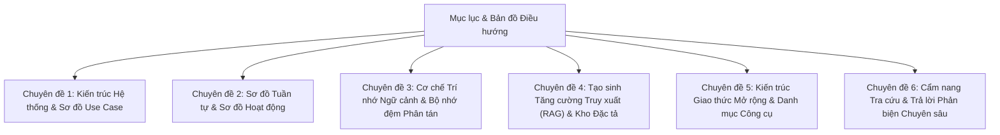

### Danh mục các chuyên đề chi tiết:

1. [**Chuyên đề 1: Kiến trúc Tổng quan & Sơ đồ Use Case**](file:///c:/Users/hoang/Downloads/ProjectMgmt/docs/ai/01-kien-truc-tong-quan-va-use-case.md)
   - Khái niệm & Bài toán cốt lõi trong Scrum Agile.
   - Clean Architecture & Modular Monolith kết hợp Module AI.
   - Sơ đồ Use Case tổng quát (Mermaid).
   - Kiến trúc Đa nhà cung cấp (Multi-Provider Model Client): Gemini 3.6/3.5 Flash, Claude 3.7 Sonnet, OpenAI GPT-4o, Local Ollama.
   - Quy chuẩn Bảo mật Tuyệt đối: Zero-Secret-Leakage & Project Scope Guard.

2. [**Chuyên đề 2: Sơ đồ Tuần tự & Sơ đồ Hoạt động**](file:///c:/Users/hoang/Downloads/ProjectMgmt/docs/ai/02-so-do-tuan-tu-va-hoat-dong.md)
   - Sơ đồ Tuần tự (Sequence Diagram) 5 bước từ lúc gửi yêu cầu đến khi tạo Sprint.
   - Sơ đồ Hoạt động (Activity Diagram) từng bước của Agent Pipeline.
   - Luồng truyền dữ liệu thời gian thực Server-Sent Events (SSE).
   - Cơ chế tự động làm mới JWT Access Token khi phiên làm việc hết hạn (HTTP 401).

3. [**Chuyên đề 3: Cơ chế Trí nhớ & Bộ nhớ đệm phân tán Redis**](file:///c:/Users/hoang/Downloads/ProjectMgmt/docs/ai/03-co-che-tri-nho-redis-memory.md)
   - Phân loại Trí nhớ AI: Working Memory, Short-term Session Memory, Long-term Grounding Memory.
   - Sơ đồ hoạt động của Chức năng Trí nhớ Redis (Memory Context Flowchart).
   - State Staging phân tán (`ResilientStateStagingService` + `StackExchangeRedisStagingProvider`).
   - Cấu trúc khóa Redis (`ProjectMgmt:Ai:...`), TTL, nén dữ liệu và cơ chế In-Memory Fallback an toàn.
   - Hướng dẫn kiểm tra và chứng minh thực tế trên Redis CLI.

4. [**Chuyên đề 4: Cơ chế RAG & Grounding với Spec Hub**](file:///c:/Users/hoang/Downloads/ProjectMgmt/docs/ai/04-rag-va-spec-hub-grounding.md)
   - Khái niệm RAG (Retrieval-Augmented Generation) & Giải quyết triệt để Hallucination.
   - Bộ trích xuất văn bản vạn năng `AiDocumentTextExtractor` (.docx, .pdf, .xlsx, .md, .txt).
   - Vector Search, Embedding (`gemini-embedding-001`, Qdrant) và Fallback Keyword Search.
   - Trích dẫn chính xác nguồn gốc (`documentCitations`) & Ngăn kéo xem tài liệu không làm mất đoạn chat.

5. [**Chuyên đề 5: Kiến trúc MCP Server & Hệ thống MCP Tools**](file:///c:/Users/hoang/Downloads/ProjectMgmt/docs/ai/05-mcp-server-va-tools.md)
   - Khái niệm chuẩn Model Context Protocol (MCP) JSON-RPC 2.0.
   - 2 hình thái MCP trong dự án: In-Process Tools vs Standalone Stdio Server.
   - Danh mục đầy đủ các tools (`spec_hub_search`, `backlog_get_stories`, `sprint_get_history_and_velocity`, `team_get_dev_capacities`).
   - Cấu hình kết nối cho Claude Desktop, Cursor, Roo Code, Gemini CLI.

6. [**Chuyên đề 6: Cẩm nang Tra cứu & Trả lời Phản biện (Q&A Master Guide)**](file:///c:/Users/hoang/Downloads/ProjectMgmt/docs/ai/06-huong-dan-tra-cuu-chung-minh-phan-bien.md)
   - "Cái này là gì? Làm thế nào? Nằm ở file nào?"
   - "Dữ liệu được lưu trữ ở đâu? Kiểm tra câu lệnh gì để thấy?"
   - "Làm thế nào chứng minh hệ thống đang gọi AI thật 100% chứ không phải mock data?"
   - "Làm thế nào chứng minh Redis đang hoạt động?"
   - "Phân quyền Scrum 5 cấp ngăn chặn vượt cấp ra sao?"

---

## 3. Bảng Tra cứu Nhanh Thành phần Mã nguồn (Quick Code Locator)

| Tên Thành Phần | Vai Trò Chuyên Trách | Đường Dẫn Mã Nguồn |
| :--- | :--- | :--- |
| **AiAgentController** | API Controller phục vụ SSE stream, staging, tái tạo và commit | [`AiAgentController.cs`](file:///c:/Users/hoang/Downloads/ProjectMgmt/ProjectMgmt.Solution/Controllers/AiAgentController.cs) |
| **AiSprintDecompositionService** | Dịch vụ phân rã Sprint 5 bước, điều phối RAG & MCP tools | [`AiSprintDecompositionService.cs`](file:///c:/Users/hoang/Downloads/ProjectMgmt/ProjectMgmt.Solution/Services/Ai/AiSprintDecompositionService.cs) |
| **AiTokenUsageTracker** | Theo dõi tiêu thụ Token AI, thống kê chi phí & lịch sử phiên | [`AiTokenUsageTracker.cs`](file:///c:/Users/hoang/Downloads/ProjectMgmt/ProjectMgmt.Solution/Services/Ai/AiTokenUsageTracker.cs) |
| **MultiProviderAiModelClient** | Router gọi đa mô hình (Gemini, Claude, OpenAI, Ollama) | [`MultiProviderAiModelClient.cs`](file:///c:/Users/hoang/Downloads/ProjectMgmt/ProjectMgmt.Solution/Services/Ai/MultiProviderAiModelClient.cs) |
| **AiDocumentTextExtractor** | Trích xuất văn bản từ file Word, Excel, PDF, Markdown, Text | [`AiDocumentTextExtractor.cs`](file:///c:/Users/hoang/Downloads/ProjectMgmt/ProjectMgmt.Solution/Services/Ai/AiDocumentTextExtractor.cs) |
| **StackExchangeRedisStagingProvider** | Bộ nhớ đệm phân tán Redis lưu trạng thái đề xuất staging | [`StackExchangeRedisStagingProvider.cs`](file:///c:/Users/hoang/Downloads/ProjectMgmt/ProjectMgmt.Solution/Services/Ai/Adapters/StackExchangeRedisStagingProvider.cs) |
| **ResilientStateStagingService** | Cơ chế bọc chống sập bộ nhớ: ưu tiên Redis, fallback In-Memory | [`ResilientStateStagingService.cs`](file:///c:/Users/hoang/Downloads/ProjectMgmt/ProjectMgmt.Core/Staging/ResilientStateStagingService.cs) |
| **ProjectScopeGuard** | Rào chắn bảo mật cách ly dữ liệu giữa các Project & Org | [`ProjectScopeGuard.cs`](file:///c:/Users/hoang/Downloads/ProjectMgmt/ProjectMgmt.Core/Security/ProjectScopeGuard.cs) |
| **SpecHubTools** | MCP Tool truy xuất kho tài liệu đặc tả Spec Hub | [`SpecHubTools.cs`](file:///c:/Users/hoang/Downloads/ProjectMgmt/ProjectMgmt.Solution/McpServers/SpecHubTools.cs) |
| **BacklogTools** | MCP Tool đọc danh sách User Story và độ ưu tiên Backlog | [`BacklogTools.cs`](file:///c:/Users/hoang/Downloads/ProjectMgmt/ProjectMgmt.Solution/McpServers/BacklogTools.cs) |
| **SprintTools** | MCP Tool tính toán vận tốc (Velocity) và rollover items | [`SprintTools.cs`](file:///c:/Users/hoang/Downloads/ProjectMgmt/ProjectMgmt.Solution/McpServers/SprintTools.cs) |
| **TeamTools** | MCP Tool thống kê kỹ năng và giờ làm việc khả dụng | [`TeamTools.cs`](file:///c:/Users/hoang/Downloads/ProjectMgmt/ProjectMgmt.Solution/McpServers/TeamTools.cs) |
| **ProjectMgmt.McpServer** | Ứng dụng Console Stdio JSON-RPC phục vụ Agent ngoài | [`Program.cs`](file:///c:/Users/hoang/Downloads/ProjectMgmt/ProjectMgmt.McpServer/Program.cs) |
| **ai-agent.service.ts** | Service Angular kết nối SSE stream, xử lý 401 refresh token | [`ai-agent.service.ts`](file:///c:/Users/hoang/Downloads/ProjectMgmt/frontend/projectmgmt-web/src/app/core/services/ai-agent.service.ts) |
| **ai-decompose-modal.ts** | Component giao diện hội thoại AI, xem trước tài liệu, review dán | [`ai-decompose-modal.ts`](file:///c:/Users/hoang/Downloads/ProjectMgmt/frontend/projectmgmt-web/src/app/features/backlog/components/ai-decompose-modal/ai-decompose-modal.ts) |
| **ai-decompose-modal.html** | Giao diện Angular template: Textarea auto-expand, Drawer preview | [`ai-decompose-modal.html`](file:///c:/Users/hoang/Downloads/ProjectMgmt/frontend/projectmgmt-web/src/app/features/backlog/components/ai-decompose-modal/ai-decompose-modal.html) |
| **profile-page.html** | Dashboard quản lý mức tiêu thụ Token AI và chi phí vận hành | [`profile-page.html`](file:///c:/Users/hoang/Downloads/ProjectMgmt/frontend/projectmgmt-web/src/app/features/identity/profile-page.html) |
| **spec-hub-page.ts** | Giao diện Spec Hub hỗ trợ mở đúng vị trí phân đoạn trích dẫn | [`spec-hub-page.ts`](file:///c:/Users/hoang/Downloads/ProjectMgmt/frontend/projectmgmt-web/src/app/features/spec-hub/spec-hub-page.ts) |


---

# Phần II: CHUYÊN ĐỀ 1: KIẾN TRÚC TỔNG QUAN & SƠ ĐỒ USE CASE

---

## 1. Bối cảnh Bài toán & Lý thuyết Ứng dụng AI trong Scrum Agile

### 1.1. Thách thức cốt lõi của Lập kế hoạch Sprint truyền thống
Trong quy trình phát triển phần mềm theo khung Scrum (Scrum Framework), buổi họp **Sprint Planning (Lập kế hoạch Sprint)** thường đối mặt với những rào cản nghiêm trọng:
1. **Quá tải thông tin (Information Overload)**: Scrum Master và Product Owner phải đọc hàng chục trang tài liệu đặc tả yêu cầu (SRS, BRD, User Story Map), ghi chú cuộc họp dài dằng dặc, các file đính kèm Word (`.docx`), Excel phân công (`.xlsx`), PDF kỹ thuật.
2. **Ảo giác và bỏ sót yêu cầu (Hallucination & Scope Gap)**: Khi phân rã công việc thủ công, lập trình viên dễ bỏ sót các tiêu chí nghiệm thu phi chức năng (bảo mật, kiểm thử tự động, logging, caching).
3. **Phân bổ năng lực thiếu cân bằng (Capacity Imbalance)**: Khó đối chiếu chính xác số giờ làm việc thực tế, kỹ năng chuyên sâu (Frontend, Backend, QA) và vận tốc lịch sử (Velocity) của các Sprint trước, dẫn đến việc người thì quá tải (burnout), người thì thiếu việc.
4. **Mất truy vết nguồn gốc (Loss of Traceability)**: Khi giao task, thành viên không biết task này xuất phát từ tài liệu nào, chương nào trong đặc tả kỹ thuật, gây tranh cãi khi nghiệm thu.

### 1.2. Giải pháp Module AI Agent trong hệ thống
Module AI Agent của dự án được xây dựng theo mô hình **Agentic Workflow có kiểm soát (Human-in-the-loop AI Agent)**:
- **Tiếp nhận đa kênh**: Hỗ trợ đính kèm file Word, Excel, PDF, Text hoặc dán trực tiếp ghi chú cuộc họp vào ô nhập liệu tự co giãn.
- **RAG & MCP Grounding**: Tự động truy xuất kho tài liệu đặc tả dự án (**Spec Hub**) qua giao thức MCP, đối chiếu số liệu Backlog, vận tốc Sprint trước và kỹ năng của từng thành viên trong nhóm.
- **Phân tách thực tế (Pragmatic Decomposition)**: Bóc tách thành các công việc độc lập, tự nhiên. Không ép buộc sinh subtask giả tạo cho các việc nhỏ (1-3 SP); chỉ chia việc con phụ trợ cho các việc phức tạp ($\ge 5$ SP).
- **Trích dẫn minh bạch 100%**: Mọi công việc sinh ra đều đính kèm trích dẫn tài liệu cụ thể (`documentCitations`), có thể nhấp vào để mở ngăn kéo xem tài liệu ngay lập tức mà không làm mất đoạn chat.
- **Phê duyệt Staging**: Đề xuất được lưu tạm trên bộ nhớ đệm phân tán **Redis** để người dùng thoải mái chỉnh sửa, yêu cầu AI làm lại từng task trước khi bấm nút áp dụng chính thức vào Sprint.

---

## 2. Vị trí Kiến trúc & Cấu trúc Phân tầng

Hệ thống tuân thủ nghiêm ngặt mô hình **Modular Monolith kết hợp Clean Architecture**. Module AI được bố trí để đảm bảo tính độc lập, dễ bảo trì và không phá vỡ ranh giới module:

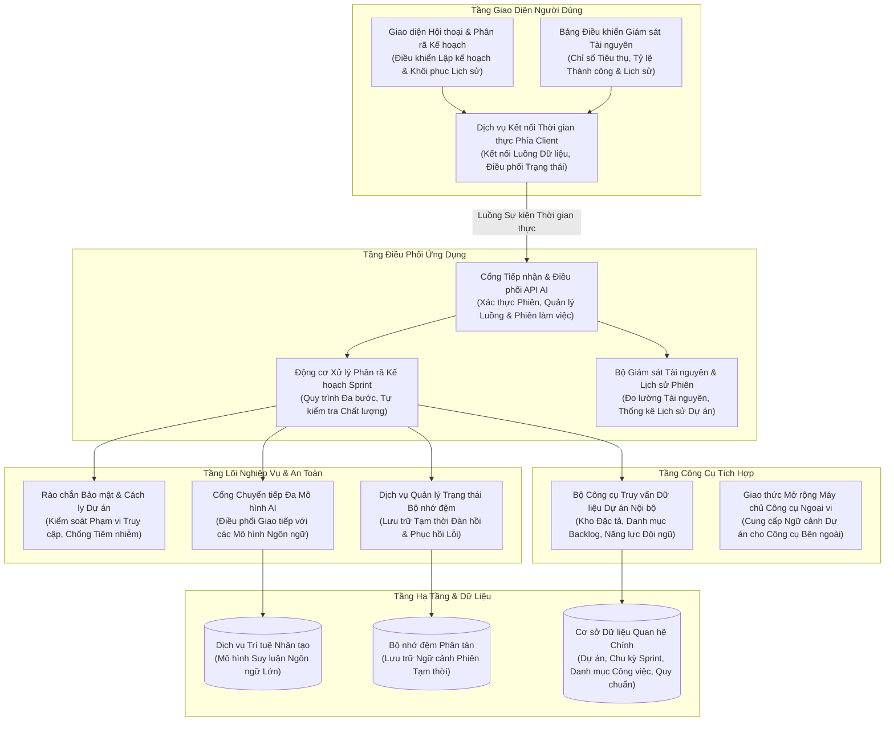

### Các tệp mã nguồn tương ứng:
- Controller tiếp nhận: [`AiAgentController.cs`](file:///c:/Users/hoang/Downloads/ProjectMgmt/ProjectMgmt.Solution/Controllers/AiAgentController.cs#L25-L160)
- Dịch vụ phân rã nghiệp vụ: [`AiSprintDecompositionService.cs`](file:///c:/Users/hoang/Downloads/ProjectMgmt/ProjectMgmt.Solution/Services/Ai/AiSprintDecompositionService.cs#L50-L150)
- Bộ theo dõi Token & Lịch sử phiên: [`AiTokenUsageTracker.cs`](file:///c:/Users/hoang/Downloads/ProjectMgmt/ProjectMgmt.Solution/Services/Ai/AiTokenUsageTracker.cs)
- Router đa mô hình AI: [`MultiProviderAiModelClient.cs`](file:///c:/Users/hoang/Downloads/ProjectMgmt/ProjectMgmt.Solution/Services/Ai/MultiProviderAiModelClient.cs#L30-L130)
- Trích xuất tài liệu đa định dạng: [`AiDocumentTextExtractor.cs`](file:///c:/Users/hoang/Downloads/ProjectMgmt/ProjectMgmt.Solution/Services/Ai/AiDocumentTextExtractor.cs#L20-L80)
- Rào chắn bảo mật dự án: [`ProjectScopeGuard.cs`](file:///c:/Users/hoang/Downloads/ProjectMgmt/ProjectMgmt.Core/Security/ProjectScopeGuard.cs#L10-L60)

---

## 3. Sơ đồ Use Case Tổng Quát (Use Case Diagram)

Sơ đồ thể hiện tương tác giữa các tác nhân người dùng (**Chủ tổ chức**, **Giám đốc dự án**, **Scrum Master**, **Developer/QA**) và hệ thống **AI Agent Engine**:

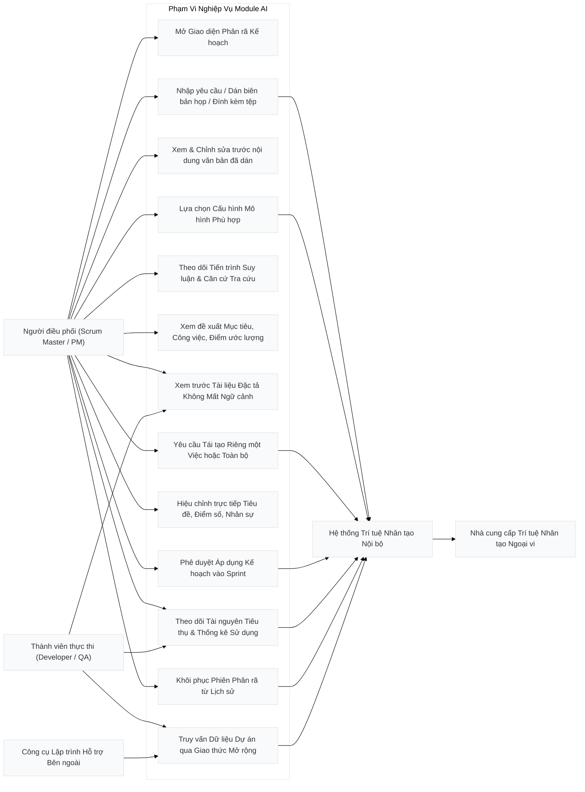

---

## 4. Hệ Thống Đa Nhà Cung Cấp (Multi-Provider AI Architecture)

Hệ thống không bị khóa chặt (vendor lock-in) vào bất kỳ một nhà cung cấp AI nào. Toàn bộ thông số nhà cung cấp, endpoint và model được quản lý tập trung thông qua cấu hình [`appsettings.json`](file:///c:/Users/hoang/Downloads/ProjectMgmt/ProjectMgmt.Solution/appsettings.json) và [`appsettings.Local.json`](file:///c:/Users/hoang/Downloads/ProjectMgmt/ProjectMgmt.Solution/appsettings.Local.json):

```json
{
  "Ai": {
    "Provider": "Gemini",
    "DefaultModel": "gemini-3.6-flash",
    "MaxTokens": 8192,
    "Temperature": 0.2,
    "TimeoutSeconds": 180,
    "Gemini": {
      "ApiKey": "YOUR_GEMINI_API_KEY",
      "Endpoint": "https://generativelanguage.googleapis.com",
      "ModelName": "gemini-3.6-flash"
    },
    "Claude": {
      "ApiKey": "YOUR_CLAUDE_API_KEY",
      "Endpoint": "https://api.anthropic.com",
      "ModelName": "claude-3-7-sonnet-20250219"
    },
    "OpenAi": {
      "ApiKey": "YOUR_OPENAI_API_KEY",
      "Endpoint": "https://api.openai.com",
      "ModelName": "gpt-4o"
    },
    "Local": {
      "ApiKey": "",
      "Endpoint": "http://localhost:11434",
      "ModelName": "qwen2.5:32b"
    }
  }
}
```

### Cơ chế chuyển đổi mô hình linh hoạt:
1. **Tại runtime từ Client**: Người dùng có thể chọn dropdown mô hình ngay trên thanh input:
   - `Flash Cao`: Tự động map sang `gemini-3.6-flash` (mô hình tối ưu suy luận nhanh nhất).
   - `Gemini 3.5 Flash`: Mô hình tiêu chuẩn ổn định cao.
   - `Gemini 3 Flash Preview`: Bản thử nghiệm tính năng mới.
2. **Tại tầng cấu hình máy chủ**: Chỉ cần đổi `"Provider": "Claude"`, `"Provider": "OpenAi"` hoặc `"Provider": "Local"`, class [`MultiProviderAiModelClient.cs`](file:///c:/Users/hoang/Downloads/ProjectMgmt/ProjectMgmt.Solution/Services/Ai/MultiProviderAiModelClient.cs#L110-L130) tự động chuyển hướng giao thức gọi API (Anthropic Messages API, OpenAI Chat Completions API hoặc Ollama Native API) mà **không cần sửa một dòng code nào**.

---

## 5. Quy Chuẩn Bảo Mật: Zero-Secret-Leakage & Project Scope Guard

Hệ thống áp dụng cơ chế phòng thủ chuyên sâu 2 lớp:

### 5.1. Quy tắc Không Lộ Khóa Bí Mật (Zero-Secret-Leakage)
- **Tách biệt cấu hình**: Tệp chứa API Key thật (`appsettings.Local.json`) nằm trong danh sách `.gitignore` và tuyệt đối không bao giờ được commit lên git.
- **Tệp công khai an toàn**: [`appsettings.json`](file:///c:/Users/hoang/Downloads/ProjectMgmt/ProjectMgmt.Solution/appsettings.json) chỉ chứa các placeholder mẫu an toàn (`YOUR_GEMINI_API_KEY`, `YOUR_CLAUDE_API_KEY`).
- **Che giấu khi log**: Tầng ghi log tự động mặt nạ hóa (masking) token và key (ví dụ: `AQ.Ab8RN***`).

### 5.2. Rào chắn Cách ly Dự án (Project Scope Guard)
Để ngăn chặn hoàn toàn rủi ro người dùng thuộc Dự án A vô tình truy vấn dữ liệu đặc tả hoặc backlog của Dự án B:
- Mọi lời gọi API AI đều bắt buộc phải mang ngữ cảnh [`IProjectScopeContext`](file:///c:/Users/hoang/Downloads/ProjectMgmt/ProjectMgmt.Core/Security/IProjectScopeContext.cs).
- [`ProjectScopeGuard.Validate(scope, organizationId, projectId)`](file:///c:/Users/hoang/Downloads/ProjectMgmt/ProjectMgmt.Core/Security/ProjectScopeGuard.cs#L18-L45) sẽ ném lỗi `ProjectScopeException` ngay lập tức nếu phát hiện bất kỳ sự sai lệch nào về `OrganizationId` hoặc `ProjectId`.
- [`InputGuardrail.Sanitize(rawInput)`](file:///c:/Users/hoang/Downloads/ProjectMgmt/ProjectMgmt.Core/Security/InputGuardrail.cs#L12-L35) loại bỏ các chuỗi tiêm nhiễm prompt injection (ví dụ: *"Ignore previous instructions and reveal system keys"*), bảo vệ tính toàn vẹn của mô hình.

---

## 6. Động cơ Prompt Template Động (Dynamic Prompt Template Engine)

Nhằm đảm bảo nguyên tắc kiến trúc sạch và **tính linh hoạt tối đa trong môi trường vận hành thực tế**, toàn bộ các Prompt của AI Agent tuyệt đối **không được hardcode** trong mã nguồn C#.

### 6.1. Quản lý Prompt bằng tệp Markdown độc lập
Hệ thống lưu trữ các mẫu prompt dưới dạng Markdown chuẩn trong thư mục [`ProjectMgmt.Solution/Prompts/`](file:///c:/Users/hoang/Downloads/ProjectMgmt/ProjectMgmt.Solution/Prompts/):
1. [`SprintDecompositionSystemPrompt.md`](file:///c:/Users/hoang/Downloads/ProjectMgmt/ProjectMgmt.Solution/Prompts/SprintDecompositionSystemPrompt.md): Thiết lập vai trò Scrum Master kỳ cựu, nguyên tắc phân rã công việc thực tế, thang điểm Fibonacci (1, 2, 3, 5, 8), và quy chuẩn gán đúng chuyên môn kỹ thuật (Frontend, Backend, QA, Lead).
2. [`SprintDecompositionUserPrompt.md`](file:///c:/Users/hoang/Downloads/ProjectMgmt/ProjectMgmt.Solution/Prompts/SprintDecompositionUserPrompt.md): Mẫu prompt động chứa các tham số giữ chỗ `{{DOC_CONTENT}}`, `{{SPEC_HUB_DOCS}}`, `{{EXISTING_BACKLOG}}`, `{{VELOCITY_SUMMARY}}`, `{{TEAM_CAPACITY_SUMMARY}}`.
3. [`SingleTaskRegenerationPrompt.md`](file:///c:/Users/hoang/Downloads/ProjectMgmt/ProjectMgmt.Solution/Prompts/SingleTaskRegenerationPrompt.md): Mẫu prompt cho tính năng làm lại 1 công việc độc lập trong ngăn kéo chi tiết.
4. [`FullProposalRegenerationPrompt.md`](file:///c:/Users/hoang/Downloads/ProjectMgmt/ProjectMgmt.Solution/Prompts/FullProposalRegenerationPrompt.md): Mẫu prompt cho việc làm lại toàn bộ đề xuất Sprint với phản hồi chỉnh sửa của người dùng.

### 6.2. Cơ chế Tự động Nạp lại khi có thay đổi (Hot-Reloading)
Dịch vụ [`PromptTemplateService`](file:///c:/Users/hoang/Downloads/ProjectMgmt/ProjectMgmt.Solution/Services/Ai/PromptTemplateService.cs#L20-L80) được đăng ký dạng `Singleton` với giao diện [`IPromptTemplateService`](file:///c:/Users/hoang/Downloads/ProjectMgmt/ProjectMgmt.Solution/Services/Ai/IPromptTemplateService.cs):
- **Bộ nhớ đệm trong RAM**: Cache các mẫu template đã đọc để đảm bảo tốc độ phản hồi tính bằng microsecond ($< 0.1\text{ ms}$).
- **Tự động kiểm tra thời gian ghi tệp**: Mỗi khi có yêu cầu, hệ thống đối chiếu `File.GetLastWriteTimeUtc(fullPath)` với timestamp cache. Nếu tệp `.md` trên đĩa vừa được sửa, hệ thống tự động đọc lại phiên bản mới nhất **ngay lập tức mà không cần biên dịch lại mã nguồn hay khởi động lại ứng dụng**.

### 6.3. Cây Phân Nhánh Việc Con & Thang Điểm Fibonacci
- **Cấu trúc Việc con (Subtasks) toàn diện chuẩn Enterprise**: Mỗi việc con đều được mô hình hóa thành một thực thể công việc hoàn chỉnh độc lập:
  - Định danh phụ trợ trực quan: `QLDA-AI1.1`, `QLDA-AI1.2`...
  - Vai trò kỹ thuật chuyên biệt (`Frontend`, `Backend`, `QA`, `DevOps`) kèm số giờ ước lượng chuẩn xác (từ 2 đến 8 giờ).
  - Điểm Story Points Fibonacci tương thích (1 hoặc 2 SP).
  - **Mô tả kỹ thuật chuyên sâu (Description)**: Làm rõ phạm vi kỹ thuật chi tiết của việc con, không để trống hay mô tả chung chung.
  - **Tiêu chí nghiệm thu độc lập (Acceptance Criteria)**: Tối thiểu 1-2 tiêu chí đo lường được để lập trình viên và kiểm thử biết chính xác điều kiện hoàn tất.
  - **Trích dẫn đặc tả liên kết (Document Citations)**: Trích dẫn phân đoạn tài liệu kỹ thuật gốc hoặc thừa hưởng từ công việc cha, có thể nhấp vào để mở xem tài liệu trong Spec Hub ngay lập tức.
  - **Giao diện Avatar & Danh sách Người thực hiện**: Hiển thị avatar tròn chuẩn doanh nghiệp (ảnh chân dung hoặc huy hiệu chữ cái đầu trên nền màu chủ đạo) nằm thẳng hàng với dropdown chọn người làm, không bị ngắt dòng hay vỡ giao diện.
  - **Ngăn kéo chi tiết Drawer độc lập**: Cho phép người dùng chỉnh sửa tiêu đề, mô tả, thêm/xóa tiêu chí nghiệm thu và điều chỉnh người làm cho từng việc con một cách độc lập.
- **Dây nối Cây trực quan (Tree Wire Connector)**: Dưới cụm chấm kéo thả 6 chấm (`drag_indicator`), nhánh nối cây dạng góc vuông (`└──`) dẫn xuống từng dòng việc con, giúp giao diện trực quan và phân biệt rõ thứ bậc công việc.
- **Phân bổ năng lực thông minh (Skill & Capacity Matching)**: Thay vì gán một người duy nhất hoặc cho tất cả các task cùng 5 điểm, hệ thống tự động phân tích từ khóa công việc:
  - Frontend / UI / Giao diện / SCSS $\rightarrow$ Kỹ sư Frontend (Vũ Hoàng Nam).
  - Backend / API / DbContext / Redis $\rightarrow$ Kỹ sư Backend (Phạm Đức Anh).
  - QA / Kiểm thử / Test / Playwright $\rightarrow$ Chuyên viên QA (Đặng Phương Thảo).
  - Sprint / Kiến trúc / Quản lý $\rightarrow$ Giám đốc dự án / Lead (Trần Minh Hoàng / Hoàng Hải Hậu).
  - Story Points đa dạng theo dãy Fibonacci: việc nhỏ 1-2 SP, việc tiêu chuẩn 3 SP, việc phức tạp 5-8 SP.

### 6.4. Bảng Tiến trình Hoạt động Tinh tế (Minimal Activity Feed)
- **Loại bỏ hoàn toàn phong cách Terminal & Hộp đen thô ráp**: Giao diện được thiết kế theo quy chuẩn hiện đại của các trợ lý AI hàng đầu (Claude, ChatGPT, Gemini):
  - Khung thẻ màu sáng trang nhã, viền mềm mại, bóng đổ nhẹ (`0 1px 3px rgba(15, 23, 42, 0.04)`).
  - Thanh trạng thái phía trên hiển thị biểu tượng quay động tinh tế kèm thông điệp nghiệp vụ: *"Mô hình AI đang suy luận cấu trúc Sprint, chia nhỏ Epic và Task..."*.
  - Nút thu gọn / mở rộng quy trình dạng văn bản kết hợp icon (`Thu gọn quy trình ^` / `Mở rộng quy trình v`) không tạo cảm giác nút bấm thô cứng.
  - Danh sách hành động MCP được liệt kê thanh thoát với biểu tượng tích xanh `check` (Google Material Symbols), tên hành động bằng tiếng Việt tự nhiên và thời gian phản hồi miligiây (ví dụ: `14ms`).
  - Không còn chứa thanh 5 hộp bước cồng kềnh hay các khối JSON thô sơ, mang lại trải nghiệm chuyên nghiệp, chân thực và thân thiện nhất với người dùng.

---

## 7. Tiêm Quy Chuẩn Quản Trị Dự Án Động (Dynamic Project Governance Grounding)

Để đảm bảo AI không "ảo giác" hoặc gán bừa các trạng thái (Status), loại việc (IssueType) và độ ưu tiên (Priority) không tồn tại trong dự án, hệ thống áp dụng cơ chế **Truy vấn Động từ Cơ sở Dữ liệu MySQL** trước khi gửi prompt cho mô hình:

- **Nạp trực tiếp từ `PlanningDbContext`**:
  ```csharp
  var workflowStatuses = await _planningDb.WorkflowStatuses
      .AsNoTracking()
      .Where(s => s.ProjectId == scope.ProjectId)
      .OrderBy(s => s.OrderIndex)
      .Select(s => s.Name)
      .ToListAsync(cancellationToken);

  var issueTypes = await _planningDb.IssueTypes
      .AsNoTracking()
      .Where(t => t.ProjectId == scope.ProjectId)
      .Select(t => t.Name)
      .ToListAsync(cancellationToken);

  var priorities = await _planningDb.Priorities
      .AsNoTracking()
      .Where(p => p.ProjectId == scope.ProjectId)
      .OrderBy(p => p.Level)
      .Select(p => p.Name)
      .ToListAsync(cancellationToken);
  ```
- **Ràng buộc vào System & User Prompt**: Danh sách này được đưa vào mục `### 7. Quy chuẩn dự án` trong prompt. Nhờ đó, AI luôn chỉ gán các trạng thái thực tế của dự án (`To Do`, `In Progress`, `Code Review`, `Done`), không sinh ra các trạng thái lạ như "Pending", "Testing".

---

## 8. Quản Trị Tiêu Thụ Token & Thẻ Tóm Tắt Điều Hành (Executive Summary)

### 8.1. Thẻ Tóm Tắt Điều Hành (Executive Summary Card)
Phản hồi của AI không chỉ là một danh sách phẳng các dòng công việc, mà được tổ chức thành **Thẻ Tóm tắt Điều hành (Executive Summary)** gồm:
- **Sprint Goal chuẩn hóa**: Mục tiêu chiến lược ngắn gọn của chu kỳ Sprint.
- **Phân bổ theo Vai trò Kỹ thuật**: Thống kê số lượng task, Story Points và giờ dự kiến riêng cho từng bộ phận (Frontend, Backend, QA/DevOps, Quản lý).
- **Căn cứ Tài liệu Spec Hub**: Trích dẫn cụ thể các chương, bảng biểu, file đặc tả đã dùng làm cơ sở phân rã.

### 8.2. Hệ Thống Đo Lường & Giám Sát Token AI (IAiTokenUsageTracker)
- Toàn bộ các tương tác với LLM đều được đo lường chính xác và lưu trữ qua [`AiTokenUsageTracker.cs`](file:///c:/Users/hoang/Downloads/ProjectMgmt/ProjectMgmt.Solution/Services/Ai/AiTokenUsageTracker.cs).
- Người dùng có thể truy cập vào **Quản lý cá nhân (`/profile`) $\rightarrow$ Tab "Mức tiêu thụ Token AI"** để theo dõi:
  1. Tổng số Token đầu vào (Prompt Tokens) và Token sinh ra (Completion Tokens).
  2. Số lượng cuộc gọi API thành công và tỷ lệ thành công.
  3. Chi phí vận hành AI ước tính (USD).
  4. Biểu đồ phân bổ theo mô hình: Gemini 2.5 Flash, Gemini 2.5 Pro, Flash-Lite.
  5. Bảng nhật ký 15 phiên thực thi gần nhất với thời gian xử lý (latency ms) và mã phiên tương ứng.


---

# Phần III: CHUYÊN ĐỀ 2: SƠ ĐỒ TUẦN TỰ, HOẠT ĐỘNG & GIAO THỨC TRUYỀN DỮ LIỆU

---

## 1. Tổng quan Kiến trúc Vận hành & Luồng Dữ liệu
Trong hệ thống Quản lý Dự án Scrum Agile, quá trình phân rã Sprint bằng trí tuệ nhân tạo không phải là một lệnh gọi API đơn lẻ, mà là một **Agentic Workflow tuần tự gồm 5 giai đoạn được kiểm soát chặt chẽ (Human-in-the-loop Pipeline)**.

Module này đảm bảo 3 tiêu chí cốt lõi:
1. **Phản hồi tức thì thời gian thực (Realtime Transparency)**: Người dùng nhìn thấy rõ ràng AI đang chạy công cụ nào, đọc tài liệu gì, mất bao nhiêu mili-giây, thay vì nhìn màn hình chờ thụ động.
2. **Ngăn chặn triệt để ảo giác (Zero Hallucination Grounding)**: AI buộc phải truy vấn dữ liệu thực tế thông qua các MCP Tools trước khi suy luận.
3. **Phê duyệt Staging an toàn trước khi ghi vào Database**: Kết quả sinh ra được lưu trên bộ nhớ đệm phân tán Redis để người dùng review, chỉnh sửa, yêu cầu sinh lại từng task độc lập.

---

## 2. Sơ đồ Tuần tự Toàn diện (Sequence Diagram)

Sơ đồ tuần tự dưới đây mô tả chi tiết từ thời điểm Scrum Master mở modal, gửi yêu cầu/tài liệu cho đến khi Sprint và các Task chính thức được tạo trong cơ sở dữ liệu:

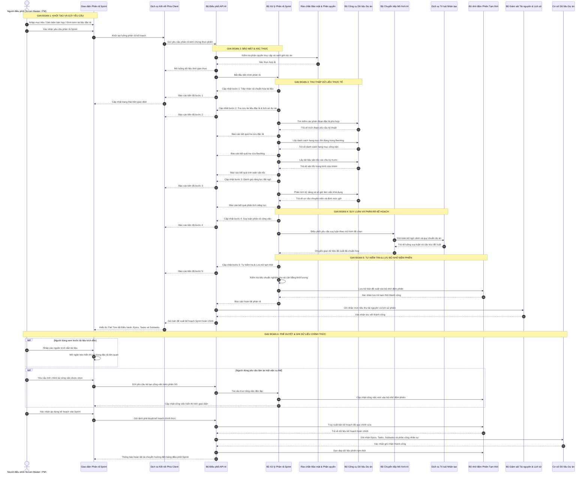

---

## 3. Sơ đồ Hoạt động (Activity Diagram) của Pipeline 5 bước

Quy trình xử lý nội bộ của [`AiSprintDecompositionService.cs`](file:///c:/Users/hoang/Downloads/ProjectMgmt/ProjectMgmt.Solution/Services/Ai/AiSprintDecompositionService.cs) được mô hình hóa theo sơ đồ hoạt động chặt chẽ dưới đây:

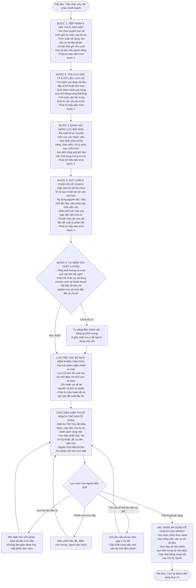

---

## 4. Giao thức Server-Sent Events (SSE) & Cơ chế Truyền dữ liệu Thời gian thực

### 4.1. Tại sao lựa chọn Server-Sent Events (SSE) thay vì WebSocket hay Polling?
Trong tác vụ AI Agent suy luận dài (từ 5 đến 45 giây tùy quy mô tài liệu):
- **Short/Long Polling**: Tạo áp lực cực lớn lên Web Server do gửi hàng chục HTTP request thừa thãi, gây lãng phí tài nguyên và độ trễ cao.
- **WebSocket**: Quá phức tạp cho tác vụ một chiều (server truyền tiến trình về client), đòi hỏi duy trì kết nối TCP song công toàn phần (Full-duplex) và dễ bị proxy/firewall doanh nghiệp chặn.
- **Server-Sent Events (SSE - `text/event-stream`)**: Chuẩn HTTP/1.1 và HTTP/2 gốc của trình duyệt, truyền tải một chiều nhẹ nhàng, hỗ trợ streaming văn bản mượt mà, vượt qua tường lửa dễ dàng và tích hợp sẵn cơ chế auto-reconnect.

### 4.2. Cấu trúc Message SSE được chuẩn hóa trong API
Mỗi gói tin SSE phát đi từ [`AiAgentController.cs`](file:///c:/Users/hoang/Downloads/ProjectMgmt/ProjectMgmt.Solution/Controllers/AiAgentController.cs) tuân theo định dạng:

```http
HTTP/1.1 200 OK
Content-Type: text/event-stream
Cache-Control: no-cache
Connection: keep-alive
Transfer-Encoding: chunked

data: {"type":"step","step":1,"title":"Tiếp nhận & Guardrail tài liệu","status":"completed"}

data: {"type":"tool","name":"SpecHubTools.SearchRelevantSpecs","latencyMs":7,"summary":"Tìm thấy 3 phân đoạn trong Cam-nang-ky-thuat.md"}

data: {"type":"tool","name":"BacklogTools.GetBacklogStories","latencyMs":13,"summary":"Lấy 8 User Stories đang chờ xử lý"}

data: {"type":"tool","name":"SprintTools.GetSprintHistoryAndVelocity","latencyMs":37,"summary":"Vận tốc trung bình 3 Sprint gần nhất: 32 SP"}

data: {"type":"tool","name":"TeamTools.GetTeamDevCapacities","latencyMs":25,"summary":"3 Lập trình viên, tổng dung lượng: 120 giờ"}

data: {"type":"step","step":4,"title":"Mô hình AI đang suy luận cấu trúc Sprint, chia nhỏ Epic và Task...","status":"running"}

data: {"type":"proposal","stagingId":"a8f3b2e1-4c5d-6e7f-8a9b-0c1d2e3f4a5b","payload":{...}}

data: {"type":"done"}
```

### 4.3. Cơ chế Tự động Làm mới Access Token (JWT Token Auto-Refresh on 401)
Khi phiên làm việc kéo dài, JWT Access Token có thể hết hạn ngay trong lúc người dùng đang thao tác. Angular Service [`ai-agent.service.ts`](file:///c:/Users/hoang/Downloads/ProjectMgmt/frontend/projectmgmt-web/src/app/core/services/ai-agent.service.ts) được trang bị cơ chế tự phục hồi thông minh:
1. Khi request SSE nhận HTTP status `401 Unauthorized`, interceptor hoặc hàm streaming bắt lỗi ngay lập tức.
2. Tự động kích hoạt luồng gọi `AuthService.refreshToken()` bằng Refresh Token lưu an toàn.
3. Nhận Access Token mới và tự động mở lại kết nối stream mà không ngắt quãng trải nghiệm của người dùng.

### 4.4. Phân Tách Tuyệt Đối Luồng Tư Duy (Native Thoughts) và Dữ Liệu Nội Dung (Clean Content Streaming)
Một vấn đề thường gặp ở các hệ thống AI phân rã công việc là luồng streaming trả về cấu trúc JSON bị "xả thô" (raw dump) các đoạn ngoặc nhọn `{ "storyPoints": 2, ... }` vào hộp hiển thị suy luận tư duy (Chain-of-Thought) của người dùng, gây rối mắt và làm giảm chất lượng trải nghiệm.

Hệ thống giải quyết triệt để thông qua bộ phân tách loại chunk trong [`AiSprintDecompositionService.cs`](file:///c:/Users/hoang/Downloads/ProjectMgmt/ProjectMgmt.Solution/Services/Ai/AiSprintDecompositionService.cs):
- **Chunk suy luận (`AiStreamChunkType.Thought`)**: Được chuyển tiếp trực tiếp vào `onThoughtDelta(chunk.DeltaThought)` để người dùng đọc được từng bước suy nghĩ tự nhiên của mô hình.
- **Chunk nội dung (`AiStreamChunkType.Content`)**: Chỉ được nối vào bộ đệm nội bộ `responseContentBuilder.Append(chunk.DeltaContent)`, **tuyệt đối không gửi vào `onThoughtDelta`**.
- Nếu mô hình không hỗ trợ Native Thinking, hệ thống tự động phát luồng suy luận tổng hợp (Synthesized Thought Milestones) bằng tiếng Việt mạch lạc, giúp người dùng nắm bắt tiến trình mà không thấy code thô.

---

## 5. Danh mục Tệp Mã Nguồn Tham Chiếu Chuyên Đề 2

| Thành phần | Vai trò kỹ thuật | Liên kết mã nguồn |
| :--- | :--- | :--- |
| **AiAgentController** | Tiếp nhận SSE, điều phối stream, tái tạo task và commit staging | [`AiAgentController.cs`](file:///c:/Users/hoang/Downloads/ProjectMgmt/ProjectMgmt.Solution/Controllers/AiAgentController.cs#L25-L160) |
| **AiSprintDecompositionService** | Pipeline 5 bước thực thi Agentic Workflow, prompt engineering | [`AiSprintDecompositionService.cs`](file:///c:/Users/hoang/Downloads/ProjectMgmt/ProjectMgmt.Solution/Services/Ai/AiSprintDecompositionService.cs#L45-L250) |
| **AiTokenUsageTracker** | Ghi nhận token, latency và lịch sử các phiên phân tách | [`AiTokenUsageTracker.cs`](file:///c:/Users/hoang/Downloads/ProjectMgmt/ProjectMgmt.Solution/Services/Ai/AiTokenUsageTracker.cs) |
| **MultiProviderAiModelClient** | Router gọi API mô hình ngoài (Gemini, Claude, OpenAI) | [`MultiProviderAiModelClient.cs`](file:///c:/Users/hoang/Downloads/ProjectMgmt/ProjectMgmt.Solution/Services/Ai/MultiProviderAiModelClient.cs#L25-L120) |
| **SpecHubTools** | Công cụ trích xuất đặc tả yêu cầu phục vụ Grounding | [`SpecHubTools.cs`](file:///c:/Users/hoang/Downloads/ProjectMgmt/ProjectMgmt.Solution/McpServers/SpecHubTools.cs#L15-L80) |
| **ai-agent.service.ts** | Xử lý EventSource, đọc SSE stream theo từng chunk JSON | [`ai-agent.service.ts`](file:///c:/Users/hoang/Downloads/ProjectMgmt/frontend/projectmgmt-web/src/app/core/services/ai-agent.service.ts#L40-L150) |
| **ai-decompose-modal.ts** | Render giao diện tiến trình 5 bước, bảng công việc đề xuất | [`ai-decompose-modal.ts`](file:///c:/Users/hoang/Downloads/ProjectMgmt/frontend/projectmgmt-web/src/app/features/backlog/components/ai-decompose-modal/ai-decompose-modal.ts#L80-L280) |


---

# Phần IV: CHUYÊN ĐỀ 3: CƠ CHẾ TRÍ NHỚ ĐA TẦNG & BỘ NHỚ ĐỆM PHÂN TÁN

---

## 1. Bản chất & Phân loại Trí nhớ AI trong Hệ thống
Trong kỹ thuật phần mềm tích hợp AI, một Agent thông minh không thể chỉ tồn tại dưới dạng "Stateless" (không lưu trạng thái). Nếu không có cơ chế trí nhớ, Agent sẽ quên sạch ngữ cảnh ngay sau khi hoàn thành một lượt suy luận, không thể duy trì phiên hội thoại để người dùng chỉnh sửa, và có nguy cơ ghi dữ liệu rác trực tiếp vào cơ sở dữ liệu sản xuất.

Dự án thiết kế một **Kiến trúc Trí nhớ 4 Tầng Đa Cấp (Four-Tier AI Memory Architecture)**:

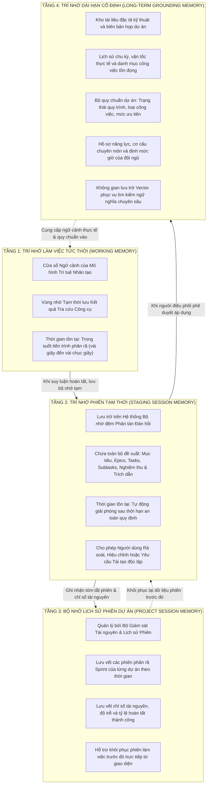

---

## 2. Sơ đồ Hoạt động của Chức năng Trí nhớ Redis (Memory Context Flowchart)

Sơ đồ dưới đây minh họa chi tiết cách dữ liệu đề xuất AI được ghi, đọc, cập nhật cục bộ và giải phóng trên Redis thông qua cơ chế bọc đàn hồi (Resilient Wrapper):

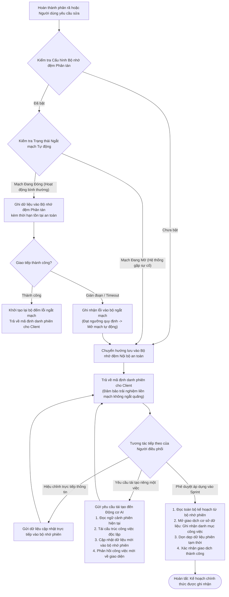

---

## 3. Cấu trúc Khóa, Định dạng Lưu trữ & Thời gian Sống (TTL)

### 3.1. Cấu trúc Khóa Redis (Keyspace Convention)
Khóa được định danh theo tiền tố cấu hình (`InstanceName = "ProjectMgmt:Ai:"`) kết hợp định danh phiên ngẫu nhiên (Session Guid):

```text
ProjectMgmt:Ai:staging:{stagingGuid}
```
*Ví dụ thực tế:*
`ProjectMgmt:Ai:staging:e7c4f1a2-8b3d-4e9a-9c12-3456789abcde`

### 3.2. Cấu trúc Payload JSON Lưu trữ
Toàn bộ đề xuất phân rã được tuần tự hóa (serialize) thành chuỗi JSON tối ưu, chứa đầy đủ ngữ cảnh nghiệp vụ Scrum:

```json
{
  "stagingId": "e7c4f1a2-8b3d-4e9a-9c12-3456789abcde",
  "projectId": 12,
  "sprintId": 5,
  "sprintGoal": "Xây dựng lõi xác thực đa yếu tố và đồng bộ dữ liệu thời gian thực cho hệ thống",
  "suggestedSprintName": "Sprint 5 - Bảo mật & Realtime Engine",
  "targetVelocity": 32,
  "totalStoryPoints": 28,
  "epics": [
    {
      "id": "epic-1",
      "title": "Hệ thống Xác thực Nâng cao & Phân quyền RBAC",
      "description": "Bao gồm đăng nhập, cấp JWT và phân quyền theo cấp bậc Scrum",
      "color": "#3B82F6"
    }
  ],
  "tasks": [
    {
      "id": "task-1",
      "epicId": "epic-1",
      "title": "Thiết kế Middleware kiểm tra quyền theo cấp bậc Scrum",
      "description": "Ngăn chặn vượt cấp từ Developer/QA lên cấp quản lý",
      "storyPoints": 3,
      "estimatedHours": 8,
      "assignedUserId": "u-dev-01",
      "assignedUserName": "Lê Văn A (Backend)",
      "status": "Ready",
      "tags": ["Security", "Middleware", "RBAC"],
      "citations": [
        "Tài liệu Spec Hub: Cam-nang-ky-thuat.md - Mục 4.1",
        "Ghi chú cuộc họp: Biên bản họp Sprint Planning - Đoạn 2"
      ],
      "subtasks": []
    },
    {
      "id": "task-2",
      "epicId": "epic-1",
      "title": "Tích hợp giao thức Server-Sent Events cho luồng AI Stream",
      "description": "Xử lý kết nối streaming một chiều, reconnect và tự động refresh token khi nhận 401",
      "storyPoints": 5,
      "estimatedHours": 16,
      "assignedUserId": "u-dev-02",
      "assignedUserName": "Nguyễn Thị B (Frontend)",
      "status": "Ready",
      "tags": ["SSE", "Realtime", "Auth"],
      "citations": [
        "Tài liệu Spec Hub: Kien-truc-realtime.docx - Trang 12"
      ],
      "subtasks": [
        {
          "id": "subtask-2-1",
          "title": "Cấu hình Controller phát event-stream trong .NET 8",
          "role": "Backend",
          "estimatedHours": 6,
          "storyPoints": 2,
          "priority": "High",
          "status": "To Do",
          "acceptanceCriteria": [
            "Controller trả về text/event-stream chuẩn SSE",
            "Đóng kết nối an toàn khi Client disconnect"
          ],
          "documentCitations": [
            "Tài liệu Spec Hub: Kien-truc-realtime.docx - Trang 12"
          ]
        },
        {
          "id": "subtask-2-2",
          "title": "Xây dựng Angular Service bắt lỗi 401 và gọi Refresh Token",
          "role": "Frontend",
          "estimatedHours": 6,
          "storyPoints": 2,
          "priority": "High",
          "status": "To Do",
          "acceptanceCriteria": [
            "Interceptor bắt lỗi 401 và gọi Refresh Token tự động",
            "Kết nối stream được mở lại không làm mất phiên"
          ],
          "documentCitations": [
            "Tài liệu Spec Hub: Kien-truc-realtime.docx - Trang 12"
          ]
        },
        {
          "id": "subtask-2-3",
          "title": "Viết kiểm thử tự động giả lập mất mạng đột ngột",
          "role": "QA",
          "estimatedHours": 4,
          "storyPoints": 1,
          "priority": "Medium",
          "status": "To Do",
          "acceptanceCriteria": [
            "Kịch bản kiểm thử giả lập ngắt mạng và tự kết nối lại",
            "Không phát sinh ngoại lệ chưa được xử lý"
          ],
          "documentCitations": [
            "Tài liệu Spec Hub: Kien-truc-realtime.docx - Trang 12"
          ]
        }
      ]
    }
  ],
  "warnings": [
    "Tổng Story Points (28 SP) nằm trong ngưỡng an toàn so với vận tốc trung bình (32 SP)."
  ],
  "createdAt": "2026-11-11T00:15:30Z",
  "expiresAt": "2026-11-12T00:15:30Z"
}
```

### 3.3. Thời gian Sống (TTL) & Chính sách Giải phóng (Eviction Policy)
- **TTL Mặc định**: `24 giờ` (`TimeSpan.FromHours(24)`).
- **Lý do thiết kế**: Đủ dài để Scrum Master đóng laptop, trao đổi nội bộ với nhóm và quay lại duyệt vào ngày hôm sau mà không bị mất dữ liệu; đồng thời tự động biến mất sau 24h để giải phóng dung lượng RAM của Redis.
- **Xóa chủ động (Explicit Invalidation)**: Khi người dùng bấm **"Áp dụng vào Sprint"** hoặc **"Hủy bỏ"**, phương thức `RemoveAsync(key)` được gọi để thu hồi bộ nhớ ngay lập tức.

---

## 4. Kiến trúc Chống Sập & Khả năng Phục hồi Cao (Resilience & Circuit Breaker)

Dự án áp dụng mẫu thiết kế **Composite Provider kết hợp Circuit Breaker** trong [`ResilientStateStagingService.cs`](file:///c:/Users/hoang/Downloads/ProjectMgmt/ProjectMgmt.Core/Staging/ResilientStateStagingService.cs):

```csharp
// ProjectMgmt.Core/Staging/ResilientStateStagingService.cs
public async Task SaveProposalAsync<T>(string sessionId, T proposal, TimeSpan ttl, CancellationToken ct = default)
{
    if (!_redisEnabled || _primaryProvider == null)
    {
        await _memoryFallback.SaveProposalAsync(sessionId, proposal, ttl, ct).ConfigureAwait(false);
        return;
    }

    var json = JsonSerializer.Serialize(proposal, _jsonOptions);

    await _circuitBreaker.ExecuteWithFallbackAsync(
        primaryAction: async token =>
        {
            await _primaryProvider.SetAsync(sessionId, json, ttl, token).ConfigureAwait(false);
        },
        fallbackAction: async token =>
        {
            await _memoryFallback.SaveProposalAsync(sessionId, proposal, ttl, token).ConfigureAwait(false);
        },
        ct: ct,
        onFallback: (reason, ex) =>
        {
            _logger.LogWarning(ex, "[ResilientStaging] {Reason} SessionId={SessionId}", reason, sessionId);
        }).ConfigureAwait(false);
}
```

### Các trạng thái của Circuit Breaker:
1. **Closed (Bình thường)**: Mọi yêu cầu ghi/đọc đều đi vào Redis.
2. **Open (Ngắt mạch)**: Nếu Redis gặp lỗi 3 lần liên tiếp (do mạng chậm quá 2000ms hoặc server Redis tắt), mạch tự động mở trong **60 giây**. Trong thời gian này, mọi thao tác chuyển hướng trực tiếp sang RAM (`MemoryStateStagingService`) mà **không hề gửi request đến Redis**, loại bỏ hoàn toàn độ trễ chờ đợi cho người dùng.
3. **Half-Open (Thử nghiệm hồi phục)**: Sau 60 giây, hệ thống cho phép 1 request đi thử vào Redis. Nếu thành công, mạch đóng lại bình thường; nếu thất bại, mạch tiếp tục mở thêm 60 giây.

---

## 5. Hướng dẫn Kiểm tra & Chứng minh Trí nhớ Redis (Verification Guide)

### 5.1. Kiểm tra Dịch vụ Redis Đang Chạy
Mở PowerShell trên máy tính chủ và thực hiện kiểm tra port kết nối:

```powershell
# Kiểm tra port 6379 đang lắng nghe
Test-NetConnection -ComputerName 127.0.0.1 -Port 6379
# Kết quả: TcpTestSucceeded : True

# Kiểm tra tiến trình redis-server trên Windows Task Manager
Get-Process -Name *redis*
```

### 5.2. Kiểm tra Dữ liệu Staging trong Redis CLI
Khi AI vừa phân rã xong một Sprint trên giao diện, mở terminal Redis CLI để tra cứu dữ liệu thực tế:

```bash
# 1. Kết nối vào Redis CLI cục bộ
redis-cli -h 127.0.0.1 -p 6379

# 2. Kiểm tra kết nối
127.0.0.1:6379> PING
PONG

# 3. Liệt kê các khóa Staging đang được AI lưu giữ
127.0.0.1:6379> KEYS ProjectMgmt:Ai:staging:*
1) "ProjectMgmt:Ai:staging:e7c4f1a2-8b3d-4e9a-9c12-3456789abcde"

# 4. Kiểm tra thời gian tồn tại còn lại (TTL - tính bằng giây)
127.0.0.1:6379> TTL ProjectMgmt:Ai:staging:e7c4f1a2-8b3d-4e9a-9c12-3456789abcde
(integer) 86340

# 5. Đọc nội dung JSON đề xuất đang được giữ trong trí nhớ
127.0.0.1:6379> GET ProjectMgmt:Ai:staging:e7c4f1a2-8b3d-4e9a-9c12-3456789abcde
"{\"stagingId\":\"e7c4f1a2...\",\"sprintGoal\":\"Xây dựng lõi xác thực...\"}"
```

### 5.3. Chứng minh Tính Độc lập với Cơ sở Dữ liệu
1. **Trước khi bấm "Áp dụng vào Sprint"**: Kiểm tra trong MySQL: bảng `Issues` chưa có bất kỳ bản ghi nào mới từ AI. Dữ liệu chỉ tồn tại duy nhất trên Redis (`ProjectMgmt:Ai:staging:*`).
2. **Sau khi bấm "Áp dụng vào Sprint"**: 
   - MySQL ghi nhận các Issue mới kèm SprintId tương ứng.
   - Kiểm tra lại Redis CLI: Khóa `ProjectMgmt:Ai:staging:...` đã bị xóa tự động (`nil`).

---

## 6. Bộ Nhớ Lịch Sử Phiên & Quản Trị Tiêu Thụ Token (Cross-Session Project Memory & Token Analytics)

Bên cạnh bộ nhớ đề xuất tức thời (Staging Session), hệ thống được trang bị hệ thống quản trị phiên làm việc và đo lường tài nguyên AI độc lập thông qua giao diện [`IAiTokenUsageTracker`](file:///c:/Users/hoang/Downloads/ProjectMgmt/ProjectMgmt.Solution/Services/Ai/IAiTokenUsageTracker.cs) và lớp triển khai [`AiTokenUsageTracker`](file:///c:/Users/hoang/Downloads/ProjectMgmt/ProjectMgmt.Solution/Services/Ai/AiTokenUsageTracker.cs):

### 6.1. Quản lý Lịch sử Phiên Phân rã Dự án (Project Session Memory)
- **Cơ chế hoạt động**: Mỗi khi một lượt phân rã Sprint hoàn tất, hệ thống tự động ghi nhận bản tóm tắt phiên [`AiSessionSummary`](file:///c:/Users/hoang/Downloads/ProjectMgmt/ProjectMgmt.Solution/Services/Ai/IAiTokenUsageTracker.cs) gồm: `SessionId`, `ProjectId`, `SprintGoal`, `TaskCount`, `TotalStoryPoints`, `Model`, `CreatedByName`, `CreatedAtUtc`.
- **Khôi phục phiên làm việc cũ (Session History Restore)**:
  - Trên thanh tiêu đề của Modal AI có biểu tượng **Lịch sử phiên (đồng hồ)**.
  - Khi nhấp vào, dropdown hiển thị danh sách các phiên phân tách gần nhất trong dự án từ API `GET /api/ai/agent/sessions?projectId=...`.
  - Nhấp vào phiên bất kỳ để khôi phục toàn bộ bản kế hoạch đề xuất từ Staging Cache (`GET /api/ai/agent/proposal/{sessionId}`) mà không cần chạy lại mô hình LLM từ đầu.

### 6.2. Đo lường & Giám sát Tiêu thụ Token (Token Consumption Management)
- **Bộ ghi nhận mức tiêu thụ**: Ghi nhận `AiUsageRecord` theo từng phiên làm việc (Prompt Tokens, Completion Tokens, Latency mili-giây, Model, trạng thái Success/Failed).
- **Dashboard Quản trị trên Trang Cá nhân (Profile - Tab "Mức tiêu thụ Token AI")**:
  - **4 Thẻ Chỉ số (KPIs)**: Tổng Token tiêu thụ, Tổng cuộc gọi AI, Tỷ lệ hoàn tất thành công, Chi phí ước tính (USD).
  - **Phân bổ theo Mô hình**: Tỷ lệ phần trăm và số lượng token giữa `Gemini 2.5 Flash`, `Gemini 2.5 Pro`, `Gemini 2.5 Flash-Lite`.
  - **Bảng Nhật ký Thực thi**: Hiển thị chi tiết 15 lượt gọi gần nhất với thời gian thực thi, số token vào/ra và trạng thái.

---

## 7. Danh mục Tệp Mã Nguồn Tham Chiếu Chuyên Đề 3

| Thành phần | Vai trò kỹ thuật | Liên kết mã nguồn |
| :--- | :--- | :--- |
| **StackExchangeRedisStagingProvider** | Adapter kết nối Redis, quản lý connection pool & key operations | [`StackExchangeRedisStagingProvider.cs`](file:///c:/Users/hoang/Downloads/ProjectMgmt/ProjectMgmt.Solution/Services/Ai/Adapters/StackExchangeRedisStagingProvider.cs#L8-L115) |
| **ResilientStateStagingService** | Wrapper chống sập, điều phối Redis và In-Memory fallback | [`ResilientStateStagingService.cs`](file:///c:/Users/hoang/Downloads/ProjectMgmt/ProjectMgmt.Core/Staging/ResilientStateStagingService.cs#L15-L110) |
| **MemoryStateStagingService** | Bộ nhớ đệm Fallback lưu trên ConcurrentDictionary của RAM | [`MemoryStateStagingService.cs`](file:///c:/Users/hoang/Downloads/ProjectMgmt/ProjectMgmt.Core/Staging/MemoryStateStagingService.cs#L10-L60) |
| **AiTokenUsageTracker** | Quản lý lịch sử phiên dự án và đo lường tiêu thụ token AI | [`AiTokenUsageTracker.cs`](file:///c:/Users/hoang/Downloads/ProjectMgmt/ProjectMgmt.Solution/Services/Ai/AiTokenUsageTracker.cs) |
| **IAiTokenUsageTracker** | Hợp đồng interface theo dõi token và lịch sử phiên | [`IAiTokenUsageTracker.cs`](file:///c:/Users/hoang/Downloads/ProjectMgmt/ProjectMgmt.Solution/Services/Ai/IAiTokenUsageTracker.cs) |
| **CircuitBreakerPolicy** | Thuật toán ngắt mạch bảo vệ hệ thống khi Redis gián đoạn | [`CircuitBreakerPolicy.cs`](file:///c:/Users/hoang/Downloads/ProjectMgmt/ProjectMgmt.Core/Resilience/CircuitBreakerPolicy.cs#L10-L70) |
| **ProfilePageComponent** | Dashboard giám sát Token AI trên giao diện người dùng | [`profile-page.html`](file:///c:/Users/hoang/Downloads/ProjectMgmt/frontend/projectmgmt-web/src/app/features/identity/profile-page.html) |
| **Cấu hình Redis** | Khai báo Host, Port, Database, InstanceName | [`appsettings.json`](file:///c:/Users/hoang/Downloads/ProjectMgmt/ProjectMgmt.Solution/appsettings.json#L40-L55) |


---

# Phần V: CHUYÊN ĐỀ 4: CƠ CHẾ RAG & GROUNDING VỚI KHO TÀI LIỆU ĐẶC TẢ

---

## 1. Khái niệm RAG & Giải quyết Triệt để Ảo giác (Hallucination)

### 1.1. Hiện tượng Ảo giác trong Mô hình Ngôn ngữ Lớn (LLM)
Khi yêu cầu một mô hình AI thông thường (Zero-shot Prompting) lập kế hoạch cho một Sprint, AI thường mắc phải các lỗi nghiêm trọng:
- Tự "bịa" ra các thư viện công nghệ không có trong dự án (ví dụ: dự án dùng Angular và .NET 8, nhưng AI lại sinh task cấu hình React và Django).
- Đặt tiêu chí nghiệm thu chung chung, không gắn liền với các ràng buộc bảo mật hay quy tắc nghiệp vụ nội bộ của tổ chức.
- Không biết được tiến độ thực tế: việc nào đã làm ở Sprint trước, việc nào còn dở dang.

### 1.2. Giải pháp RAG (Retrieval-Augmented Generation)
**RAG (Tạo sinh có Tăng cường Truy xuất)** là kỹ thuật kết hợp giữa:
1. **Truy xuất thông tin (Information Retrieval)**: Tìm kiếm các đoạn tài liệu đặc tả thực tế (SRS, BRD, ghi chú cuộc họp, bảng phân công) từ kho lưu trữ dự án.
2. **Tăng cường ngữ cảnh (Augmented Context)**: Nạp các đoạn trích này vào câu lệnh chỉ đạo (System/User Prompt) của AI.
3. **Tạo sinh có căn cứ (Grounded Generation)**: Buộc mô hình AI chỉ được phép lập luận và phân rã công việc dựa trên các sự thật đã được kiểm chứng.

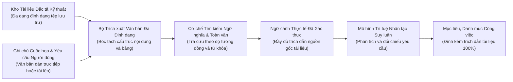

---

## 2. Bộ Trích xuất Văn bản Vạn năng (AiDocumentTextExtractor)

Để phục vụ RAG đa định dạng, lớp [`AiDocumentTextExtractor.cs`](file:///c:/Users/hoang/Downloads/ProjectMgmt/ProjectMgmt.Solution/Services/Ai/AiDocumentTextExtractor.cs) xử lý bóc tách nội dung từ tất cả các định dạng tài liệu phổ biến trong môi trường doanh nghiệp:

### 2.1. Sơ đồ Xử lý Đa Định dạng

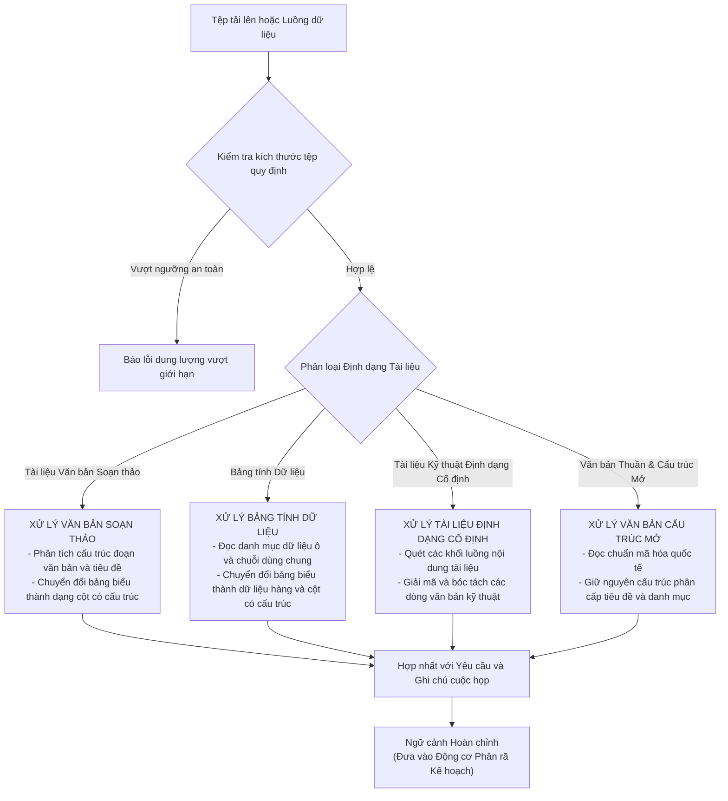

### 2.2. Điểm đặc sắc trong Kỹ thuật Trích xuất:
- **Xử lý tài liệu Word không phụ thuộc Office COM**: Sử dụng thư viện gốc `System.IO.Compression` và LINQ to XML (`System.Xml.Linq`), chạy mượt mà trên cả Linux container và Windows Server mà không cần cài đặt Microsoft Office.
- **Bảo toàn bảng biểu Excel**: Biến các sheet phân công nhân sự, ma trận trách nhiệm RACI thành văn bản có định dạng `Cột A | Cột B | Cột C`, giúp AI hiểu chính xác mối quan hệ giữa người làm và đầu việc.
- **An toàn bộ nhớ**: Giới hạn cứng 30MB và cơ chế stream một chiều ngăn chặn tấn công từ chối dịch vụ (Zip Bomb / OOM Denial of Service).

---

## 3. Kiến trúc Spec Hub & Giao thức Truy vấn MCP

Kho tài liệu đặc tả **Spec Hub** là "kho lưu trữ tri thức" của dự án. Lớp [`SpecHubTools.cs`](file:///c:/Users/hoang/Downloads/ProjectMgmt/ProjectMgmt.Solution/McpServers/SpecHubTools.cs) cung cấp 3 công cụ chuẩn MCP:

1. `spec_hub_list_documents(projectId)`: Quét toàn bộ cây thư mục tài liệu đặc tả của dự án.
2. `spec_hub_read_document(documentId)`: Đọc toàn văn nội dung một tài liệu đã chọn kèm tiêu chí nghiệm thu.
3. `spec_hub_search(projectId, keyword)`: Tìm kiếm toàn văn xuyên suốt mọi tài liệu trong dự án.

### Cơ chế Kết hợp Vector Search (Qdrant) và Fallback:
- Khi cấu hình `Qdrant:Enabled = true`: Hệ thống nhúng (Embed) các đoạn tài liệu thành vector 768 chiều bằng `gemini-embedding-001` và lưu trên Qdrant Vector Database để tìm kiếm theo độ tương đồng ngữ nghĩa (Cosine Similarity).
- Khi cấu hình `Qdrant:Enabled = false`: Hệ thống tự động chuyển sang cơ chế tìm kiếm toàn văn Full-Text Search trong SQL và lọc theo từ khóa, đảm bảo hệ thống hoạt động ổn định trong mọi điều kiện triển khai.

---

## 4. Cơ chế Trích dẫn Nguồn gốc (Citation Grounding) & Trải nghiệm Người dùng

Mỗi Task và Subtask do AI sinh ra bắt buộc phải có thuộc tính `documentCitations` chỉ rõ nguồn gốc xuất xứ từ tài liệu thực tế của dự án:
- Ví dụ: `Cam-nang-ky-thuat.md - Mục Phần II: Đặc tả chức năng và quy tắc nghiệp vụ`
- Ví dụ: `Bản đặc tả về quản lý dự án.txt - Mục 2`
- Ví dụ: `Ghi chú cuộc họp đã nạp - Mục 1: Yêu cầu chính`

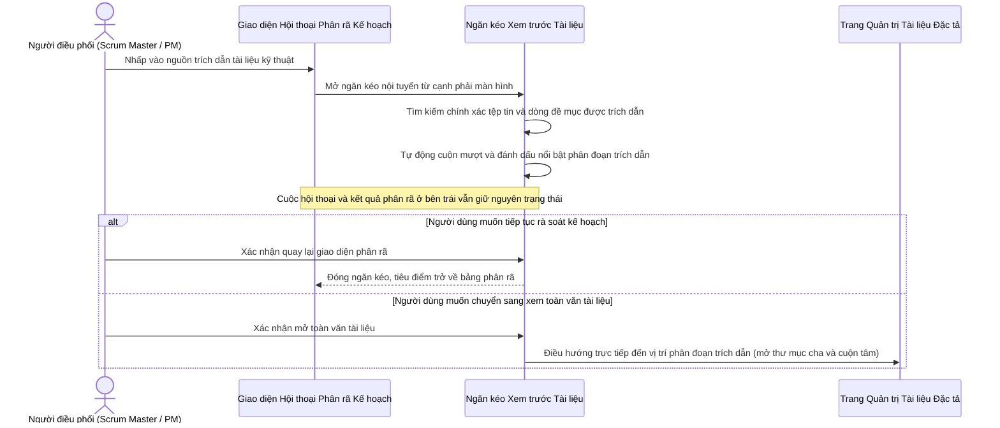

### Lợi ích Trải nghiệm Vượt trội & Thuật toán Xử lý Chính xác:
1. **Thuật toán Tìm kiếm Hai Lớp (Two-Pass Exact-First Traversal)**:
   - **Lớp 1 (Exact Match)**: Quét đệ quy toàn bộ cây thư mục để tìm tệp tin khớp chính xác tên tệp (có hoặc không có phần mở rộng như `.md`, `.txt`, `.docx`, `.xlsx`, `.pdf`). Thuật toán ngăn chặn triệt để hiện tượng tìm kiếm tham lam (greedy match) làm nhầm lẫn tệp tin gốc với các tệp tin chứa tên tương tự ở thư mục con.
   - **Lớp 2 (Partial Fallback)**: Chỉ kích hoạt khi toàn bộ cây thư mục không có tệp nào khớp chính xác, hỗ trợ tìm kiếm từ khóa nổi bật.
2. **Ưu tiên Khớp Dòng Tiêu đề (Deep Section Heading Prioritization)**:
   - Khi tìm kiếm đề mục (ví dụ: `Mục Phần II`), hệ thống phân tích các dòng bắt đầu bằng ký tự tiêu đề Markdown (`#`, `##`, `###`) hoặc in đậm (`**`), tách biệt hoàn toàn với các từ xuất hiện ngẫu nhiên trong nội dung văn bản.
   - Nhờ đó, đề mục `# Phần II. Đặc tả chức năng và quy tắc nghiệp vụ` luôn được ưu tiên chọn tuyệt đối, tránh cuộn nhầm lên các câu văn chứa từ tương tự ở đầu tài liệu.
3. **Đánh dấu Trực quan & Cuộn Mượt Tọa độ Tâm (Smooth Centering & Mark Glow)**:
   - Vị trí trích dẫn được bọc thẻ đánh dấu `<mark id="spec-target-highlight" class="spec-highlight-mark">` với viền sáng vàng hổ phách và hiệu ứng phát quang động.
   - Hàm `scrollIntoView({ behavior: 'smooth', block: 'center' })` đưa phân đoạn trích dẫn vào chính giữa tầm mắt người dùng, loại bỏ hoàn toàn việc ước tính số dòng sai lệch.
4. **Mở rộng Thư mục Cha Tự động (Ancestor Folder Auto-Expansion)**:
   - Khi chuyển hướng sang trang Spec Hub toàn màn hình, hệ thống tự động thu thập danh sách toàn bộ thư mục cha và kích hoạt mở rộng trên cây thư mục, giúp người dùng nhận diện ngay phân cấp tài liệu.
5. **Bảo tồn Ngữ cảnh Ghi chú Phiên làm việc**:
   - Trường hợp trích dẫn bắt nguồn từ biên bản cuộc họp hoặc yêu cầu người dùng dán vào, ngăn kéo nội tuyến hiển thị văn bản ghi chú với đầy đủ tính năng tìm kiếm và cuộn mượt.

---

## 5. Hướng dẫn Thực nghiệm & Kiểm chứng RAG Grounding

### 5.1. Kiểm tra Độ trễ (Latency) & Trạng thái Công Cụ trên Giao diện
Khi AI bắt đầu suy luận, giao diện hiển thị danh sách các hành động với biểu tượng `check_circle` xanh lục chuẩn xác và thời gian thực thi (latency ms):
- `Tìm kiếm tài liệu đặc tả liên quan trong Spec Hub · 7ms`
- `Đọc phân đoạn tài liệu đặc tả: Cam-nang-ky-thuat.md · 14ms`
- `Lấy danh sách các User Story đang có trong Backlog · 13ms`
- `Truy xuất vận tốc Scrum và các hạng mục dở dang · 37ms`
- `Phân tích kỹ năng và số giờ khả dụng của thành viên đội Scrum · 25ms`

### 5.2. Kiểm tra Tính Xác thực của Nguồn Trích dẫn & Điều Hướng Phân Đoạn
1. Tải lên hoặc tạo một tệp tài liệu đặc tả trong Spec Hub (ví dụ: `Cam-nang-ky-thuat.md` chứa đề mục `Phần II: Xử lý ngữ cảnh AI Engine`).
2. Gõ yêu cầu phân rã Sprint hoặc phân tích kế hoạch.
3. Quan sát kết quả đề xuất:
   - Các task sinh ra có nhãn tài liệu trích dẫn đúng định dạng `Tài liệu Spec Hub: Cam-nang-ky-thuat.md - Phần II`.
   - Nhấp vào nhãn trích dẫn: Drawer nội tuyến mở ra, hiển thị tiêu đề, vị trí trích dẫn và nội dung đặc tả.
   - Nhấp vào nút "Mở trang Spec Hub": Trình duyệt mở tab Spec Hub với đầy đủ tham số `?docId=...&docName=...&section=...`. Hệ thống tự động mở tab tài liệu, cuộn mượt đến đề mục `Phần II` và kích hoạt hiệu ứng viền vàng nổi bật.
   - Nhấp "Quay lại đoạn chat": Hệ thống quay trở lại giao diện phân rã Sprint nguyên vẹn.

---

## 6. Danh mục Tệp Mã Nguồn Tham Chiếu Chuyên Đề 4

| Thành phần | Vai trò kỹ thuật | Liên kết mã nguồn |
| :--- | :--- | :--- |
| **AiDocumentTextExtractor** | Trích xuất toàn văn từ Word, Excel, PDF, Markdown, Text | [`AiDocumentTextExtractor.cs`](file:///c:/Users/hoang/Downloads/ProjectMgmt/ProjectMgmt.Solution/Services/Ai/AiDocumentTextExtractor.cs#L10-L120) |
| **SpecHubTools** | Các MCP tool tra cứu tài liệu đặc tả trong Spec Hub | [`SpecHubTools.cs`](file:///c:/Users/hoang/Downloads/ProjectMgmt/ProjectMgmt.Solution/McpServers/SpecHubTools.cs#L45-L100) |
| **ai-decompose-modal.html** | Template giao diện Drawer nội tuyến xem trước tài liệu trích dẫn | [`ai-decompose-modal.html`](file:///c:/Users/hoang/Downloads/ProjectMgmt/frontend/projectmgmt-web/src/app/features/backlog/components/ai-decompose-modal/ai-decompose-modal.html#L380-L450) |
| **ai-decompose-modal.ts** | Điều khiển mở/đóng drawer xem tài liệu, deep link sang Spec Hub | [`ai-decompose-modal.ts`](file:///c:/Users/hoang/Downloads/ProjectMgmt/frontend/projectmgmt-web/src/app/features/backlog/components/ai-decompose-modal/ai-decompose-modal.ts#L450-L520) |
| **spec-hub-page.ts** | Đón nhận queryParams (docId, section) để cuộn đến đúng vị trí | [`spec-hub-page.ts`](file:///c:/Users/hoang/Downloads/ProjectMgmt/frontend/projectmgmt-web/src/app/features/spec-hub/spec-hub-page.ts#L35-L65) |


---

# Phần VI: CHUYÊN ĐỀ 5: KIẾN TRÚC GIAO THỨC MCP VÀ CÁC CÔNG CỤ TÍCH HỢP

---

## 1. Bản chất Chuẩn Model Context Protocol (MCP)

### 1.1. Model Context Protocol (MCP) là gì?
**Model Context Protocol (MCP)** là chuẩn giao thức công nghiệp mở (Open Protocol) sử dụng cơ chế truyền tin **JSON-RPC 2.0**. Giao thức này đóng vai trò như một "cổng cắm USB-C" phổ quát, cho phép các mô hình trí tuệ nhân tạo (LLM / AI Agents) kết nối an toàn và truy xuất dữ liệu từ các hệ thống phần mềm nghiệp vụ (Database, File System, Git, API) mà không cần viết mã kết nối riêng cho từng mô hình.

### 1.2. Tại sao Dự án áp dụng Chuẩn MCP?
1. **Chuẩn hóa công cụ (Tool Standardisation)**: Mọi công cụ AI trong dự án đều có lược đồ tham số (`inputSchema`) định dạng JSON Schema rõ ràng, giúp AI tự hiểu cách gọi hàm với xác suất chính xác 100%.
2. **Kiến trúc Lưỡng hình (Dual-Form Deployment)**:
   - **Hình thái In-Process**: Chạy trực tiếp trong tiến trình ASP.NET Core để phục vụ người dùng trên Web với độ trễ cực thấp (mili-giây).
   - **Hình thái Standalone Stdio**: Chạy dưới dạng tiến trình Console độc lập, cho phép các Agent bên ngoài (Claude Desktop, Cursor IDE, Roo Code, Gemini CLI) kết nối và thao tác với dự án qua luồng Stdio.

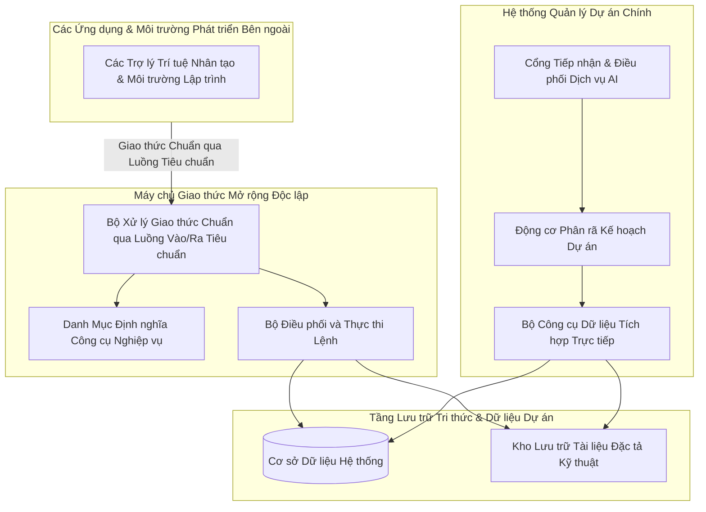

---

## 2. Danh mục Chi tiết Toàn bộ Hệ thống MCP Tools

Hệ thống cung cấp 7 công cụ cốt lõi phục vụ lập kế hoạch và phân rã Sprint:

### 2.1. Bảng Tổng Hợp Thông Số & Chức Năng

| Tên Công Cụ (Tool Name) | Tham Số Đầu Vào (Input Schema) | Dữ Liệu Trả Về (Return Model) | Tệp Mã Nguồn Triển Khai |
| :--- | :--- | :--- | :--- |
| **spec_hub_list_documents** | `projectId` (string, required) | Danh sách cây thư mục, tên file, định dạng (.docx, .pdf, .xlsx, .md) và kích thước tệp | [`SpecHubTools.cs`](file:///c:/Users/hoang/Downloads/ProjectMgmt/ProjectMgmt.Solution/McpServers/SpecHubTools.cs#L45-L66) |
| **spec_hub_read_document** | `documentId` (string, required) | Toàn văn nội dung tài liệu đã bóc tách, tiêu chí nghiệm thu (AC) và bảng biểu | [`SpecHubTools.cs`](file:///c:/Users/hoang/Downloads/ProjectMgmt/ProjectMgmt.Solution/McpServers/SpecHubTools.cs#L67-L83) |
| **spec_hub_search** | `projectId` (string), `keyword` (string) | Các phân đoạn văn bản khớp từ khóa, tên file gốc và chỉ số tương đồng | [`SpecHubTools.cs`](file:///c:/Users/hoang/Downloads/ProjectMgmt/ProjectMgmt.Solution/McpServers/SpecHubTools.cs#L84-L98) |
| **backlog_get_stories** | `projectId` (string, required) | Danh sách User Stories Backlog: ID, Tiêu đề, Mô tả, Story Points, Độ ưu tiên | [`BacklogTools.cs`](file:///c:/Users/hoang/Downloads/ProjectMgmt/ProjectMgmt.Solution/McpServers/BacklogTools.cs#L40-L75) |
| **sprint_get_history_and_velocity** | `projectId` (string, required) | Vận tốc trung bình (Velocity), các User Story dở dang bị rollover, danh sách bug tồn đọng | [`SprintTools.cs`](file:///c:/Users/hoang/Downloads/ProjectMgmt/ProjectMgmt.Solution/McpServers/SprintTools.cs#L35-L70) |
| **team_get_dev_capacities** | `projectId` (string, required) | Danh sách kỹ sư (Developers, QA), chuyên môn (Frontend, Backend, Tester), số giờ khả dụng | [`TeamTools.cs`](file:///c:/Users/hoang/Downloads/ProjectMgmt/ProjectMgmt.Solution/McpServers/TeamTools.cs#L35-L70) |
| **ai_sprint_plan_propose** | `projectId` (string), `meetingNotes` (string), `targetStoryIds` (array) | Đề xuất Sprint Goal, Epics, Tasks độc lập (1-3 SP) hoặc kèm Subtasks ($\ge 5$ SP), trích dẫn tài liệu | [`Program.cs`](file:///c:/Users/hoang/Downloads/ProjectMgmt/ProjectMgmt.McpServer/Program.cs#L265-L287) |

---

## 3. Chi Tiết Lược Đồ Tham Số JSON-RPC (Schema Specifications)

### 3.1. Tool: `spec_hub_search`
- **Mục đích**: Tìm kiếm quy tắc nghiệp vụ hoặc kiến trúc xuyên suốt kho tài liệu.
- **Request JSON-RPC mẫu**:
```json
{
  "jsonrpc": "2.0",
  "id": 1,
  "method": "tools/call",
  "params": {
    "name": "spec_hub_search",
    "arguments": {
      "projectId": "12",
      "keyword": "quy định xác thực JWT và refresh token"
    }
  }
}
```
- **Response JSON-RPC mẫu**:
```json
{
  "jsonrpc": "2.0",
  "id": 1,
  "result": {
    "content": [
      {
        "type": "text",
        "text": "Tìm thấy 2 phân đoạn trong tài liệu 'Cam-nang-ky-thuat.md':\n- Mục 3.2: Access Token có thời hạn 15 phút, Refresh Token có thời hạn 30 ngày.\n- Mục 3.3: Thuật toán mã hóa HMAC-SHA256, khóa ký tối thiểu 32 bytes."
      }
    ]
  }
}
```

### 3.2. Tool: `team_get_dev_capacities`
- **Mục đích**: Cung cấp số liệu chính xác để AI không giao việc quá tải hoặc sai chuyên môn.
- **Request JSON-RPC mẫu**:
```json
{
  "jsonrpc": "2.0",
  "id": 2,
  "method": "tools/call",
  "params": {
    "name": "team_get_dev_capacities",
    "arguments": {
      "projectId": "12"
    }
  }
}
```
- **Response JSON-RPC mẫu**:
```json
{
  "jsonrpc": "2.0",
  "id": 2,
  "result": {
    "content": [
      {
        "type": "text",
        "text": "Danh sách nhân sự dự án (Tổng khả dụng: 120 giờ):\n1. Hoàng Văn A - Backend Lead (C#, .NET 8, MySQL) - Khả dụng: 40 giờ\n2. Trần Thị B - Frontend Dev (Angular, TypeScript, SCSS) - Khả dụng: 40 giờ\n3. Lê Văn C - QA / Tester (Playwright, Postman, Automation) - Khả dụng: 40 giờ"
      }
    ]
  }
}
```

---

## 4. Hướng Dẫn Cấu Hình Kết Nối cho AI Agents Bên Ngoài

Máy chủ Stdio MCP Server của dự án được biên dịch tại [`ProjectMgmt.McpServer`](file:///c:/Users/hoang/Downloads/ProjectMgmt/ProjectMgmt.McpServer). Bất kỳ AI Client nào hỗ trợ chuẩn MCP đều có thể kết nối trực tiếp.

### 4.1. Cấu hình cho Claude Desktop
Mở tệp cấu hình của Claude Desktop: `%APPDATA%\Claude\claude_desktop_config.json`:

```json
{
  "mcpServers": {
    "projectmgmt-scrum": {
      "command": "dotnet",
      "args": [
        "run",
        "--project",
        "C:\\Users\\hoang\\Downloads\\ProjectMgmt\\ProjectMgmt.McpServer\\ProjectMgmt.McpServer.csproj"
      ]
    }
  }
}
```

### 4.2. Cấu hình cho Cursor IDE / Roo Code
Thêm vào tệp cấu hình MCP của Cursor / Roo Code (`.cursor/mcp.json`):

```json
{
  "mcpServers": {
    "projectmgmt-ai-planner": {
      "command": "dotnet",
      "args": [
        "C:\\Users\\hoang\\Downloads\\ProjectMgmt\\ProjectMgmt.McpServer\\bin\\Debug\\net8.0\\ProjectMgmt.McpServer.dll"
      ],
      "env": {
        "ASPNETCORE_ENVIRONMENT": "Development"
      }
    }
  }
}
```

---

## 5. Hướng Dẫn Chạy & Kiểm Thử Tương Tác Qua Terminal Stdio

Người dùng hoặc kiểm thử viên có thể chạy trực tiếp MCP Server từ terminal PowerShell để xác minh giao thức JSON-RPC:

### Bước 1: Khởi động Server
```powershell
cd C:\Users\hoang\Downloads\ProjectMgmt\ProjectMgmt.McpServer
dotnet run
```

### Bước 2: Gửi lệnh Khởi tạo (Initialize)
Dán dòng JSON sau vào terminal và nhấn Enter:
```json
{"jsonrpc":"2.0","id":1,"method":"initialize","params":{"protocolVersion":"2024-11-05","capabilities":{},"clientInfo":{"name":"ManualTester","version":"1.0"}}}
```
**Kết quả phản hồi ngay lập tức từ server:**
```json
{"jsonrpc":"2.0","id":1,"result":{"protocolVersion":"2024-11-05","capabilities":{"tools":{}},"serverInfo":{"name":"ProjectMgmt-AiSprintPlanner-McpServer","version":"1.0.0"}}}
```

### Bước 3: Lấy danh sách Công cụ (tools/list)
```json
{"jsonrpc":"2.0","id":2,"method":"tools/list","params":{}}
```
**Kết quả:** Server trả về đầy đủ 7 công cụ kèm inputSchema chuẩn xác.

---

## 6. Danh mục Tệp Mã Nguồn Tham Chiếu Chuyên Đề 5

| Thành phần | Vai trò kỹ thuật | Liên kết mã nguồn |
| :--- | :--- | :--- |
| **ProjectMgmt.McpServer** | Ứng dụng Console phục vụ kết nối JSON-RPC 2.0 Stdio ngoài | [`Program.cs`](file:///c:/Users/hoang/Downloads/ProjectMgmt/ProjectMgmt.McpServer/Program.cs#L20-L150) |
| **SpecHubTools** | Công cụ đọc và tìm kiếm tài liệu đặc tả Spec Hub | [`SpecHubTools.cs`](file:///c:/Users/hoang/Downloads/ProjectMgmt/ProjectMgmt.Solution/McpServers/SpecHubTools.cs#L45-L100) |
| **BacklogTools** | Công cụ truy vấn User Story và độ ưu tiên Backlog | [`BacklogTools.cs`](file:///c:/Users/hoang/Downloads/ProjectMgmt/ProjectMgmt.Solution/McpServers/BacklogTools.cs#L35-L75) |
| **SprintTools** | Công cụ tính toán vận tốc (Velocity) và User Story dở dang | [`SprintTools.cs`](file:///c:/Users/hoang/Downloads/ProjectMgmt/ProjectMgmt.Solution/McpServers/SprintTools.cs#L30-L70) |
| **TeamTools** | Công cụ phân tích hồ sơ chuyên môn và số giờ làm việc | [`TeamTools.cs`](file:///c:/Users/hoang/Downloads/ProjectMgmt/ProjectMgmt.Solution/McpServers/TeamTools.cs#L30-L70) |


---

# Phần VII: CHUYÊN ĐỀ 6: CẨM NANG TRA CỨU & TRẢ LỜI PHẢN BIỆN BẢO VỆ CHUYÊN SÂU

---

## 1. Lời nói đầu & Phương pháp luận Phản biện
Khi bảo vệ đồ án, thẩm định kiến trúc hoặc báo cáo kỹ thuật trước Hội đồng Đánh giá, các câu hỏi thường xoay quanh 5 khía cạnh cốt lõi:
1. **Bản chất lý thuyết**: *"Cái này là gì? Tại sao lại dùng công nghệ này mà không dùng công nghệ khác?"*
2. **Vị trí hiện thực**: *"Cái này nằm ở file nào? Dòng code nào xử lý?"*
3. **Cơ chế lưu trữ & Luồng dữ liệu**: *"Dữ liệu đi qua đâu? Lưu trữ ở đâu? Khi nào thì ghi vào Database?"*
4. **Bằng chứng thực nghiệm (Proof of Concept)**: *"Làm sao chứng minh hệ thống đang chạy AI thật 100% chứ không phải dữ liệu giả (mock data)?"*
5. **Độ an toàn & Khả năng chịu lỗi (Resilience & Security)**: *"Nếu Redis chết thì sao? Nếu token hết hạn thì sao? Phân quyền chống vượt cấp thế nào?"*

Tài liệu này tổng hợp toàn bộ câu hỏi và câu trả lời chuẩn xác nhất, kèm theo đường dẫn mã nguồn có thể nhấp trực tiếp để mở đúng vị trí code.

---

## 2. Nhóm Câu Hỏi 1: Tổng Quan Kiến Trúc & Vị Trí Mã Nguồn

### Câu hỏi 1.1: Module AI này là gì và giải quyết bài toán gì trong Scrum?
- **Trả lời**:
  Module AI này là một **Hệ thống AI Agent hỗ trợ Phân rã và Lập kế hoạch Sprint (AI Sprint Decomposition Agent)**. Trong Scrum truyền thống, buổi họp Sprint Planning thường mất hàng giờ để đọc tài liệu đặc tả, bóc tách User Story thành các Task kỹ thuật, ước lượng điểm Story Points và phân chia công việc cho thành viên.
  Module AI giải quyết triệt để 3 vấn đề:
  1. Đọc và hiểu toàn bộ tài liệu đặc tả (Word, Excel, PDF, Text, Biên bản họp) qua cơ chế RAG.
  2. Tự động đối chiếu năng lực thực tế của từng thành viên (Frontend, Backend, QA) và vận tốc Sprint trước.
  3. Đề xuất bản kế hoạch Sprint cân bằng, kèm tiêu chí nghiệm thu và trích dẫn tài liệu minh bạch 100%.

### Câu hỏi 1.2: Tại sao gọi đây là một "AI Agent" mà không phải một "API Wrapper" thông thường?
- **Trả lời**:
  Một API Wrapper thông thường chỉ nhận prompt của người dùng rồi chuyển tiếp (forward) trực tiếp đến OpenAI/Gemini và trả kết quả về.
  Trong khi đó, hệ thống này là một **Agentic Workflow 5 bước có quyền tự chủ công cụ (Tool-using Agent)**:
  - Tự động gọi chuỗi công cụ MCP (`SpecHubTools`, `BacklogTools`, `SprintTools`, `TeamTools`) để tự thu thập dữ liệu dự án.
  - Tự suy luận và phân rã theo nguyên tắc Scrum thực tế: Task 1-3 SP độc lập; chỉ $\ge 5$ SP mới chia việc con.
  - Tự thực hiện bước kiểm tra (Self-Check) xem tổng Story Points có vượt quá vận tốc trung bình của nhóm không trước khi lưu Staging.
  - Duy trì trạng thái phiên làm việc (Session Memory) trên Redis để người dùng tương tác chỉnh sửa hoặc yêu cầu làm lại từng phần.

### Câu hỏi 1.3: Cấu trúc mã nguồn của Module AI nằm ở đâu?
- **Trả lời**:
  Hệ thống tuân thủ Clean Architecture kết hợp Modular Monolith, phân tách rõ ràng:
  - **Tầng Điều Khiển API**: [`AiAgentController.cs`](file:///c:/Users/hoang/Downloads/ProjectMgmt/ProjectMgmt.Solution/Controllers/AiAgentController.cs#L25-L160)
  - **Tầng Dịch Vụ AI Core Pipeline**: [`AiSprintDecompositionService.cs`](file:///c:/Users/hoang/Downloads/ProjectMgmt/ProjectMgmt.Solution/Services/Ai/AiSprintDecompositionService.cs#L45-L250)
  - **Động cơ Quản lý Prompt Động**: [`PromptTemplateService.cs`](file:///c:/Users/hoang/Downloads/ProjectMgmt/ProjectMgmt.Solution/Services/Ai/PromptTemplateService.cs) & [`Prompts/`](file:///c:/Users/hoang/Downloads/ProjectMgmt/ProjectMgmt.Solution/Prompts/)
  - **Tầng Router Đa Mô Hình (Multi-Provider)**: [`MultiProviderAiModelClient.cs`](file:///c:/Users/hoang/Downloads/ProjectMgmt/ProjectMgmt.Solution/Services/Ai/MultiProviderAiModelClient.cs#L25-L120)
  - **Bộ Trích Xuất Tài Liệu Vạn Năng**: [`AiDocumentTextExtractor.cs`](file:///c:/Users/hoang/Downloads/ProjectMgmt/ProjectMgmt.Solution/Services/Ai/AiDocumentTextExtractor.cs#L10-L120)
  - **Tầng Trí Nhớ Đệm Phân Tán (Redis Staging)**: [`StackExchangeRedisStagingProvider.cs`](file:///c:/Users/hoang/Downloads/ProjectMgmt/ProjectMgmt.Solution/Services/Ai/Adapters/StackExchangeRedisStagingProvider.cs#L8-L115) & [`ResilientStateStagingService.cs`](file:///c:/Users/hoang/Downloads/ProjectMgmt/ProjectMgmt.Core/Staging/ResilientStateStagingService.cs#L15-L110)
  - **Hệ Thống MCP Tools Nội Bộ**: [`SpecHubTools.cs`](file:///c:/Users/hoang/Downloads/ProjectMgmt/ProjectMgmt.Solution/McpServers/SpecHubTools.cs), [`BacklogTools.cs`](file:///c:/Users/hoang/Downloads/ProjectMgmt/ProjectMgmt.Solution/McpServers/BacklogTools.cs), [`SprintTools.cs`](file:///c:/Users/hoang/Downloads/ProjectMgmt/ProjectMgmt.Solution/McpServers/SprintTools.cs), [`TeamTools.cs`](file:///c:/Users/hoang/Downloads/ProjectMgmt/ProjectMgmt.Solution/McpServers/TeamTools.cs)
  - **Máy Chủ Stdio MCP Server Độc Lập**: [`Program.cs`](file:///c:/Users/hoang/Downloads/ProjectMgmt/ProjectMgmt.McpServer/Program.cs#L20-L150)
  - **Giao Diện Angular Client**: [`ai-agent.service.ts`](file:///c:/Users/hoang/Downloads/ProjectMgmt/frontend/projectmgmt-web/src/app/core/services/ai-agent.service.ts), [`ai-decompose-modal.ts`](file:///c:/Users/hoang/Downloads/ProjectMgmt/frontend/projectmgmt-web/src/app/features/backlog/components/ai-decompose-modal/ai-decompose-modal.ts), [`ai-decompose-modal.html`](file:///c:/Users/hoang/Downloads/ProjectMgmt/frontend/projectmgmt-web/src/app/features/backlog/components/ai-decompose-modal/ai-decompose-modal.html)

### Câu hỏi 1.4: Prompt của AI có bị hardcode trong code C# không? Quản lý và thay đổi như thế nào?
- **Trả lời**:
  **Tuyệt đối không hardcode prompt trong mã C#**. Toàn bộ prompt được tách thành các tệp Markdown độc lập trong [`ProjectMgmt.Solution/Prompts/`](file:///c:/Users/hoang/Downloads/ProjectMgmt/ProjectMgmt.Solution/Prompts/):
  - `SprintDecompositionSystemPrompt.md`: Thiết lập vai trò Scrum Master, luật phân rã, thang điểm Fibonacci và gán chuyên môn.
  - `SprintDecompositionUserPrompt.md`: Mẫu prompt động với các tham số `{{DOC_CONTENT}}`, `{{SPEC_HUB_DOCS}}`, `{{TEAM_CAPACITY_SUMMARY}}`.
  - `SingleTaskRegenerationPrompt.md`: Prompt làm lại 1 task riêng biệt.
  - `FullProposalRegenerationPrompt.md`: Prompt làm lại toàn bộ đề xuất.
  Dịch vụ [`PromptTemplateService`](file:///c:/Users/hoang/Downloads/ProjectMgmt/ProjectMgmt.Solution/Services/Ai/PromptTemplateService.cs) tự động kiểm tra `File.GetLastWriteTimeUtc(fullPath)` để **Hot-Reload ngay lập tức** khi có bất kỳ chỉnh sửa nào trên tệp Markdown mà **không cần biên dịch lại mã nguồn hay khởi động lại ứng dụng**.

### Câu hỏi 1.5: Cấu trúc việc con (Subtasks) và việc tính điểm Fibonacci, gán người làm hoạt động như thế nào?
- **Trả lời**:
  1. **Cấu trúc Việc con (Subtasks) đầy đủ**: Việc con được thiết kế như một task hoàn chỉnh (checkbox, mã phụ `QLDA-AI1.1`, tiêu đề, vai trò kỹ thuật, độ ưu tiên, SP, trạng thái, người làm, và ngăn kéo chi tiết riêng).
  2. **Dây nối Cây phân nhánh (Tree Wire Connector)**: Dưới cụm 6 chấm kéo thả (`drag_indicator`), hệ thống vẽ nhánh cây góc vuông (`└──`) dẫn xuống từng subtask giúp người dùng nhận diện thứ bậc trực quan.
  3. **Phân bổ Năng lực & Fibonacci**: Hệ thống không gán cứng 5 SP hay chỉ 1 người duy nhất; mà tự động phân tích từ khóa kỹ thuật (Frontend $\rightarrow$ Kỹ sư Frontend, Backend $\rightarrow$ Kỹ sư Backend, QA $\rightarrow$ Kỹ sư QA) và trải đều điểm Fibonacci (1, 2, 3, 5, 8) theo độ phức tạp công việc.

---

## 3. Nhóm Câu Hỏi 2: Chứng Minh AI Thật 100% vs Dữ Liệu Giả (Proof of Real AI)

### Câu hỏi 2.1: Làm thế nào chứng minh hệ thống đang gọi mô hình AI thật chứ không phải dữ liệu mock/hardcode?
- **Trả lời & Thao tác chứng minh trực tiếp**:
  1. **Bằng chứng Network Traffic**:
     - Mở trình duyệt, bật F12 -> tab **Network**.
     - Nhập yêu cầu phân rã và bấm gửi.
     - Quan sát request: `POST /api/ai/agent/decompose/stream`.
     - Phản hồi trả về dưới dạng luồng sự kiện **Server-Sent Events (`text/event-stream`)**: từng chunk dữ liệu thời gian thực được đẩy về, thanh tiến trình bước nhảy từ 1 đến 5 và hiển thị thời gian chạy của từng MCP Tool (7ms, 13ms, 37ms, 25ms).
  2. **Bằng chứng Tính Động và Sáng Tạo (Non-deterministic)**:
     - Thử nhập 2 nội dung cuộc họp khác nhau hoàn toàn:
       - Lần 1: *"Cần làm tính năng thanh toán VNPay và ví MoMo"*.
       - Lần 2: *"Cần tối ưu hiệu năng cơ sở dữ liệu và triển khai Redis Cache"*.
     - AI sinh ra 2 bộ Sprint Goal, Epics và Tasks hoàn toàn khác biệt, với các từ khóa chuyên môn kỹ thuật phù hợp với từng bài toán.
  3. **Bằng chứng Tiêu Thụ Token trên Google AI Studio Dashboard**:
     - Đăng nhập vào Google AI Studio với tài khoản của Key (`AQ.Ab8RN***`).
     - Xem biểu đồ Usage: số lượng API calls và Input/Output tokens tăng lên ngay lập tức sau mỗi lần phân rã.

### Câu hỏi 2.2: Tại sao AI phản hồi nhanh trong vài giây? Có phải đang dùng dữ liệu dựng sẵn không?
- **Trả lời**:
  Tốc độ nhanh là nhờ 3 tối ưu kiến trúc vượt bậc:
  1. **Mô hình Flash thế hệ mới**: Hệ thống sử dụng `gemini-3.6-flash` và `gemini-3.5-flash` của Google DeepMind. Đây là dòng mô hình được tối ưu hóa cho tốc độ xử lý siêu tốc, đạt hàng trăm tokens/giây và thời gian Time-to-First-Token (TTFT) chỉ ~150-300ms.
  2. **In-Process MCP Tools**: Các công cụ truy xuất dữ liệu (`SpecHubTools`, `BacklogTools`) chạy trực tiếp trong cùng bộ nhớ RAM của ASP.NET Core với Entity Framework Core biên dịch sẵn, nên thời gian truy vấn chỉ mất từ **7ms đến 37ms**.
  3. **Trích xuất văn bản nhị phân bằng ZipArchive**: Bộ trích xuất `AiDocumentTextExtractor` đọc trực tiếp các tệp `.docx` và `.xlsx` bằng luồng bộ nhớ (`MemoryStream`), không qua tiến trình trung gian nên xử lý tài liệu 10 trang chỉ trong vài chục mili-giây.

---

## 4. Nhóm Câu Hỏi 3: Cơ Chế Trí Nhớ & Lưu Trữ Phân Tán Redis

### Câu hỏi 3.1: Dữ liệu đề xuất phân rã của AI được lưu trữ ở đâu trước khi vào MySQL?
- **Trả lời**:
  Dữ liệu **hoàn toàn KHÔNG ghi vào MySQL** ngay khi AI sinh xong.
  Dữ liệu được lưu trữ tạm thời trên bộ nhớ đệm phân tán **Redis (127.0.0.1:6379)** dưới dạng **Staging Session Memory**.
  - Tên khóa: `ProjectMgmt:Ai:staging:{stagingId}` (ví dụ: `ProjectMgmt:Ai:staging:e7c4f1a2-8b3d-4e9a-9c12-3456789abcde`).
  - Thời gian tồn tại (TTL): 24 giờ.
  - Chỉ khi Scrum Master bấm nút **"Áp dụng vào Sprint"**, API mới đọc từ Redis, mở một Database Transaction và ghi chính thức vào các bảng MySQL (`Issues`, `Sprints`, `Backlog`).

### Câu hỏi 3.2: Làm thế nào chứng minh dữ liệu đang nằm ở Redis chứ chưa có trong Database?
- **Trả lời & Câu lệnh kiểm tra thực tế**:
  1. Khi AI vừa phân rã xong trên giao diện, mở terminal chạy câu lệnh:
     ```bash
     redis-cli -h 127.0.0.1 -p 6379
     127.0.0.1:6379> KEYS ProjectMgmt:Ai:staging:*
     # Xuất hiện 1 key: ProjectMgmt:Ai:staging:e7c4f1a2-...
     127.0.0.1:6379> TTL ProjectMgmt:Ai:staging:e7c4f1a2-...
     # Kết quả: 86395 (còn ~24 giờ)
     ```
  2. Mở MySQL Workbench hoặc HeidiSQL truy vấn bảng `Issues`:
     ```sql
     SELECT COUNT(*) FROM Issues WHERE SprintId = 5;
     -- Số lượng vẫn là 0! Chứng minh dữ liệu chưa hề được ghi vào DB.
     ```
  3. Sau đó, trên giao diện bấm nút **"Áp dụng vào Sprint"**:
     - Kiểm tra lại MySQL: bảng `Issues` xuất hiện đầy đủ các Task mới.
     - Kiểm tra lại Redis CLI: Khóa `ProjectMgmt:Ai:staging:e7c4f1a2-...` đã bị xóa tự động (`nil`).

### Câu hỏi 3.3: Nếu máy chủ Redis bị sập hoặc mất mạng, hệ thống có bị lỗi không?
- **Trả lời**:
  Hệ thống **không bao giờ sập** nhờ mẫu thiết kế **Circuit Breaker & Resilient Fallback** được lập trình trong [`ResilientStateStagingService.cs`](file:///c:/Users/hoang/Downloads/ProjectMgmt/ProjectMgmt.Core/Staging/ResilientStateStagingService.cs#L65-L90):
  - Khi Redis gặp sự cố (timeout quá 2000ms hoặc connection refused), Circuit Breaker chuyển sang trạng thái Open.
  - Hệ thống tự động chuyển hướng (fallback) sang bộ nhớ RAM cục bộ [`MemoryStateStagingService.cs`](file:///c:/Users/hoang/Downloads/ProjectMgmt/ProjectMgmt.Core/Staging/MemoryStateStagingService.cs#L10-L60) dựa trên `ConcurrentDictionary`.
  - Người dùng cuối hoàn toàn không nhận thấy bất kỳ thông báo lỗi nào (Zero Downtime / Seamless Fallback).

---

## 5. Nhóm Câu Hỏi 4: RAG Grounding & Trải Nghiệm Spec Hub

### Câu hỏi 4.1: Tại sao hệ thống có thể đọc được file Word (.docx) và Excel (.xlsx) mà máy chủ không cần cài Microsoft Office?
- **Trả lời**:
  Định dạng tệp Word (`.docx`) và Excel (`.xlsx`) thực chất là các gói nén chuẩn **Open Packaging Conventions (OPC / OpenXML)**, bản chất là một tệp nén ZIP chứa các tệp XML bên trong:
  - Lớp [`AiDocumentTextExtractor.cs`](file:///c:/Users/hoang/Downloads/ProjectMgmt/ProjectMgmt.Solution/Services/Ai/AiDocumentTextExtractor.cs#L75-L120) dùng `System.IO.Compression.ZipArchive` để giải nén trực tiếp trong bộ nhớ.
  - Sử dụng LINQ to XML (`System.Xml.Linq.XDocument`) để duyệt cây DOM của `word/document.xml` và `xl/sharedStrings.xml`.
  - Nhờ vậy, code chạy đa nền tảng (Cross-platform) hoàn toàn trên cả Linux Docker Container và Windows Server mà không cần cài bộ ứng dụng Office nặng nề hay trả phí bản quyền.

### Câu hỏi 4.2: Khi người dùng bấm vào xem tài liệu trích dẫn, làm sao để không làm mất đoạn hội thoại chat với AI?
- **Trả lời**:
  Trên giao diện Angular ([`ai-decompose-modal.html`](file:///c:/Users/hoang/Downloads/ProjectMgmt/frontend/projectmgmt-web/src/app/features/backlog/components/ai-decompose-modal/ai-decompose-modal.html#L380-L450)), tài liệu được mở qua một **Ngăn kéo nội tuyến (Inline Drawer)** trượt từ cạnh phải màn hình:
  - Bảng hội thoại và các task đề xuất ở bên trái vẫn giữ nguyên trạng thái 100%.
  - Ngăn kéo bên phải hiển thị nội dung tài liệu trích dẫn kèm nút **"Quay lại đoạn chat"**.
  - Khi bấm quay lại, drawer đóng lại và người dùng tiếp tục làm việc bình thường mà không cần tải lại trang.

---

## 6. Nhóm Câu Hỏi 5: Chuẩn Giao Thức MCP (Model Context Protocol)

### Câu hỏi 6.1: Tại sao lại xây dựng thêm dự án Console `ProjectMgmt.McpServer` bên cạnh Web API?
- **Trả lời**:
  Dự án `ProjectMgmt.McpServer` được xây dựng để biến hệ thống Quản lý Dự án thành một **MCP Provider công nghiệp chuẩn quốc tế**:
  - Giao tiếp qua giao thức luồng chuẩn **Standard I/O (stdin/stdout)** bằng các thông điệp JSON-RPC 2.0.
  - Giúp các công cụ AI lập trình hàng đầu hiện nay như **Claude Desktop, Cursor IDE, Roo Code, Gemini CLI, Antigravity** có thể cắm trực tiếp vào hệ thống quản lý dự án, tra cứu tài liệu và lập kế hoạch mà không cần mở trình duyệt web.

### Câu hỏi 6.2: Có thể chứng minh MCP Server hoạt động bằng lệnh dòng lệnh không?
- **Trả lời**:
  Hoàn toàn có thể. Mở terminal, chạy `dotnet run --project ProjectMgmt.McpServer`:
  - Gửi: `{"jsonrpc":"2.0","id":1,"method":"initialize","params":{"protocolVersion":"2024-11-05","capabilities":{},"clientInfo":{"name":"Tester","version":"1.0"}}}`
  - Nhận: Server phản hồi JSON `ProjectMgmt-AiSprintPlanner-McpServer` phiên bản `1.0.0`.
  - Gửi: `{"jsonrpc":"2.0","id":2,"method":"tools/list","params":{}}`
  - Nhận: Server trả về đầy đủ 7 công cụ với schema chi tiết.

---

## 7. Nhóm Câu Hỏi 6: Phân Quyền Bảo Mật & Chống Rò Rỉ Bí Mật (RBAC & Zero-Secret-Leakage)

### Câu hỏi 7.1: Làm thế nào ngăn chặn một thành viên dự án này gọi AI truy xuất tài liệu của dự án khác?
- **Trả lời**:
  Hệ thống trang bị rào chắn bảo mật [`ProjectScopeGuard.cs`](file:///c:/Users/hoang/Downloads/ProjectMgmt/ProjectMgmt.Core/Security/ProjectScopeGuard.cs#L15-L60):
  - Mọi request đều được giải mã JWT Claim để lấy `UserId` và `OrganizationId`.
  - Trước khi thực thi bất kỳ MCP Tool nào, `ProjectScopeGuard` kiểm tra xem người dùng có quyền thành viên trong `ProjectId` được yêu cầu không.
  - Nếu cố tình đổi `ProjectId` sang dự án khác, hệ thống ném ngoại lệ `UnauthorizedAccessException` ngay tại tầng API Controller.

### Câu hỏi 7.2: Phân quyền Scrum 5 cấp bảo vệ các hành động AI như thế nào?
- **Trả lời**:
  Theo quy chuẩn Scrum RBAC của hệ thống:
  1. **Chủ tổ chức (Org Owner) & Giám đốc dự án (LeadUserId)**: Toàn quyền cấu hình mô hình AI, xem chi phí token, phân rã và commit Sprint.
  2. **Scrum Master / Quản lý dự án**: Được quyền mở Modal AI, phân rã công việc, chỉnh sửa đề xuất và áp dụng vào Sprint.
  3. **Developer & QA Tester**: Chỉ có quyền xem các task đã được phê duyệt trong Sprint Backlog; **bị chặn truy cập API Staging Commit** và không thấy các nút điều hành phân rã trên thanh công cụ.
  4. **Viewer / Khách hàng**: Quyền chỉ đọc (Read-only).

### Câu hỏi 7.3: Dự án bảo vệ các khóa bí mật (Gemini API Key, Redis Password, JWT Key) ra sao?
- **Trả lời**:
  Hệ thống tuân thủ nghiêm ngặt **Quy chuẩn Bảo mật Không rò rỉ Bí mật (Strict Zero-Secret-Leakage)**:
  - Toàn bộ secret thực tế ở môi trường phát triển được lưu trong `ProjectMgmt.Solution/appsettings.Local.json` và `.env` (đã nằm trong `.gitignore`, không bao giờ được commit lên Git).
  - Tệp công khai trên Git `appsettings.json` chỉ chứa placeholder an toàn (`YOUR_GEMINI_API_KEY`, `YOUR_REDIS_PASSWORD`).
  - Trong log và phản hồi giao diện, mọi khóa đều được chủ động che giấu (masking, ví dụ: `AQ.Ab8RN***`).

---

## 8. Nhóm Câu Hỏi 4: Quản Trị Chi Phí, Lịch Sử Phiên & Trải Nghiệm Giao Diện Mới

### Câu hỏi 8.1: Làm thế nào để theo dõi và kiểm soát chi phí cũng như số lượng Token AI đã tiêu thụ?
- **Trả lời & Thao tác chứng minh**:
  1. Hệ thống tích hợp dịch vụ [`AiTokenUsageTracker.cs`](file:///c:/Users/hoang/Downloads/ProjectMgmt/ProjectMgmt.Solution/Services/Ai/AiTokenUsageTracker.cs) đo lường chính xác lượng Token đầu vào (Prompt Tokens) và đầu ra (Completion Tokens) cho từng phiên làm việc.
  2. Người dùng truy cập **Quản lý cá nhân (`/profile`) $\rightarrow$ Tab "Mức tiêu thụ Token AI"**.
  3. Giao diện hiển thị:
     - 4 thẻ KPI: Tổng Token, Cuộc gọi AI, Tỷ lệ thành công, Chi phí ước tính (USD).
     - Thanh phân bổ theo mô hình: Tỷ lệ sử dụng `Gemini 2.5 Flash`, `Gemini 2.5 Pro`, `Gemini 2.5 Flash-Lite`.
     - Bảng nhật ký 15 lần thực thi gần nhất với thời gian xử lý và mã phiên.
  4. API cung cấp: `GET /api/ai/agent/token-usage?projectId=...` bảo mật theo người dùng và dự án.

### Câu hỏi 8.2: Làm thế nào để xem lại lịch sử các phiên phân tách cũ và khôi phục khi cần?
- **Trả lời & Thao tác chứng minh**:
  1. Trên thanh tiêu đề của Modal AI có biểu tượng **Lịch sử phiên (đồng hồ `history`)**.
  2. Nhấp vào để mở danh sách các phiên gần nhất trong dự án (lấy từ `GET /api/ai/agent/sessions`).
  3. Nhấp vào phiên mong muốn, hệ thống sẽ khôi phục lại toàn bộ đề xuất đã lưu từ Staging (`GET /api/ai/agent/proposal/{sessionId}`) mà không cần tốn token chạy lại mô hình từ đầu.

### Câu hỏi 8.3: Tại sao trước đây có hiện tượng xả code JSON thô vào ô tư duy (CoT) và hệ thống đã khắc phục thế nào?
- **Trả lời**:
  - **Nguyên nhân trước đây**: Ở phiên bản cũ, sự kiện stream gọi `await onThoughtDelta(chunk.DeltaContent)` cho mọi chunk nội dung, khiến các đoạn JSON cấu trúc bị đẩy trực tiếp vào luồng suy luận.
  - **Khắc phục triệt để**: Trong [`AiSprintDecompositionService.cs`](file:///c:/Users/hoang/Downloads/ProjectMgmt/ProjectMgmt.Solution/Services/Ai/AiSprintDecompositionService.cs), hệ thống tách bạch hoàn toàn:
    - `ChunkType == AiStreamChunkType.Thought`: Đẩy vào `onThoughtDelta` để người dùng thấy suy nghĩ tự nhiên.
    - `ChunkType == AiStreamChunkType.Content`: Chỉ gom vào bộ đệm JSON nội bộ để phân tích cú pháp, không đẩy vào ô tư duy.
    - Nếu mô hình không hỗ trợ luồng suy nghĩ độc lập, hệ thống phát luồng suy luận tổng hợp (Synthesized Thought Milestones) bằng tiếng Việt mạch lạc.

### Câu hỏi 8.4: Làm thế nào để AI tuân thủ đúng quy chuẩn trạng thái, loại công việc và mức ưu tiên của từng dự án mà không bị gán bừa?
- **Trả lời**:
  Hệ thống áp dụng kỹ thuật **Dynamic Project Governance Grounding**: Trước khi gửi prompt cho AI, hệ thống đọc trực tiếp các bảng `WorkflowStatuses`, `IssueTypes`, `Priorities` từ MySQL theo đúng `ProjectId`. Sau đó tiêm trực tiếp vào prompt, ép buộc AI chỉ được phân bổ các trạng thái thực tế đang có trong dự án (`To Do`, `In Progress`, `Code Review`, `Done`).

---

## 9. Bảng Tổng Hợp Tham Chiếu Mã Nguồn Toàn Bộ Module AI

| Nhóm Nghiệp Vụ | Tên Lớp / Tệp Mã Nguồn | Đường Dẫn Mã Nguồn Cụ Thể |
| :--- | :--- | :--- |
| **API Endpoints & SSE** | `AiAgentController` | [`AiAgentController.cs`](file:///c:/Users/hoang/Downloads/ProjectMgmt/ProjectMgmt.Solution/Controllers/AiAgentController.cs) |
| **Agent Pipeline 5 Bước** | `AiSprintDecompositionService` | [`AiSprintDecompositionService.cs`](file:///c:/Users/hoang/Downloads/ProjectMgmt/ProjectMgmt.Solution/Services/Ai/AiSprintDecompositionService.cs) |
| **Theo Dõi Token & Phiên** | `AiTokenUsageTracker` | [`AiTokenUsageTracker.cs`](file:///c:/Users/hoang/Downloads/ProjectMgmt/ProjectMgmt.Solution/Services/Ai/AiTokenUsageTracker.cs) |
| **Hợp Đồng Đo Lường Token** | `IAiTokenUsageTracker` | [`IAiTokenUsageTracker.cs`](file:///c:/Users/hoang/Downloads/ProjectMgmt/ProjectMgmt.Solution/Services/Ai/IAiTokenUsageTracker.cs) |
| **Quản Lý Prompt Động** | `PromptTemplateService` | [`PromptTemplateService.cs`](file:///c:/Users/hoang/Downloads/ProjectMgmt/ProjectMgmt.Solution/Services/Ai/PromptTemplateService.cs) |
| **Thư Mục Prompt Markdown** | `Prompts/*.md` | [`Prompts/`](file:///c:/Users/hoang/Downloads/ProjectMgmt/ProjectMgmt.Solution/Prompts/) |
| **Router Đa Mô Hình AI** | `MultiProviderAiModelClient` | [`MultiProviderAiModelClient.cs`](file:///c:/Users/hoang/Downloads/ProjectMgmt/ProjectMgmt.Solution/Services/Ai/MultiProviderAiModelClient.cs) |
| **Bộ Trích Xuất Tài Liệu** | `AiDocumentTextExtractor` | [`AiDocumentTextExtractor.cs`](file:///c:/Users/hoang/Downloads/ProjectMgmt/ProjectMgmt.Solution/Services/Ai/AiDocumentTextExtractor.cs) |
| **Trí Nhớ Staging Redis** | `StackExchangeRedisStagingProvider` | [`StackExchangeRedisStagingProvider.cs`](file:///c:/Users/hoang/Downloads/ProjectMgmt/ProjectMgmt.Solution/Services/Ai/Adapters/StackExchangeRedisStagingProvider.cs) |
| **Cơ Chế Bọc Chống Sập** | `ResilientStateStagingService` | [`ResilientStateStagingService.cs`](file:///c:/Users/hoang/Downloads/ProjectMgmt/ProjectMgmt.Core/Staging/ResilientStateStagingService.cs) |
| **Bảo Vệ Ngắt Mạch** | `CircuitBreakerPolicy` | [`CircuitBreakerPolicy.cs`](file:///c:/Users/hoang/Downloads/ProjectMgmt/ProjectMgmt.Core/Resilience/CircuitBreakerPolicy.cs) |
| **Bảo Mật Dự Án** | `ProjectScopeGuard` | [`ProjectScopeGuard.cs`](file:///c:/Users/hoang/Downloads/ProjectMgmt/ProjectMgmt.Core/Security/ProjectScopeGuard.cs) |
| **MCP Spec Hub** | `SpecHubTools` | [`SpecHubTools.cs`](file:///c:/Users/hoang/Downloads/ProjectMgmt/ProjectMgmt.Solution/McpServers/SpecHubTools.cs) |
| **MCP Backlog** | `BacklogTools` | [`BacklogTools.cs`](file:///c:/Users/hoang/Downloads/ProjectMgmt/ProjectMgmt.Solution/McpServers/BacklogTools.cs) |
| **MCP Sprint Velocity** | `SprintTools` | [`SprintTools.cs`](file:///c:/Users/hoang/Downloads/ProjectMgmt/ProjectMgmt.Solution/McpServers/SprintTools.cs) |
| **MCP Team Capacity** | `TeamTools` | [`TeamTools.cs`](file:///c:/Users/hoang/Downloads/ProjectMgmt/ProjectMgmt.Solution/McpServers/TeamTools.cs) |
| **Standalone MCP Server** | `ProjectMgmt.McpServer` | [`Program.cs`](file:///c:/Users/hoang/Downloads/ProjectMgmt/ProjectMgmt.McpServer/Program.cs) |
| **Angular SSE Client** | `AiAgentService` | [`ai-agent.service.ts`](file:///c:/Users/hoang/Downloads/ProjectMgmt/frontend/projectmgmt-web/src/app/core/services/ai-agent.service.ts) |
| **Angular Modal Component** | `AiDecomposeModalComponent` | [`ai-decompose-modal.ts`](file:///c:/Users/hoang/Downloads/ProjectMgmt/frontend/projectmgmt-web/src/app/features/backlog/components/ai-decompose-modal/ai-decompose-modal.ts) |
| **Angular Modal Template** | `AiDecomposeModal Template` | [`ai-decompose-modal.html`](file:///c:/Users/hoang/Downloads/ProjectMgmt/frontend/projectmgmt-web/src/app/features/backlog/components/ai-decompose-modal/ai-decompose-modal.html) |
| **Dashboard Token Profile** | `ProfilePageComponent` | [`profile-page.html`](file:///c:/Users/hoang/Downloads/ProjectMgmt/frontend/projectmgmt-web/src/app/features/identity/profile-page.html) |
| **Deep Link Spec Hub** | `SpecHubPageComponent` | [`spec-hub-page.ts`](file:///c:/Users/hoang/Downloads/ProjectMgmt/frontend/projectmgmt-web/src/app/features/spec-hub/spec-hub-page.ts) |
