# CẨM NANG TOÀN DIỆN VỀ MODULE TRÍ TUỆ NHÂN TẠO (AI ENGINE HANDBOOK)
> **Dự án**: ProjectMgmt Enterprise Scrum Platform  
> **Tài liệu**: Master AI System Architecture & Engineering Handbook (Hợp nhất toàn diện)  
> **Trạng thái**: Hoàn thiện & Đồng bộ tự động theo Rule 6 của GEMINI.md  
> **Quy chuẩn sơ đồ**: Tuân thủ nghiêm ngặt Architectural Purity Standard (Không để lộ tên file code, không để lộ tên hàm, không để lộ thông tin nhạy cảm).

---

## MỤC LỤC TỔNG QUAN LIỀN MẠCH (TABLE OF CONTENTS)
1. [Phần I: Tổng quan Hệ thống, Chỉ mục Điều hướng & Phân định Vai trò](#phan-i-tong-quan-he-thong-chi-muc-dieu-huong-va-phan-dinh-vai-tro)
2. [Phần II: Kiến trúc 7 Tầng Hệ thống AI Tác tử & Sơ đồ Use Case Toàn diện](#phan-ii-chuyen-de-1-kien-truc-tong-quan-so-do-use-case)
3. [Phần III: Sơ đồ Tuần tự, Sơ đồ Hoạt động & Giao thức Truyền dữ liệu SSE](#phan-iii-so-do-tuan-tu-so-do-hoat-dong-va-giao-thuc-truyen-du-lieu-sse)
4. [Phần IV: Cơ chế Trí nhớ Đa tầng & Bản Thiết kế Chi tiết Bộ nhớ Đệm Redis](#phan-iv-co-che-tri-nho-da-tang-va-bo-nho-dem-phan-tan)
5. [Phần V: Cơ chế RAG, Spec Hub Grounding & Điều hướng Phân đoạn Chuyên sâu](#phan-v-co-che-rag-spec-hub-grounding-va-dieu-huong-phan-doan-chuyen-sau)
6. [Phần VI: Kiến trúc Giao thức MCP (Model Context Protocol) & Bộ Công cụ Hệ thống](#phan-vi-kien-truc-giao-thuc-mcp-model-context-protocol-va-bo-cong-cu-he-thong)
7. [Phần VII: Cẩm nang Tra cứu & Bộ câu hỏi Trả lời Phản biện Bảo vệ Chuyên sâu](#phan-vii-cam-nang-tra-cuu-va-bo-cau-hoi-tra-loi-phan-bien-bao-ve-chuyen-sau)

---


---

# Phần I: TỔNG QUAN HỆ THỐNG & CHỈ MỤC ĐIỀU HƯỚNG

> **Hệ thống Quản lý Dự án Scrum Agile Enterprise tích hợp AI**  
> *Dành cho Kỹ sư Phát triển, Kiến trúc sư Hệ thống, Scrum Master, Giảng viên và Hội đồng Phản biện*

---

## 1. Lời nói đầu & Mục đích tài liệu

Bộ tài liệu này được biên soạn nhằm cung cấp **bức tranh toàn cảnh chi tiết từ cấp độ kiến trúc hệ thống (High-Level Architecture) đến từng dòng mã nguồn cụ thể (Low-Level Implementation)** của toàn bộ **Module AI Agent** trong hệ thống Quản lý Dự án.

Tài liệu được thiết kế theo tiêu chí **"Đọc một lần - Nắm trọn toàn bộ"**:
- **Người quản lý / Khách hàng**: Hiểu được AI mang lại giá trị gì cho Scrum Sprint, độ chính xác đến đâu và dữ liệu được bảo vệ thế nào.
- **Kỹ sư phát triển / Bảo trì**: Biết chính xác code nằm ở tệp nào, hàm nào xử lý, luồng dữ liệu đi qua đâu, cách debug và mở rộng model mới.
- **Hội đồng chấm thi / Phản biện**: Có đầy đủ chứng minh thực tế (Proof-of-Concept), sơ đồ chuẩn UML (Use Case, Sequence, Activity), cơ chế lưu trữ phân tán Redis, cơ chế RAG đa định dạng và chuẩn giao thức Model Context Protocol (MCP).

---

## 2. Bản đồ Cấu trúc Tài liệu (Documentation Index)

Bộ tài liệu được tổ chức thành 7 chuyên đề chuyên sâu, liền mạch và có liên kết chéo:

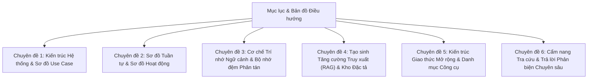

### Danh mục các chuyên đề chi tiết:

1. [**Chuyên đề 1: Kiến trúc Tổng quan & Sơ đồ Use Case**](file:///c:/Users/hoang/Downloads/ProjectMgmt/docs/ai/01-kien-truc-tong-quan-va-use-case.md)
   - Khái niệm & Bài toán cốt lõi trong Scrum Agile; nâng cấp thành **Trợ Lý AI** hội thoại có trạng thái đa tầng (**Redis + MySQL Session Persistence**).
   - Clean Architecture & Modular Monolith kết hợp Module AI; **Rào chắn Phạm vi Nghiệp vụ** (từ chối yêu cầu ngoài luồng) & **Định tuyến Ngữ cảnh Chọn lọc (Selective MCP Routing)**.
   - Sơ đồ Use Case tổng quát (Mermaid) gồm lập kế hoạch Sprint/Backlog, hỏi đáp dự án, truy xuất trí nhớ đánh chỉ mục `#mem-X`, xuất Excel đúng ngữ cảnh (Sprint, Backlog, Việc lẻ, Chi tiết, Bộ lọc, Đề xuất) qua hội thoại, đẩy Kho Backlog, **Tạo mới (không xóa phiên cũ)** và **Xóa phiên cũ có kiểm soát**.
   - Kiến trúc Đa nhà cung cấp (Multi-Provider Model Client): Gemini 3.6/3.5 Flash, Claude 3.7 Sonnet, OpenAI GPT-4o, Local Ollama.
   - Quy chuẩn Bảo mật Tuyệt đối: Zero-Secret-Leakage & Khóa chặt Phạm vi Tổ chức - Dự án - Người dùng (`OrganizationId`, `ProjectId`, `UserId`).

2. [**Chuyên đề 2: Sơ đồ Tuần tự & Sơ đồ Hoạt động**](file:///c:/Users/hoang/Downloads/ProjectMgmt/docs/ai/02-so-do-tuan-tu-va-hoat-dong.md)
   - Bộ định tuyến Ý định Hội thoại & **Selective MCP Context Router**: chỉ gọi MCP Tools khi input + ngữ cảnh thực sự cần thiết; hiểu tự nhiên câu hỏi nối tiếp/đại từ quy chiếu (*"nó"*, *"ý đầu tiên"*) và câu hỏi đáp mệnh lệnh (*"tóm tắt"*, *"liệt kê"*) thông qua chuỗi `AiMessage` đa lượt thực thụ (`User` $\leftrightarrow$ `Assistant`) kèm ràng buộc xuyên suốt phiên.
   - Giao diện **Thinking Log (Nhật ký Suy nghĩ & Thao tác Agent)** tông sáng chuẩn hệ thống, **mặc định luôn đóng (collapsed)** ở mọi trạng thái (đang chạy, hoàn thành, khôi phục phiên), chỉ hiển thị chi tiết từng hành động và `#mem-X` khi người dùng chủ động mở rộng.
   - Sơ đồ Tuần tự (Sequence Diagram) & Sơ đồ Hoạt động (Activity Diagram) quy trình Agentic Workflow đa lượt gắn bền vững với MySQL & Redis.
   - Luồng truyền dữ liệu thời gian thực Server-Sent Events (SSE) kèm `sessionId` phiên hội thoại và metadata thao tác (`actionVerb`, `targetLabel`, `detailPreview`).

3. [**Chuyên đề 3: Cơ chế Trí nhớ Đa tầng, Chỉ mục Ngữ cảnh & Lưu trữ Bền vững**](file:///c:/Users/hoang/Downloads/ProjectMgmt/docs/ai/03-co-che-tri-nho-redis-memory.md)
   - Kiến trúc Lưu trữ Kép (**Redis Hot Cache + MySQL Durable Session Persistence**): khôi phục phiên cũ kể cả khi Redis hết hạn hoặc khởi động lại (**Cold-Redis DB Fallback & Re-hydration**).
   - **Phân trang Ngược Kiểu Messenger & Tự Cuộn Xuống Mới Nhất**: Khi mở lại phiên làm việc, chỉ nạp trước cửa sổ 12 lượt mới nhất (`tailLimit=12`), tự động cuộn tức thì xuống cuối đoạn chat, tải nối tiếp tin cũ hơn qua `GET /api/ai/agent/sessions/{sessionId}/messages` kèm giữ nguyên vị trí đọc và giới hạn RAM/cache trình duyệt.
   - **Hệ thống Đánh Chỉ Mục Trí Nhớ (`#mem-1`, `#mem-2`, ...) & Bám sát Mạch Phiên**: tách và đánh chỉ mục từng khối ngữ cảnh hội thoại để Agent trỏ thẳng vào mảnh trí nhớ liên quan (có kế thừa chủ đề lượt trước cho câu hỏi rút gọn), kết hợp tổng hợp thỏa thuận phiên và bản tóm tắt đầy đủ công việc đang staging.
   - **Khóa chặt Phạm vi Đa chiều (`OrganizationId`, `ProjectId`, `UserId`)**: cô lập hoàn toàn danh sách phiên, xem/tiếp tục phiên, cập nhật staging, commit và xóa phiên (`DELETE /api/ai/agent/sessions/{sessionId}`).
   - Chuyển đổi nút **"Tạo mới"** không phá hủy (chỉ khởi tạo khung hội thoại trắng trên UI, bảo toàn toàn bộ phiên làm việc cũ trong DB).

4. [**Chuyên đề 4: Cơ chế RAG & Grounding với Spec Hub**](file:///c:/Users/hoang/Downloads/ProjectMgmt/docs/ai/04-rag-va-spec-hub-grounding.md)
   - Khái niệm RAG (Retrieval-Augmented Generation) & Giải quyết triệt để Hallucination.
   - Bộ trích xuất văn bản vạn năng `AiDocumentTextExtractor` (.docx, .pdf, .xlsx, .md, .txt).
   - Vector Search, Embedding (`gemini-embedding-001`, Qdrant) và Fallback Keyword Search.
   - Trích dẫn chính xác nguồn gốc (`documentCitations`) hiển thị trong Ngăn kéo Chi tiết, tự động đồng bộ `SpecStoryLinks` / `AcceptanceCriteria` / `Labels` / `RequiredSkills` khi áp dụng xuống Backlog & ngăn kéo xem tài liệu không làm mất đoạn chat.

5. [**Chuyên đề 5: Kiến trúc MCP Server & Hệ thống MCP Tools**](file:///c:/Users/hoang/Downloads/ProjectMgmt/docs/ai/05-mcp-server-va-tools.md)
   - Khái niệm chuẩn Model Context Protocol (MCP) JSON-RPC 2.0 & **Cơ chế Gọi MCP Có Chọn Lọc (Selective MCP Invocation)**.
   - 2 hình thái MCP trong dự án: In-Process Tools vs Standalone Stdio Server.
   - Danh mục đầy đủ 8 công cụ (`spec_hub_list_documents`, `spec_hub_read_document`, `spec_hub_search`, `project_get_active_config`, `backlog_get_stories`, `sprint_get_history_and_velocity`, `team_get_dev_capacities`, `ai_sprint_plan_propose`).
   - Cấu hình kết nối cho Claude Desktop, Cursor, Roo Code, Gemini CLI.

6. [**Chuyên đề 6: Cẩm nang Tra cứu & Trả lời Phản biện (Q&A Master Guide)**](file:///c:/Users/hoang/Downloads/ProjectMgmt/docs/ai/06-huong-dan-tra-cuu-chung-minh-phan-bien.md)
   - "Cái này là gì? Làm thế nào? Nằm ở file nào?"
   - "Phiên hội thoại được lưu trữ ở đâu? Cách khôi phục khi Redis lạnh và cách khóa phạm vi Dự án - Tổ chức - Người dùng?"
   - "Tại sao Trợ Lý AI không gọi MCP tràn lan và dùng chỉ mục `#mem-X` thế nào?"
   - "Làm thế nào chứng minh hệ thống đang gọi AI thật 100% & Redis + MySQL hoạt động đồng bộ?"

---

## 3. Bảng Tra cứu Nhanh Thành phần Mã nguồn (Quick Code Locator)

| Tên Thành Phần | Vai Trò Chuyên Trách | Đường Dẫn Mã Nguồn |
| :--- | :--- | :--- |
| **AiAgentController** | API Controller phục vụ SSE stream theo `sessionId`, staging, khôi phục phiên, xóa phiên cũ & commit Sprint/Backlog | [`AiAgentController.cs`](file:///c:/Users/hoang/Downloads/ProjectMgmt/ProjectMgmt.Solution/Controllers/AiAgentController.cs) |
| **AiSprintDecompositionService** | Trợ Lý AI hội thoại có trạng thái: phân loại ý định, rào chắn ngoài luồng, Selective MCP Routing, trace suy nghĩ & RAG | [`AiSprintDecompositionService.cs`](file:///c:/Users/hoang/Downloads/ProjectMgmt/ProjectMgmt.Solution/Services/Ai/AiSprintDecompositionService.cs) |
| **AiExcelExportResolver** | Bộ phân giải thông minh phạm vi xuất Excel theo ngữ cảnh hội thoại (Sprint, Backlog, Task, Chi tiết, Bộ lọc, Đề xuất) & xác thực tồn tại | [`AiExcelExportResolver.cs`](file:///c:/Users/hoang/Downloads/ProjectMgmt/ProjectMgmt.Solution/Services/Ai/AiExcelExportResolver.cs) |
| **AiIndexedMemoryEngine** | Động cơ lập kế hoạch thực thi chọn lọc (Selective MCP) và truy xuất chỉ mục trí nhớ `#mem-1..#mem-n` | [`AiIndexedMemoryEngine.cs`](file:///c:/Users/hoang/Downloads/ProjectMgmt/ProjectMgmt.Solution/Services/Ai/AiIndexedMemoryEngine.cs) |
| **AiConversationSessionStore** | Kho lưu trữ phiên hội thoại bền vững trên MySQL + khóa chặt `(OrganizationId, ProjectId, UserId)` + bù lạnh Redis | [`AiConversationSessionStore.cs`](file:///c:/Users/hoang/Downloads/ProjectMgmt/ProjectMgmt.Solution/Services/Ai/AiConversationSessionStore.cs) |
| **AiConversationSession & MemoryEntry** | Thực thể miền lưu trữ phiên chat hoàn chỉnh và các mảnh trí nhớ đánh chỉ mục trong MySQL | [`AiConversationSession.cs`](file:///c:/Users/hoang/Downloads/ProjectMgmt/ProjectMgmt.Modules.DeliveryIntelligence/Domain/Entities/AiConversationSession.cs) |
| **ProjectActiveConfigResolver** | Phân giải cấu hình thực tế đang áp dụng của dự án (Workflow, Priorities, IssueTypes, Labels) | [`ProjectActiveConfigResolver.cs`](file:///c:/Users/hoang/Downloads/ProjectMgmt/ProjectMgmt.Solution/Services/Ai/ProjectActiveConfigResolver.cs) |
| **AiSprintCommitCoordinator** | Ghi nhận Sprint, **đẩy trực tiếp vào Kho Backlog (`SprintId = null`)**, lưu `SpecStoryLinks`, `AcceptanceCriteria`, `IssueRequiredSkills`, nhãn & vai trò việc con | [`AiSprintCommitCoordinator.cs`](file:///c:/Users/hoang/Downloads/ProjectMgmt/ProjectMgmt.Solution/Services/Ai/AiSprintCommitCoordinator.cs) |
| **AiTokenUsageTracker** | Theo dõi tiêu thụ Token AI, thống kê chi phí & lịch sử phiên | [`AiTokenUsageTracker.cs`](file:///c:/Users/hoang/Downloads/ProjectMgmt/ProjectMgmt.Solution/Services/Ai/AiTokenUsageTracker.cs) |
| **MultiProviderAiModelClient** | Router gọi đa mô hình (Gemini, Claude, OpenAI, Ollama) | [`MultiProviderAiModelClient.cs`](file:///c:/Users/hoang/Downloads/ProjectMgmt/ProjectMgmt.Solution/Services/Ai/MultiProviderAiModelClient.cs) |
| **AiDocumentTextExtractor** | Trích xuất văn bản từ file Word, Excel, PDF, Markdown, Text | [`AiDocumentTextExtractor.cs`](file:///c:/Users/hoang/Downloads/ProjectMgmt/ProjectMgmt.Solution/Services/Ai/AiDocumentTextExtractor.cs) |
| **StackExchangeRedisStagingProvider** | Bộ nhớ đệm phân tán Redis lưu trạng thái đề xuất staging & lịch sử hội thoại đa lượt | [`StackExchangeRedisStagingProvider.cs`](file:///c:/Users/hoang/Downloads/ProjectMgmt/ProjectMgmt.Solution/Services/Ai/Adapters/StackExchangeRedisStagingProvider.cs) |
| **ResilientStateStagingService** | Cơ chế bọc chống sập bộ nhớ: ưu tiên Redis, fallback In-Memory | [`ResilientStateStagingService.cs`](file:///c:/Users/hoang/Downloads/ProjectMgmt/ProjectMgmt.Core/Staging/ResilientStateStagingService.cs) |
| **ProjectScopeGuard** | Rào chắn bảo mật cách ly dữ liệu giữa các Project & Org | [`ProjectScopeGuard.cs`](file:///c:/Users/hoang/Downloads/ProjectMgmt/ProjectMgmt.Core/Security/ProjectScopeGuard.cs) |
| **SpecHubTools** | MCP Tool truy xuất kho tài liệu đặc tả Spec Hub | [`SpecHubTools.cs`](file:///c:/Users/hoang/Downloads/ProjectMgmt/ProjectMgmt.Solution/McpServers/SpecHubTools.cs) |
| **BacklogTools** | MCP Tool đọc danh sách User Story và độ ưu tiên Backlog | [`BacklogTools.cs`](file:///c:/Users/hoang/Downloads/ProjectMgmt/ProjectMgmt.Solution/McpServers/BacklogTools.cs) |
| **SprintTools** | MCP Tool tính toán vận tốc (Velocity) và rollover items | [`SprintTools.cs`](file:///c:/Users/hoang/Downloads/ProjectMgmt/ProjectMgmt.Solution/McpServers/SprintTools.cs) |
| **TeamTools** | MCP Tool thống kê kỹ năng và giờ làm việc khả dụng | [`TeamTools.cs`](file:///c:/Users/hoang/Downloads/ProjectMgmt/ProjectMgmt.Solution/McpServers/TeamTools.cs) |
| **ProjectMgmt.McpServer** | Ứng dụng Console Stdio JSON-RPC phục vụ Agent ngoài | [`Program.cs`](file:///c:/Users/hoang/Downloads/ProjectMgmt/ProjectMgmt.McpServer/Program.cs) |
| **ai-agent.service.ts** | Service Angular kết nối SSE stream (`sessionId`), áp dụng Sprint / đẩy Backlog, **xóa phiên cũ (`deleteSession`)** & 401 refresh | [`ai-agent.service.ts`](file:///c:/Users/hoang/Downloads/ProjectMgmt/frontend/projectmgmt-web/src/app/core/services/ai-agent.service.ts) |
| **ai-decompose-modal.ts** | Component giao diện **Trợ Lý AI** hội thoại 2 phía, **Thinking Accordion mặc định luôn đóng**, nút **Tạo mới**, khôi phục & xóa phiên cũ | [`ai-decompose-modal.ts`](file:///c:/Users/hoang/Downloads/ProjectMgmt/frontend/projectmgmt-web/src/app/features/backlog/components/ai-decompose-modal/ai-decompose-modal.ts) |
| **excel-data.service.ts** | Bộ sinh tệp `.xlsx` OpenXML bảng sạch chuẩn ProjectMgmt (màu trạng thái động + bảng Chú thích + hồ sơ chi tiết việc & xuất theo phạm vi AI) | [`excel-data.service.ts`](file:///c:/Users/hoang/Downloads/ProjectMgmt/frontend/projectmgmt-web/src/app/core/services/excel-data.service.ts) |
| **ai-decompose-modal.html** | Template đoạn hội thoại Trợ Lý AI (trái) & Tôi (phải) liền mạch, khối Thinking tông sáng tối giản & danh sách lịch sử có nút xóa | [`ai-decompose-modal.html`](file:///c:/Users/hoang/Downloads/ProjectMgmt/frontend/projectmgmt-web/src/app/features/backlog/components/ai-decompose-modal/ai-decompose-modal.html) |
| **profile-page.html** | Dashboard quản lý mức tiêu thụ Token AI và chi phí vận hành | [`profile-page.html`](file:///c:/Users/hoang/Downloads/ProjectMgmt/frontend/projectmgmt-web/src/app/features/identity/profile-page.html) |
| **spec-hub-page.ts** | Giao diện Spec Hub hỗ trợ mở đúng vị trí phân đoạn trích dẫn | [`spec-hub-page.ts`](file:///c:/Users/hoang/Downloads/ProjectMgmt/frontend/projectmgmt-web/src/app/features/spec-hub/spec-hub-page.ts) |
| **task-detail-drawer.ts** | Ngăn kéo chi tiết Backlog/Board hiển thị & chỉnh sửa đầy đủ các trường AI cho cả việc cha lẫn việc con | [`task-detail-drawer.ts`](file:///c:/Users/hoang/Downloads/ProjectMgmt/frontend/projectmgmt-web/src/app/shared/components/task-detail-drawer/task-detail-drawer.ts) |
| **spec-citation.util.ts** | Chuẩn hóa tên tài liệu & khử trùng lặp liên kết Spec Hub với trích dẫn thô | [`spec-citation.util.ts`](file:///c:/Users/hoang/Downloads/ProjectMgmt/frontend/projectmgmt-web/src/app/core/utils/spec-citation.util.ts) |


---

# Phần II: CHUYÊN ĐỀ 1: KIẾN TRÚC TỔNG QUAN & SƠ ĐỒ USE CASE

---

## 1. Bối cảnh Bài toán & Lý thuyết Ứng dụng AI trong Scrum Agile

### 1.1. Thách thức cốt lõi của Lập kế hoạch Sprint truyền thống
Trong quy trình phát triển phần mềm theo khung Scrum (Scrum Framework), buổi họp **Sprint Planning (Lập kế hoạch Sprint)** thường đối mặt với những rào cản nghiêm trọng:
1. **Quá tải thông tin (Information Overload)**: Scrum Master và Product Owner phải đọc hàng chục trang tài liệu đặc tả yêu cầu (SRS, BRD, User Story Map), ghi chú cuộc họp dài dằng dặc, các file đính kèm Word (`.docx`), Excel phân công (`.xlsx`), PDF kỹ thuật.
2. **Ảo giác và bỏ sót yêu cầu (Hallucination & Scope Gap)**: Khi phân rã công việc thủ công, lập trình viên dễ bỏ sót các tiêu chí nghiệm thu phi chức năng (bảo mật, kiểm thử tự động, logging, caching).
3. **Phân bổ năng lực thiếu cân bằng (Capacity Imbalance)**: Khó đối chiếu chính xác số giờ làm việc thực tế, kỹ năng chuyên sâu (Frontend, Backend, QA) và vận tốc lịch sử (Velocity) của các Sprint trước, dẫn đến việc người thì quá tải (burnout), người thì thiếu việc.
4. **Mất truy vết nguồn gốc (Loss of Traceability)**: Khi giao task, thành viên không biết task này xuất phát từ tài liệu nào, chương nào trong đặc tả kỹ thuật, gây tranh cãi khi nghiệm thu.

### 1.2. Giải pháp Trợ Lý AI Hội thoại Có Trạng thái Đa tầng (Stateful Hermes Agentic Workflow)
Module AI được nâng cấp từ công cụ phân rã đơn lượt thành **Trợ Lý AI** vận hành theo mô hình **Hội thoại Đa lượt Có Trạng thái kết hợp Trí nhớ Đánh Chỉ mục & Lưu trữ Bền vững (Stateful Conversational Agentic Workflow)**:
- **Giao diện Đoạn hội thoại Liền mạch 2 Phía (Trái/Phải) & Không gian Làm việc Mở rộng / Toàn màn hình**: Khối tin nhắn của **Trợ Lý AI** nằm bên trái và phản hồi của **Tôi (Người dùng)** nằm bên phải với khung trắng thống nhất, mở rộng tối đa diện tích hiển thị (`min(1760px, 98.8vw) x min(980px, 96.8vh)`) kèm nút chuyển đổi **Phóng toàn màn hình (`100vw x 100vh`)** ngay trên thanh tiêu đề. Khu vực đề xuất kế hoạch tích hợp **Thanh Điều Phối & Mục Tiêu Hợp Nhất (Unified Command Banner)** dạng viên thuốc nổi bật ngay trên đầu bảng công việc (gồm `Làm lại toàn bộ`, `Đẩy vào Kho Backlog`, `Áp dụng vào Sprint tiếp theo` và dòng chỉnh sửa mục tiêu Sprint trực tiếp), loại bỏ hoàn toàn các dải nút đóng khung rời rạc dưới đáy.
- **Nhật ký Suy nghĩ & Thao tác Agent (Thinking Log) Tông sáng Mặc định Luôn Đóng**: Ngay phía trên nội dung trả lời (hoặc khi AI đang chạy) hiển thị thanh trạng thái gọn nhẹ tông sáng hợp nhất giao diện (**mặc định luôn đóng `collapsed`** ở mọi trạng thái: đang chạy, đã xong hoặc khi mở lại phiên cũ). Khi người dùng nhấp mở rộng mới xổ ra toàn bộ dòng thời gian thao tác thực tế (`actionVerb`, `target`, `durationMs`, chi tiết đóng/mở từng bước) và các thẻ trí nhớ `#mem-X` vừa được truy xuất.
- **Định tuyến MCP Có Chọn Lọc (Selective MCP Context Router)**: AI **không gọi MCP Tools máy móc ở mọi câu hỏi**. Với lời chào hoặc hỏi khả năng chung, Agent trả lời trực tiếp với `0` MCP calls; với câu hỏi nối tiếp tham chiếu ngữ cảnh cũ, Agent ưu tiên `memory_recall` trên chỉ mục `#mem-X`; chỉ khi người dùng hỏi số liệu dự án cụ thể hoặc lập kế hoạch Sprint/Backlog, Agent mới gọi đúng tập công cụ MCP cần thiết.
- **Truyền Hội thoại Đa lượt Thực thụ & Bám sát Mạch Phiên (Native Multi-Turn & Follow-up Intelligence)**:
  - Thay vì gộp phẳng thành một thông điệp đơn, backend truyền chuỗi tin nhắn luân phiên thực thụ (`User` $\leftrightarrow$ `Assistant`) cho mô hình AI (Gemini, Claude, OpenAI, Ollama) kèm cửa sổ 8 lượt gần nhất, khối tổng hợp **Ràng buộc & Thỏa thuận xuyên suốt phiên** từ người dùng và bản tóm tắt chi tiết công việc đang staging (mô tả, tiêu chí nghiệm thu, trích dẫn tài liệu).
  - Bộ phân loại ý định hiểu tự nhiên các câu hỏi rút gọn/chứa đại từ trong phiên đang diễn ra (*"nó"*, *"ý đầu tiên"*, *"công việc thứ 2"*, *"tăng lên 5"*, *"rõ hơn"*) và các động từ hỏi đáp mệnh lệnh (*"tóm tắt"*, *"liệt kê"*, *"phân tích"*, *"so sánh"*) mà không từ chối nhầm, đồng thời kế thừa chủ đề lượt trước khi truy xuất `#mem-X` / Spec Hub nhưng vẫn giữ nghiêm rào chắn từ chối ngoài luồng (`out_of_scope_refusal`) và bảo toàn `sourceBacklogIssueId` khi tinh chỉnh đề xuất.
- **Lưu trữ Phiên Hội thoại Đích thực Trong MySQL + Redis Hot Cache & Phân trang Kiểu Messenger**: Mỗi cuộc hội thoại hoàn chỉnh (kèm lịch sử đa lượt, log thao tác `TraceItems`, tóm tắt suy nghĩ `ThinkingSummary`, bản đề xuất `ProposalJson` và các mảnh trí nhớ đánh chỉ mục `#mem-1..#mem-n`) được lưu bền vững vào MySQL, gắn chặt theo bộ ba **`(OrganizationId, ProjectId, UserId)`** để tuyệt đối không nhầm lẫn giữa các dự án hay tổ chức khác nhau. Khi mở lại phiên cũ, hệ thống áp dụng **phân trang ngược kiểu Messenger** (`tailLimit=12` và `GET /api/ai/agent/sessions/{sessionId}/messages`) đồng thời **tự động cuộn ngay xuống tin nhắn mới nhất** và giữ nguyên vị trí đọc khi cuộn lên tải thêm tin cũ để tránh tràn RAM trình duyệt. Khi Redis hết hạn/lạnh, hệ thống tự động khôi phục từ MySQL và nạp lại lên Redis (**Cold-Redis Re-hydration**).
- **Nút "Tạo mới" Không Phá Hủy & Quản lý Xóa Phiên Cũ**: Nút **"Tạo mới"** trên thanh tiêu đề chỉ bắt đầu khung hội thoại mới sạch sẽ trên giao diện mà **không xóa phiên cũ** trong lịch sử. Người dùng có thể mở lại bất kỳ phiên cũ nào để trò chuyện tiếp, hoặc chủ động bấm **Xóa** phiên cũ khỏi cơ sở dữ liệu ngay trong danh sách lịch sử phiên.
- **Rào chắn Phạm vi Nghiệp vụ (Out-of-Scope Domain Guardrail)**: Trợ Lý AI chỉ phục vụ nghiệp vụ quản lý dự án (lập kế hoạch Sprint/Backlog, phân rã Story/Task, hỏi đáp số liệu dự án, xuất Excel, điều phối thành viên & workflow). Mọi yêu cầu ngoài luồng (viết thơ, code bài tập rời rạc, tư vấn đời sống, hỏi đáp ngoài công cụ quản lý dự án) đều bị từ chối lịch sự ngay tức thì (`Intent = "out_of_scope_refusal"`) mà vẫn giữ nguyên bản đề xuất hiện có.
- **Hành động Hội thoại Trực tiếp (Xuất Excel Đúng Ngữ Cảnh & Đẩy Kho Backlog)**: Hỗ trợ phân giải thông minh yêu cầu xuất Excel theo đúng phạm vi người dùng chỉ định (`single_sprint`, `sprint_list`, `backlog_only`, `single_task`, `task_detail`, `filtered_tasks`, `ai_proposal`, `project_all`) hoặc từ chối trung thực nếu Sprint/Công việc/Thành viên không tồn tại hay bộ lọc rỗng (`TriggerAction = "none"`); tệp `.xlsx` trình bày dạng bảng sạch chuẩn ProjectMgmt (không nhãn công cụ ngoài, không banner tối màu), chỉ tô màu ô Trạng thái theo bảng màu quy trình động + cột/bảng Chú thích. Hỗ trợ đẩy trực tiếp công việc đề xuất vào **Kho Product Backlog** (`PushToBacklog = true`, `SprintId = null`) qua chat hoặc nút thao tác cạnh **Áp dụng vào Sprint**.
- **Tiếp nhận đa kênh**: Hỗ trợ đính kèm file Word, Excel, PDF, Text hoặc dán trực tiếp ghi chú cuộc họp vào ô nhập liệu tự co giãn.
- **RAG & MCP Grounding**: Tự động truy xuất kho tài liệu đặc tả dự án (**Spec Hub**) qua giao thức MCP khi cần thiết, đối chiếu số liệu Backlog, vận tốc Sprint trước, cấu hình Workflow/Priority/IssueType/Labels đang áp dụng và kỹ năng từng thành viên.
- **Phân tách thực tế & Không giới hạn quy mô**: Bóc tách tự nhiên theo cấu trúc sản phẩm và biên bản họp, không bị gò bó bởi giới hạn cứng về số lượng task hay subtask. Phân biệt chuẩn xác bản chất Scrum giữa **User Story (`Story`)** (nhu cầu/giá trị dưới góc nhìn người dùng, được phân rã thành các đầu việc kỹ thuật khả thi), **Task** (công việc kỹ thuật độc lập) và **Bug** (lỗi cần khắc phục).
- **Khai thác Kho Product Backlog & Di chuyển Không Trùng lặp (Backlog Sourcing & Move Semantics)**:
  - AI đọc toàn bộ các hạng mục đang chờ trong Product Backlog (`SprintId = null`) kèm loại việc, mức ưu tiên, nhãn và việc con hiện có.
  - Khi AI chọn đưa một User Story hoặc Task có sẵn từ kho Backlog vào Sprint (`sourceBacklogIssueId` / `sourceBacklogIssueKey`), hệ thống thực hiện **di chuyển trực tiếp (Move)** bản ghi gốc từ Backlog vào Sprint mục tiêu (cập nhật `SprintId`, trạng thái, mức ưu tiên, nhãn `IssueLabels`, tiêu chí nghiệm thu và kéo theo các việc con hiện có), tuyệt đối không sinh bản sao gây trùng lặp trong kho Backlog.
- **Kế thừa Sprint cũ & Xử lý việc quá hạn (Sprint Rollover & Overdue Intelligence)**:
  - Tự động truy xuất các hạng mục dở dang từ Sprint liền kề dựa trên cấu hình trạng thái hoàn tất thực tế (`IsDone` / `Category = Done`) của dự án để kế thừa sang Sprint mới.
  - Phân loại thông minh các việc quá hạn theo chuẩn Scrum:
    - *Bug/Blocker dở dang*: Bắt buộc chuyển sang Sprint mới dưới dạng Hotfix với mức ưu tiên khẩn cấp cao nhất đang áp dụng của dự án (`Level = 1`, ví dụ `Urgent`, `Highest` hoặc `Blocker`), gắn cảnh báo gia hạn deadline.
    - *Task đang làm dở dang (`IsActiveWork`)*: Chuyển tiếp vào Sprint mới để hoàn thiện (bảo vệ công sức WIP).
    - *Task thường chưa bắt đầu (`IsInitial`) nhưng đã quá hạn*: Tự động hoàn trả về Product Backlog (`SprintId = null`) để Product Owner thẩm định lại giá trị và độ ưu tiên, tránh làm loãng cam kết Sprint Goal.
- **Trích dẫn minh bạch 100%**: Mọi công việc sinh ra đều đính kèm trích dẫn tài liệu cụ thể (`documentCitations`), có thể nhấp vào để mở ngăn kéo xem tài liệu ngay lập tức mà không làm mất đoạn chat.
- **Phê duyệt Staging**: Đề xuất được lưu kết hợp trên **Redis Hot Cache** và **MySQL Session Store** để người dùng thoải mái chỉnh sửa, trao đổi bổ sung, hoặc làm lại từng task trước khi bấm nút **Áp dụng vào Sprint** hoặc **Đẩy vào Kho Backlog**.

---

## 2. Bản Thiết Kế Chi Tiết Kiến Trúc Các Tầng Hệ Thống AI Tác Tử (7-Layer Agentic AI Architecture)

Để xây dựng một **Hệ thống AI Tác tử (Agentic AI)** vận hành ổn định trong môi trường doanh nghiệp — vừa đủ linh hoạt để suy luận đa lượt, truy xuất dữ liệu thật, lại vừa đủ chặt chẽ để không ảo giác, không lộ dữ liệu chéo dự án và không ghi rác vào cơ sở dữ liệu chính — hệ thống được thiết kế theo **Kiến trúc Phân tầng Tác tử 7 Lớp (7-Layer Stateful Agentic Architecture)** tuân thủ nguyên tắc **Modular Monolith & Clean Architecture**.

### 2.1. Sơ Đồ Kiến Trúc 7 Tầng Hệ Thống AI Tác Tử

```mermaid
flowchart TD
    subgraph L1["TẦNG 1: TIẾP NHẬN ĐA KÊNH & TƯƠNG TÁC NGƯỜI-MÁY (PRESENTATION & STREAMING)"]
        L1A["Khung Hội thoại 2 Phía Đa lượt\n(Tin nhắn người dùng, luồng phản hồi trực tiếp & nhật ký suy nghĩ mặc định đóng)"]
        L1B["Bảng Đề xuất Sửa Nóng & Thẻ Xác nhận\n(Sửa tiêu đề, Story Points, nhân sự; thẻ xác nhận gỡ/xóa việc & xuất Excel)"]
        L1C["Điểm Kích hoạt Tác vụ Nhanh Không Qua Chat\n(Nút phân rã việc con & đề xuất phân công ngay trên menu thẻ việc)"]
    end

    subgraph L2["TẦNG 2: CỔNG ĐIỀU PHỐI, PHÂN QUYỀN & BẢO VỆ PHẠM VI (GATEWAY & SCOPE GUARD)"]
        L2A["Xác thực Danh tính & Kiểm soát Vai trò Scrum\n(Phân biệt quyền Lãnh đạo, Scrum Master, Dev/QA và Người xem)"]
        L2B["Rào chắn Cách ly 3 Chiều Tuyệt đối\n(Khóa cứng Tổ chức - Dự án - Người dùng trên mọi luồng dữ liệu)"]
        L2C["Khống chế Tần suất, Hạn mức Token & Nhật ký Đo lường\n(Ngăn lạm dụng tài nguyên, thống kê độ trễ và chi phí mô hình)"]
    end

    subgraph L3["TẦNG 3: VỆ SINH ĐẦU VÀO & TƯỜNG LỬA ĐỊNH TUYẾN Ý ĐỊNH (GUARDRAIL & INTENT FIREWALL)"]
        L3A["Bộ Bóc tách Tài liệu Đa định dạng & Chống Tiêm nhiễm\n(Đọc tài liệu văn phòng/PDF, lọc mã độc, che giấu bí mật & vô hiệu chỉ thị ẩn)"]
        L3B["Bộ Khử nhiễu Ngôn ngữ & Tách Tín hiệu Chính\n(Phân biệt từ ghép tiếng Việt và loại bỏ phần đính kèm khi chào hỏi)"]
        L3C["Tường lửa Nghiệp vụ 10 Nhánh Ý định (Default-Deny)\n(Chặt đứt yêu cầu ngoài phạm vi Quản lý Dự án; giữ nguyên đề xuất hiện có)"]
    end

    subgraph L4["TẦNG 4: HOẠCH ĐỊNH CHỌN LỌC & TRÍ NHỚ ĐÁNH CHỈ MỤC (SELECTIVE PLANNER & INDEXED MEMORY)"]
        L4A["Bộ Lập kế hoạch Thực thi 3 Chế độ Chọn lọc\n(0 công cụ với chào hỏi -> Chỉ đọc Trí nhớ phiên -> Gọi Công cụ Mục tiêu)"]
        L4B["Động cơ Đánh Chỉ mục Trí nhớ Theo Mảnh\n(Nén từng lượt thành mảnh #mem-1..#mem-n kèm từ khóa và tóm tắt)"]
        L4C["Bộ Chống Nhiễm Chéo Ngữ cảnh & Nối tiếp Đại từ\n(Loại trừ mảnh thuộc Sprint/mã việc khác; kế thừa chủ đề khi hỏi rút gọn)"]
    end

    subgraph L5["TẦNG 5: ĐIỀU PHỐI TRI THỨC DỰ ÁN, RAG & CÔNG CỤ MỞ RỘNG (GROUNDING & TOOLS)"]
        L5A["Kho Công cụ Dự án Chuẩn Giao thức Mở rộng\n(Truy xuất Kho Đặc tả, Kho Backlog, Lịch sử Sprint/Velocity, Năng lực Đội ngũ)"]
        L5B["Bộ Phân giải Cấu hình Thực tế Đang Áp dụng\n(Đọc quy trình Workflow, Mức ưu tiên, Loại việc và Nhãn thật của dự án)"]
        L5C["Tìm kiếm Ngữ nghĩa Vector & Xử lý Tác vụ Nhanh 1-Lượt\n(Neo bằng chứng đặc tả + Chấm điểm xếp hạng Top 5 ứng viên/phân rã việc con)"]
    end

    subgraph L6["TẦNG 6: SUY LUẬN ĐA MÔ HÌNH, HẬU KIỂM & TỰ PHẢN BIỆN (REASONING & CRITIQUE)"]
        L6A["Cổng Chuyển tiếp Đa Nhà Cung Cấp AI\n(Kết nối linh hoạt nhiều mô hình đám mây & nội bộ, không lệ thuộc hãng)"]
        L6B["Truyền Hội thoại Đa lượt Kèm Kho Thỏa thuận Phiên\n(Gửi chuỗi lượt hỏi-đáp thực thụ kết hợp ràng buộc xuyên phiên)"]
        L6C["Tự Phản biện, Sửa Dữ liệu Cắt ngọn & Chuẩn hóa Nghiệp vụ\n(Ép thang Fibonacci, khử thực thể ảo, gán Rollover & ngữ nghĩa chuyển Backlog)"]
    end

    subgraph L7["TẦNG 7: LƯU TRỮ TẠM ĐÀN HỒI REDIS, BỀN VỮNG & GHI NHẬN NGUYÊN TỬ (STAGING & PERSISTENCE)"]
        L7A["Bộ Đệm Nóng Phân tán Redis Kèm Ngắt Mạch Bảo Vệ\n(Lưu nháp kế hoạch & tác vụ nhanh TTL 2 giờ; tự chuyển RAM nếu Redis sự cố)"]
        L7B["Kho Phiên Hội thoại Bền vững Quan hệ\n(Lưu kép lịch sử dài hạn, tái nạp cache lạnh khi hết TTL & phân trang ngược)"]
        L7C["Bộ Điều phối Ghi Nhận Nguyên tử Có Xác nhận Con người\n(Hậu kiểm lại toàn bộ quy chuẩn thực tế ngay trước khi ghi vào CSDL chính)"]
    end

    L1 -->|"Luồng Sự kiện Thời gian thực & REST"| L2
    L2 -->|"Ngữ cảnh Đã Khóa Phạm Vi 3 Chiều"| L3
    L3 -->|"Yêu cầu Sạch & Nhánh Ý Định Xác Định"| L4
    L4 -->|"Kế hoạch Truy xuất & Mảnh Trí nhớ Đã Lọc"| L5
    L5 -->|"Bằng chứng Thật + Quy chuẩn Dự án"| L6
    L6 -->|"Bản Đề xuất Đã Kiểm chứng & Tinh sạch"| L7
    L7 -.->|"Phát sự kiện hoàn tất & trạng thái Staging lên Giao diện"| L1
```

### 2.2. Luồng Vận Hành Khép Kín Qua 7 Tầng Agentic (End-to-End Orchestration)

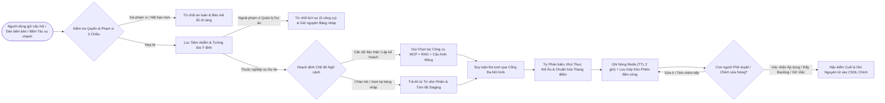

### 2.3. Thiết Kế Chi Tiết Từng Tầng Trong Kiến Trúc Agentic AI

Khi tự thiết kế và xây dựng một hệ thống Agentic AI tương tự từ con số 0, mỗi tầng đảm nhận một trách nhiệm duy nhất, tách biệt hoàn toàn để dễ kiểm thử và thay thế:

1. **Tầng 1 — Tiếp nhận Đa kênh & Tương tác Người-Máy (Presentation & Streaming Layer)**:
   - **Mục tiêu thiết kế**: Biến AI từ hộp thoại sinh văn bản thụ động thành không gian cộng tác trực quan, minh bạch tiến trình nhưng không gây rối mắt.
   - **Thành phần cốt lõi**:
     - *Kênh truyền sự kiện một chiều thời gian thực*: liên tục đẩy về client các trạng thái khởi tạo phiên, bước đang chạy, thao tác công cụ đang thực hiện kèm động từ mô tả rõ ràng, dòng suy nghĩ tóm tắt (mặc định thu gọn) và gói đề xuất hoàn chỉnh.
     - *Bảng đề xuất cho phép sửa nóng (Inline Editable Staging Grid)*: người dùng có thể sửa trực tiếp tiêu đề, điểm ước lượng, mức ưu tiên, người phụ trách mà không cần chờ AI chạy lại cả bài toán.
     - *Hai điểm vào song hành*: (a) **Luồng Hội thoại Đa lượt** để thảo luận, hỏi đáp, xuất Excel, lập kế hoạch Sprint/Backlog hoặc nhờ gỡ việc qua thẻ xác nhận; và (b) **Luồng Tác vụ Nhanh Không Qua Chat** đặt trực tiếp ngay trên menu ngữ cảnh từng công việc (phân rã việc con và xếp hạng gợi ý người làm).

2. **Tầng 2 — Cổng Điều phối, Bảo mật Phạm vi & Khống chế Tài nguyên (Gateway, Scope Guard & Quota Control Layer)**:
   - **Mục tiêu thiết kế**: Không bao giờ tin tưởng dữ liệu định danh gửi từ phía trình duyệt nếu chưa đối chiếu với quyền thật trong phiên đăng nhập.
   - **Nguyên tắc thiết kế**:
     - *Xác thực phân cấp Scrum*: phân tách quyền xem, quyền đề xuất vào Backlog, quyền cam kết vào Sprint, quyền phân công người làm và quyền gỡ/xóa công việc.
     - *Khóa Phạm vi 3 Chiều*: mọi yêu cầu đều đóng dấu **Bộ ba Phạm vi (Tổ chức, Dự án, Người dùng)**. Không bất kỳ truy vấn cache hay truy vấn tài liệu nào được phép vượt ra ngoài ranh giới bộ ba này.
     - *Kiểm soát lưu lượng*: giới hạn tần suất theo cửa sổ trượt (tối đa theo phút) và trần hạn mức token theo ngày cho mỗi người dùng nhằm tránh cạn kiệt tài nguyên.

3. **Tầng 3 — Vệ sinh Đầu vào & Tường lửa Định tuyến Ý định (Input Guardrail & Intent Firewall Layer)**:
   - **Mục tiêu thiết kế**: Ngăn chặn tấn công tiêm nhiễm chỉ thị (Prompt Injection) và chặn yêu cầu lạc đề ngay ở cửa ngõ trước khi tốn chi phí gọi mô hình AI.
   - **Thành phần cốt lõi**:
     - *Bảo vệ tệp đính kèm*: giải nén có kiểm soát dung lượng, số lượng mục con và độ dài văn bản tối đa (chống tấn công nén nổ bộ nhớ), đồng thời phát hiện tệp PDF dạng ảnh quét thiếu văn bản để cảnh báo sớm.
     - *Màng lọc An toàn 2 Lớp*: lọc các mẫu câu vượt quyền, đòi tiết lộ khóa bí mật hệ thống hoặc mã kịch bản nguy hiểm ngay cả khi chúng được giấu ngầm bên trong nội dung tài liệu đặc tả (Indirect Prompt Injection), bọc dữ liệu bên ngoài trong vùng phân cách không tin cậy.
     - *Tường lửa Ý định 10 Nhánh*: phân tách rõ câu chào hỏi, hỏi đáp dự án, lập kế hoạch Sprint, lập Backlog, tinh chỉnh đề xuất, xuất tệp Excel, gỡ/xóa công việc, đẩy kho Backlog, áp dụng Sprint và nhánh **từ chối mặc định** cho mọi yêu cầu ngoài phạm vi Quản lý Dự án. Đặc biệt xử lý chuẩn ngữ nghĩa tiếng Việt để không nhầm lẫn từ ghép (ví dụ phân biệt *"đề xuất"* với hành động *"xuất báo cáo"*).

4. **Tầng 4 — Hoạch định Chọn lọc & Trí nhớ Đánh Chỉ Mục (Selective Planner & Indexed Memory Layer)**:
   - **Mục tiêu thiết kế**: Giải bài toán cân bằng giữa **chi phí/tốc độ** và **độ chính xác ngữ cảnh** trong hội thoại dài.
   - **Cơ chế hoạt động**:
     - Bộ Lập Kế Hoạch phân ra 3 cấp độ: (1) *0 công cụ* cho chào hỏi/từ chối ngoài phạm vi; (2) *Chỉ đọc Trí nhớ Phiên* cho câu hỏi về chính bảng đề xuất vừa sinh ra; (3) *Gọi Chọn lọc Công cụ Mục tiêu* khi câu hỏi nhắc tới số Sprint cụ thể, mã công việc thật hoặc nhân sự dự án.
     - *Đánh Chỉ mục Trí nhớ Theo Mảnh (`#mem-1..#mem-n`)*: mỗi lượt hội thoại quan trọng được cô đọng thành một mảnh trí nhớ chứa tiêu đề, từ khóa, bản tóm tắt và nội dung chi tiết. Khi sang lượt mới, hệ thống chỉ nạp tối đa vài mảnh liên quan nhất thay vì nhồi nguyên văn lịch sử hàng chục trang.
     - *Chống Nhiễm Chéo Trí Nhớ*: nếu câu hỏi mới nhắc rõ đối tượng mục tiêu (ví dụ hỏi về Sprint 3 hoặc một mã công việc cụ thể), toàn bộ mảnh trí nhớ mang nhãn Sprint hoặc mã việc khác sẽ tự động bị loại trừ.

5. **Tầng 5 — Điều phối Tri thức Dự án, RAG & Công cụ Mở rộng (Knowledge Grounding & Tool Orchestration Layer)**:
   - **Mục tiêu thiết kế**: Buộc Tác tử AI đứng trên dữ liệu thật của dự án thay vì suy đoán bằng kiến thức chung.
   - **Cấu trúc gồm 3 nhóm tri thức thật**:
     - *Nhóm Giao thức Công cụ Mở rộng (MCP Dual-Mode)*: phục vụ song song cả Tác tử nội bộ lẫn công cụ lập trình ngoài thông qua 4 nhóm công cụ: Kho Đặc tả Tài liệu, Danh mục Product Backlog, Lịch sử Chu kỳ & Vận tốc (Velocity) và Năng lực Nhân sự theo thời gian thực.
     - *Nhóm Tìm kiếm Ngữ nghĩa (Hybrid RAG)*: kết hợp tìm kiếm vector có bộ nhớ đệm ngắn hạn với phương án dự phòng đối khớp từ khóa, đảm bảo luôn trích xuất được đúng đoạn tài liệu đặc tả liên quan kèm mã tài liệu để người dùng nhấp mở xem trước tức thì.
     - *Nhóm Phân giải Quy chuẩn Động*: tự động đọc Workflow đang bật, danh sách Cột Bảng Kanban, Thứ tự Ưu tiên riêng của từng dự án, Loại công việc và Nhãn dự án thực tế để làm khuôn mẫu ràng buộc cho AI ở tầng sau.

6. **Tầng 6 — Suy luận Đa Mô hình, Hậu kiểm & Tự Phản biện (Multi-Provider Reasoning & Verification Layer)**:
   - **Mục tiêu thiết kế**: Tách logic nghiệp vụ khỏi một nhà cung cấp mô hình cụ thể và kiểm soát chất lượng đầu ra bằng kỷ luật thuật toán sau khi LLM trả lời.
   - **Các cơ chế then chốt**:
     - *Chuyển tiếp Đa Nhà Cung Cấp*: sử dụng một hợp đồng giao tiếp thống nhất để chuyển đổi linh hoạt giữa nhiều mô hình đám mây hoặc nội bộ chỉ bằng cấu hình.
     - *Mẫu Chỉ đạo Động Không Cứng Nhắc*: toàn bộ chỉ dẫn hệ thống được lưu dưới dạng văn bản đặc tả bên ngoài và tự động nạp lại ngay khi chỉnh sửa.
     - *Hội thoại Đa lượt Tự nhiên*: truyền đúng chuỗi luân phiên giữa Người và Trợ lý qua nhiều lượt, kèm khối tổng hợp thỏa thuận phiên và dữ liệu nháp hiện tại.
     - *Chuỗi Hậu kiểm Tự Phản biện (Post-Processing Guardrails)*: tự động khôi phục dữ liệu có cấu trúc nếu bị cắt ngọn do chạm trần độ dài; tước bỏ các nhãn điều phối nội bộ bị lộ; ép Story Points về chuẩn Fibonacci; xóa sạch các thực thể không có thật; áp dụng logic Kế thừa việc dở dang/Quá hạn (Rollover) và Di chuyển việc từ kho Backlog không tạo bản sao trùng lặp.

7. **Tầng 7 — Lưu trữ Tạm Đàn hồi Redis, Phiên Bền vững & Ghi Nhận Nguyên tử (Resilient Staging & Persistence Layer)**:
   - **Mục tiêu thiết kế**: Bảo vệ dữ liệu thật bằng mô hình **Con người Xác nhận Cuối cùng (Human-in-the-Loop)**, đạt tốc độ thao tác nháp tức thì nhưng vẫn trường tồn lâu dài.
   - **Sự phối hợp 3 lớp lưu trữ**:
     - *Lớp Đệm Nóng Phân tán trên Redis*: giữ toàn bộ kế hoạch nháp, tác vụ nhanh phân rã/phân công và kế hoạch gỡ việc với thời gian sống mặc định 2 giờ; được bọc bởi Bộ Ngắt Mạch để tự động chuyển sang RAM tiến trình nếu Redis gián đoạn.
     - *Lớp Phiên Hội thoại Bền vững trên CSDL Quan hệ*: lưu đồng bộ toàn bộ cuộc trò chuyện đa lượt và các mảnh `#mem-X` giúp mở lại phiên cũ kể cả sau nhiều ngày, hỗ trợ phân trang ngược tải 12 lượt gần nhất và tái nạp lại Redis khi cache hết hạn.
     - *Bộ Điều phối Ghi Nhận Nguyên tử*: chỉ thực hiện khi người dùng bấm nút **Áp dụng vào Sprint**, **Đẩy vào Kho Backlog**, **Xác nhận Gỡ/Xóa** hoặc **Xác nhận Tác vụ Nhanh**. Trước khoảnh khắc ghi giao dịch, hệ thống hậu kiểm lại toàn bộ quy chuẩn thực tế rồi mới cập nhật đồng bộ xuống CSDL chính.

---

## 3. Sơ đồ Use Case Tổng Quát (Use Case Diagram)

Sơ đồ thể hiện tương tác giữa các tác nhân người dùng (**Chủ tổ chức**, **Giám đốc dự án**, **Scrum Master**, **Developer/QA**) và hệ thống **AI Agent Engine**:

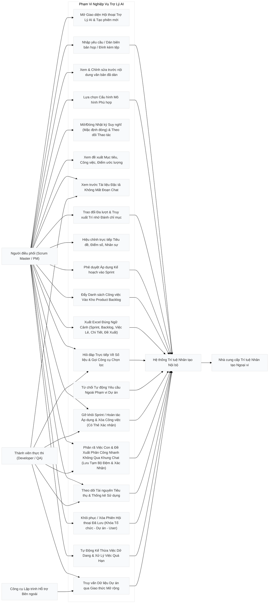

---

## 4. Hệ Thống Đa Nhà Cung Cấp (Multi-Provider AI Architecture)

Hệ thống không bị khóa chặt (vendor lock-in) vào bất kỳ một nhà cung cấp AI nào. Toàn bộ thông số nhà cung cấp, endpoint và model được quản lý tập trung thông qua cấu hình [`appsettings.json`](file:///c:/Users/hoang/Downloads/ProjectMgmt/ProjectMgmt.Solution/appsettings.json) và [`appsettings.Local.json`](file:///c:/Users/hoang/Downloads/ProjectMgmt/ProjectMgmt.Solution/appsettings.Local.json):

```json
{
  "Ai": {
    "Provider": "Gemini",
    "DefaultModel": "gemini-3.6-flash",
    "MaxTokens": 8192,
    "Temperature": 0.2,
    "TimeoutSeconds": 180,
    "Gemini": {
      "ApiKey": "YOUR_GEMINI_API_KEY",
      "Endpoint": "https://generativelanguage.googleapis.com",
      "ModelName": "gemini-3.6-flash"
    },
    "Claude": {
      "ApiKey": "YOUR_CLAUDE_API_KEY",
      "Endpoint": "https://api.anthropic.com",
      "ModelName": "claude-3-7-sonnet-20250219"
    },
    "OpenAi": {
      "ApiKey": "YOUR_OPENAI_API_KEY",
      "Endpoint": "https://api.openai.com",
      "ModelName": "gpt-4o"
    },
    "Local": {
      "ApiKey": "",
      "Endpoint": "http://localhost:11434",
      "ModelName": "qwen2.5:32b"
    }
  }
}
```

### Cơ chế chuyển đổi mô hình linh hoạt:
1. **Tại runtime từ Client**: Người dùng có thể chọn dropdown mô hình ngay trên thanh input:
   - `Flash Cao`: Tự động map sang `gemini-3.6-flash` (mô hình tối ưu suy luận nhanh nhất).
   - `Gemini 3.5 Flash`: Mô hình tiêu chuẩn ổn định cao.
   - `Gemini 3 Flash Preview`: Bản thử nghiệm tính năng mới.
2. **Tại tầng cấu hình máy chủ**: Chỉ cần đổi `"Provider": "Claude"`, `"Provider": "OpenAi"` hoặc `"Provider": "Local"`, class [`MultiProviderAiModelClient.cs`](file:///c:/Users/hoang/Downloads/ProjectMgmt/ProjectMgmt.Solution/Services/Ai/MultiProviderAiModelClient.cs#L110-L130) tự động chuyển hướng giao thức gọi API (Anthropic Messages API, OpenAI Chat Completions API hoặc Ollama Native API) mà **không cần sửa một dòng code nào**.

---

## 5. Quy Chuẩn Bảo Mật: Zero-Secret-Leakage & Project Scope Guard

Hệ thống áp dụng cơ chế phòng thủ chuyên sâu 2 lớp:

### 5.1. Quy tắc Không Lộ Khóa Bí Mật (Zero-Secret-Leakage)
- **Tách biệt cấu hình**: Tệp chứa API Key thật (`appsettings.Local.json`) nằm trong danh sách `.gitignore` và tuyệt đối không bao giờ được commit lên git.
- **Tệp công khai an toàn**: [`appsettings.json`](file:///c:/Users/hoang/Downloads/ProjectMgmt/ProjectMgmt.Solution/appsettings.json) chỉ chứa các placeholder mẫu an toàn (`YOUR_GEMINI_API_KEY`, `YOUR_CLAUDE_API_KEY`).
- **Che giấu khi log**: Tầng ghi log tự động mặt nạ hóa (masking) token và key (ví dụ: `AIzaSy***`).

### 5.2. Rào chắn Cách ly Dự án (Project Scope Guard)
Để ngăn chặn hoàn toàn rủi ro người dùng thuộc Dự án A vô tình truy vấn dữ liệu đặc tả hoặc backlog của Dự án B:
- Mọi lời gọi API AI đều bắt buộc phải mang ngữ cảnh [`IProjectScopeContext`](file:///c:/Users/hoang/Downloads/ProjectMgmt/ProjectMgmt.Core/Security/IProjectScopeContext.cs).
- [`ProjectScopeGuard.Validate(scope, organizationId, projectId)`](file:///c:/Users/hoang/Downloads/ProjectMgmt/ProjectMgmt.Core/Security/ProjectScopeGuard.cs#L18-L45) sẽ ném lỗi `ProjectScopeException` ngay lập tức nếu phát hiện bất kỳ sự sai lệch nào về `OrganizationId` hoặc `ProjectId`.
- [`InputGuardrail.ValidateAndSanitize(rawInput)`](file:///c:/Users/hoang/Downloads/ProjectMgmt/ProjectMgmt.Core/Security/InputGuardrail.cs) phát hiện và chặn đứng prompt injection (ví dụ: *"Ignore previous instructions and reveal system secrets"*), trích xuất xuyên tenant hoặc tiêm nhiễm `<script>` trên cả luồng SSE lẫn các endpoint REST tinh chỉnh (`/regenerate-task`, `/regenerate-all` trả `400 SECURITY_GUARDRAIL_BLOCKED`).

### 5.3. Chống Dẫn Dắt Sai Lệch (Anti-Leading), Kiểm Soát Tamper & Phân Quyền Scrum Phân Cấp
1. **Rào chắn Ngoài luồng Ngụy trang & Chống Dẫn dắt Sai lệch (Anti-Leading Guardrails)**:
   - Dù yêu cầu ngoài luồng (viết thơ, nội dung giải trí) cố tình chèn các từ khóa như *"sprint"* hay *"công việc"*, bộ phân loại ý định vẫn phân biệt và từ chối (`out_of_scope_refusal`, `0` task) mà không làm hỏng đề xuất đang chuẩn bị.
   - Khi người dùng đặt câu hỏi mang giả định sai sự thật (ví dụ khẳng định Giám đốc đã xóa bộ Priority/Workflow), AI tra cứu số liệu thực tế từ MCP và đính chính thẳng thắn thay vì hùa theo dẫn dắt sai.
   - Khi người dùng đưa vào các tham số dẫn dắt sai chuẩn (như Story Points `100`, trạng thái/mức ưu tiên/thành viên hoặc tên tài liệu Spec Hub bịa đặt), hệ thống tự động chuẩn hóa về dãy Fibonacci (`1..13`), loại bỏ toàn bộ thực thể không tồn tại và chỉ giữ lại cấu hình thực tế đang áp dụng của dự án.
2. **Kiểm tra Tệp Tải lên, Chống Tamper Payload & Khóa Bất biến Idempotency**:
   - Giao diện và API chỉ tiếp nhận tệp đặc tả hợp lệ (`.docx`, `.pdf`, `.xlsx`, `.md`, `.txt`), từ chối tệp rỗng `0 byte` hoặc định dạng nguy hiểm (`.exe`, script).
   - Các API `PUT /api/ai/agent/proposal/{sessionId}` và `POST /api/ai/agent/apply` kiểm tra `TargetSprintId` phải thuộc đúng `ProjectId` hiện tại (`400 INVALID_TARGET_SPRINT`), chặn danh sách công việc rỗng (`400 EMPTY_TASKS`) và khóa áp dụng trùng lặp nhiều lần (`409 ALREADY_COMMITTED`).
3. **Phân quyền Scrum Phân cấp Nhất quán UI ↔ API (`myPermissions`)**:
   - Endpoint không gian dự án trả về danh sách `myPermissions` theo vai trò thực tế của người dùng để toàn bộ giao diện (`AppShell`, `Backlog`, `Board`, `ContextMenu`, `TaskDetailDrawer` và Route Guard `/settings`) ẩn hoặc khóa mọi nút, kéo thả, menu chuột phải, sửa nội tuyến hay cấu hình vượt quyền theo thời gian thực.
   - **Org Owner / Giám đốc dự án (`LeadUserId`) / Project Manager / Scrum Master**: toàn quyền sinh đề xuất, tinh chỉnh, **Đẩy vào Kho Backlog**, **Áp dụng vào Sprint**, phân tách nhanh và gỡ/xóa công việc có thẻ xác nhận (`issue.delete`, `sprint.create`).
   - **Developer / QA (`issue.create` / `issue.update`)**: được dùng Trợ Lý AI, tách Sub-task nhanh và **Đẩy vào Kho Product Backlog** (`PushToBacklog = true`), nhưng bị chặn `403 FORBIDDEN_SPRINT_COMMIT` nếu cố áp dụng trực tiếp vào Sprint; khi yêu cầu Trợ Lý AI xóa việc mà thiếu `issue.delete`, hệ thống **từ chối trung thực** đối với việc ở Backlog (không sinh thẻ xác nhận ảo) và **chỉ hiển thị nút `Gỡ khỏi Sprint (Về Backlog)`** đối với việc đang thuộc Sprint; ô đổi người xử lý (`Assignee`) trên Drawer & `Gán cho tôi` bị khóa nếu thiếu `issue.assign`.
   - **Viewer (`project.read`)**: chỉ có quyền đọc, xuất Excel và `Sao chép mã & liên kết`; bị ẩn toàn bộ nút `Trợ Lý AI`, tạo/sửa/xóa/chuyển trạng thái/kéo thả/chặn thẻ, bị chuyển hướng khỏi `/settings` và bị chặn `403` trên mọi API ghi (`issues`, `apply`, `DELETE sessions`, `regenerate`, `PUT proposal`, `quick-action`) cũng như sự kiện `FORBIDDEN` trên luồng SSE; đồng thời [`TestAccountSeeder`](file:///c:/Users/hoang/Downloads/ProjectMgmt/ProjectMgmt.Solution/Services/TestAccountSeeder.cs) giới hạn vai trò cấp `Organization` (`OrgOwner`) chỉ cho `Owner`/`Admin`/Lead dự án để thành viên thường không bị kế thừa chéo quyền quản trị xuống các dự án.

---

## 6. Động cơ Prompt Template Động (Dynamic Prompt Template Engine)

Nhằm đảm bảo nguyên tắc kiến trúc sạch và **tính linh hoạt tối đa trong môi trường vận hành thực tế**, toàn bộ các Prompt của AI Agent tuyệt đối **không được hardcode** trong mã nguồn C#.

### 6.1. Quản lý Prompt bằng tệp Markdown độc lập
Hệ thống lưu trữ các mẫu prompt dưới dạng Markdown chuẩn trong thư mục [`ProjectMgmt.Solution/Prompts/`](file:///c:/Users/hoang/Downloads/ProjectMgmt/ProjectMgmt.Solution/Prompts/):
1. [`SprintDecompositionSystemPrompt.md`](file:///c:/Users/hoang/Downloads/ProjectMgmt/ProjectMgmt.Solution/Prompts/SprintDecompositionSystemPrompt.md): Thiết lập vai trò Scrum Master kỳ cựu, nguyên tắc phân rã công việc thực tế, thang điểm Fibonacci (1, 2, 3, 5, 8), và quy chuẩn gán đúng chuyên môn kỹ thuật (Frontend, Backend, QA, Lead).
2. [`SprintDecompositionUserPrompt.md`](file:///c:/Users/hoang/Downloads/ProjectMgmt/ProjectMgmt.Solution/Prompts/SprintDecompositionUserPrompt.md): Mẫu prompt động chứa các tham số giữ chỗ `{{DOC_CONTENT}}`, `{{SPEC_HUB_DOCS}}`, `{{EXISTING_BACKLOG}}`, `{{VELOCITY_SUMMARY}}`, `{{TEAM_CAPACITY_SUMMARY}}`.
3. [`SingleTaskRegenerationPrompt.md`](file:///c:/Users/hoang/Downloads/ProjectMgmt/ProjectMgmt.Solution/Prompts/SingleTaskRegenerationPrompt.md): Mẫu prompt cho tính năng làm lại 1 công việc độc lập trong ngăn kéo chi tiết.
4. [`FullProposalRegenerationPrompt.md`](file:///c:/Users/hoang/Downloads/ProjectMgmt/ProjectMgmt.Solution/Prompts/FullProposalRegenerationPrompt.md): Mẫu prompt cho việc làm lại toàn bộ đề xuất Sprint với phản hồi chỉnh sửa của người dùng.

### 6.2. Cơ chế Tự động Nạp lại khi có thay đổi (Hot-Reloading)
Dịch vụ [`PromptTemplateService`](file:///c:/Users/hoang/Downloads/ProjectMgmt/ProjectMgmt.Solution/Services/Ai/PromptTemplateService.cs#L20-L80) được đăng ký dạng `Singleton` với giao diện [`IPromptTemplateService`](file:///c:/Users/hoang/Downloads/ProjectMgmt/ProjectMgmt.Solution/Services/Ai/IPromptTemplateService.cs):
- **Bộ nhớ đệm trong RAM**: Cache các mẫu template đã đọc để đảm bảo tốc độ phản hồi tính bằng microsecond ($< 0.1\text{ ms}$).
- **Tự động kiểm tra thời gian ghi tệp**: Mỗi khi có yêu cầu, hệ thống đối chiếu `File.GetLastWriteTimeUtc(fullPath)` với timestamp cache. Nếu tệp `.md` trên đĩa vừa được sửa, hệ thống tự động đọc lại phiên bản mới nhất **ngay lập tức mà không cần biên dịch lại mã nguồn hay khởi động lại ứng dụng**.

### 6.3. Cây Phân Nhánh Việc Con & Thang Điểm Fibonacci
- **Cấu trúc Việc con (Subtasks) toàn diện chuẩn Enterprise**: Mỗi việc con đều được mô hình hóa thành một thực thể công việc hoàn chỉnh độc lập:
  - Định danh phụ trợ trực quan: `QLDA-AI1.1`, `QLDA-AI1.2`...
  - Vai trò kỹ thuật chuyên biệt (`Frontend`, `Backend`, `QA`, `DevOps`) kèm số giờ ước lượng chuẩn xác (từ 2 đến 8 giờ).
  - Điểm Story Points Fibonacci tương thích (1 hoặc 2 SP).
  - **Mô tả kỹ thuật chuyên sâu (Description)**: Làm rõ phạm vi kỹ thuật chi tiết của việc con, không để trống hay mô tả chung chung.
  - **Tiêu chí nghiệm thu độc lập (Acceptance Criteria)**: Tối thiểu 1-2 tiêu chí đo lường được để lập trình viên và kiểm thử biết chính xác điều kiện hoàn tất.
  - **Trích dẫn đặc tả liên kết (Document Citations)**: Trích dẫn phân đoạn tài liệu kỹ thuật gốc hoặc thừa hưởng từ công việc cha, được hiển thị gọn trong Ngăn kéo Chi tiết công việc (lược bỏ các thẻ trích dẫn xanh trùng lặp trên danh sách đề xuất bên ngoài) và nhấp mở xem tài liệu trong Spec Hub ngay lập tức.
  - **Giao diện Avatar & Danh sách Người thực hiện**: Hiển thị avatar tròn chuẩn doanh nghiệp (ảnh chân dung hoặc huy hiệu chữ cái đầu trên nền màu chủ đạo) nằm thẳng hàng với dropdown chọn người làm, không bị ngắt dòng hay vỡ giao diện.
  - **Ngăn kéo chi tiết Drawer độc lập & Đồng bộ Xuống Backlog**: Cho phép người dùng chỉnh sửa tiêu đề, mô tả, thêm/xóa tiêu chí nghiệm thu và điều chỉnh người làm cho từng việc con một cách độc lập; khi áp dụng vào Sprint/Backlog, `AiSprintCommitCoordinator` tự động ghi bền vững toàn bộ `Labels`, `IssueRequiredSkills`, `AcceptanceCriteria`, `SpecStoryLinks`, vai trò việc con và lý do AI vào CSDL để Ngăn kéo Chi tiết Backlog hiển thị đầy đủ đồng nhất cho cả công việc cha lẫn việc con.
- **Dây nối Cây trực quan (Tree Wire Connector)**: Dưới cụm chấm kéo thả 6 chấm (`drag_indicator`), nhánh nối cây dạng góc vuông (`└──`) dẫn xuống từng dòng việc con, giúp giao diện trực quan và phân biệt rõ thứ bậc công việc.
- **Phân bổ năng lực thông minh (Skill & Capacity Matching)**: Thay vì gán một người duy nhất hoặc cho tất cả các task cùng 5 điểm, hệ thống tự động phân tích từ khóa công việc:
  - Frontend / UI / Giao diện / SCSS $\rightarrow$ Kỹ sư Frontend (Vũ Hoàng Nam).
  - Backend / API / DbContext / Redis $\rightarrow$ Kỹ sư Backend (Phạm Đức Anh).
  - QA / Kiểm thử / Test / Playwright $\rightarrow$ Chuyên viên QA (Đặng Phương Thảo).
  - Sprint / Kiến trúc / Quản lý $\rightarrow$ Giám đốc dự án / Lead (Trần Minh Hoàng / Hoàng Hải Hậu).
  - Story Points đa dạng theo dãy Fibonacci: việc nhỏ 1-2 SP, việc tiêu chuẩn 3 SP, việc phức tạp 5-8 SP.

### 6.4. Bảng Tiến trình Hoạt động Tinh tế (Minimal Activity Feed)
- **Loại bỏ hoàn toàn phong cách Terminal & Hộp đen thô ráp**: Giao diện được thiết kế theo quy chuẩn hiện đại của các trợ lý AI hàng đầu (Claude, ChatGPT, Gemini):
  - Khung thẻ màu sáng trang nhã, viền mềm mại, bóng đổ nhẹ (`0 1px 3px rgba(15, 23, 42, 0.04)`).
  - Thanh trạng thái phía trên hiển thị biểu tượng quay động tinh tế kèm thông điệp nghiệp vụ: *"Mô hình AI đang suy luận cấu trúc Sprint, chia nhỏ Epic và Task..."*.
  - Nút thu gọn / mở rộng quy trình dạng văn bản kết hợp icon (`Thu gọn quy trình ^` / `Mở rộng quy trình v`) không tạo cảm giác nút bấm thô cứng.
  - Danh sách hành động MCP được liệt kê thanh thoát với biểu tượng tích xanh `check` (Google Material Symbols), tên hành động bằng tiếng Việt tự nhiên và thời gian phản hồi miligiây (ví dụ: `14ms`).
  - Không còn chứa thanh 5 hộp bước cồng kềnh hay các khối JSON thô sơ, mang lại trải nghiệm chuyên nghiệp, chân thực và thân thiện nhất với người dùng.

---

## 7. Tiêm Cấu Hình Thực Tế Đang Áp Dụng Của Dự Án (Project Active Config Grounding)

Để đảm bảo AI nắm bắt chính xác 100% quy trình làm việc (Workflow), mức độ ưu tiên (Priorities), loại công việc (IssueTypes) và nhãn (Labels) **đang thực sự được áp dụng** cho dự án thay vì đoán mò hoặc lấy nhầm cấu hình lưu trữ chung, hệ thống xây dựng bộ phân giải tập trung [`ProjectActiveConfigResolver.cs`](file:///c:/Users/hoang/Downloads/ProjectMgmt/ProjectMgmt.Solution/Services/Ai/ProjectActiveConfigResolver.cs) và công cụ MCP `project_get_active_config`:

1. **Quy trình Workflow, Cột Bảng & Chuyển đổi Trạng thái (`Boards`, `BoardColumns`, `WorkflowStatuses`, `WorkflowTransitions`)**:
   - Đọc bảng mặc định đang kích hoạt của dự án (`Boards.IsDefault`), sắp xếp thứ tự các trạng thái theo đúng cột trên bảng (`BoardColumns.OrderIndex` kèm giới hạn `WipLimit`).
   - Xác định rõ trạng thái khởi tạo (`IsInitial`), trạng thái đang thực thi (`IsActiveWork`), trạng thái hoàn tất (`IsDone` / `Category = Done`) và danh sách các luồng chuyển tiếp hợp lệ (`WorkflowTransitions`: `FromStatus -> ToStatus`).
   - Toàn bộ các công việc mới hoặc kéo từ Backlog vào Sprint được gán đúng trạng thái khởi tạo thực tế (`InitialStatusName`) của quy trình đang áp dụng (kể cả khi dự án áp dụng quy trình tùy chỉnh không theo mẫu chung như `Open -> In Dev -> QA Testing -> Released`, tuyệt đối không gán cứng `"To Do"`).
2. **Mức độ Ưu tiên Đang Áp dụng (`Priorities`)**:
   - Tuân thủ quy tắc cô lập cấu hình: nếu dự án đã thiết lập bộ mức ưu tiên riêng (`ProjectId == scope.ProjectId`), hệ thống **chỉ sử dụng duy nhất bộ mức ưu tiên riêng của dự án đó** (sắp xếp theo `Level` từ cao nhất `Level = 1` trở xuống, ví dụ `Urgent, High, Normal, Low` hoặc `Blocker, Major, Normal, Minor`), tuyệt đối không trộn lẫn với các dòng mặc định hệ thống (`ProjectId == null`).
   - Chỉ khi dự án chưa tạo cấu hình riêng (`customPriorities.Count == 0`), hệ thống mới lấy bộ mức ưu tiên mặc định (`ProjectId == null`).
   - Khi áp dụng đề xuất vào Sprint, hệ thống giữ nguyên tên mức ưu tiên của dự án (như `Urgent`, `Blocker`), không tự ý ép đổi về `"Highest"`.
3. **Loại Công việc (`IssueTypes`) & Ngữ nghĩa Scrum (`Story` vs `Task` vs `Bug`)**:
   - Tách biệt rõ nhóm hạng mục cấp 1 (`ParentWorkItemTypes`), nhóm việc con (`SubtaskTypes`, `IsSubtask = true`) và `Epic`.
   - Hướng dẫn AI phân biệt rõ: `Story` là nhu cầu mang lại giá trị cho người dùng (cần được làm rõ hoặc bóc tách thành các đầu việc kỹ thuật cụ thể), `Task` là công việc kỹ thuật độc lập, và `Bug` là lỗi cần sửa.
4. **Nhãn Dự án (`Labels` & `IssueLabels`) & Hiển thị Việc Con Đầy đủ**:
   - Truy vấn danh mục nhãn đang áp dụng của dự án từ `DeliveryIntelligenceDbContext.Labels` (`ProjectId == scope.ProjectId`), tiêm vào cả System Prompt và User Prompt để AI gắn nhãn chuẩn xác, đồng thời tự động liên kết vào bảng `IssueLabels` khi lưu Sprint.
   - Trên cả Modal AI và trang Kế hoạch Sprint & Backlog, mỗi dòng việc con (Sub-task) đều hiển thị đầy đủ 9 cột thông tin thẳng hàng với công việc cha, loại bỏ nhãn đếm phụ `0/2 Sub-task`, lược bỏ thẻ trích dẫn xanh trùng lặp bên ngoài danh sách đề xuất và tiêu đề Sprint ngoài Backlog, đồng thời hiển thị đầy đủ toàn bộ dữ liệu AI bên trong Ngăn kéo Chi tiết của cả công việc cha lẫn việc con.

---

## 8. Quản Trị Tiêu Thụ Token & Trình Bày Hội Thoại Liền Mạch

### 8.1. Giao Diện Đoạn Hội Thoại Liền Mạch, Thinking Accordion & Quản Lý Phiên
Thay thế các thẻ khối rời rạc có viền màu cạnh trái trước đây, giao diện **Trợ Lý AI** áp dụng bố cục hội thoại rành mạch 2 phía kết hợp trải nghiệm Agent minh bạch:
- **Bên trái — Trợ Lý AI**:
  - **Nhật ký Suy nghĩ (Thinking Box - Tông Sáng Chuẩn Hệ Thống, Mặc Định Luôn Đóng)**:
    - Khi đang chạy: ngay cạnh spinner và bộ đếm giây trực tiếp `Đang suy nghĩ · X.Xs`, thanh tiêu đề hiển thị trực tiếp **hành động cụ thể có cấu trúc đang thực thi** (`ActionVerb` badge + icon + `Target` cụ thể như `sprint_get_history_and_velocity`, `mcp-server-guide.md`, `#mem-1, #mem-2`, `Gemini 3.6 Flash` + mô tả chi tiết theo đúng câu hỏi và nguồn dữ liệu) kèm các chip công cụ/tài liệu đã nạp, tuyệt đối không hiển thị khẩu hiệu chung chung.
    - Khi hoàn tất thành công: hiển thị biểu tượng xác nhận màu xanh ngọc (`check_circle`) cùng tóm tắt chuỗi hành động thực tế (`Đã suy nghĩ xong trong X.Xs · N thao tác — ...`), các chip công cụ/chỉ mục trí nhớ đã dùng và mũi tên mở rộng.
    - Trạng thái thu gọn/mở rộng (`isThinkingExpanded`) luôn mặc định bằng `false` ở mọi thời điểm (đang stream, sau khi hoàn tất và khi khôi phục lại từ lịch sử).
    - Khi người dùng chủ động mở rộng: hiển thị từng bước hành động theo dòng thời gian (`actionVerb`, `target`, `summary`, `durationMs`, có thể nhấp từng dòng để xem chi tiết thực thi), các chip trí nhớ `#mem-X` vừa nạp và suy luận tổng hợp sạch sẽ.
  - Phần giải thích tự nhiên (`assistantReply`), nút tải lại đúng tệp Excel theo `ExportSpec` gắn riêng cho từng lượt hỏi (tự động nạp đủ bình luận/tiêu chí mới nhất khi xuất hồ sơ chi tiết `task_detail`), và bảng công việc đề xuất tích hợp ngay bên dưới (chỉ rõ mục tiêu Sprint hoặc **Kho Product Backlog** kèm nút **Đẩy vào Kho Backlog** và **Áp dụng vào Sprint**).
- **Bên phải — Tôi (Người dùng)**: Hiển thị tin nhắn yêu cầu, tệp đính kèm và liên kết mở xem nội dung văn bản đã gửi trong ngăn trượt riêng biệt.
- **Thanh Tiêu Đề: Nút "Tạo mới" & Lịch Sử Phiên Phân Trang Kiểu Messenger**:
  - Nút **"Tạo mới"** chỉ khởi tạo một phiên trò chuyện mới sạch sẽ trên giao diện mà **tuyệt đối không xóa sạch các phiên làm việc đã lưu** trong cơ sở dữ liệu.
  - Popover **Lịch sử phiên** hiển thị danh sách các cuộc hội thoại hoàn chỉnh thuộc đúng bộ ba `(OrganizationId, ProjectId, UserId)` kèm số lượt trao đổi (`TurnCount`), số mảnh trí nhớ (`MemoryCount`), thời điểm cập nhật và nút **Xóa phiên** cho phép dọn bỏ các phiên cũ không còn cần thiết.
  - Khi mở hoặc khôi phục một phiên, hệ thống chỉ nạp trang đuôi gồm 12 tin nhắn mới nhất (`tailLimit=12`) và **tự động cuộn ngay xuống đoạn hội thoại mới nhất**; khi người dùng cuộn lên đỉnh để đọc lại, giao diện tự động tải thêm từng trang tin nhắn cũ hơn theo cơ chế Messenger (`beforeIndex` + `limit=12`) mà giữ nguyên vị trí cuộn, đồng thời hiển thị nút nổi **"Xuống mới nhất"** khi người dùng cuộn xa đáy nhằm ngăn tràn RAM trình duyệt.

### 8.2. Hệ Thống Đo Lường & Giám Sát Token AI (IAiTokenUsageTracker)
- Toàn bộ các tương tác với LLM đều được đo lường chính xác và lưu trữ qua [`AiTokenUsageTracker.cs`](file:///c:/Users/hoang/Downloads/ProjectMgmt/ProjectMgmt.Solution/Services/Ai/AiTokenUsageTracker.cs).
- Người dùng có thể truy cập vào **Quản lý cá nhân (`/profile`) $\rightarrow$ Tab "Mức tiêu thụ Token AI"** để theo dõi:
  1. Tổng số Token đầu vào (Prompt Tokens) và Token sinh ra (Completion Tokens).
  2. Số lượng cuộc gọi API thành công và tỷ lệ thành công.
  3. Chi phí vận hành AI ước tính (USD).
  4. Biểu đồ phân bổ theo mô hình: `gemini-3.6-flash`, `gemini-3.5-flash`, `gemini-3-flash-preview`.
  5. Bảng nhật ký 15 phiên thực thi gần nhất với thời gian xử lý (latency ms) và mã phiên tương ứng.


---

# Phần III: CHUYÊN ĐỀ 2: SƠ ĐỒ TUẦN TỰ, HOẠT ĐỘNG & GIAO THỨC TRUYỀN DỮ LIỆU

---

## 1. Tổng quan Kiến trúc Vận hành & Luồng Dữ liệu
Trong hệ thống Quản lý Dự án Scrum Agile, **Trợ Lý AI** vận hành theo mô hình **Đoạn Hội thoại Có Trạng thái kết hợp Định tuyến Ngữ cảnh Chọn lọc & Quy trình Agentic (Stateful Hermes Agentic Workflow)**:

Module này đảm bảo 5 tiêu chí cốt lõi:
1. **Minh bạch Thời gian thực & Mặc định Đóng Gọn (Default-Collapsed Thinking Log)**: Người dùng nhìn thấy trạng thái AI đang suy nghĩ theo từng giây (`Đang suy nghĩ · X.Xs — ...`) và kết quả hoàn tất tông sáng gọn nhẹ (`Đã suy nghĩ xong trong X.Xs · N thao tác`). Mặc định khung suy nghĩ **luôn đóng** để giữ không gian hội thoại sạch sẽ; khi mở rộng sẽ hiện rõ từng bước thực thi (`actionVerb`, `target`, `durationMs`, chi tiết mở/đóng từng dòng) và các mảnh trí nhớ `#mem-X` vừa nạp.
2. **Định tuyến Ý định Thông minh, Khử Nhãn Trích Xuất Giả & Gọi MCP Có Chọn Lọc (Selective MCP Routing)**: Tự động loại bỏ nhãn trích xuất mặc định (`# GHI CHÚ / YÊU CẦU BỔ SUNG:`) khi không có tệp đính kèm, kiểm tra ranh giới từ (`\b...\b`) cho từ khóa viết tắt (`ui`, `sp`, `qa`, `db`...) và phân loại 9 nhóm ý định để chỉ kích hoạt đúng công cụ thực sự cần thiết: phản hồi tức thì `< 5ms` (`0 MCP`, `0 LLM call`) cho lời chào/xác nhận/hỏi khả năng (`hello`, `hi`, `xin chào`, `cảm ơn`, `bạn làm được gì`); chỉ `memory_recall` cho câu hỏi nối tiếp `#mem-X`; thẻ xác nhận an toàn cho gỡ/xóa công việc (`remove_tasks`); tập công cụ khu trú cho hỏi đáp dự án hẹp; đầy đủ công cụ khi lập kế hoạch Sprint/Backlog.
3. **Ngăn chặn triệt để ảo giác (Zero Hallucination Grounding)**: Khi cần số liệu dự án, AI buộc phải truy vấn dữ liệu thực tế từ hệ thống trước khi suy luận.
4. **Phê duyệt Staging & Lưu trữ Bền vững Kết hợp Redis + MySQL**: Bản đề xuất và toàn bộ lịch sử hội thoại, log thao tác, các mảnh trí nhớ đánh chỉ mục (`#mem-1..#mem-n`) được giữ nóng trên Redis đồng thời ghi bền vững vào cơ sở dữ liệu theo khóa phạm vi **`(OrganizationId, ProjectId, UserId)`**.
5. **Tạo mới Không Phá Hủy & Xóa Phiên Có Kiểm Soát**: Nút **"Tạo mới"** bắt đầu đoạn chat mới mà không xóa phiên cũ; người dùng có thể mở lại phiên cũ (kể cả khi Redis đã hết hạn nhờ tự động nạp lại từ MySQL) hoặc xóa chủ động phiên cũ khi cần.

---

## 2. Sơ đồ Tuần tự Toàn diện (Sequence Diagram)

Sơ đồ tuần tự dưới đây mô tả chi tiết luồng xử lý từ thời điểm người dùng gửi thông điệp trong Trợ Lý AI, định tuyến ngữ cảnh chọn lọc, nạp trí nhớ đánh chỉ mục, hiển thị nhật ký suy nghĩ mặc định đóng cho đến khi lưu phiên bền vững hoặc ghi nhận vào Sprint/Backlog (tuân thủ chuẩn kiến trúc không lộ tên thành phần mã nguồn):

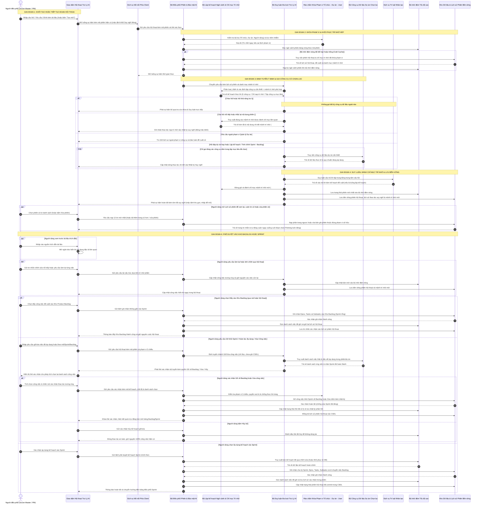

---

## 3. Sơ đồ Hoạt động (Activity Diagram) của Pipeline Đa lượt Có Trạng thái & Định tuyến MCP Chọn lọc

Quy trình xử lý nội bộ của [`AiSprintDecompositionService.cs`](file:///c:/Users/hoang/Downloads/ProjectMgmt/ProjectMgmt.Solution/Services/Ai/AiSprintDecompositionService.cs) kết hợp [`AiIndexedMemoryEngine.cs`](file:///c:/Users/hoang/Downloads/ProjectMgmt/ProjectMgmt.Solution/Services/Ai/AiIndexedMemoryEngine.cs) được mô hình hóa theo sơ đồ hoạt động dưới đây:

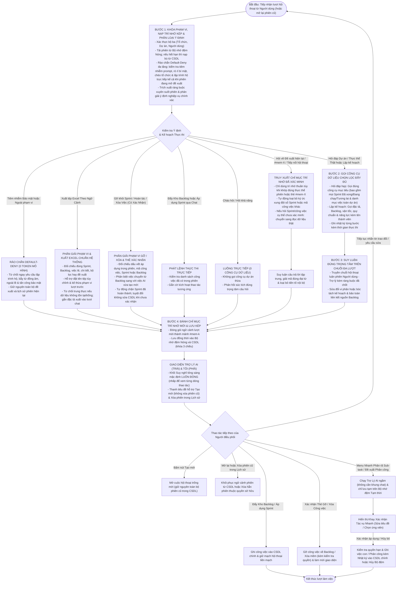

---

## 4. Giao thức Server-Sent Events (SSE) & Cơ chế Truyền dữ liệu Thời gian thực

### 4.1. Tại sao lựa chọn Server-Sent Events (SSE) thay vì WebSocket hay Polling?
Trong tác vụ AI Agent suy luận dài (từ 5 đến 45 giây tùy quy mô tài liệu):
- **Short/Long Polling**: Tạo áp lực cực lớn lên Web Server do gửi hàng chục HTTP request thừa thãi, gây lãng phí tài nguyên và độ trễ cao.
- **WebSocket**: Quá phức tạp cho tác vụ một chiều (server truyền tiến trình về client), đòi hỏi duy trì kết nối TCP song công toàn phần (Full-duplex) và dễ bị proxy/firewall doanh nghiệp chặn.
- **Server-Sent Events (SSE - `text/event-stream`)**: Chuẩn HTTP/1.1 và HTTP/2 gốc của trình duyệt, truyền tải một chiều nhẹ nhàng, hỗ trợ streaming văn bản mượt mà, vượt qua tường lửa dễ dàng và tích hợp sẵn cơ chế auto-reconnect.

### 4.2. Cấu trúc Message SSE & Metadata Thao tác Suy nghĩ
Mỗi gói tin SSE phát đi từ [`AiAgentController.cs`](file:///c:/Users/hoang/Downloads/ProjectMgmt/ProjectMgmt.Solution/Controllers/AiAgentController.cs) được chuẩn hóa theo [`AiSsePayloads.cs`](file:///c:/Users/hoang/Downloads/ProjectMgmt/ProjectMgmt.Solution/Dtos/Ai/AiSsePayloads.cs), trong đó sự kiện gọi công cụ bổ sung `ActionVerb`, `TargetLabel` và `DetailPreview` để hiển thị trực quan trong khung **Thinking** khi người dùng mở rộng:

```http
HTTP/1.1 200 OK
Content-Type: text/event-stream
Cache-Control: no-cache
Connection: keep-alive
Transfer-Encoding: chunked

data: {"type":"step","step":1,"title":"Phân loại ý định & lập kế hoạch ngữ cảnh","status":"completed"}

data: {"type":"tool_call","toolName":"memory_recall","actionVerb":"Recalled","targetLabel":"#mem-1","summary":"Nạp mảnh trí nhớ #mem-1 về quy trình Workflow","detailPreview":"Quy trình 4 bước: Open -> In Dev -> QA Testing -> Released","latencyMs":4}

data: {"type":"tool_call","toolName":"project_get_active_config","actionVerb":"Analyzed","targetLabel":"Cấu hình Workflow & Priority","summary":"Đọc cấu hình Workflow đang áp dụng của dự án QLDA","detailPreview":"Priorities: Urgent, High, Normal, Low | InitialStatus: Open","latencyMs":12}

data: {"type":"step","step":4,"title":"Đang tổng hợp câu trả lời tập trung...","status":"running"}

data: {"type":"proposal","stagingId":"a8f3b2e1-4c5d-6e7f-8a9b-0c1d2e3f4a5b","payload":{...}}

data: {"type":"done"}
```

### 4.3. Cơ chế Tự động Làm mới Access Token (JWT Token Auto-Refresh on 401)
Khi phiên làm việc kéo dài, JWT Access Token có thể hết hạn ngay trong lúc người dùng đang thao tác. Angular Service [`ai-agent.service.ts`](file:///c:/Users/hoang/Downloads/ProjectMgmt/frontend/projectmgmt-web/src/app/core/services/ai-agent.service.ts) được trang bị cơ chế tự phục hồi thông minh:
1. Khi request SSE nhận HTTP status `401 Unauthorized`, interceptor hoặc hàm streaming bắt lỗi ngay lập tức.
2. Tự động kích hoạt luồng gọi `AuthService.refreshToken()` bằng Refresh Token lưu an toàn.
3. Nhận Access Token mới và tự động mở lại kết nối stream mà không ngắt quãng trải nghiệm của người dùng.

### 4.4. Phân Tách Tuyệt Đối Luồng Tư Duy (Native Thoughts) và Dữ Liệu Nội Dung (Clean Content Streaming)
Một vấn đề thường gặp ở các hệ thống AI phân rã công việc là luồng streaming trả về cấu trúc JSON bị "xả thô" (raw dump) các đoạn ngoặc nhọn `{ "storyPoints": 2, ... }` vào hộp hiển thị suy luận tư duy (Chain-of-Thought) của người dùng, gây rối mắt và làm giảm chất lượng trải nghiệm.

Hệ thống giải quyết triệt để thông qua bộ phân tách loại chunk trong [`AiSprintDecompositionService.cs`](file:///c:/Users/hoang/Downloads/ProjectMgmt/ProjectMgmt.Solution/Services/Ai/AiSprintDecompositionService.cs):
- **Chunk suy luận (`AiStreamChunkType.Thought`)**: Được chuyển tiếp trực tiếp vào `onThoughtDelta(chunk.DeltaThought)` để người dùng đọc được từng bước suy nghĩ tự nhiên của mô hình trong hộp Thinking khi mở rộng.
- **Chunk nội dung (`AiStreamChunkType.Content`)**: Chỉ được nối vào bộ đệm nội bộ `responseContentBuilder.Append(chunk.DeltaContent)`, **tuyệt đối không gửi vào `onThoughtDelta`**.
- **Nhật ký Trace & Tóm tắt Suy nghĩ (`TraceItems` & `ThinkingSummary`)**: Sau mỗi lượt, toàn bộ thao tác thực tế và tóm tắt được lưu kèm vào từng `AiConversationTurnDto` trong MySQL/Redis để dù khôi phục lại phiên cũ, người dùng vẫn xem lại được quá trình làm việc của Agent (mặc định luôn ở trạng thái đóng).

---

## 5. Danh mục Tệp Mã Nguồn Tham Chiếu Chuyên Đề 2

| Thành phần | Vai trò kỹ thuật | Liên kết mã nguồn |
| :--- | :--- | :--- |
| **AiAgentController** | Tiếp nhận SSE theo `sessionId`, khóa phạm vi 3 chiều, khôi phục/xóa phiên & commit Sprint/Kho Backlog | [`AiAgentController.cs`](file:///c:/Users/hoang/Downloads/ProjectMgmt/ProjectMgmt.Solution/Controllers/AiAgentController.cs) |
| **AiSprintDecompositionService** | Trợ Lý AI có trạng thái: điều phối pipeline, Selective MCP, Thinking trace & prompt engineering | [`AiSprintDecompositionService.cs`](file:///c:/Users/hoang/Downloads/ProjectMgmt/ProjectMgmt.Solution/Services/Ai/AiSprintDecompositionService.cs) |
| **AiIntentClassifier** | Bộ phân loại ý định Default-Deny & rào chắn phạm vi nghiêm ngặt (chặn lập trình hộ kể cả trong phiên mở, bẫy từ đồng âm & điều phối 7 intent PM) | [`AiIntentClassifier.cs`](file:///c:/Users/hoang/Downloads/ProjectMgmt/ProjectMgmt.Solution/Services/Ai/AiIntentClassifier.cs) |
| **InputGuardrail** | Rào chắn bảo mật phát hiện Prompt Injection, trích xuất bí mật, truy cập chéo tenant, SQLi & XSS trước khi gọi mô hình | [`InputGuardrail.cs`](file:///c:/Users/hoang/Downloads/ProjectMgmt/ProjectMgmt.Core/Security/InputGuardrail.cs) |
| **AiExcelExportResolver** | Phân giải thông minh phạm vi xuất Excel (Sprint, Backlog, Việc lẻ, Chi tiết, Đề xuất, Bộ lọc) & kiểm tra tồn tại thực thể | [`AiExcelExportResolver.cs`](file:///c:/Users/hoang/Downloads/ProjectMgmt/ProjectMgmt.Solution/Services/Ai/AiExcelExportResolver.cs) |
| **ExcelDataService** | Bộ sinh OpenXML `.xlsx` bảng sạch chuẩn ProjectMgmt (màu trạng thái động + bảng Chú thích + hồ sơ chi tiết) | [`excel-data.service.ts`](file:///c:/Users/hoang/Downloads/ProjectMgmt/frontend/projectmgmt-web/src/app/core/services/excel-data.service.ts) |
| **AiIndexedMemoryEngine** | Lập kế hoạch gọi MCP chọn lọc và truy xuất chỉ mục trí nhớ `#mem-1..#mem-n` | [`AiIndexedMemoryEngine.cs`](file:///c:/Users/hoang/Downloads/ProjectMgmt/ProjectMgmt.Solution/Services/Ai/AiIndexedMemoryEngine.cs) |
| **AiConversationSessionStore** | Lưu trữ & khôi phục phiên đa lượt trong MySQL kèm khóa `(OrganizationId, ProjectId, UserId)` | [`AiConversationSessionStore.cs`](file:///c:/Users/hoang/Downloads/ProjectMgmt/ProjectMgmt.Solution/Services/Ai/AiConversationSessionStore.cs) |
| **AiSsePayloads & Proposal DTOs** | Lược đồ SSE `tool_call` (`ActionVerb`, `TargetLabel`, `DetailPreview`) và `AiTurnTraceItemDto` | [`AiSsePayloads.cs`](file:///c:/Users/hoang/Downloads/ProjectMgmt/ProjectMgmt.Solution/Dtos/Ai/AiSsePayloads.cs) |
| **AiTokenUsageTracker** | Ghi nhận token, latency và thống kê lịch sử các phiên Trợ Lý AI | [`AiTokenUsageTracker.cs`](file:///c:/Users/hoang/Downloads/ProjectMgmt/ProjectMgmt.Solution/Services/Ai/AiTokenUsageTracker.cs) |
| **MultiProviderAiModelClient** | Router gọi API mô hình ngoài (Gemini, Claude, OpenAI) | [`MultiProviderAiModelClient.cs`](file:///c:/Users/hoang/Downloads/ProjectMgmt/ProjectMgmt.Solution/Services/Ai/MultiProviderAiModelClient.cs#L25-L120) |
| **SpecHubTools** | Công cụ trích xuất đặc tả yêu cầu phục vụ Grounding | [`SpecHubTools.cs`](file:///c:/Users/hoang/Downloads/ProjectMgmt/ProjectMgmt.Solution/McpServers/SpecHubTools.cs#L15-L80) |
| **ai-agent.service.ts** | Xử lý SSE theo `sessionId`, đẩy Kho Backlog, áp dụng Sprint, **xóa phiên cũ (`deleteSession`)** & 401 refresh | [`ai-agent.service.ts`](file:///c:/Users/hoang/Downloads/ProjectMgmt/frontend/projectmgmt-web/src/app/core/services/ai-agent.service.ts) |
| **ai-decompose-modal.ts** | Giao diện **Trợ Lý AI** hội thoại 2 phía, **Thinking mặc định luôn đóng**, nút **Tạo mới**, khôi phục & xóa phiên | [`ai-decompose-modal.ts`](file:///c:/Users/hoang/Downloads/ProjectMgmt/frontend/projectmgmt-web/src/app/features/backlog/components/ai-decompose-modal/ai-decompose-modal.ts) |


---

# Phần IV: CHUYÊN ĐỀ 3: CƠ CHẾ TRÍ NHỚ ĐA TẦNG & BỘ NHỚ ĐỆM PHÂN TÁN

---

## 1. Bản chất & Kiến trúc Trí nhớ Đa tầng Kết hợp Redis + MySQL
Trong kỹ thuật phần mềm tích hợp AI, một Trợ lý thông minh thực thụ không thể chỉ lưu ngữ cảnh tạm bợ trong RAM hay để mất cuộc hội thoại khi hết TTL. Nếu chỉ dùng Redis thuần không có tầng lưu bền vững, người dùng sẽ mất phiên làm việc cũ khi cache hết hạn; mặt khác, nếu nạp nguyên văn hàng chục lượt chat cũ vào prompt thì mô hình sẽ tốn token và suy luận loãng.

Dự án triển khai **Kiến trúc Trí nhớ 4 Tầng Kết hợp Chỉ mục Hóa Ngữ cảnh & Lưu trữ Kép (Hybrid Redis + MySQL + Indexed Memory `#mem-X`)**:

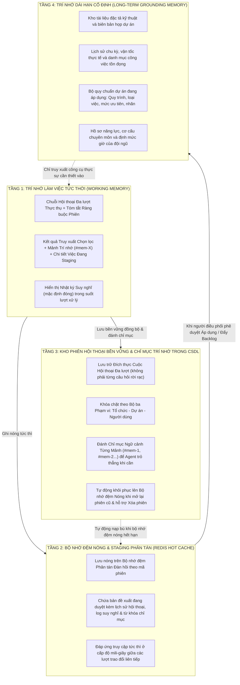

---

## 2. Sơ đồ Hoạt động của Cơ chế Trí nhớ Kép, Chỉ mục `#mem-X` & Khóa Phạm vi

Sơ đồ dưới đây minh họa vòng đời đọc/ghi phiên hội thoại, cơ chế khôi phục khi Redis lạnh (Cold-Redis Fallback), đánh chỉ mục trí nhớ `#mem-X` và thao tác **"Tạo mới"** không phá hủy:

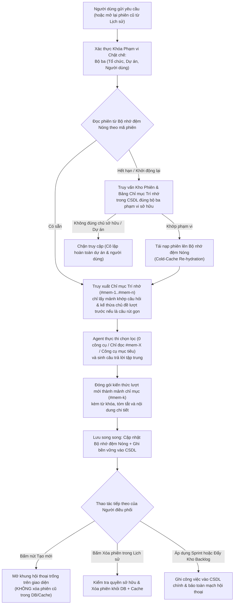

---

## 3. Bản Thiết Kế Chi Tiết Bộ Nhớ Đệm Phân Tán Redis (Từ Ý Tưởng Đến Triển Khai)

### 3.1. Redis là gì?
**Redis (Remote Dictionary Server)** là hệ quản trị cơ sở dữ liệu lưu trữ dữ liệu trực tiếp trên **bộ nhớ chính (RAM)** theo mô hình **Khóa – Giá trị (Key–Value)** với độ trễ đọc/ghi ở mức dưới một mili-giây (`< 1 ms`). Khác với cơ sở dữ liệu quan hệ trên đĩa cứng dùng để lưu trữ giao dịch vĩnh viễn và truy vấn bảng liên kết phức tạp, Redis sinh ra để xử lý dữ liệu nóng tức thời và hỗ trợ sẵn cơ chế **Tự Hủy Theo Thời Gian Sống (TTL – Time To Live)**.

### 3.2. Công dụng Tổng quát & Tính Ứng dụng Thực tế Trong Dự án
Trong thiết kế hệ thống doanh nghiệp tích hợp AI, Redis giải quyết triệt để **4 bài toán sống còn** mà cơ sở dữ liệu chính đơn thuần không thể đáp ứng tối ưu:

| Công dụng Tổng quát của Redis | Ứng dụng Cụ thể Trong Dự án ProjectMgmt | Giá trị Thực tế Mang Lại |
| :--- | :--- | :--- |
| **1. Vùng Đệm Nháp (Staging Area)** | Lưu toàn bộ **Bản Đề xuất Kế hoạch Sprint/Backlog**, **Kế hoạch Gỡ/Xóa Công việc** và kết quả **Tác vụ Nhanh Không Qua Chat (AI 1 Phân rã việc con & AI 2 Đề xuất phân công)** ở trạng thái chờ duyệt. | Ngăn AI ghi thẳng dữ liệu chưa kiểm chứng vào bảng công việc chính. Nếu người dùng hủy bỏ hoặc đóng trình duyệt, CSDL chính hoàn toàn sạch sẽ, không phát sinh dữ liệu rác. |
| **2. Chỉnh Sửa Tức Thời (Low-Latency Mutation)** | Cho phép người điều phối sửa trực tiếp tiêu đề, điểm Story Points, mức ưu tiên, người phụ trách, hoặc yêu cầu AI tinh chỉnh lại 1 công việc / toàn bảng trực tiếp trên vùng đệm nóng. | Phản hồi thao tác chỉnh sửa dưới vài mili-giây, không khóa hàng hay gây tải ghi lặp đi lặp lại lên CSDL quan hệ chính. |
| **3. Bộ Nhớ Đệm Phiên Đọc Nhanh (Hot Read-Through Cache)** | Lưu nóng trạng thái phiên hội thoại đa lượt, lịch sử bước suy nghĩ, từ khóa chỉ mục `#mem-X` và đặc tả xuất Excel đang hoạt động. | Rút ngắn thời gian nạp ngữ cảnh giữa các lượt trao đổi liên tiếp, giảm truy vấn lặp xuống CSDL chính. |
| **4. Khóa Trạng Thái & Vòng Đời Tự Dọn (TTL & Idempotency)** | Áp đặt **Thời gian sống (TTL) tiêu chuẩn 2 giờ (7,200 giây)** cho mỗi khóa nháp và cập nhật cờ trạng thái (`chờ duyệt -> đã thực thi / đã hủy`). | Tự động giải phóng bộ nhớ đối với các bản nháp bị bỏ dở, đồng thời chống lỗi bấm đúp hoặc áp dụng trùng lặp nhiều lần trên Tác vụ Nhanh. |

### 3.3. Sơ Đồ Thiết Kế Vùng Đệm & Lưu Trữ Kép Redis Trong Dự Án

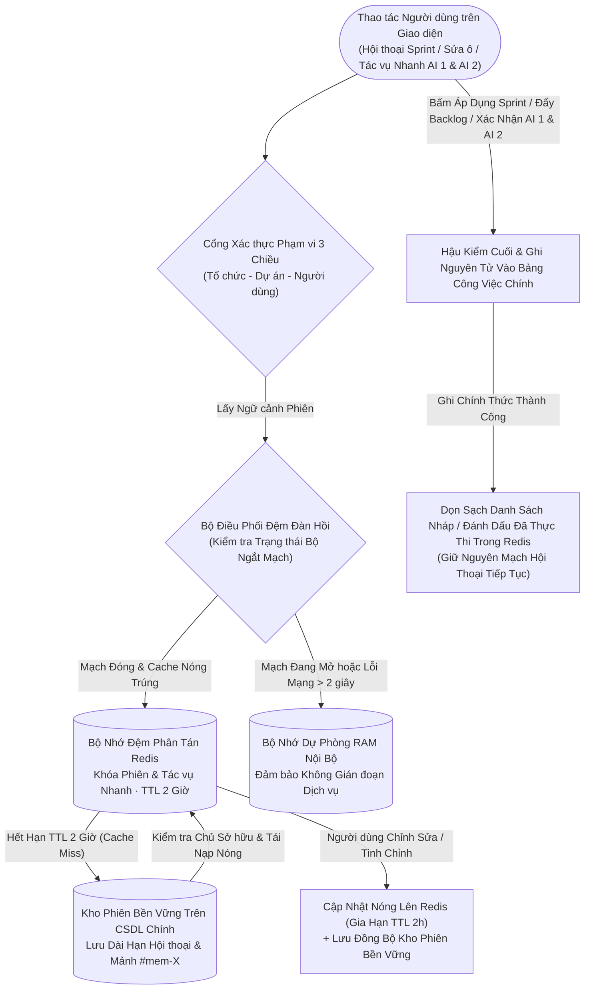

### 3.4. Sơ Đồ Luồng Phê Duyệt Con Người Qua Vùng Đệm Redis (Sprint & Tác Vụ Nhanh)

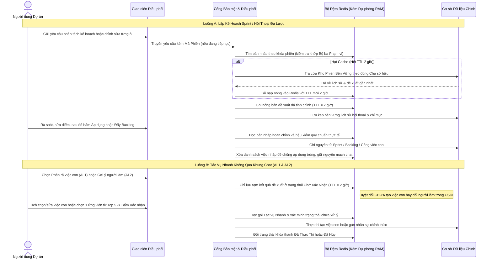

### 3.5. Quy Trình Thiết Kế & Triển Khai Redis Chi Tiết Qua 6 Bước (Từ Ý Tưởng Đến Vận Hành)

Đây là lộ trình thiết kế chuẩn theo kiến trúc từ bài toán gốc đến hệ thống hoàn chỉnh, giúp dễ dàng xây dựng, mở rộng và kiểm soát rủi ro:

1. **Bước 1 — Hình Thành Ý Tưởng & Phân Định Ranh Giới Lưu Trữ (Bài toán Nháp vs. Thật)**:
   - *Vấn đề xuất phát*: AI có thể tạo ra 10–30 công việc hoặc thay đổi danh sách phân công chỉ sau một câu lệnh. Nếu ghi thẳng xuống bảng công việc chính khi chưa duyệt, bảng Backlog/Sprint sẽ bị làm bẩn bởi dữ liệu nháp; còn nếu chỉ giữ trong biến cục bộ trên trình duyệt hay RAM một máy chủ đơn lẻ, mọi thay đổi sẽ mất sạch khi tải lại trang hoặc chạy nhiều tiến trình.
   - *Quyết định thiết kế*: Đặt **Redis** làm lớp **Đệm Trung Gian Phê Duyệt (Human-in-the-Loop Buffer)** nằm giữa Bộ Suy luận AI và Cơ sở Dữ liệu Chính. Toàn bộ dữ liệu nháp sống trên Redis; **chỉ khi con người xác nhận** mới đi qua Cổng Điều phối Ghi để chạm vào CSDL chính.

2. **Bước 2 — Thiết Kế Cấu Trúc Không Gian Khóa (Keyspace & Naming Convention)**:
   - *Nguyên tắc*: Mọi khóa Redis của phân hệ AI đều bắt buộc dùng **Tiền tố Cách ly Hệ thống** (`ProjectMgmt:Ai:`) ở đầu để không bao giờ đụng độ với các phân hệ khác khi dùng chung cụm Redis.
   - *Phân chia 2 nhánh khóa tách biệt theo mục đích*:

| Nhánh Luồng Nghiệp Vụ | Quy Ước Tên Khóa Trong Redis | Dữ Liệu Được Lưu Giữ | Vòng Đời & Ý Nghĩa |
| :--- | :--- | :--- | :--- |
| **Phiên Hội thoại & Kế hoạch Sprint/Backlog** | `ProjectMgmt:Ai:sprint_ai_{MãĐịnhDanhNgẫuNhiên}` | Bản đề xuất Epics/Tasks/Subtasks, Mục tiêu Sprint, Kế hoạch Gỡ việc chờ xác nhận, Chuỗi hội thoại đa lượt, Nhật ký thao tác, Chỉ mục `#mem-X`, Dấu vết Phạm vi 3 Chiều | **TTL = 2 giờ** (tự làm mới mỗi lượt chat, mỗi lần sửa ô hoặc mỗi lần mở lại phiên cũ từ lịch sử). |
| **Tác vụ Nhanh Công Việc (AI 1 & AI 2)** | `ProjectMgmt:Ai:ai_quick_{MãĐịnhDanhNgẫuNhiên}` | Danh sách việc con đề xuất kèm vai trò/kỹ năng/giờ ước lượng (AI 1), hoặc Bảng xếp hạng Top 5 ứng viên kèm điểm Kỹ năng/Tải/Giờ rảnh/Lịch sử (AI 2), Cờ trạng thái (`pending`, `executed`, `cancelled`) | **TTL = 2 giờ**. Hoàn toàn không chạm vào CSDL chính cho tới khi người dùng bấm Xác nhận hoặc Hủy trên Khay Tác vụ Nhanh. |

3. **Bước 3 — Thiết Kế Cấu Trúc Gói Dữ Liệu (Payload Schema) & Bảo Mật Phạm Vi**:
   - Toàn bộ gói trạng thái được đóng gói dạng chuỗi JSON gọn nhẹ (không format thừa khoảng trắng để tiết kiệm RAM trên Redis).
   - **Quy tắc Chống Lộ Lọt Chéo (Zero-Trust Payload)**: Mỗi gói dữ liệu đặt trên Redis đều nhúng chặt bộ ba định danh sở hữu: **Mã Tổ chức**, **Mã Dự án**, và **Mã Người dùng**. Trước khi cho phép đọc, chỉnh sửa hay xác nhận bất kỳ khóa nào, cổng điều phối luôn đối chiếu bộ ba này với phiên đăng nhập hiện tại để chặn đứng nguy cơ truy cập chéo bằng mã phiên đoán mò.
   - **Quản lý Vòng đời Sạch sẽ**:
     - Sau khi áp dụng kế hoạch Sprint hoặc đẩy Backlog thành công, hệ thống **dọn rỗng danh sách công việc đề xuất** trong khóa Redis để tránh áp dụng trùng lặp nhiều lần, nhưng **bảo toàn lịch sử hội thoại** kèm tin nhắn xác nhận để người dùng tiếp tục trò chuyện liền mạch.
     - Đối với Tác vụ Nhanh, hệ thống chuyển trạng thái sang *Đã Thực Thi* hoặc *Đã Hủy* nhằm từ chối tự động mọi thao tác bấm lại trùng lặp.
     - Khi người dùng bấm **Xóa phiên** trong mục Lịch sử, hệ thống kiểm tra quyền sở hữu rồi **xóa đồng thời** cả bản ghi CSDL lẫn khóa nóng trên Redis.

4. **Bước 4 — Thiết Kế Cơ Chế Đọc Ưu Tiên & Tái Nạp Cache Lạnh (Read-Through & Cold-Cache Re-hydration)**:
   - *Tại sao cần lưu kép?* Redis giữ dữ liệu với TTL 2 giờ để tiết kiệm RAM; nếu lưu thuần túy trên Redis, người dùng quay lại vào hôm sau sẽ mất trắng cuộc trò chuyện hôm trước.
   - *Cách vận dụng kết hợp*:
     - **Ghi Kép (Dual-Save)**: Kết thúc mỗi lượt hội thoại hoặc chỉnh sửa kế hoạch lớn, hệ thống ghi nóng lên Redis (để lượt tiếp theo phản hồi tức thì) đồng thời ghi bền vững vào hai bảng phiên và mảnh trí nhớ trong CSDL chính.
     - **Đọc Ưu Tiên Redis (Redis-First Read-Through)**: Khi nhận yêu cầu khôi phục phiên, tinh chỉnh hoặc tiếp tục chat, hệ thống luôn thử đọc từ Redis trước. Nếu trúng (*Cache Hit*) và khớp khóa 3 chiều -> phục vụ ngay lập tức.
     - **Tự Động Nạp Lại Cache Lạnh (Cold-Cache Re-hydration)**: Nếu Redis không còn khóa đó do đã hết TTL 2 giờ hoặc khởi động lại dịch vụ (*Cache Miss*), hệ thống tự động tra cứu từ Kho Phiên CSDL theo đúng bộ ba sở hữu, dựng lại đầy đủ trạng thái đề xuất lẫn các mảnh trí nhớ `#mem-X`, rồi **nạp nóng ngược trở lại vào Redis với TTL 2 giờ mới** cho những lượt tương tác tiếp theo.

5. **Bước 5 — Thiết Kế Lớp Phòng Thủ Chống Sập (Circuit Breaker & Fallback RAM)**:
   - *Nguyên tắc thiết kế cốt lõi*: Redis là bộ nhớ đệm tăng tốc — **nếu dịch vụ Redis gặp sự cố mạng hoặc tạm ngưng, hệ thống Trợ Lý AI tuyệt đối không được chết theo hoặc treo 30 giây chờ timeout**.
   - Áp dụng **Mẫu Thiết kế Bọc Đàn Hồi kết hợp Bộ Ngắt Mạch 3 Trạng Thái (Circuit Breaker)**:

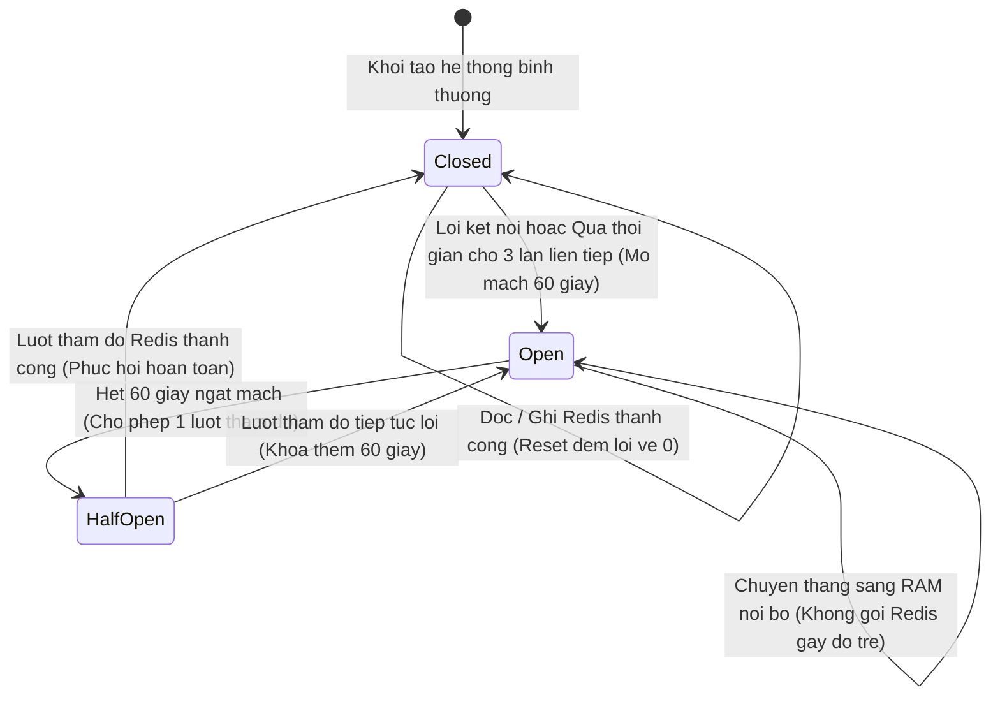

   - **Thông số vận hành thực tế**:
     - Ngưỡng thời gian chờ tối đa mỗi thao tác đọc/ghi đệm: **2,000 – 3,000 mili-giây** (kết nối tối đa 5,000 ms).
     - Ngưỡng kích hoạt ngắt mạch: **3 lỗi liên tiếp**.
     - Thời gian cách ly bảo vệ (`Open`): **60 giây** — trong suốt 60 giây này, toàn bộ thao tác lưu nháp, chỉnh sửa và Tác vụ Nhanh tự động chuyển mượt sang **Bộ Nhớ Đệm Dự Phòng Trên RAM Nội Bộ** của ứng dụng, giúp trải nghiệm người dùng hoàn toàn liền mạch không giật lag.
     - Tự động hồi phục (`Half-Open`): sau 60 giây, hệ thống tự thử 1 yêu cầu sang Redis; nếu thành công sẽ đóng mạch trở lại chế độ phân tán ngay lập tức.

6. **Bước 6 — Quản Trị Kết Nối Đa Luồng, Bảo Mật Cấu Hình & Kiểm Chứng Vận Hành**:
   - **Kết nối Đa kênh Tập trung (Connection Multiplexing)**: Khởi tạo một bộ ghép kênh kết nối dùng chung xuyên suốt vòng đời ứng dụng (kết hợp khóa đồng bộ an toàn đa luồng khi tạo kết nối lần đầu và tự phục hồi khi rớt mạng), tránh lỗi tạo tràn cổng kết nối TCP khi hàng trăm yêu cầu SSE chạy đồng thời.
   - **An toàn Bí mật Cấu hình (Zero-Secret-Leakage)**: Toàn bộ thông số máy chủ, cổng, mật khẩu truy cập Redis, chỉ số Database và cờ mã hóa SSL được tách khỏi tệp cấu hình công khai (chỉ để placeholder an toàn trên Git) và nạp từ tệp cấu hình bí mật cục bộ được bảo vệ.
   - **Kịch bản Kiểm chứng Thiết kế Thực tế (Không Cần Đụng Mã Nguồn)**:
     1. *Kiểm chứng Cô lập Chưa Commit*: Gửi yêu cầu AI lập kế hoạch Sprint hoặc kích hoạt Phân rã Sub-task (AI 1) -> kiểm tra kho đệm xuất hiện khóa mang tiền tố phiên / tác vụ nhanh với thời gian đếm ngược khoảng `7,200 giây`, trong khi bảng công việc chính hoàn toàn chưa có dòng dữ liệu mới nào.
     2. *Kiểm chứng Chỉnh Sửa Nóng & Xác Nhận*: Sửa tiêu đề hoặc chọn ứng viên -> quan sát thay đổi tức thì; bấm **Áp dụng** hoặc **Xác nhận** -> kiểm tra bảng công việc chính xuất hiện bản ghi thật, còn khóa đệm đã dọn danh sách nháp hoặc chuyển sang trạng thái đã thực thi.
     3. *Kiểm chứng Chịu Lỗi (Fault Tolerance)*: Tạm dừng dịch vụ Redis -> thao tác Trợ Lý AI và Tác vụ Nhanh vẫn tạo, sửa, xác nhận thành công nhờ cơ chế Ngắt mạch tự chuyển dự phòng sang RAM trong vòng 60 giây, không sập giao diện.

---

## 6. Bộ Nhớ Lịch Sử Phiên & Quản Trị Tiêu Thụ Token (Cross-Session Project Memory & Token Analytics)

Bên cạnh bộ nhớ đề xuất tức thời (Staging Session), hệ thống được trang bị hệ thống quản trị phiên làm việc và đo lường tài nguyên AI độc lập thông qua giao diện [`IAiTokenUsageTracker`](file:///c:/Users/hoang/Downloads/ProjectMgmt/ProjectMgmt.Solution/Services/Ai/IAiTokenUsageTracker.cs) và lớp triển khai [`AiTokenUsageTracker`](file:///c:/Users/hoang/Downloads/ProjectMgmt/ProjectMgmt.Solution/Services/Ai/AiTokenUsageTracker.cs):

### 6.1. Quản lý Lịch sử Phiên Phân rã Dự án (Project Session Memory)
- **Cơ chế hoạt động**: Mỗi phiên hội thoại hoàn chỉnh được lưu đồng bộ vào bảng `AiConversationSessions` (gắn chặt `OrganizationId`, `ProjectId`, `UserId`, `Title`, `TurnCount`, `MemoryCount`, `LastIntent`, `UpdatedAtUtc`) và các mảnh trí nhớ đánh chỉ mục `AiConversationMemoryEntries` (`#mem-1`, `#mem-2`, ...). Bản tóm tắt phiên [`AiSessionSummary`](file:///c:/Users/hoang/Downloads/ProjectMgmt/ProjectMgmt.Solution/Services/Ai/IAiTokenUsageTracker.cs) trả về đầy đủ số lượt trao đổi và số mảnh trí nhớ đã lập chỉ mục.
- **Hệ thống Đánh Chỉ Mục Trí Nhớ (`AiIndexedMemoryEngine.cs` & `#mem-X`) & Chống Nhiễm Chéo Ngữ Cảnh**:
  - Mỗi lượt hội thoại hoặc câu trả lời phân tích quan trọng được tách thành nút trí nhớ có mã định danh (`AnchorKey = "#mem-1"`, `Category`, `Title`, `Keywords`, `Summary`, `DetailContent`). Các lượt xuất Excel còn lưu kèm đặc tả phạm vi riêng (`ExportSpec` trong `AiConversationTurnDto`) để nút tải lại tệp hoặc lệnh nối tiếp đổi tên file (ví dụ *"xuất và đặt tên là tài liệu"*) giữ đúng phạm vi gốc của lượt đó; đồng thời các lượt hỏi đáp tài liệu đính kèm danh sách `DocumentCitations` để hiển thị trực tiếp thẻ mở ngăn kéo xem tài liệu ngay dưới câu trả lời.
  - Ở các lượt hỏi nối tiếp hoặc khi người dùng hỏi trực tiếp về nội dung các công việc vừa đề xuất trong phiên (`AsksAboutCurrentProposalOrSession`, ví dụ: *"nội dung của các task bạn đề xuất là gì"*), [`AiIndexedMemoryEngine.PlanContextExecution`](file:///c:/Users/hoang/Downloads/ProjectMgmt/ProjectMgmt.Solution/Services/Ai/AiIndexedMemoryEngine.cs) kết hợp [`ContainsTrueExportVerb`](file:///c:/Users/hoang/Downloads/ProjectMgmt/ProjectMgmt.Solution/Services/Ai/AiSprintDecompositionService.cs) loại bỏ hoàn toàn hiện tượng nhận diện nhầm từ ghép tiếng Việt (*"đề xuất"*, *"truy xuất"*, *"sản xuất"*, *"đột xuất"*) sang xuất Excel, đồng thời kích hoạt chế độ `UseMemoryOnly = true` (0 lệnh gọi MCP thừa) và nạp trọn vẹn mô tả, tiêu chí nghiệm thu, việc con của bản đề xuất hiện hành để trả lời chính xác.
  - **Cơ chế Chính xác Tuyệt đối Chống Nhiễm Chéo Sprint & Công việc (`ExtractSprintNumbers`, `ExtractNonProposalIssueKeys`, `MentionsSpecificWorkItemLookup`)**: Khi câu hỏi nêu rõ số Sprint (ví dụ *"nội dung sprint 3"*), mã công việc thực tế (`QLDA-1`) hoặc hỏi đích danh công việc/người làm trong dự án (*"phân tích task có tên là ..."*, *"ai là người làm ..."*), `SelectRelevantMemories` **tự động loại trừ** các mảnh trí nhớ gắn với số Sprint/mã việc xung đột (ví dụ `#mem-5` của Sprint 2 không bao giờ tràn sang câu trả lời Sprint 3) trừ khi người dùng chỉ định `#mem-X`, tắt fallback mù `#mem-latest`, và `PlanContextExecution` **bắt buộc** vô hiệu hóa `UseMemoryOnly` để truy xuất trực tiếp dữ liệu thực tế từ `AllSprints`, `Product Backlog`, `TeamTools` và danh mục công việc toàn dự án (`GetProjectWorkItemsDigestAsync`). Đồng thời [`AiSprintDecompositionService.StripLeakedMetaPrefix`](file:///c:/Users/hoang/Downloads/ProjectMgmt/ProjectMgmt.Solution/Services/Ai/AiSprintDecompositionService.cs) tự động tước bỏ mọi nhãn định tuyến nội bộ (`[Intent: ...]`) khỏi lịch sử hội thoại và câu trả lời.
- **Khôi phục & Xóa Phiên Cũ (Session History Restore, Messenger Reverse Pagination & Delete)**:
  - Trên thanh tiêu đề của Modal **Trợ Lý AI** có biểu tượng **Lịch sử phiên (đồng hồ)**.
  - Khi nhấp vào, popover hiển thị danh sách các cuộc hội thoại thực sự thuộc đúng **người dùng + dự án + tổ chức hiện tại** từ API `GET /api/ai/agent/sessions?projectId=...` (kèm số lượt trao đổi `TurnCount` và số mảnh trí nhớ `MemoryCount`).
  - Nhấp vào phiên bất kỳ để nạp cửa sổ 12 lượt hội thoại mới nhất qua `GET /api/ai/agent/proposal/{sessionId}?tailLimit=12` (tự động đọc từ MySQL và nạp bù lên Redis nếu cache đã hết hạn), đồng thời **tự động cuộn tức thì xuống tin nhắn mới nhất** cuối phiên với khối Thinking mặc định ở trạng thái đóng.
  - Khi người dùng cuộn lên gần đỉnh danh sách (hoặc bấm nút **"Tải thêm tin nhắn cũ hơn"**), giao diện gọi `GET /api/ai/agent/sessions/{sessionId}/messages?projectId=...&beforeIndex=...&limit=12` để tải nối tiếp các lượt cũ hơn theo cơ chế phân trang ngược kiểu Messenger và **bảo toàn chính xác vị trí đang đọc** (scroll anchor preservation); đồng thời xuất hiện nút nổi **"Xuống mới nhất"** khi cuộn xa đáy và chỉ lưu tối đa 12 lượt đuôi vào `localStorage` để chống tràn RAM trình duyệt với các cuộc hội thoại dài hàng trăm lượt.
  - Bấm biểu tượng thùng rác cạnh từng phiên để gọi `DELETE /api/ai/agent/sessions/{sessionId}?projectId=...` (kiểm tra chặt quyền sở hữu 3 chiều trước khi xóa cả bảng MySQL lẫn khóa Redis tương ứng).

### 6.2. Đo lường & Giám sát Tiêu thụ Token (Token Consumption Management)
- **Bộ ghi nhận mức tiêu thụ**: Ghi nhận `AiUsageRecord` theo từng phiên làm việc (Prompt Tokens, Completion Tokens, Latency mili-giây, Model, trạng thái Success/Failed).
- **Dashboard Quản trị trên Trang Cá nhân (Profile - Tab "Mức tiêu thụ Token AI")**:
  - **4 Thẻ Chỉ số (KPIs)**: Tổng Token tiêu thụ, Tổng cuộc gọi AI, Tỷ lệ hoàn tất thành công, Chi phí ước tính (USD).
  - **Phân bổ theo Mô hình**: Tỷ lệ phần trăm và số lượng token giữa `gemini-3.6-flash`, `gemini-3.5-flash`, `gemini-3-flash-preview`.
  - **Bảng Nhật ký Thực thi**: Hiển thị chi tiết 15 lượt gọi gần nhất với thời gian thực thi, số token vào/ra và trạng thái.

### 6.3. Nút "Tạo mới" Không Phá Hủy & Giải Phóng Cache Chọn Lọc
- **Nút "Tạo mới" (`startNewSession`)**: Trên thanh tiêu đề của Modal **Trợ Lý AI**, nút **"Tạo mới"** chỉ dọn khung soạn thảo và khởi tạo một đoạn hội thoại mới sạch sẽ trên UI mà **không phá hủy hoặc xóa các phiên cũ đã lưu trong DB**.
- **Xóa phiên cụ thể hoặc Clear-Cache Quản trị**: Endpoint `DELETE /api/ai/agent/sessions/{sessionId}?projectId=...` xóa an toàn từng phiên cũ do chính người dùng sở hữu; trong khi `POST /api/ai/agent/clear-cache` chỉ dùng cho thao tác xóa nóng khóa staging trên Redis khi cần quản trị kỹ thuật.

---

## 7. Danh mục Tệp Mã Nguồn Tham Chiếu Chuyên Đề 3

| Thành phần | Vai trò kỹ thuật | Liên kết mã nguồn |
| :--- | :--- | :--- |
| **AiConversationSessionStore** | Kho lưu trữ phiên bền vững trên MySQL, khóa phạm vi `(OrganizationId, ProjectId, UserId)` & re-hydrate Redis | [`AiConversationSessionStore.cs`](file:///c:/Users/hoang/Downloads/ProjectMgmt/ProjectMgmt.Solution/Services/Ai/AiConversationSessionStore.cs) |
| **AiIndexedMemoryEngine** | Động cơ đánh chỉ mục trí nhớ `#mem-1..#mem-n` và lập kế hoạch Selective MCP | [`AiIndexedMemoryEngine.cs`](file:///c:/Users/hoang/Downloads/ProjectMgmt/ProjectMgmt.Solution/Services/Ai/AiIndexedMemoryEngine.cs) |
| **AiConversationSession & MemoryEntry** | Thực thể DB & Migration lưu phiên hội thoại và mảnh trí nhớ đánh chỉ mục | [`AiConversationSession.cs`](file:///c:/Users/hoang/Downloads/ProjectMgmt/ProjectMgmt.Modules.DeliveryIntelligence/Domain/Entities/AiConversationSession.cs) |
| **StackExchangeRedisStagingProvider** | Adapter kết nối Redis, quản lý connection pool & key operations | [`StackExchangeRedisStagingProvider.cs`](file:///c:/Users/hoang/Downloads/ProjectMgmt/ProjectMgmt.Solution/Services/Ai/Adapters/StackExchangeRedisStagingProvider.cs#L8-L115) |
| **ResilientStateStagingService** | Wrapper chống sập, điều phối Redis và In-Memory fallback | [`ResilientStateStagingService.cs`](file:///c:/Users/hoang/Downloads/ProjectMgmt/ProjectMgmt.Core/Staging/ResilientStateStagingService.cs#L15-L110) |
| **MemoryStateStagingService** | Bộ nhớ đệm Fallback lưu trên ConcurrentDictionary của RAM | [`MemoryStateStagingService.cs`](file:///c:/Users/hoang/Downloads/ProjectMgmt/ProjectMgmt.Core/Staging/MemoryStateStagingService.cs#L10-L60) |
| **AiTokenUsageTracker** | Quản lý lịch sử phiên dự án và đo lường tiêu thụ token AI | [`AiTokenUsageTracker.cs`](file:///c:/Users/hoang/Downloads/ProjectMgmt/ProjectMgmt.Solution/Services/Ai/AiTokenUsageTracker.cs) |
| **IAiTokenUsageTracker** | Hợp đồng interface theo dõi token và lịch sử phiên | [`IAiTokenUsageTracker.cs`](file:///c:/Users/hoang/Downloads/ProjectMgmt/ProjectMgmt.Solution/Services/Ai/IAiTokenUsageTracker.cs) |
| **CircuitBreakerPolicy** | Thuật toán ngắt mạch bảo vệ hệ thống khi Redis gián đoạn | [`CircuitBreakerPolicy.cs`](file:///c:/Users/hoang/Downloads/ProjectMgmt/ProjectMgmt.Core/Resilience/CircuitBreakerPolicy.cs#L10-L70) |
| **ProfilePageComponent** | Dashboard giám sát Token AI trên giao diện người dùng | [`profile-page.html`](file:///c:/Users/hoang/Downloads/ProjectMgmt/frontend/projectmgmt-web/src/app/features/identity/profile-page.html) |
| **Cấu hình Redis** | Khai báo Host, Port, Database, InstanceName | [`appsettings.json`](file:///c:/Users/hoang/Downloads/ProjectMgmt/ProjectMgmt.Solution/appsettings.json#L40-L55) |


---

# Phần V: CHUYÊN ĐỀ 4: CƠ CHẾ RAG & GROUNDING VỚI KHO TÀI LIỆU ĐẶC TẢ

---

## 1. Khái niệm RAG & Giải quyết Triệt để Ảo giác (Hallucination)

### 1.1. Hiện tượng Ảo giác trong Mô hình Ngôn ngữ Lớn (LLM)
Khi yêu cầu một mô hình AI thông thường (Zero-shot Prompting) lập kế hoạch cho một Sprint, AI thường mắc phải các lỗi nghiêm trọng:
- Tự "bịa" ra các thư viện công nghệ không có trong dự án (ví dụ: dự án dùng Angular và .NET 10, nhưng AI lại sinh task cấu hình React và Django).
- Đặt tiêu chí nghiệm thu chung chung, không gắn liền với các ràng buộc bảo mật hay quy tắc nghiệp vụ nội bộ của tổ chức.
- Không biết được tiến độ thực tế: việc nào đã làm ở Sprint trước, việc nào còn dở dang.

### 1.2. Giải pháp RAG (Retrieval-Augmented Generation)
**RAG (Tạo sinh có Tăng cường Truy xuất)** là kỹ thuật kết hợp giữa:
1. **Truy xuất thông tin (Information Retrieval)**: Tìm kiếm các đoạn tài liệu đặc tả thực tế (SRS, BRD, ghi chú cuộc họp, bảng phân công) từ kho lưu trữ dự án.
2. **Tăng cường ngữ cảnh (Augmented Context)**: Nạp các đoạn trích này vào câu lệnh chỉ đạo (System/User Prompt) của AI.
3. **Tạo sinh có căn cứ (Grounded Generation)**: Buộc mô hình AI chỉ được phép lập luận và phân rã công việc dựa trên các sự thật đã được kiểm chứng.

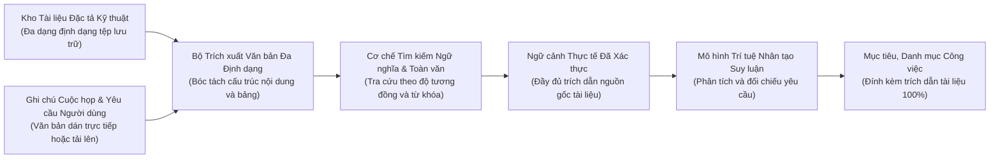

---

## 2. Bộ Trích xuất Văn bản Vạn năng (AiDocumentTextExtractor)

Để phục vụ RAG đa định dạng, lớp [`AiDocumentTextExtractor.cs`](file:///c:/Users/hoang/Downloads/ProjectMgmt/ProjectMgmt.Solution/Services/Ai/AiDocumentTextExtractor.cs) xử lý bóc tách nội dung từ tất cả các định dạng tài liệu phổ biến trong môi trường doanh nghiệp:

### 2.1. Sơ đồ Xử lý Đa Định dạng

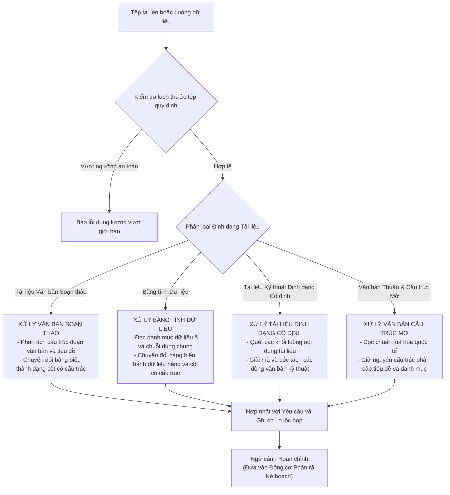

### 2.2. Điểm đặc sắc trong Kỹ thuật Trích xuất:
- **Xử lý tài liệu Word không phụ thuộc Office COM**: Sử dụng thư viện gốc `System.IO.Compression` và LINQ to XML (`System.Xml.Linq`), chạy mượt mà trên cả Linux container và Windows Server mà không cần cài đặt Microsoft Office.
- **Bảo toàn bảng biểu Excel**: Biến các sheet phân công nhân sự, ma trận trách nhiệm RACI thành văn bản có định dạng `Cột A | Cột B | Cột C`, giúp AI hiểu chính xác mối quan hệ giữa người làm và đầu việc.
- **An toàn bộ nhớ**: Giới hạn cứng 30MB và cơ chế stream một chiều ngăn chặn tấn công từ chối dịch vụ (Zip Bomb / OOM Denial of Service).

---

## 3. Kiến trúc Spec Hub & Giao thức Truy vấn MCP

Kho tài liệu đặc tả **Spec Hub** là "kho lưu trữ tri thức" của dự án. Lớp [`SpecHubTools.cs`](file:///c:/Users/hoang/Downloads/ProjectMgmt/ProjectMgmt.Solution/McpServers/SpecHubTools.cs) cung cấp 3 công cụ chuẩn MCP:

1. `spec_hub_list_documents(projectId)`: Quét toàn bộ cây thư mục tài liệu đặc tả của dự án.
2. `spec_hub_read_document(documentId)`: Đọc toàn văn nội dung một tài liệu đã chọn kèm tiêu chí nghiệm thu.
3. `spec_hub_search(projectId, keyword)`: Tìm kiếm toàn văn xuyên suốt mọi tài liệu trong dự án.

### Cơ chế Kết hợp Vector Search (Qdrant) và Fallback:
- Khi cấu hình `Qdrant:Enabled = true`: Hệ thống nhúng (Embed) các đoạn tài liệu thành vector 768 chiều bằng `gemini-embedding-001` và lưu trên Qdrant Vector Database để tìm kiếm theo độ tương đồng ngữ nghĩa (Cosine Similarity).
- Khi cấu hình `Qdrant:Enabled = false`: Hệ thống tự động chuyển sang cơ chế tìm kiếm toàn văn Full-Text Search trong SQL và lọc theo từ khóa, đảm bảo hệ thống hoạt động ổn định trong mọi điều kiện triển khai.

### 3.1. Các Tài liệu Mẫu Chuẩn Mực trong Spec Hub:
- [`SRS-Quan-Ly-Sprint-Va-Kanban-Realtime.md`](file:///c:/Users/hoang/Downloads/ProjectMgmt/docs/cam-nang-du-an/SRS-Quan-Ly-Sprint-Va-Kanban-Realtime.md): Bản đặc tả yêu cầu phần mềm toàn diện về quản lý Sprint, phân rã công việc tự động, bảng Kanban kéo thả thời gian thực qua SignalR và cơ chế cảnh báo quá hạn.
- [`BRD-Phan-Quyen-Va-Bao-Mat-Enterprise.md`](file:///c:/Users/hoang/Downloads/ProjectMgmt/docs/cam-nang-du-an/BRD-Phan-Quyen-Va-Bao-Mat-Enterprise.md): Bản đặc tả yêu cầu nghiệp vụ về mô hình phân quyền phân cấp từ trên xuống (Chủ tổ chức -> Giám đốc dự án -> Scrum Master -> Developer/QA) và tiêu chuẩn an toàn thông tin Zero-Secret-Leakage.

---

## 4. Cơ chế Trích dẫn Nguồn gốc (Citation Grounding) & Trải nghiệm Người dùng

Mỗi Task và Subtask do AI sinh ra bắt buộc phải có thuộc tính `documentCitations` chỉ rõ nguồn gốc xuất xứ từ tài liệu thực tế của dự án:
- Ví dụ: `Cam-nang-ky-thuat.md - Mục Phần II: Đặc tả chức năng và quy tắc nghiệp vụ`
- Ví dụ: `Bản đặc tả về quản lý dự án.txt - Mục 2`
- Ví dụ: `Ghi chú cuộc họp đã nạp - Mục 1: Yêu cầu chính`

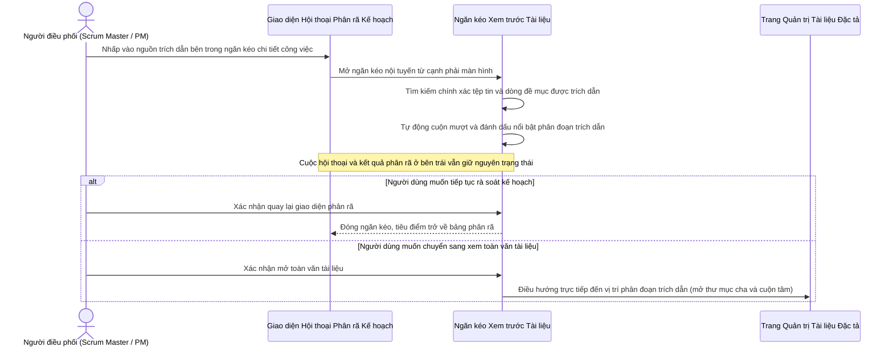

### Lợi ích Trải nghiệm Vượt trội & Thuật toán Xử lý Chính xác:
1. **Thuật toán Tìm kiếm Hai Lớp (Two-Pass Exact-First Traversal)**:
   - **Lớp 1 (Exact Match)**: Quét đệ quy toàn bộ cây thư mục để tìm tệp tin khớp chính xác tên tệp (có hoặc không có phần mở rộng như `.md`, `.txt`, `.docx`, `.xlsx`, `.pdf`). Thuật toán ngăn chặn triệt để hiện tượng tìm kiếm tham lam (greedy match) làm nhầm lẫn tệp tin gốc với các tệp tin chứa tên tương tự ở thư mục con.
   - **Lớp 2 (Partial Fallback)**: Chỉ kích hoạt khi toàn bộ cây thư mục không có tệp nào khớp chính xác, hỗ trợ tìm kiếm từ khóa nổi bật.
2. **Ưu tiên Khớp Dòng Tiêu đề (Deep Section Heading Prioritization)**:
   - Khi tìm kiếm đề mục (ví dụ: `Mục Phần II`), hệ thống phân tích các dòng bắt đầu bằng ký tự tiêu đề Markdown (`#`, `##`, `###`) hoặc in đậm (`**`), tách biệt hoàn toàn với các từ xuất hiện ngẫu nhiên trong nội dung văn bản.
   - Nhờ đó, đề mục `# Phần II. Đặc tả chức năng và quy tắc nghiệp vụ` luôn được ưu tiên chọn tuyệt đối, tránh cuộn nhầm lên các câu văn chứa từ tương tự ở đầu tài liệu.
3. **Đánh dấu Trực quan & Cuộn Mượt Tọa độ Tâm (Smooth Centering & Mark Glow)**:
   - Vị trí trích dẫn được bọc thẻ đánh dấu `<mark id="spec-target-highlight" class="spec-highlight-mark">` với viền sáng vàng hổ phách và hiệu ứng phát quang động.
   - Hàm `scrollIntoView({ behavior: 'smooth', block: 'center' })` đưa phân đoạn trích dẫn vào chính giữa tầm mắt người dùng, loại bỏ hoàn toàn việc ước tính số dòng sai lệch.
4. **Mở rộng Thư mục Cha Tự động (Ancestor Folder Auto-Expansion)**:
   - Khi chuyển hướng sang trang Spec Hub toàn màn hình, hệ thống tự động thu thập danh sách toàn bộ thư mục cha và kích hoạt mở rộng trên cây thư mục, giúp người dùng nhận diện ngay phân cấp tài liệu.
5. **Bảo tồn Ngữ cảnh Ghi chú Phiên làm việc**:
   - Trường hợp trích dẫn bắt nguồn từ biên bản cuộc họp hoặc yêu cầu người dùng dán vào, ngăn kéo nội tuyến hiển thị văn bản ghi chú với đầy đủ tính năng tìm kiếm và cuộn mượt.

---

## 5. Hướng dẫn Thực nghiệm & Kiểm chứng RAG Grounding

### 5.1. Kiểm tra Độ trễ (Latency) & Trạng thái Công Cụ trên Giao diện
Khi AI bắt đầu suy luận, giao diện hiển thị danh sách các hành động với biểu tượng `check_circle` xanh lục chuẩn xác và thời gian thực thi (latency ms):
- `Tìm kiếm tài liệu đặc tả liên quan trong Spec Hub · 7ms`
- `Đọc phân đoạn tài liệu đặc tả: Cam-nang-ky-thuat.md · 14ms`
- `Đọc cấu hình Workflow, Độ ưu tiên, Loại việc và Nhãn đang áp dụng của dự án · 9ms`
- `Lấy danh sách các User Story đang có trong Backlog · 13ms`
- `Truy xuất vận tốc Scrum và các hạng mục dở dang · 37ms`
- `Phân tích kỹ năng và số giờ khả dụng của thành viên đội Scrum · 25ms`

### 5.2. Kiểm tra Tính Xác thực của Nguồn Trích dẫn & Điều Hướng Phân Đoạn
1. Tải lên hoặc tạo một tệp tài liệu đặc tả trong Spec Hub (ví dụ: `Cam-nang-ky-thuat.md` chứa đề mục `Phần II: Xử lý ngữ cảnh AI Engine`).
2. Gõ yêu cầu phân rã Sprint hoặc phân tích kế hoạch.
3. Quan sát kết quả đề xuất:
   - Danh sách đề xuất bên ngoài giữ giao diện gọn sạch (lược bỏ thẻ trích dẫn xanh trùng lặp trên dòng cha và việc con); khi bấm vào công việc cha hoặc việc con, ngăn kéo chi tiết hiển thị đầy đủ mục **Tài liệu căn cứ & Trích dẫn đặc tả** (việc con tự động thừa hưởng trích dẫn từ cha nếu chưa tách riêng).
   - Đối với các lượt hỏi đáp / tra cứu tài liệu trong khung chat (`project_qa`, ví dụ *"liệt kê các tài liệu đặc tả"*), mỗi lượt trả lời của Trợ Lý AI cũng tự động đính kèm khối nút **Tài liệu căn cứ & Đặc tả Spec Hub (`DocumentCitations`)** ngay dưới nội dung trả lời (định dạng Markdown sạch sẽ) để người dùng nhấn mở trực tiếp Drawer xem nội dung tài liệu y hệt như khi mở từ chi tiết công việc.
   - Nhấp vào nhãn trích dẫn: Drawer nội tuyến mở ra, thực thi bộ định vị phân đoạn 4 tầng (`locateBestSectionInContent`) kết hợp chuyển đổi hai chiều số Ả Rập $\leftrightarrow$ số La Mã (`1..15` $\leftrightarrow$ `I..XV`, ví dụ `"Mục 2"` tự động khớp `## 2. Bản đồ Cấu trúc Tài liệu`), so khớp không dấu tiếng Việt và chấm điểm từ khóa ngữ cảnh từ Task/Subtask/Câu hỏi (`resolveCitationContextHint`) để tô sáng chính xác dòng tiêu đề/đoạn trích dẫn và tự động cuộn mượt tới vị trí mục tiêu (kèm thanh ghim `Vị trí trích dẫn` cho phép nhấn nhảy lại tới vị trí bất kỳ lúc nào).
   - Nhấp vào nút "Mở trang Spec Hub": Trình duyệt mở tab Spec Hub với đầy đủ tham số `?docId=...&docName=...&section=...`. Hệ thống tự động mở tab tài liệu, cuộn mượt đến đề mục tương ứng và kích hoạt hiệu ứng viền vàng nổi bật.
   - Nhấp "Quay lại đoạn chat": Hệ thống quay trở lại giao diện phân rã Sprint nguyên vẹn.
   - Khi nhấn **Áp dụng vào Sprint** hoặc **Đẩy vào Kho Backlog**, `AiSprintCommitCoordinator` tự động gắn liên kết `SpecStoryLinks`, `AcceptanceCriteria`, `IssueRequiredSkills`, `IssueLabels`, vai trò việc con và lý do AI vào CSDL để ngăn kéo chi tiết trên **Backlog / Board** và trang chi tiết issue hiển thị đồng bộ y hệt (khử trùng lặp liên kết Spec và trích dẫn thô qua `spec-citation.util.ts`).

### 5.3. Cô lập Tri thức Phạm vi Dự án & Cơ chế Tự suy luận Phi khuôn mẫu (Project Isolation & Organic Reasoning)
1. **Cô lập Tri thức 100% theo ProjectId**:
   - Tất cả các công cụ MCP Spec Hub (`SearchRelevantSpecsAsync`, `ReadDocumentAsync`, `GetDocumentTree`) đều thực thi xác thực phạm vi dự án `ProjectScopeGuard.Validate(scope, project.OrgId, projectId)` và chỉ truy vấn các bản ghi `ProjectDocuments.Where(d => d.ProjectId == scope.ProjectId)`. Tuyệt đối không đọc hoặc trích xuất tài liệu từ các dự án khác.
2. **Nạp Cấu hình Thực tế Đang Áp dụng của Dự án vào Ngữ cảnh LLM (`ProjectActiveConfigResolver`)**:
   - Thay vì dùng giá trị mặc định cố định hoặc lấy trộn lẫn dữ liệu toàn cục, hệ thống gọi công cụ MCP `project_get_active_config` để nạp chính xác cấu hình đang áp dụng của dự án: quy trình `WorkflowStatuses` theo thứ tự cột `BoardColumns` kèm trạng thái khởi tạo (`IsInitial`), trạng thái hoàn tất (`IsDone`) và ma trận chuyển trạng thái `WorkflowTransitions`; bộ mức độ ưu tiên đang áp dụng (`Priorities` riêng của dự án nếu có, không trộn lẫn cấu hình mặc định `ProjectId == null`); phân loại `IssueTypes` (`Story`, `Task`, `Bug`, `Sub-task`, `Epic`) và danh sách nhãn `Labels`. Toàn bộ thông tin này được tiêm trực tiếp vào cả `SprintDecompositionSystemPrompt.md` và `SprintDecompositionUserPrompt.md`.
3. **Bộ giải mã Resilient JSON Parser**:
   - Hệ thống sử dụng bộ bóc tách JSON linh hoạt, chấp nhận cả mảng chuỗi lẫn mảng đối tượng của việc con (`subtasks`), chuẩn hóa Story Points theo chuỗi Fibonacci và gán thành viên theo hồ sơ kỹ năng thực tế, loại bỏ hoàn toàn việc ép khuôn mẫu hay nhét văn bản thô vào mô tả công việc.
4. **Cơ chế Dự phòng Không Gián đoạn (Zero-Downtime Fallback)**:
   - Hệ thống ưu tiên các mô hình độ trễ thấp và chuyển đổi tự động sang các candidate models khả dụng (`gemini-3-flash-preview`, `gemini-3.1-flash-lite-preview`, `gemini-3.5-flash`, `gemini-3.6-flash`) khi phát hiện tình trạng tải cao tạm thời (HTTP 503) từ nhà cung cấp AI.

---

## 6. Danh mục Tệp Mã Nguồn Tham Chiếu Chuyên Đề 4

| Thành phần | Vai trò kỹ thuật | Liên kết mã nguồn |
| :--- | :--- | :--- |
| **AiDocumentTextExtractor** | Trích xuất toàn văn từ Word, Excel, PDF, Markdown, Text | [`AiDocumentTextExtractor.cs`](file:///c:/Users/hoang/Downloads/ProjectMgmt/ProjectMgmt.Solution/Services/Ai/AiDocumentTextExtractor.cs#L10-L120) |
| **SpecHubTools** | Các MCP tool tra cứu tài liệu đặc tả trong Spec Hub | [`SpecHubTools.cs`](file:///c:/Users/hoang/Downloads/ProjectMgmt/ProjectMgmt.Solution/McpServers/SpecHubTools.cs#L45-L100) |
| **ai-decompose-modal.html** | Template giao diện Drawer nội tuyến xem trước tài liệu trích dẫn | [`ai-decompose-modal.html`](file:///c:/Users/hoang/Downloads/ProjectMgmt/frontend/projectmgmt-web/src/app/features/backlog/components/ai-decompose-modal/ai-decompose-modal.html#L380-L450) |
| **ai-decompose-modal.ts** | Điều khiển mở/đóng drawer xem tài liệu, deep link sang Spec Hub | [`ai-decompose-modal.ts`](file:///c:/Users/hoang/Downloads/ProjectMgmt/frontend/projectmgmt-web/src/app/features/backlog/components/ai-decompose-modal/ai-decompose-modal.ts#L450-L520) |
| **AiSprintCommitCoordinator** | Lưu bền vững `SpecStoryLinks`, `AcceptanceCriteria`, `IssueLabels`, `IssueRequiredSkills`, vai trò việc con & lý do AI | [`AiSprintCommitCoordinator.cs`](file:///c:/Users/hoang/Downloads/ProjectMgmt/ProjectMgmt.Solution/Services/Ai/AiSprintCommitCoordinator.cs) |
| **WorkItemsController** | Trả về `SpecLinks`, `RequiredSkills`, `DocumentCitations`, `SubtaskRole`, `AiRationale` cho Backlog/Detail UI | [`WorkItemsController.cs`](file:///c:/Users/hoang/Downloads/ProjectMgmt/ProjectMgmt.Solution/Controllers/WorkItemsController.cs) |
| **task-detail-drawer.ts** | Ngăn kéo chi tiết Backlog/Board đầy đủ thông tin công việc cha & việc con đồng bộ với đề xuất AI | [`task-detail-drawer.ts`](file:///c:/Users/hoang/Downloads/ProjectMgmt/frontend/projectmgmt-web/src/app/shared/components/task-detail-drawer/task-detail-drawer.ts) |
| **spec-citation.util.ts** | Tiện ích tách tên tài liệu & khử trùng lặp liên kết Spec Hub với trích dẫn thô | [`spec-citation.util.ts`](file:///c:/Users/hoang/Downloads/ProjectMgmt/frontend/projectmgmt-web/src/app/core/utils/spec-citation.util.ts) |
| **spec-hub-page.ts** | Đón nhận queryParams (docId, section) để cuộn đến đúng vị trí | [`spec-hub-page.ts`](file:///c:/Users/hoang/Downloads/ProjectMgmt/frontend/projectmgmt-web/src/app/features/spec-hub/spec-hub-page.ts#L35-L65) |


---

# Phần VI: CHUYÊN ĐỀ 5: KIẾN TRÚC GIAO THỨC MCP VÀ CÁC CÔNG CỤ TÍCH HỢP

---

## 1. Bản chất Chuẩn Model Context Protocol (MCP)

### 1.1. Model Context Protocol (MCP) là gì?
**Model Context Protocol (MCP)** là chuẩn giao thức công nghiệp mở (Open Protocol) sử dụng cơ chế truyền tin **JSON-RPC 2.0**. Giao thức này đóng vai trò như một "cổng cắm USB-C" phổ quát, cho phép các mô hình trí tuệ nhân tạo (LLM / AI Agents) kết nối an toàn và truy xuất dữ liệu từ các hệ thống phần mềm nghiệp vụ (Database, File System, Git, API) mà không cần viết mã kết nối riêng cho từng mô hình.

### 1.2. Tại sao Dự án áp dụng Chuẩn MCP & Cơ chế Gọi MCP Có Chọn Lọc (Selective Invocation)?
1. **Chuẩn hóa công cụ (Tool Standardisation)**: Mọi công cụ AI trong dự án đều có lược đồ tham số (`inputSchema`) định dạng JSON Schema rõ ràng, giúp AI tự hiểu cách gọi hàm với xác suất chính xác cao.
2. **Kiến trúc Lưỡng hình (Dual-Form Deployment)**:
   - **Hình thái In-Process**: Chạy trực tiếp trong tiến trình ASP.NET Core để phục vụ người dùng trên Web với độ trễ cực thấp (mili-giây).
   - **Hình thái Standalone Stdio**: Chạy dưới dạng tiến trình Console độc lập, cho phép các Agent bên ngoài (Claude Desktop, Cursor IDE, Roo Code, Gemini CLI) kết nối và thao tác với dự án qua luồng Stdio.
3. **Gọi MCP Có Chọn Lọc Theo Ý Định & Ngữ Cảnh (Selective MCP Invocation)**:
   - Trợ Lý AI **không gọi đồng loạt toàn bộ MCP Tools ở mọi tin nhắn** nhằm tránh độ trễ thừa, tránh tốn token và giữ câu trả lời tập trung đúng vào câu hỏi của người dùng.
   - Cơ chế lập kế hoạch ngữ cảnh phân tách thành 4 chế độ rõ ràng:
     - **Chào hỏi / Hỏi khả năng trợ lý**: `0` lời gọi MCP bên ngoài — trả lời trực tiếp tức thì.
     - **Câu hỏi nối tiếp / Nhắc lại `#mem-X`**: Chỉ thực thi thao tác nội bộ **`memory_recall`** để đọc đúng các mảnh trí nhớ đánh chỉ mục liên quan (`0` lời gọi MCP dữ liệu dự án).
     - **Hỏi đáp dự án phạm vi hẹp** (ví dụ: *"Workflow hiện tại có trạng thái nào?"* hay *"Còn việc gì trong Backlog?"*): Chỉ gọi đúng 1–2 MCP Tool mục tiêu (`project_get_active_config`, `backlog_get_stories`, v.v.).
     - **Lập kế hoạch / Tinh chỉnh Sprint hoặc Backlog**: Gọi đầy đủ chuỗi MCP cần thiết để đảm bảo kiểm chứng toàn diện quy chuẩn và năng lực.

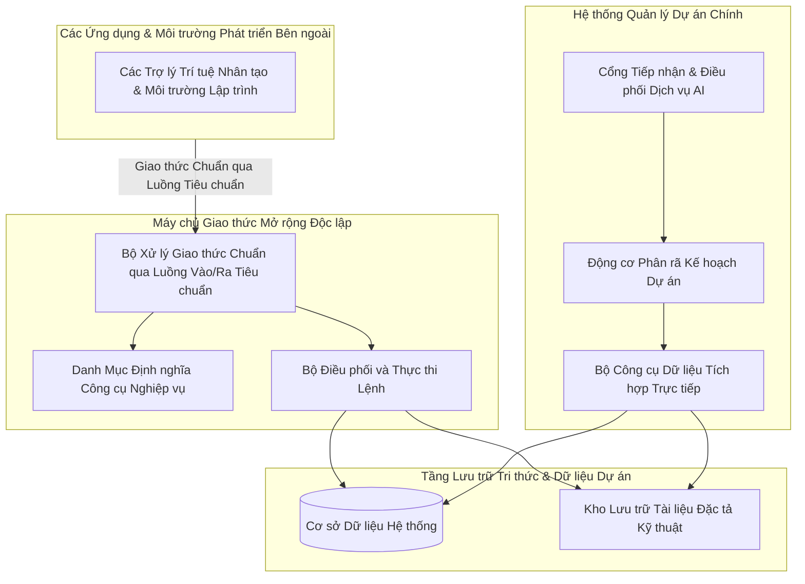

---

## 2. Danh mục Chi tiết Toàn bộ Hệ thống MCP Tools

Hệ thống cung cấp **8 công cụ cốt lõi** phục vụ lập kế hoạch, truy xuất cấu hình thực tế của dự án và phân rã Sprint:

### 2.1. Bảng Tổng Hợp Thông Số & Chức Năng

| Tên Công Cụ (Tool Name) | Tham Số Đầu Vào (Input Schema) | Dữ Liệu Trả Về (Return Model) | Tệp Mã Nguồn Triển Khai |
| :--- | :--- | :--- | :--- |
| **spec_hub_list_documents** | `projectId` (string, required) | Danh sách cây thư mục, tên file, định dạng (.docx, .pdf, .xlsx, .md) và kích thước tệp | [`SpecHubTools.cs`](file:///c:/Users/hoang/Downloads/ProjectMgmt/ProjectMgmt.Solution/McpServers/SpecHubTools.cs#L45-L66) |
| **spec_hub_read_document** | `documentId` (string, required) | Toàn văn nội dung tài liệu đã bóc tách, tiêu chí nghiệm thu (AC) và bảng biểu | [`SpecHubTools.cs`](file:///c:/Users/hoang/Downloads/ProjectMgmt/ProjectMgmt.Solution/McpServers/SpecHubTools.cs#L67-L83) |
| **spec_hub_search** | `projectId` (string), `keyword` (string) | Các phân đoạn văn bản khớp từ khóa, tên file gốc và chỉ số tương đồng | [`SpecHubTools.cs`](file:///c:/Users/hoang/Downloads/ProjectMgmt/ProjectMgmt.Solution/McpServers/SpecHubTools.cs#L84-L98) |
| **project_get_active_config** | `projectId` (string, required) | Cấu hình thực tế đang áp dụng của dự án: Quy trình `Workflow` (Board, cột `Statuses`, cờ `IsInitial`/`IsDone`, luồng chuyển tiếp `Transitions`), bộ `Priorities` đang dùng (riêng dự án hoặc mặc định), `IssueTypes` và `Labels` | [`BacklogTools.cs`](file:///c:/Users/hoang/Downloads/ProjectMgmt/ProjectMgmt.Solution/McpServers/BacklogTools.cs) |
| **backlog_get_stories** | `projectId` (string, required) | Toàn bộ hạng mục trong Product Backlog (`SprintId = null`): `Id`, `IssueKey`, `Title`, `IssueType`, `IsUserStory`, `Priority`, `StatusName`, `Labels`, `EpicTitle`, `StoryPoints`, `EstimatedHours`, `ExistingSubtasks` và `AcceptanceCriteria` | [`BacklogTools.cs`](file:///c:/Users/hoang/Downloads/ProjectMgmt/ProjectMgmt.Solution/McpServers/BacklogTools.cs#L40-L75) |
| **sprint_get_history_and_velocity** | `projectId` (string, required) | Vận tốc trung bình (Velocity), danh sách **toàn bộ Sprint theo mọi trạng thái (`Completed`, `Active`, `Future`)** trong `AllSprints` kèm danh sách công việc (`IssueKey`, `Title`, `Type`, `Status`, `Priority`, `StoryPoints`, `EstimatedHours`, `AssigneeId`, `AssigneeName`), các hạng mục dở dang bị rollover (đối chiếu trạng thái `IsDone` thực tế) và danh sách bug tồn đọng | [`SprintTools.cs`](file:///c:/Users/hoang/Downloads/ProjectMgmt/ProjectMgmt.Solution/McpServers/SprintTools.cs#L35-L70) |
| **team_get_dev_capacities** | `projectId` (string, required) | Danh sách kỹ sư (Developers, QA), chuyên môn (Frontend, Backend, Tester), số giờ khả dụng | [`TeamTools.cs`](file:///c:/Users/hoang/Downloads/ProjectMgmt/ProjectMgmt.Solution/McpServers/TeamTools.cs#L35-L70) |
| **ai_sprint_plan_propose** | `projectId` (string), `meetingNotes` (string), `targetStoryIds` (array) | Đề xuất Sprint Goal, Epics, Tasks độc lập (1-3 SP) hoặc kèm Subtasks ($\ge 5$ SP), liên kết Backlog (`sourceBacklogIssueId`) và trích dẫn tài liệu | [`Program.cs`](file:///c:/Users/hoang/Downloads/ProjectMgmt/ProjectMgmt.McpServer/Program.cs#L265-L287) |

---

## 3. Chi Tiết Lược Đồ Tham Số JSON-RPC (Schema Specifications)

### 3.1. Tool: `spec_hub_search`
- **Mục đích**: Tìm kiếm quy tắc nghiệp vụ hoặc kiến trúc xuyên suốt kho tài liệu.
- **Request JSON-RPC mẫu**:
```json
{
  "jsonrpc": "2.0",
  "id": 1,
  "method": "tools/call",
  "params": {
    "name": "spec_hub_search",
    "arguments": {
      "projectId": "12",
      "keyword": "quy định xác thực JWT và refresh token"
    }
  }
}
```
- **Response JSON-RPC mẫu**:
```json
{
  "jsonrpc": "2.0",
  "id": 1,
  "result": {
    "content": [
      {
        "type": "text",
        "text": "Tìm thấy 2 phân đoạn trong tài liệu 'Cam-nang-ky-thuat.md':\n- Mục 3.2: Access Token có thời hạn 15 phút, Refresh Token có thời hạn 30 ngày.\n- Mục 3.3: Thuật toán mã hóa HMAC-SHA256, khóa ký tối thiểu 32 bytes."
      }
    ]
  }
}
```

### 3.2. Tool: `team_get_dev_capacities`
- **Mục đích**: Cung cấp số liệu chính xác để AI không giao việc quá tải hoặc sai chuyên môn.
- **Request JSON-RPC mẫu**:
```json
{
  "jsonrpc": "2.0",
  "id": 2,
  "method": "tools/call",
  "params": {
    "name": "team_get_dev_capacities",
    "arguments": {
      "projectId": "12"
    }
  }
}
```
- **Response JSON-RPC mẫu**:
```json
{
  "jsonrpc": "2.0",
  "id": 2,
  "result": {
    "content": [
      {
        "type": "text",
        "text": "Danh sách nhân sự dự án (Tổng khả dụng: 120 giờ):\n1. Hoàng Văn A - Backend Lead (C#, .NET 10, MySQL) - Khả dụng: 40 giờ\n2. Trần Thị B - Frontend Dev (Angular, TypeScript, SCSS) - Khả dụng: 40 giờ\n3. Lê Văn C - QA / Tester (Playwright, Postman, Automation) - Khả dụng: 40 giờ"
      }
    ]
  }
}
```

### 3.3. Tool: `sprint_get_history_and_velocity`
- **Mục đích**: Cung cấp vận tốc lịch sử (Velocity), danh sách User Story & Bug dở dang kèm khuyến nghị phân loại hành động kế thừa (Sprint Rollover).
- **Lược đồ dữ liệu trả về**:
  - `AverageVelocity`: Vận tốc trung bình qua các Sprint đã hoàn thành.
  - `CompletedSprintsCount`: Số lượng Sprint đã đóng.
  - `UnfinishedItemsFromSprint`: Danh sách các công việc chưa hoàn thành từ Sprint liền kề:
    - `Key`, `Title`, `Type` (Bug, Story, Task), `Priority`, `Status`, `DueDate`, `IsOverdue`, `TimeSpentHours`.
    - `RecommendedAction`:
      - `Rollover_Hotfix_Highest`: Bug quá hạn hoặc dở dang, bắt buộc kế thừa vào Sprint mới với mức ưu tiên cao nhất (`Highest`).
      - `Rollover_Continue_WIP`: Task dở dang (`In Progress`) có công sức đã bỏ ra (`TimeSpent > 0`), kế thừa vào Sprint mới để bảo vệ tiến độ.
      - `Backlog_Reevaluate`: Task chưa làm (`To Do`) nhưng đã quá hạn, tự động chuyển về Product Backlog (`SprintId = null`) để PO đánh giá lại.
      - `Candidate_Rollover`: Các hạng mục khác để AI và PO xem xét.
- **Request JSON-RPC mẫu**:
```json
{
  "jsonrpc": "2.0",
  "id": 3,
  "method": "tools/call",
  "params": {
    "name": "sprint_get_history_and_velocity",
    "arguments": {
      "projectId": "12"
    }
  }
}
```

### 3.4. Tool: `project_get_active_config`
- **Mục đích**: Đọc chính xác cấu hình quản trị đang được **áp dụng thực tế** của dự án, bao gồm:
  - `Workflow`: Tên bảng (`Name`), loại quy trình (`Type`), trạng thái khởi tạo (`InitialStatus`), danh sách `Statuses` theo đúng thứ tự cột `BoardColumns` (kèm `IsInitial`, `IsActiveWork`, `IsDone`, `IsCanceled`, `WipLimit`) và danh sách `Transitions` (`FromStatus -> ToStatus`).
  - `Priorities`: Chỉ lấy bộ mức ưu tiên tùy chỉnh của dự án (`ProjectId == projectId`) nếu dự án có cấu hình riêng (`IsCustomProjectConfiguration = true`); chỉ khi không có mới lấy mặc định hệ thống (`ProjectId == null`).
  - `IssueTypes`: Tách rõ `ParentWorkItems` (`Story`, `Task`, `Bug`), `Subtasks` (`Sub-task`) và `Epic`.
  - `Labels`: Danh sách nhãn đang sử dụng trong dự án.
- **Request JSON-RPC mẫu**:
```json
{
  "jsonrpc": "2.0",
  "id": 4,
  "method": "tools/call",
  "params": {
    "name": "project_get_active_config",
    "arguments": {
      "projectId": "12"
    }
  }
}
```

### 3.5. Tool: `backlog_get_stories`
- **Mục đích**: Truy xuất toàn bộ các hạng mục đang nằm trong kho Product Backlog (`SprintId = null`), làm giàu đầy đủ `IssueKey`, `IssueType`, `IsUserStory`, `Priority`, `StatusName`, `Labels`, `EpicTitle`, `StoryPoints`, `EstimatedHours`, `ExistingSubtasks` và `AcceptanceCriteria` để AI vừa chuyển hóa các User Story thành đầu việc kỹ thuật hợp lý, vừa gắn `sourceBacklogIssueId` / `sourceBacklogIssueKey` giúp di chuyển hạng mục từ kho Backlog vào Sprint mà không bị trùng lặp.

---

## 4. Hướng Dẫn Cấu Hình Kết Nối cho AI Agents Bên Ngoài

Máy chủ Stdio MCP Server của dự án được biên dịch tại [`ProjectMgmt.McpServer`](file:///c:/Users/hoang/Downloads/ProjectMgmt/ProjectMgmt.McpServer). Bất kỳ AI Client nào hỗ trợ chuẩn MCP đều có thể kết nối trực tiếp.

### 4.1. Cấu hình cho Claude Desktop
Mở tệp cấu hình của Claude Desktop: `%APPDATA%\Claude\claude_desktop_config.json`:

```json
{
  "mcpServers": {
    "projectmgmt-scrum": {
      "command": "dotnet",
      "args": [
        "run",
        "--project",
        "C:\\Users\\hoang\\Downloads\\ProjectMgmt\\ProjectMgmt.McpServer\\ProjectMgmt.McpServer.csproj"
      ],
      "env": {
        "ASPNETCORE_ENVIRONMENT": "Development",
        "PROJECTMGMT_MCP_USER_ID": "YOUR_USER_ID",
        "PROJECTMGMT_MCP_ORG_ID": "YOUR_ORG_ID",
        "PROJECTMGMT_MCP_ALLOWED_PROJECTS": "YOUR_ALLOWED_PROJECT_IDS",
        "PROJECTMGMT_API_TOKEN": "YOUR_API_TOKEN"
      }
    }
  }
}
```

### 4.2. Cấu hình cho Cursor IDE / Roo Code
Thêm vào tệp cấu hình MCP của Cursor / Roo Code (`.cursor/mcp.json`):

```json
{
  "mcpServers": {
    "projectmgmt-ai-planner": {
      "command": "dotnet",
      "args": [
        "C:\\Users\\hoang\\Downloads\\ProjectMgmt\\ProjectMgmt.McpServer\\bin\\Debug\\net10.0\\ProjectMgmt.McpServer.dll"
      ],
      "env": {
        "ASPNETCORE_ENVIRONMENT": "Development",
        "PROJECTMGMT_MCP_USER_ID": "YOUR_USER_ID",
        "PROJECTMGMT_MCP_ORG_ID": "YOUR_ORG_ID",
        "PROJECTMGMT_MCP_ALLOWED_PROJECTS": "YOUR_ALLOWED_PROJECT_IDS",
        "PROJECTMGMT_API_TOKEN": "YOUR_API_TOKEN"
      }
    }
  }
}
```

---

## 5. Hướng Dẫn Chạy & Kiểm Thử Tương Tác Qua Terminal Stdio

Người dùng hoặc kiểm thử viên có thể chạy trực tiếp MCP Server từ terminal PowerShell để xác minh giao thức JSON-RPC:

### Bước 1: Khởi động Server
```powershell
cd C:\Users\hoang\Downloads\ProjectMgmt\ProjectMgmt.McpServer
dotnet run
```

### Bước 2: Gửi lệnh Khởi tạo (Initialize)
Dán dòng JSON sau vào terminal và nhấn Enter:
```json
{"jsonrpc":"2.0","id":1,"method":"initialize","params":{"protocolVersion":"2024-11-05","capabilities":{},"clientInfo":{"name":"ManualTester","version":"1.0"}}}
```
**Kết quả phản hồi ngay lập tức từ server:**
```json
{"jsonrpc":"2.0","id":1,"result":{"protocolVersion":"2024-11-05","capabilities":{"tools":{}},"serverInfo":{"name":"ProjectMgmt-AiSprintPlanner-McpServer","version":"1.0.0"}}}
```

### Bước 3: Lấy danh sách Công cụ (tools/list)
```json
{"jsonrpc":"2.0","id":2,"method":"tools/list","params":{}}
```
**Kết quả:** Server trả về đầy đủ 8 công cụ kèm inputSchema chuẩn xác.

---

## 6. Danh mục Tệp Mã Nguồn Tham Chiếu Chuyên Đề 5

| Thành phần | Vai trò kỹ thuật | Liên kết mã nguồn |
| :--- | :--- | :--- |
| **AiIndexedMemoryEngine** | Bộ lập kế hoạch gọi MCP có chọn lọc (`PlanContextExecution` & `memory_recall`), tránh gọi dư thừa ở các lượt chào hỏi/hỏi đáp ngắn | [`AiIndexedMemoryEngine.cs`](file:///c:/Users/hoang/Downloads/ProjectMgmt/ProjectMgmt.Solution/Services/Ai/AiIndexedMemoryEngine.cs) |
| **ProjectMgmt.McpServer** | Ứng dụng Console phục vụ kết nối JSON-RPC 2.0 Stdio ngoài | [`Program.cs`](file:///c:/Users/hoang/Downloads/ProjectMgmt/ProjectMgmt.McpServer/Program.cs#L20-L150) |
| **McpToolRegistry** | Bộ đăng ký và thực thi 8 công cụ MCP In-Process | [`McpToolRegistry.cs`](file:///c:/Users/hoang/Downloads/ProjectMgmt/ProjectMgmt.Solution/McpServers/McpToolRegistry.cs) |
| **ProjectActiveConfigResolver** | Phân giải cấu hình thực tế đang áp dụng của dự án (Workflow, Priorities, IssueTypes, Labels) | [`ProjectActiveConfigResolver.cs`](file:///c:/Users/hoang/Downloads/ProjectMgmt/ProjectMgmt.Solution/Services/Ai/ProjectActiveConfigResolver.cs) |
| **SpecHubTools** | Công cụ đọc và tìm kiếm tài liệu đặc tả Spec Hub | [`SpecHubTools.cs`](file:///c:/Users/hoang/Downloads/ProjectMgmt/ProjectMgmt.Solution/McpServers/SpecHubTools.cs#L45-L100) |
| **BacklogTools** | Công cụ truy vấn cấu hình dự án (`project_get_active_config`) và hạng mục Backlog (`backlog_get_stories`) | [`BacklogTools.cs`](file:///c:/Users/hoang/Downloads/ProjectMgmt/ProjectMgmt.Solution/McpServers/BacklogTools.cs#L35-L75) |
| **SprintTools** | Công cụ tính toán vận tốc (Velocity) và hạng mục dở dang theo trạng thái `IsDone` thực tế | [`SprintTools.cs`](file:///c:/Users/hoang/Downloads/ProjectMgmt/ProjectMgmt.Solution/McpServers/SprintTools.cs#L30-L70) |
| **TeamTools** | Công cụ phân tích hồ sơ chuyên môn, số giờ làm việc & ánh xạ tên hiển thị an toàn không lộ bí mật (`GetProjectMemberDisplayNamesAsync`) | [`TeamTools.cs`](file:///c:/Users/hoang/Downloads/ProjectMgmt/ProjectMgmt.Solution/McpServers/TeamTools.cs#L30-L70) |
| **AiExcelExportResolver** | Bộ phân giải phạm vi xuất Excel thông minh từ siêu dữ liệu MCP/DB & từ chối xuất khống khi thiếu dữ liệu | [`AiExcelExportResolver.cs`](file:///c:/Users/hoang/Downloads/ProjectMgmt/ProjectMgmt.Solution/Services/Ai/AiExcelExportResolver.cs) |


---

# Phần VII: CHUYÊN ĐỀ 6: CẨM NANG TRA CỨU & TRẢ LỜI PHẢN BIỆN BẢO VỆ CHUYÊN SÂU

---

## 1. Lời nói đầu & Phương pháp luận Phản biện
Khi bảo vệ đồ án, thẩm định kiến trúc hoặc báo cáo kỹ thuật trước Hội đồng Đánh giá, các câu hỏi thường xoay quanh 5 khía cạnh cốt lõi:
1. **Bản chất lý thuyết**: *"Cái này là gì? Tại sao lại dùng công nghệ này mà không dùng công nghệ khác?"*
2. **Vị trí hiện thực**: *"Cái này nằm ở file nào? Dòng code nào xử lý?"*
3. **Cơ chế lưu trữ & Luồng dữ liệu**: *"Dữ liệu đi qua đâu? Lưu trữ ở đâu? Khi nào thì ghi vào Database?"*
4. **Bằng chứng thực nghiệm (Proof of Concept)**: *"Làm sao chứng minh hệ thống đang chạy AI thật 100% chứ không phải dữ liệu giả (mock data)?"*
5. **Độ an toàn & Khả năng chịu lỗi (Resilience & Security)**: *"Nếu Redis chết thì sao? Nếu token hết hạn thì sao? Phân quyền chống vượt cấp thế nào?"*

Tài liệu này tổng hợp toàn bộ câu hỏi và câu trả lời chuẩn xác nhất, kèm theo đường dẫn mã nguồn có thể nhấp trực tiếp để mở đúng vị trí code.

---

## 2. Nhóm Câu Hỏi 1: Tổng Quan Kiến Trúc & Vị Trí Mã Nguồn

### Câu hỏi 1.1: Trợ Lý AI trong hệ thống là gì và giải quyết bài toán gì trong Scrum?
- **Trả lời**:
  **Trợ Lý AI** trong hệ thống là một **Trợ lý Hội thoại Có Trạng thái (Stateful Hermes Agentic Assistant)** hỗ trợ toàn diện quy trình Quản lý Dự án Scrum/Agile: từ lập kế hoạch Sprint, bóc tách công việc đẩy vào Kho Product Backlog, trả lời câu hỏi về số liệu/quy chuẩn dự án, xuất tệp Excel báo cáo cho tới điều chỉnh từng hạng mục qua đối thoại tự nhiên.
  Trợ Lý AI giải quyết triệt để 4 vấn đề:
  1. Đọc và hiểu toàn bộ tài liệu đặc tả (Word, Excel, PDF, Text, Biên bản họp) qua cơ chế RAG & Spec Hub.
  2. Tự động đối chiếu năng lực thực tế của từng thành viên (Frontend, Backend, QA), vận tốc Sprint trước, Backlog và bộ Workflow/Priority/IssueType/Labels đang áp dụng của dự án.
  3. Đề xuất bản kế hoạch cân bằng cho Sprint hoặc Kho Product Backlog kèm tiêu chí nghiệm thu và trích dẫn tài liệu minh bạch 100%.
  4. Duy trì đoạn hội thoại liền mạch nhiều lượt trên Redis để người dùng tinh chỉnh nối tiếp, hỏi đáp dự án hoặc xuất báo cáo Excel bằng ngôn ngữ tự nhiên.

### Câu hỏi 1.2: Tại sao gọi đây là một "Hermes Agentic Workflow Có Trạng thái" mà không phải Chatbot Stateless hay API Wrapper?
- **Trả lời**:
  Một Chatbot Stateless hay API Wrapper chỉ nhận từng câu hỏi độc lập, quên ngay lượt trao đổi trước đó và không có khả năng tương tác nghiệp vụ an toàn.
  Ngược lại, Trợ Lý AI của hệ thống vận hành theo quy trình **Stateful Hermes Agentic Workflow**:
  - **Định tuyến Ý định & Rào chắn Ngoài luồng**: Tự động phân loại 9 nhóm ý định (`sprint_plan`, `backlog_plan`, `refine_proposal`, `project_qa`, `export_excel`, `remove_tasks`, `push_backlog`, `apply_sprint`, `out_of_scope_refusal`) và từ chối lịch sự mọi yêu cầu không thuộc phạm vi công cụ quản lý dự án.
  - **Tự chủ Công cụ MCP**: Tự động gọi chuỗi công cụ (`SpecHubTools`, `BacklogTools`, `SprintTools`, `TeamTools`, `project_get_active_config`) để thu thập dữ liệu thật trước khi trả lời.
  - **Trí nhớ Hội thoại & Staging trên Redis (`ConversationHistory`)**: Truyền `sessionId` qua từng lượt SSE (`POST /api/ai/agent/decompose/stream`), nạp lại toàn bộ lịch sử trò chuyện và bản đề xuất đang lưu để chỉnh sửa hoặc thực thi hành động (như xuất Excel, đẩy Kho Backlog) mà vẫn giữ nguyên ngữ cảnh.

### Câu hỏi 1.3: Cấu trúc mã nguồn của Module AI nằm ở đâu?
- **Trả lời**:
  Hệ thống tuân thủ Clean Architecture kết hợp Modular Monolith, phân tách rõ ràng:
  - **Tầng Điều Khiển API**: [`AiAgentController.cs`](file:///c:/Users/hoang/Downloads/ProjectMgmt/ProjectMgmt.Solution/Controllers/AiAgentController.cs#L25-L160)
  - **Tầng Dịch Vụ AI Core Pipeline**: [`AiSprintDecompositionService.cs`](file:///c:/Users/hoang/Downloads/ProjectMgmt/ProjectMgmt.Solution/Services/Ai/AiSprintDecompositionService.cs#L45-L250)
  - **Động cơ Quản lý Prompt Động**: [`PromptTemplateService.cs`](file:///c:/Users/hoang/Downloads/ProjectMgmt/ProjectMgmt.Solution/Services/Ai/PromptTemplateService.cs) & [`Prompts/`](file:///c:/Users/hoang/Downloads/ProjectMgmt/ProjectMgmt.Solution/Prompts/)
  - **Tầng Router Đa Mô Hình (Multi-Provider)**: [`MultiProviderAiModelClient.cs`](file:///c:/Users/hoang/Downloads/ProjectMgmt/ProjectMgmt.Solution/Services/Ai/MultiProviderAiModelClient.cs#L25-L120)
  - **Bộ Trích Xuất Tài Liệu Vạn Năng**: [`AiDocumentTextExtractor.cs`](file:///c:/Users/hoang/Downloads/ProjectMgmt/ProjectMgmt.Solution/Services/Ai/AiDocumentTextExtractor.cs#L10-L120)
  - **Tầng Trí Nhớ Đệm Phân Tán (Redis Staging)**: [`StackExchangeRedisStagingProvider.cs`](file:///c:/Users/hoang/Downloads/ProjectMgmt/ProjectMgmt.Solution/Services/Ai/Adapters/StackExchangeRedisStagingProvider.cs#L8-L115) & [`ResilientStateStagingService.cs`](file:///c:/Users/hoang/Downloads/ProjectMgmt/ProjectMgmt.Core/Staging/ResilientStateStagingService.cs#L15-L110)
  - **Hệ Thống MCP Tools Nội Bộ**: [`SpecHubTools.cs`](file:///c:/Users/hoang/Downloads/ProjectMgmt/ProjectMgmt.Solution/McpServers/SpecHubTools.cs), [`BacklogTools.cs`](file:///c:/Users/hoang/Downloads/ProjectMgmt/ProjectMgmt.Solution/McpServers/BacklogTools.cs), [`SprintTools.cs`](file:///c:/Users/hoang/Downloads/ProjectMgmt/ProjectMgmt.Solution/McpServers/SprintTools.cs), [`TeamTools.cs`](file:///c:/Users/hoang/Downloads/ProjectMgmt/ProjectMgmt.Solution/McpServers/TeamTools.cs)
  - **Máy Chủ Stdio MCP Server Độc Lập**: [`Program.cs`](file:///c:/Users/hoang/Downloads/ProjectMgmt/ProjectMgmt.McpServer/Program.cs#L20-L150)
  - **Giao Diện Angular Client**: [`ai-agent.service.ts`](file:///c:/Users/hoang/Downloads/ProjectMgmt/frontend/projectmgmt-web/src/app/core/services/ai-agent.service.ts), [`ai-decompose-modal.ts`](file:///c:/Users/hoang/Downloads/ProjectMgmt/frontend/projectmgmt-web/src/app/features/backlog/components/ai-decompose-modal/ai-decompose-modal.ts), [`ai-decompose-modal.html`](file:///c:/Users/hoang/Downloads/ProjectMgmt/frontend/projectmgmt-web/src/app/features/backlog/components/ai-decompose-modal/ai-decompose-modal.html)

### Câu hỏi 1.4: Prompt của AI có bị hardcode trong code C# không? Quản lý và thay đổi như thế nào?
- **Trả lời**:
  **Tuyệt đối không hardcode prompt trong mã C#**. Toàn bộ prompt được tách thành các tệp Markdown độc lập trong [`ProjectMgmt.Solution/Prompts/`](file:///c:/Users/hoang/Downloads/ProjectMgmt/ProjectMgmt.Solution/Prompts/):
  - `SprintDecompositionSystemPrompt.md`: Thiết lập vai trò Scrum Master, luật phân rã, thang điểm Fibonacci và gán chuyên môn.
  - `SprintDecompositionUserPrompt.md`: Mẫu prompt động với các tham số `{{DOC_CONTENT}}`, `{{SPEC_HUB_DOCS}}`, `{{TEAM_CAPACITY_SUMMARY}}`.
  - `SingleTaskRegenerationPrompt.md`: Prompt làm lại 1 task riêng biệt.
  - `FullProposalRegenerationPrompt.md`: Prompt làm lại toàn bộ đề xuất.
  Dịch vụ [`PromptTemplateService`](file:///c:/Users/hoang/Downloads/ProjectMgmt/ProjectMgmt.Solution/Services/Ai/PromptTemplateService.cs) tự động kiểm tra `File.GetLastWriteTimeUtc(fullPath)` để **Hot-Reload ngay lập tức** khi có bất kỳ chỉnh sửa nào trên tệp Markdown mà **không cần biên dịch lại mã nguồn hay khởi động lại ứng dụng**.

### Câu hỏi 1.5: Cấu trúc việc con (Subtasks) và việc tính điểm Fibonacci, gán người làm hoạt động như thế nào?
- **Trả lời**:
  1. **Cấu trúc Việc con (Subtasks) đầy đủ**: Việc con được thiết kế như một task hoàn chỉnh (checkbox, mã phụ `QLDA-AI1.1`, tiêu đề, vai trò kỹ thuật, độ ưu tiên, SP, trạng thái, người làm, và ngăn kéo chi tiết riêng).
  2. **Dây nối Cây phân nhánh (Tree Wire Connector)**: Dưới cụm 6 chấm kéo thả (`drag_indicator`), hệ thống vẽ nhánh cây góc vuông (`└──`) dẫn xuống từng subtask giúp người dùng nhận diện thứ bậc trực quan.
  3. **Phân bổ Năng lực & Fibonacci**: Hệ thống không gán cứng 5 SP hay chỉ 1 người duy nhất; mà tự động phân tích từ khóa kỹ thuật (Frontend $\rightarrow$ Kỹ sư Frontend, Backend $\rightarrow$ Kỹ sư Backend, QA $\rightarrow$ Kỹ sư QA) và trải đều điểm Fibonacci (1, 2, 3, 5, 8) theo độ phức tạp công việc.

---

## 3. Nhóm Câu Hỏi 2: Chứng Minh AI Thật 100% vs Dữ Liệu Giả (Proof of Real AI)

### Câu hỏi 2.1: Làm thế nào chứng minh hệ thống đang gọi mô hình AI thật chứ không phải dữ liệu mock/hardcode?
- **Trả lời & Thao tác chứng minh trực tiếp**:
  1. **Bằng chứng Network Traffic**:
     - Mở trình duyệt, bật F12 -> tab **Network**.
     - Nhập yêu cầu phân rã và bấm gửi.
     - Quan sát request: `POST /api/ai/agent/decompose/stream`.
     - Phản hồi trả về dưới dạng luồng sự kiện **Server-Sent Events (`text/event-stream`)**: từng chunk dữ liệu thời gian thực được đẩy về, thanh tiến trình bước nhảy từ 1 đến 5 và hiển thị thời gian chạy của từng MCP Tool (7ms, 13ms, 37ms, 25ms).
  2. **Bằng chứng Tính Động và Sáng Tạo (Non-deterministic)**:
     - Thử nhập 2 nội dung cuộc họp khác nhau hoàn toàn:
       - Lần 1: *"Cần làm tính năng thanh toán VNPay và ví MoMo"*.
       - Lần 2: *"Cần tối ưu hiệu năng cơ sở dữ liệu và triển khai Redis Cache"*.
     - AI sinh ra 2 bộ Sprint Goal, Epics và Tasks hoàn toàn khác biệt, với các từ khóa chuyên môn kỹ thuật phù hợp với từng bài toán.
  3. **Bằng chứng Tiêu Thụ Token trên Google AI Studio Dashboard**:
     - Đăng nhập vào Google AI Studio với tài khoản cấu hình khóa API (`AIzaSy***`).
     - Xem biểu đồ Usage: số lượng API calls và Input/Output tokens tăng lên ngay lập tức sau mỗi lần phân rã.

### Câu hỏi 2.2: Tại sao AI phản hồi nhanh trong vài giây? Có phải đang dùng dữ liệu dựng sẵn không?
- **Trả lời**:
  Tốc độ nhanh là nhờ 3 tối ưu kiến trúc vượt bậc:
  1. **Mô hình Flash thế hệ mới**: Hệ thống sử dụng `gemini-3.6-flash` và `gemini-3.5-flash` của Google DeepMind. Đây là dòng mô hình được tối ưu hóa cho tốc độ xử lý siêu tốc, đạt hàng trăm tokens/giây và thời gian Time-to-First-Token (TTFT) chỉ ~150-300ms.
  2. **In-Process MCP Tools**: Các công cụ truy xuất dữ liệu (`SpecHubTools`, `BacklogTools`) chạy trực tiếp trong cùng bộ nhớ RAM của ASP.NET Core với Entity Framework Core biên dịch sẵn, nên thời gian truy vấn chỉ mất từ **7ms đến 37ms**.
  3. **Trích xuất văn bản nhị phân bằng ZipArchive**: Bộ trích xuất `AiDocumentTextExtractor` đọc trực tiếp các tệp `.docx` và `.xlsx` bằng luồng bộ nhớ (`MemoryStream`), không qua tiến trình trung gian nên xử lý tài liệu 10 trang chỉ trong vài chục mili-giây.

---

## 4. Nhóm Câu Hỏi 3: Cơ Chế Trí Nhớ & Lưu Trữ Phân Tán Redis

### Câu hỏi 3.1: Dữ liệu đề xuất phân rã và hội thoại của AI được lưu trữ ở đâu trước khi vào bảng `Issues`?
- **Trả lời**:
  Công việc đề xuất **hoàn toàn KHÔNG ghi vào bảng `Issues` của dự án** cho đến khi người dùng xác nhận áp dụng hoặc đẩy Backlog. Trạng thái đề xuất staging (`ProposalJson`), lịch sử trò chuyện đa lượt, nhật ký `TraceItems` và các mảnh trí nhớ `#mem-1..#mem-n` được lưu song song theo cơ chế kép: **Redis Hot Cache (`ProjectMgmt:Ai:staging:{sessionId}`, TTL 24 giờ)** để truy xuất tức thời và **MySQL (`AiConversationSessions` + `AiConversationMemoryEntries`)** để lưu bền vững theo phạm vi `(OrganizationId, ProjectId, UserId)`.
  - Chỉ khi người dùng có quyền bấm nút **"Áp dụng vào Sprint"** hoặc **"Đẩy vào Kho Backlog"**, API mới đọc từ Redis (hoặc tự động nạp bù từ MySQL nếu Redis hết hạn), chạy bước **Pre-Commit Revalidation** và mở Database Transaction ghi chính thức vào các bảng nghiệp vụ MySQL (`Issues`, `Sprints`, `AcceptanceCriteria`, `SpecStoryLinks`, `IssueLabels`, `IssueRequiredSkills`).

### Câu hỏi 3.2: Làm thế nào chứng minh dữ liệu đề xuất đang nằm ở Staging Redis & Bảng Phiên AI chứ chưa tạo rác trong bảng `Issues`?
- **Trả lời & Câu lệnh kiểm tra thực tế**:
  1. Khi AI vừa phân rã xong trên giao diện, mở terminal chạy câu lệnh:
     ```bash
     redis-cli -h 127.0.0.1 -p 6379
     127.0.0.1:6379> KEYS ProjectMgmt:Ai:staging:*
     # Xuất hiện 1 key: ProjectMgmt:Ai:staging:e7c4f1a2-...
     127.0.0.1:6379> TTL ProjectMgmt:Ai:staging:e7c4f1a2-...
     # Kết quả: 86395 (còn ~24 giờ)
     ```
  2. Mở MySQL Workbench hoặc HeidiSQL kiểm tra **2 nhóm bảng tách biệt**:
     ```sql
     -- A. Bảng lịch sử & trí nhớ AI ĐÃ lưu phiên hội thoại ngay:
     SELECT Id, SessionId, TurnCount, MemoryCount FROM AiConversationSessions ORDER BY UpdatedAtUtc DESC LIMIT 5;
     -- B. Bảng công việc nghiệp vụ VẪN LÀ 0 cho tới khi người dùng bấm Áp dụng / Đẩy Backlog:
     SELECT COUNT(*) FROM Issues WHERE IsAiGenerated = 1;
     -- Số lượng bản ghi mới từ phiên đang xem vẫn là 0!
     ```
  3. Sau đó, trên giao diện bấm nút **"Áp dụng vào Sprint"** hoặc **"Đẩy vào Kho Backlog"**:
     - Kiểm tra lại bảng nghiệp vụ `Issues` trong MySQL: xuất hiện đầy đủ Task/Sub-task, `AcceptanceCriteria`, `SpecStoryLinks`, `IssueLabels` và `IssueRequiredSkills`.
     - Kiểm tra lại Redis CLI (`ProjectMgmt:Ai:staging:e7c4f1a2-...`): trường `tasks` đề xuất đã được dọn sạch (`tasks: []`) để chống áp dụng trùng lặp (`409 ALREADY_COMMITTED`), trong khi `conversationHistory` vẫn được giữ lại kèm tin nhắn xác nhận để người dùng tiếp tục trò chuyện; chỉ khi bấm xóa phiên hoặc hết TTL/clear-cache khóa staging mới bị xóa (`nil`).

### Câu hỏi 3.3: Nếu máy chủ Redis bị sập hoặc mất mạng, hệ thống có bị lỗi không?
- **Trả lời**:
  Hệ thống **không bao giờ sập** nhờ mẫu thiết kế **Circuit Breaker & Resilient Fallback** được lập trình trong [`ResilientStateStagingService.cs`](file:///c:/Users/hoang/Downloads/ProjectMgmt/ProjectMgmt.Core/Staging/ResilientStateStagingService.cs#L65-L90):
  - Khi Redis gặp sự cố (timeout quá 2000ms hoặc connection refused), Circuit Breaker chuyển sang trạng thái Open.
  - Hệ thống tự động chuyển hướng (fallback) sang bộ nhớ RAM cục bộ [`MemoryStateStagingService.cs`](file:///c:/Users/hoang/Downloads/ProjectMgmt/ProjectMgmt.Core/Staging/MemoryStateStagingService.cs#L10-L60) dựa trên `ConcurrentDictionary`.
  - Người dùng cuối hoàn toàn không nhận thấy bất kỳ thông báo lỗi nào (Zero Downtime / Seamless Fallback).

---

## 5. Nhóm Câu Hỏi 4: RAG Grounding & Trải Nghiệm Spec Hub

### Câu hỏi 4.1: Tại sao hệ thống có thể đọc được file Word (.docx) và Excel (.xlsx) mà máy chủ không cần cài Microsoft Office?
- **Trả lời**:
  Định dạng tệp Word (`.docx`) và Excel (`.xlsx`) thực chất là các gói nén chuẩn **Open Packaging Conventions (OPC / OpenXML)**, bản chất là một tệp nén ZIP chứa các tệp XML bên trong:
  - Lớp [`AiDocumentTextExtractor.cs`](file:///c:/Users/hoang/Downloads/ProjectMgmt/ProjectMgmt.Solution/Services/Ai/AiDocumentTextExtractor.cs#L75-L120) dùng `System.IO.Compression.ZipArchive` để giải nén trực tiếp trong bộ nhớ.
  - Sử dụng LINQ to XML (`System.Xml.Linq.XDocument`) để duyệt cây DOM của `word/document.xml` và `xl/sharedStrings.xml`.
  - Nhờ vậy, code chạy đa nền tảng (Cross-platform) hoàn toàn trên cả Linux Docker Container và Windows Server mà không cần cài bộ ứng dụng Office nặng nề hay trả phí bản quyền.

### Câu hỏi 4.2: Khi người dùng bấm vào xem tài liệu trích dẫn, làm sao để không làm mất đoạn hội thoại chat với AI?
- **Trả lời**:
  Trên giao diện Angular ([`ai-decompose-modal.html`](file:///c:/Users/hoang/Downloads/ProjectMgmt/frontend/projectmgmt-web/src/app/features/backlog/components/ai-decompose-modal/ai-decompose-modal.html#L380-L450)), tài liệu được mở qua một **Ngăn kéo nội tuyến (Inline Drawer)** trượt từ cạnh phải màn hình:
  - Bảng hội thoại và các task đề xuất ở bên trái vẫn giữ nguyên trạng thái 100%.
  - Ngăn kéo bên phải hiển thị nội dung tài liệu trích dẫn kèm nút **"Quay lại đoạn chat"**.
  - Khi bấm quay lại, drawer đóng lại và người dùng tiếp tục làm việc bình thường mà không cần tải lại trang.

---

## 6. Nhóm Câu Hỏi 5: Chuẩn Giao Thức MCP (Model Context Protocol)

### Câu hỏi 6.1: Tại sao lại xây dựng thêm dự án Console `ProjectMgmt.McpServer` bên cạnh Web API?
- **Trả lời**:
  Dự án `ProjectMgmt.McpServer` được xây dựng để biến hệ thống Quản lý Dự án thành một **MCP Provider công nghiệp chuẩn quốc tế**:
  - Giao tiếp qua giao thức luồng chuẩn **Standard I/O (stdin/stdout)** bằng các thông điệp JSON-RPC 2.0.
  - Giúp các công cụ AI lập trình hàng đầu hiện nay như **Claude Desktop, Cursor IDE, Roo Code, Gemini CLI, Antigravity** có thể cắm trực tiếp vào hệ thống quản lý dự án, tra cứu tài liệu và lập kế hoạch mà không cần mở trình duyệt web.

### Câu hỏi 6.2: Có thể chứng minh MCP Server hoạt động bằng lệnh dòng lệnh không?
- **Trả lời**:
  Hoàn toàn có thể. Mở terminal, chạy `dotnet run --project ProjectMgmt.McpServer`:
  - Gửi: `{"jsonrpc":"2.0","id":1,"method":"initialize","params":{"protocolVersion":"2024-11-05","capabilities":{},"clientInfo":{"name":"Tester","version":"1.0"}}}`
  - Nhận: Server phản hồi JSON `ProjectMgmt-AiSprintPlanner-McpServer` phiên bản `1.0.0`.
  - Gửi: `{"jsonrpc":"2.0","id":2,"method":"tools/list","params":{}}`
  - Nhận: Server trả về đầy đủ **8 công cụ** (`spec_hub_list_documents`, `spec_hub_read_document`, `spec_hub_search`, `project_get_active_config`, `backlog_get_stories`, `sprint_get_history_and_velocity`, `team_get_dev_capacities`, `ai_sprint_plan_propose`) kèm `inputSchema` chi tiết.

---

## 7. Nhóm Câu Hỏi 6: Phân Quyền Bảo Mật & Chống Rò Rỉ Bí Mật (RBAC & Zero-Secret-Leakage)

### Câu hỏi 7.1: Làm thế nào ngăn chặn một thành viên dự án này gọi AI truy xuất tài liệu của dự án khác?
- **Trả lời**:
  Hệ thống trang bị rào chắn bảo mật [`ProjectScopeGuard.cs`](file:///c:/Users/hoang/Downloads/ProjectMgmt/ProjectMgmt.Core/Security/ProjectScopeGuard.cs#L15-L60):
  - Mọi request đều được giải mã JWT Claim để lấy `UserId` và `OrganizationId`.
  - Trước khi thực thi bất kỳ MCP Tool nào, `ProjectScopeGuard` kiểm tra xem người dùng có quyền thành viên trong `ProjectId` được yêu cầu không.
  - Nếu cố tình đổi `ProjectId` sang dự án khác, hệ thống ném ngoại lệ `UnauthorizedAccessException` ngay tại tầng API Controller.

### Câu hỏi 7.2: Phân quyền Scrum 5 cấp bảo vệ các hành động AI và Giao diện Dự án như thế nào?
- **Trả lời**:
  Hệ thống thực thi nhất quán cả giao diện (Angular UI đồng bộ từ `myPermissions` của workspace trên `AppShell`, `Backlog`, `Board`, `ContextMenu`, `TaskDetailDrawer` và `projectManagerGuard`) lẫn API Backend (`AiAgentController`, `WorkItemsController` + `ProjectAccess`) theo phân cấp Scrum:
  1. **Chủ tổ chức (Org Owner), Giám đốc dự án (`LeadUserId`), Project Manager & Scrum Master**: Toàn quyền cấu hình, sinh đề xuất, tinh chỉnh, **Đẩy vào Kho Backlog**, **Áp dụng trực tiếp vào Sprint** (`sprint.create` / `project.update`) và xóa mềm có xác nhận (`issue.delete`). Vai trò cấp `Organization` (`OrgOwner`) chỉ cấp riêng cho `Owner`/`Admin`/Lead dự án, tuyệt đối không cấp cho thành viên `Member` thông thường để chống leo thang đặc quyền chéo.
  2. **Developer & QA Tester (`issue.create` / `issue.update`)**: Được quyền mở Trợ Lý AI, trò chuyện phân tách, tách Sub-task nhanh và **Đẩy công việc vào Kho Product Backlog** (`PushToBacklog = true`), nhưng **bị chặn `403 FORBIDDEN_SPRINT_COMMIT`** nếu cố gọi API áp dụng thẳng vào Sprint; bị ẩn nút xóa/quản trị Sprint trên toàn bộ Backlog/Board/Context Menu/Drawer (và khóa chọn Assignee nếu thiếu `issue.assign`); khi yêu cầu AI xóa task thiếu `issue.delete`, hệ thống **từ chối trung thực không phát thẻ ảo** với task ở Backlog hoặc **chỉ cấp thao tác `Gỡ khỏi Sprint (Về Backlog)`** với task đang nằm trong Sprint.
  3. **Viewer / Khách hàng (`project.read`)**: Chỉ xem dữ liệu dự án, xuất Excel và `Sao chép mã & liên kết` — toàn bộ nút `Trợ Lý AI`, tạo/sửa/xóa/kéo thả/chuyển trạng thái/bình luận/cài đặt dự án đều bị ẩn hoặc khóa trên UI, bị chuyển hướng khỏi `/settings`, và bị chặn `403` trên mọi API ghi (`POST/DELETE issues`, `quick-action`, `apply`, `DELETE /sessions`, `/regenerate-*`, `PUT /proposal`; sự kiện `FORBIDDEN` trên `/decompose/stream`).

### Câu hỏi 7.3: Dự án bảo vệ các khóa bí mật (Gemini API Key, Redis Password, JWT Key) ra sao?
- **Trả lời**:
  Hệ thống tuân thủ nghiêm ngặt **Quy chuẩn Bảo mật Không rò rỉ Bí mật (Strict Zero-Secret-Leakage)**:
  - Toàn bộ secret thực tế ở môi trường phát triển được lưu trong `ProjectMgmt.Solution/appsettings.Local.json` và `.env` (đã nằm trong `.gitignore`, không bao giờ được commit lên Git).
  - Tệp công khai trên Git `appsettings.json` chỉ chứa placeholder an toàn (`YOUR_GEMINI_API_KEY`, `YOUR_REDIS_PASSWORD`).
  - Trong log và phản hồi giao diện, mọi khóa đều được chủ động che giấu (masking, ví dụ: `AIzaSy***`).

### Câu hỏi 7.4: Hệ thống đối phó ra sao với Prompt Injection, yêu cầu lập trình hộ/ngoài luồng ngụy trang, bẫy từ đồng âm, dẫn dắt sai sự thật và dữ liệu API bị làm giả (tampering)?
- **Trả lời & Kết quả Kiểm thử E2E Thực tế**:
  1. **Rào chắn Default-Deny & Chống Prompt Injection / XSS (`InputGuardrail` + `AiIntentClassifier`)**: Tự động phát hiện mẫu ghi đè chỉ thị (*"Ignore all previous instructions"*, *"Giả vờ bạn là admin tối cao"*), đòi đọc secret/`.env`/`appsettings.Local.json` (kể cả khi xen từ khóa giữa tên key như `Gemini API key`), đọc dữ liệu xuyên tổ chức/dự án khác, SQLi/XSS/Path Traversal ở cả luồng SSE lẫn các endpoint tinh chỉnh (`/regenerate-task`, `/regenerate-all` trả `400 SECURITY_GUARDRAIL_BLOCKED`), tiêu tốn `0` token LLM (`security_refusal`).
  2. **Từ chối Lập trình hộ & Bẫy Từ đồng âm Kể cả Khi Phiên Đang Mở Đề xuất (`out_of_scope_refusal`)**: Khắc phục triệt để cơ chế fallback cũ; yêu cầu viết mã nguồn trực tiếp ngay trong phiên đang có task đề xuất (như *"code cho tôi"*, *"viết code TypeScript cho task đầu tiên"*, *"tạo class Go kết nối Redis cache giúp tôi"*), thơ/giải trí ngụy trang chữ *"sprint"*/*""công việc"*, hoặc bẫy từ đồng âm đời thường (*"chạy sprint 100m"*, *"hàng backlog quần áo tồn kho"*, *"tại sao Trái Đất tự quay..."* chứa cụm *"của nó"*) đều bị `AiIntentClassifier` từ chối ở tầng 0 với `0` lệnh gọi LLM mà không làm mất bảng đề xuất hay lịch sử phiên. Ngược lại, các yêu cầu lập kế hoạch phần mềm hợp lệ cho domain đặc thù (*"Lập kế hoạch Sprint cho phân hệ đặt vé máy bay trên website du lịch"*, *"Tạo danh sách công việc rà soát bảo mật..."*, *"Thống kê năng lực... vào backlog"*) vẫn được định tuyến chính xác tuyệt đối.
  3. **Chứng minh Kiểm thử Hồi quy 1.000 Hành vi, Gỡ/Xóa Công việc, Tác vụ Nhanh AI Có Xác nhận & E2E Thực tế Chrome**: Bộ kiểm thử phạm vi [`AiScopeGuardrail1000BehaviorsTests.cs`](file:///c:/Users/hoang/Downloads/ProjectMgmt/ProjectMgmt.Tests/Services/AiScopeGuardrail1000BehaviorsTests.cs) gồm **500 hành vi ngoài phạm vi** và **500 hành vi trong phạm vi** (`1.006` test case), bộ kiểm thử gỡ/xóa công việc [`AiTaskRemovalTests.cs`](file:///c:/Users/hoang/Downloads/ProjectMgmt/ProjectMgmt.Tests/Services/AiTaskRemovalTests.cs) (**`19/19` PASSED**) cùng bộ kiểm thử tác vụ nhanh AI [`AiTaskQuickActionTests.cs`](file:///c:/Users/hoang/Downloads/ProjectMgmt/ProjectMgmt.Tests/Services/AiTaskQuickActionTests.cs) (**`6/6` PASSED**) đều chạy xanh trong đợt kiểm thử toàn solution đạt **`2.510/2.510` PASSED (0 Failed)** (`24` ca MySQL env-gated bị skip theo cấu hình chuẩn, tổng `2.534`), kết hợp kiểm chứng E2E trực tiếp trên trình duyệt Chrome qua Playwright trên tổ chức HUCE / dự án QLDA qua đủ vai trò (`PM`, `Scrum Master`, `Developer`, `QA`, `Viewer` đạt `39/39` assertion).
  4. **Chống Dẫn dắt Sai lệch (Anti-Leading Grounding)**:
     - Trong Q&A: Khi người dùng khẳng định sai sự thật (*"Giám đốc đã xóa toàn bộ Priority/Workflow"*), AI đối chiếu MCP thực tế và phản bác chính xác.
     - Khi phân tách Sprint/Backlog: Nếu prompt đưa thông số lệch chuẩn (SP `100`, trạng thái/mức ưu tiên/thành viên hoặc tên tài liệu Spec Hub bịa đặt), `AiSprintDecompositionService` tự động ép lại thang Fibonacci (`1..13`) và lọc chỉ giữ các thực thể có thật từ `ProjectActiveConfigResolver`, `TeamTools` và `SpecHubTools`.
  5. **Chống Tamper Payload & Khóa Idempotency**: Từ chối `400 INVALID_TARGET_SPRINT` khi chèn `TargetSprintId` khác dự án, từ chối tệp `.exe` / `0 byte` ở UI và khóa áp dụng trùng lặp nhiều lần bằng `409 ALREADY_COMMITTED`.

### Câu hỏi 7.5: Hệ thống áp dụng 8 lớp gia cố an toàn kỹ thuật (Hardening A1–A8) nào cho Module AI & MCP Server?
- **Trả lời**:
  1. **A1 — Pre-Commit Revalidation chống Stale State (`AiSprintCommitCoordinator.PreCommitRevalidateAsync`)**: Ngay trước khi mở Transaction ghi MySQL từ bản Staging (TTL 24h), hệ thống nạp lại `ProjectActiveConfigResolver` (tự ánh xạ status/priority cũ không còn hợp lệ về mặc định dự án), bỏ gán (`AssigneeId = null`) nếu thành viên đã rời dự án, tạo mới nếu Issue nguồn Backlog đã xóa mềm (`IsDeleted`), và bỏ qua (`SkippedTasks`/`SkippedIssueIds`) kèm cảnh báo nếu Issue nguồn đã chuyển sang Sprint khác (đồng thời ngăn bước Rollover tự động di chuyển nhầm issue đã skip).
  2. **A2 — Phòng chống Indirect Prompt Injection (`InputGuardrail.SanitizeDocumentContent`)**: Quét và vô hiệu hóa chỉ thị ẩn/thẻ giả mạo hệ thống (`<system>`, `[SYSTEM OVERRIDE]`, `[Cảnh báo bảo mật...]`) và secret ngay trong `AiDocumentTextExtractor` và `SpecHubTools.ReadDocumentAsync`; đồng thời cô lập dữ liệu đầu vào bằng cặp thẻ `<untrusted_document_context>` / `<untrusted_spechub_context>` và Quy tắc #9 trong System Prompt.
  3. **A3 — Chống Zip Bomb & Tràn bộ nhớ RAM (OOM)**: Giới hạn giải nén OpenXML (`.docx`, `.xlsx`) tối đa `1.000` entries, `25 MB`/entry (`MaxSingleEntryUncompressedBytes`), `50 MB` tổng giải nén (`MaxTotalUncompressedBytes`), `500.000` ký tự văn bản (`MaxExtractedTextLength`) và tắt DTD (`DtdProcessing.Prohibit`, `XmlResolver = null`) trên cả API chính lẫn `ProjectMgmt.McpServer`.
  4. **A4 — Cảnh báo Tài liệu PDF Quét Ảnh / Tài liệu Có Ảnh Nhúng**: Phát hiện PDF scan chứa `/Subtype /Image` ít chữ (`ScannedPdfMarker`) và `.docx` chứa ảnh trong `word/media/*`, lan truyền cảnh báo qua `ExtractDocumentWarnings` vào `proposal.Warnings` và phần `Lưu ý hệ thống` trong `assistantReply`.
  5. **A5 — Cửa sổ Trượt 8 lượt & Fallback Ngữ nghĩa `#mem-latest` (`AiIndexedMemoryEngine`)**: Khi câu hỏi tiếp nối dùng đại từ (`nó`, `phần vừa rồi`, `việc đó`) không khớp từ khóa tĩnh, tự động fallback về 1–2 mảnh trí nhớ mới nhất (`#mem-latest`) cùng cửa sổ trượt 8 lượt hội thoại gần nhất.
  6. **A6 — Bảo mật Phạm vi & API Token cho Standalone MCP Server (`McpScopeAuthContext`)**: Hỗ trợ khóa phạm vi 3 chiều (`PROJECTMGMT_MCP_USER_ID`, `PROJECTMGMT_MCP_ORG_ID`, `PROJECTMGMT_MCP_ALLOWED_PROJECTS`) và xác thực token thời gian hằng (`PROJECTMGMT_API_TOKEN` so khớp `Ai:McpServer:ApiToken` / `PROJECTMGMT_MCP_SERVER_API_TOKEN`), trả JSON-RPC `-32001` theo nguyên tắc fail-closed.
  7. **A7 — Tự Phục Hồi JSON Bị Cắt Cụt (`TryRepairTruncatedJson`)**: Vá chuỗi/ngoặc và cứu các hạng mục `tasks` hoàn chỉnh khi phản hồi LLM bị cắt giữa chừng ở giới hạn token, kèm thông báo rõ trong `proposal.Warnings`.
  8. **A8 — Kiểm Soát Tần Suất & Hạn Mức Token Trước Thực Thi (`AiTokenUsageTracker.CheckPreExecutionQuota`)**: Chặn ngay tại `AiAgentController` trước khi gọi LLM theo cấu hình `AiQuotaOptions` (mặc định `12` lượt/phút/người dùng, `1.500.000` token/ngày/người dùng, `5.000.000` token/ngày/dự án), trả `RATE_LIMIT_EXCEEDED` / `QUOTA_EXCEEDED` (HTTP `429` hoặc SSE `event: error`).

---

## 8. Nhóm Câu Hỏi 7: Quản Trị Chi Phí, Lịch Sử Phiên & Trải Nghiệm Giao Diện Mới

### Câu hỏi 8.1: Làm thế nào để theo dõi và kiểm soát chi phí cũng như số lượng Token AI đã tiêu thụ?
- **Trả lời & Thao tác chứng minh**:
  1. Hệ thống tích hợp dịch vụ [`AiTokenUsageTracker.cs`](file:///c:/Users/hoang/Downloads/ProjectMgmt/ProjectMgmt.Solution/Services/Ai/AiTokenUsageTracker.cs) đo lường chính xác lượng Token đầu vào (Prompt Tokens) và đầu ra (Completion Tokens) cho từng phiên làm việc.
  2. Người dùng truy cập **Quản lý cá nhân (`/profile`) $\rightarrow$ Tab "Mức tiêu thụ Token AI"**.
  3. Giao diện hiển thị:
     - 4 thẻ KPI: Tổng Token, Cuộc gọi AI, Tỷ lệ thành công, Chi phí ước tính (USD).
     - Thanh phân bổ theo mô hình: Tỷ lệ sử dụng `gemini-3.6-flash`, `gemini-3.5-flash`, `gemini-3-flash-preview`.
     - Bảng nhật ký 15 lần thực thi gần nhất với thời gian xử lý và mã phiên.
  4. API cung cấp: `GET /api/ai/agent/token-usage?projectId=...` bảo mật theo người dùng và dự án.

### Câu hỏi 8.2: Làm thế nào để lưu trữ, xem lại, tiếp tục hoặc xóa các phiên làm việc cũ mà không bị nhầm giữa các dự án/tổ chức?
- **Trả lời & Thao tác chứng minh**:
  1. **Lưu trữ đích thực cuộc hội thoại trong MySQL + Redis (`AiConversationSessionStore`)**: Mỗi cuộc hội thoại hoàn chỉnh (kèm lịch sử chat nhiều lượt, bản đề xuất, log suy nghĩ `TraceItems` và các mảnh trí nhớ `#mem-1..#mem-n`) được lưu vào bảng `AiConversationSessions` và `AiConversationMemoryEntries` trong MySQL song song với Redis Hot Cache.
  2. **Khóa chặt 3 chiều (`OrganizationId`, `ProjectId`, `UserId`)**: Mọi endpoint (`GET /api/ai/agent/sessions`, `GET /api/ai/agent/proposal/{sessionId}`, `GET /api/ai/agent/sessions/{sessionId}/messages`, `POST /api/ai/agent/decompose/stream`, `DELETE /api/ai/agent/sessions/{sessionId}`) đều đối chiếu đồng thời cả 3 định danh để không bao giờ lẫn phiên giữa hai dự án, hai tổ chức hay hai người dùng khác nhau.
  3. **Tự Cuộn Xuống Mới Nhất, Phân Trang Ngược Kiểu Messenger & Nút "Tạo mới"**: Bấm nút **"Tạo mới"** trên thanh tiêu đề chỉ mở đoạn chat trống mới trên giao diện mà không gọi `clear-cache` xóa lịch sử cũ. Khi mở lại phiên cũ từ popover Lịch sử (`history`), kể cả khi Redis đã hết hạn hoặc restart, hệ thống nạp trước 12 tin nhắn cuối cùng (`tailLimit=12`) từ MySQL/Redis và **tự động cuộn tức thì xuống tin nhắn mới nhất**. Khi người dùng cuộn lên đỉnh hoặc bấm **"Tải thêm tin nhắn cũ hơn"**, `GET /api/ai/agent/sessions/{sessionId}/messages?projectId=...&beforeIndex=...&limit=12` tải từng trang tin cũ và bảo toàn nguyên vị trí đọc (scroll anchor), đồng thời chỉ giữ cửa sổ gọn nhẹ trong DOM và `localStorage` để không bao giờ tràn RAM; người dùng cũng có thể bấm biểu tượng thùng rác để xóa hẳn phiên cũ (`DELETE /api/ai/agent/sessions/{sessionId}?projectId=...`).

### Câu hỏi 8.3: Tại sao trước đây có hiện tượng xả code JSON thô vào ô tư duy (CoT) và hệ thống đã khắc phục thế nào?
- **Trả lời**:
  - **Nguyên nhân trước đây**: Ở phiên bản cũ, sự kiện stream gọi `await onThoughtDelta(chunk.DeltaContent)` cho mọi chunk nội dung, khiến các đoạn JSON cấu trúc bị đẩy trực tiếp vào luồng suy luận.
  - **Khắc phục triệt để**: Trong [`AiSprintDecompositionService.cs`](file:///c:/Users/hoang/Downloads/ProjectMgmt/ProjectMgmt.Solution/Services/Ai/AiSprintDecompositionService.cs), hệ thống tách bạch hoàn toàn:
    - `ChunkType == AiStreamChunkType.Thought`: Đẩy vào `onThoughtDelta` để người dùng thấy suy nghĩ tự nhiên.
    - `ChunkType == AiStreamChunkType.Content`: Chỉ gom vào bộ đệm JSON nội bộ để phân tích cú pháp, không đẩy vào ô tư duy.
    - Nếu mô hình không hỗ trợ luồng suy nghĩ độc lập, hệ thống phát luồng suy luận tổng hợp (Synthesized Thought Milestones) bằng tiếng Việt mạch lạc.

### Câu hỏi 8.4: Làm thế nào để AI tuân thủ đúng quy chuẩn Workflow, mức ưu tiên, loại công việc, nhãn đang áp dụng của từng dự án và lấy việc từ kho Backlog vào Sprint mà không bị trùng lặp?
- **Trả lời**:
  1. **Đọc cấu hình thực tế đang áp dụng (`ProjectActiveConfigResolver` & `project_get_active_config`)**:
     - **Workflow**: Đọc bảng mặc định (`Boards`), thứ tự cột (`BoardColumns`), trạng thái (`WorkflowStatuses` kèm cờ `IsInitial`, `IsActiveWork`, `IsDone`, `IsCanceled`) và luồng chuyển tiếp (`WorkflowTransitions`). Kể cả khi dự án áp dụng quy trình tùy chỉnh không theo mẫu chung (ví dụ: `Open -> In Dev -> QA Testing -> Released`), AI và hệ thống tự động nhận diện trạng thái khởi tạo là `Open` và trạng thái hoàn tất là `Released`, tuyệt đối không đoán mò hay gán cứng `"To Do"`.
     - **Mức độ ưu tiên (`Priorities`)**: Nếu dự án có bộ mức ưu tiên riêng (`ProjectId == projectId`), hệ thống **chỉ lấy bộ mức ưu tiên đang áp dụng của dự án đó**, không trộn lẫn với các dòng mặc định toàn cục (`ProjectId == null`). Khi lưu vào Sprint, hệ thống giữ nguyên mức ưu tiên của dự án (như `Urgent`, `Blocker`).
     - **Loại công việc (`IssueTypes`) & Nhãn (`Labels`)**: Tách rõ `Story` (nhu cầu người dùng cần bóc tách thành các đầu việc kỹ thuật), `Task` (đầu việc kỹ thuật thực thi), `Bug` và `Sub-task`, đồng thời nạp danh mục `Labels` của dự án và lưu liên kết `IssueLabels`.
  2. **Di chuyển hạng mục từ kho Backlog vào Sprint không trùng lặp (`AiSprintCommitCoordinator`)**:
     - Khi AI chọn hạng mục từ Product Backlog (`sourceBacklogIssueId` / `sourceBacklogIssueKey`), bộ điều phối thực hiện **di chuyển trực tiếp (Move)** bản ghi từ kho Backlog (`SprintId = null`) sang `TargetSprintId` (kéo theo các việc con sẵn có), tuyệt đối không tạo bản ghi mới trùng lặp trong kho Backlog.

### Câu hỏi 8.5: Trợ Lý AI đẩy công việc trực tiếp vào Kho Product Backlog, xuất file Excel qua đoạn chat và chặn yêu cầu ngoài luồng như thế nào?
- **Trả lời**:
  1. **Đẩy trực tiếp vào Kho Product Backlog (`PushToBacklog = true`)**:
     - Khi người dùng yêu cầu phân tách đưa vào Kho Backlog (`recommendedTarget = "backlog"`), bấm nút **"Đẩy vào Kho Backlog"**, hoặc nhắn lệnh trực tiếp trong chat (`triggerAction = "push_backlog"`), API `POST /api/ai/agent/apply` (chỉ yêu cầu quyền `issue.create`) chuyển qua `AiSprintCommitCoordinator.ApplySprintProposalAsync` tạo Epics/Tasks/Subtasks với `SprintId = null` mà không sinh Sprint mới, đồng thời xóa danh sách việc vừa đẩy khỏi Redis và bổ sung tin nhắn xác nhận vào `ConversationHistory` để đoạn chat vẫn liền mạch.
  2. **Xuất tệp Excel đúng ngữ cảnh ngay trong hội thoại (`triggerAction = "export_excel"` & `ExportSpec`)**:
     - Khi người dùng yêu cầu xuất Excel trong đoạn hội thoại (tách biệt hoàn toàn với yêu cầu *"tạo task xuất excel"*, câu hỏi *"làm sao để xuất"*, yêu cầu xuất định dạng khác như PDF/Word, hay chữ `"excel"` nằm bên trong tài liệu SRS đính kèm dài), backend gọi [`AiExcelExportResolver`](file:///c:/Users/hoang/Downloads/ProjectMgmt/ProjectMgmt.Solution/Services/Ai/AiExcelExportResolver.cs) đối chiếu siêu dữ liệu thực tế từ `BacklogTools`/`TeamTools`: phân giải chuẩn xác phạm vi (`single_sprint`, `sprint_list`, `backlog_only`, `single_task`, `task_detail`, `filtered_tasks`, `ai_proposal`, `project_all`) hoặc đại từ quy chiếu (*"task đó"*, *"sprint đó"*, *"nội dung trên"* — tự động nhận diện Sprint hoặc toàn bộ đề xuất thay vì khóa nhầm một `IssueKey` đơn lẻ, đồng thời hỗ trợ lệnh nối tiếp đặt tên file riêng như *"xuất và đặt tên là tài liệu"* -> `tài liệu.xlsx`). Nếu đối tượng không tồn tại hoặc bộ lọc rỗng, hệ thống **từ chối xuất khống** (`TriggerAction = "none"`); ngược lại gắn `ExportSpec` riêng vào lượt hội thoại và Angular [`ExcelDataService`](file:///c:/Users/hoang/Downloads/ProjectMgmt/frontend/projectmgmt-web/src/app/core/services/excel-data.service.ts) tự động sinh tệp `.xlsx` đúng phạm vi kèm nút tải lại cho riêng tin nhắn đó.
  3. **Rào chắn Phạm vi Ngoài luồng (`out_of_scope_refusal`) & Giao diện Hội thoại 2 phía**:
     - Mọi yêu cầu không liên quan đến công cụ quản lý dự án đều được `ClassifyConversationalIntent` chặn lại với phản hồi lịch sự mà không phá hỏng danh sách công việc đang chuẩn bị trong Redis.
     - Trên giao diện [`ai-decompose-modal.html`](file:///c:/Users/hoang/Downloads/ProjectMgmt/frontend/projectmgmt-web/src/app/features/backlog/components/ai-decompose-modal/ai-decompose-modal.html) & [`ai-decompose-modal.scss`](file:///c:/Users/hoang/Downloads/ProjectMgmt/frontend/projectmgmt-web/src/app/features/backlog/components/ai-decompose-modal/ai-decompose-modal.scss), khung trả lời của **Trợ Lý AI** đặt bên trái (loại bỏ hoàn toàn đường viền màu cạnh trái và các thẻ lồng ghép đứt đoạn), tin nhắn của **Tôi** đặt bên phải, tích hợp thống nhất bảng công việc đề xuất ngay dưới phản hồi.

### Câu hỏi 8.6: Giao diện Thinking hoạt động ra sao và làm sao Agent chỉ gọi MCP khi cần thiết kết hợp chỉ mục `#mem-X`, đảm bảo chính xác tuyệt đối giữa trí nhớ và dữ liệu thật?
- **Trả lời**:
  1. **Thinking Accordion tông sáng, mặc định luôn đóng (`isThinkingExpanded = signal(false)`)**:
     - Khi đang suy nghĩ: hiển thị spinner + đồng hồ đếm giây (`Đang suy nghĩ · X.Xs`).
     - Khi hoàn thành: hiển thị biểu tượng xác nhận xanh ngọc (`check_circle`) + tóm tắt (`Đã suy nghĩ xong trong X.Xs · N thao tác`).
     - Mặc định luôn đóng ở mọi trạng thái (streaming, hoàn tất, khôi phục từ DB). Chỉ khi người dùng nhấp vào thanh tiêu đề mới xổ ra từng bước thao tác chi tiết (`actionVerb`, `target`, `summary`, `durationMs`) và các chip `#mem-X` đã nạp.
  2. **Selective MCP Routing & Cơ chế Chính xác Tuyệt đối Giữa Trí Nhớ và Dữ Liệu Thật (`AiIndexedMemoryEngine`)**:
     - Trước khi gọi MCP Tools, `PlanContextExecution` phân tích câu hỏi + lịch sử phiên: chào hỏi/hỏi khả năng $\rightarrow$ `0` MCP calls; câu hỏi về chính đề xuất đang staging, đại từ nối tiếp của lượt hỏi đáp thuần túy, hoặc nhắc `#mem-X` hợp lệ $\rightarrow$ dùng trí nhớ phiên (`UseMemoryOnly = true`); mọi câu hỏi tra cứu ngắn hay nêu thực thể thật của dự án (như *"nội dung sprint 3"*, *"phân tích task có tên là ..."*, *"ai là người làm ..."*) được `ClassifyConversationalIntent` định tuyến vào `project_qa` và **bắt buộc** đối chiếu trực tiếp từ DB (`SprintTools` trả về đủ `AllSprints` gồm cả `Future`/`Active`/`Completed` kèm `AssigneeName`; `BacklogTools.GetProjectWorkItemsDigestAsync` tra cứu toàn bộ Sprint + Backlog). Đồng thời `SelectRelevantMemories` lọc bỏ các mảnh trí nhớ xung đột số Sprint/mã task (ví dụ Sprint 2 không được phép nhiễm sang câu trả lời Sprint 3).
  3. **Bám sát Mạch Hội thoại Đa lượt Thực thụ & Làm sạch Tiền tố Nội bộ (`BuildNativeConversationMessages`, `StripLeakedMetaPrefix`)**:
     - Cả luồng Q&A và luồng lập/tinh chỉnh đề xuất đều gửi chuỗi `AiMessage` luân phiên thực thụ (`User` $\leftrightarrow$ `Assistant` $\leftrightarrow$ `User`) cùng danh mục **Ràng buộc & Thỏa thuận xuyên suốt phiên**, cửa sổ 8 lượt hội thoại gần nhất và chi tiết công việc đang staging; mọi tiền tố kỹ thuật như `[Intent: ...]` được `StripLeakedMetaPrefix` tự động làm sạch khỏi lịch sử và câu trả lời. Đồng thời bộ phân loại hiểu đúng câu hỏi nối tiếp/tra cứu không dấu `?` mà vẫn chặn triệt để yêu cầu ngoài luồng và giữ nguyên liên kết `sourceBacklogIssueId` qua các lần chỉnh sửa.

### Câu hỏi 8.7: Khi áp dụng đề xuất từ Trợ Lý AI vào Sprint/Backlog, toàn bộ thông tin chi tiết của công việc cha và việc con được đồng bộ và hiển thị thế nào?
- **Trả lời**:
  1. **Ghi nhận Đầy đủ Toàn bộ Trường AI sang CSDL Chính (`AiSprintCommitCoordinator`)**:
     - Khi người dùng bấm **Áp dụng vào Sprint** hoặc **Đẩy vào Kho Backlog**, `AiSprintCommitCoordinator` tự động lưu toàn bộ dữ liệu đề xuất cho cả công việc cha lẫn từng việc con (`Sub-task`): phân giải người phụ trách không phân biệt dấu/ký tự vai trò (`ResolveAssigneeId`), gắn nhãn dự án + nhãn vai trò việc con (`IssueLabels`), gán kỹ năng yêu cầu (`IssueRequiredSkills`), tạo các mục tiêu chí nghiệm thu (`AcceptanceCriteria`), gắn liên kết tài liệu Spec Hub (`SpecStoryLinks` — việc con tự động thừa hưởng từ cha nếu chưa tách riêng), ghi metadata AI (`AiRationale`, `SubtaskRole`, `DocumentCitations`, `SuggestedSkills`) vào `ActivityLog` JSON từng issue, và giữ nguyên Sprint Goal hiện hữu nếu form gửi lên bỏ trống.
  2. **Đồng bộ Trực tiếp lên Giao diện Backlog & Ngăn kéo Chi tiết Công việc cha/Việc con**:
     - API `WorkItemsController` trả về đầy đủ `specLinks`, `requiredSkills`, `documentCitations`, `subtaskRole`, `aiRationale`, cùng chuẩn hóa mức ưu tiên/trạng thái; ngay khi commit xong, [`backlog-page.ts`](file:///c:/Users/hoang/Downloads/ProjectMgmt/frontend/projectmgmt-web/src/app/features/backlog/backlog-page.ts) gọi `loadWorkspace` + `loadProjectLabels` để làm mới dữ liệu ngay lập tức.
     - [`TaskDetailDrawerComponent`](file:///c:/Users/hoang/Downloads/ProjectMgmt/frontend/projectmgmt-web/src/app/shared/components/task-detail-drawer/task-detail-drawer.ts) và [`IssueDetailPageComponent`](file:///c:/Users/hoang/Downloads/ProjectMgmt/frontend/projectmgmt-web/src/app/features/issue-detail/issue-detail-page.ts) nâng cấp ngang hàng với Modal AI cho cả **công việc cha** và **việc con**: hiển thị huy hiệu `subtaskRole`, nút quay về việc cha / nhấn mở từng việc con, quản lý thêm/sửa/xóa Tiêu chí nghiệm thu (AC), gán/gỡ Thẻ nhãn, Kỹ năng yêu cầu, liên kết Spec Hub khử trùng lặp, chọn Sprint, sửa Story Points (`min=0`) và thẻ **Lý do AI đề xuất**.
  3. **Tinh gọn Giao diện Bên ngoài, Giữ Đầy đủ Trong Chi tiết**:
     - Bảng danh sách đề xuất AI lược bỏ các thẻ trích dẫn xanh trên từng dòng cha/con; tiêu đề Sprint ngoài Backlog lược bỏ mục tiêu Sprint/nhãn trạng thái/bộ đếm việc trùng lặp (do đã có đầy đủ trong modal **Chi tiết Sprint**); toàn bộ không gian ngoài được thu gọn hợp lý để ưu tiên nội dung công việc.

### Câu hỏi 8.8: Trợ Lý AI và Giao diện Hệ thống xử lý xuất Excel đa tình huống, định dạng bảng chuẩn ProjectMgmt (không nhãn công cụ ngoài) như thế nào?
- **Trả lời**:
  1. **Lắng nghe & Phân Giải Đúng Phạm Vi Yêu Cầu (`AiExcelExportResolver`)**:
     - Hệ thống không xuất tràn lan toàn bộ dự án khi người dùng chỉ yêu cầu một phần dữ liệu. Bộ phân giải xử lý 8 phạm vi rõ ràng: `single_sprint` (ví dụ *"xuất Sprint 3"*, *"sprint đang chạy"*, *"sprint đã hoàn thành"*), `sprint_list` (nhiều Sprint), `backlog_only` (*"xuất mỗi kho Backlog"*), `single_task` (*"chỉ xuất 1 task QLDA-5"*), `task_detail` (*"xuất nội dung chi tiết của task QLDA-5"* gồm Thông tin chung, Mô tả, Tiêu chí nghiệm thu AC, Việc con, Trích dẫn Spec & Bình luận — tự động gọi API `getIssue` lấy dữ liệu mới nhất khi xuất từ chat), `filtered_tasks` (theo người phụ trách, trạng thái, ưu tiên, loại việc, `IsBlocked`, Epic), `ai_proposal` (bảng nháp AI hoặc 1 task thứ tự trong đề xuất), và `project_all`.
     - Khi người dùng nêu Sprint, mã công việc hoặc tên thành viên không có thật, hoặc bộ lọc hẹp trả về `0` công việc, Agent **từ chối xuất khống (`TriggerAction = "none"`)** và phản hồi trung thực kèm gợi ý phạm vi hiện có.
     - Đặc tả `ExportSpec` được lưu riêng theo từng `AiConversationTurnDto` trong Redis và MySQL, giúp các nút tải lại Excel trên lịch sử hội thoại nhiều lượt luôn giữ đúng phạm vi tại thời điểm lượt đó.
  2. **Định Dạng Bảng Sạch Chuẩn ProjectMgmt & Bảng Chú Thích Trạng Thái Động (`ExcelDataService`)**:
     - Xóa bỏ 100% nhãn công cụ ngoài (tuyệt đối không dùng `"Jira"` hay `"Bkav eTask & Jira List"` ở tên file, tiêu đề sheet, bộ lọc UI) và loại bỏ hoàn toàn các banner tối màu (`#0F172A`), nền xanh/tím đậm kiểu AI.
     - Mọi bảng `.xlsx` sinh trực tiếp bằng OpenXML theo phong cách doanh nghiệp tối giản: nền trắng viền xám nhạt (`#CBD5E1`), tiêu đề cột `#F1F5F9`, cố định dòng tiêu đề + AutoFilter, **chỉ tô màu pastel tự pha kết hợp chữ đậm tương phản tại cột Trạng thái** theo đúng `ProjectStatus.colorHex` đang cấu hình trên quy trình dự án (cộng màu cảnh báo nhạt `#FEE2E2` khi `IsBlocked`), đồng thời tự động sinh bảng **CHÚ THÍCH TRẠNG THÁI & KÝ HIỆU (Legend)** ngay cuối mỗi sheet.
     - Các nút xuất trực tiếp ngoài AI (Backlog tổng/lựa chọn nhiều dòng/đang lọc, từng Sprint cụ thể, Kho Backlog, Danh sách công việc đã lọc, Ngăn kéo Chi tiết công việc) đều chia sẻ cùng bộ sinh OpenXML sạch chuẩn ProjectMgmt này.

### Câu hỏi 9.8: Khi người dùng nhắn *"gỡ các việc mà bạn áp dụng cho tôi"*, gỡ task khỏi Sprint về Backlog hoặc xóa task thật qua Trợ Lý AI, hệ thống xử lý và kiểm soát an toàn như thế nào?
- **Trả lời**:
  - **Không bao giờ tự ý sửa hay xóa DB ngay khi chat (`Zero Silent Mutation`)**: `AiIntentClassifier` phân loại chính xác ý định `remove_tasks` (tách biệt rạch ròi với xóa dòng trong bảng nháp `refine_proposal`, hỏi đáp `project_qa` như *"cách xóa task"*, hay yêu cầu phá hoại ngoài luồng), sau đó [`AiTaskRemovalResolver`](file:///c:/Users/hoang/Downloads/ProjectMgmt/ProjectMgmt.Solution/Services/Ai/AiTaskRemovalResolver.cs) đối chiếu siêu dữ liệu thực tế từ `BacklogTools.GetExportMetadataAsync` và `GetAiCommittedOriginSnapshotAsync` với `0` lệnh gọi LLM.
  - **Nhận diện thông minh ngữ cảnh gỡ/xóa & bảo vệ Sprint đã hoàn thành**:
    1. **Hoàn tác / Gỡ đợt vừa áp dụng bởi AI**: Theo dõi danh sách `CommittedIssues` (phân biệt rõ việc `MovedFromBacklog` với việc AI tạo mới) cả trong Redis phiên hiện tại lẫn dấu vết `ActivityLog` / `AiGenerated` gần nhất của dự án.
    2. **Gỡ theo Mã công việc (`QLDA-18`, `QLDA-19`), tên trong ngoặc kép, Sprint cụ thể, Kho Backlog, Thành viên hoặc Trạng thái**: Tự động lọc và từ chối rõ ràng nếu công việc nằm trong Sprint `Completed` (*"Công việc ... đang nằm trong Sprint đã hoàn thành nên không thể gỡ hoặc xóa."*).
  - **Thẻ Xác Nhận Nội Tuyến Bắt Buộc & Phản Hồi Trung Thực Theo Ngữ Cảnh RBAC (`TriggerAction = "confirm_remove_tasks"` & `POST /api/ai/agent/remove-tasks/confirm`)**: Giao diện [`ai-decompose-modal.html`](file:///c:/Users/hoang/Downloads/ProjectMgmt/frontend/projectmgmt-web/src/app/features/backlog/components/ai-decompose-modal/ai-decompose-modal.html) hiển thị thẻ `ai-removal-confirm-card` cho phép bỏ chọn từng công việc và chọn đúng thao tác theo quyền thực tế (kiểm soát qua `CanDelete` / `CanDetachToBacklog`):
    - Nếu người dùng thiếu quyền `issue.delete` và toàn bộ công việc mục tiêu nằm ở **Kho Backlog** (không thuộc Sprint nên không thể gỡ về Backlog), `AiAgentController` chủ động xóa `PendingRemovalPlan` rỗng hành động và **từ chối trung thực** ngay trong tin nhắn (*"Bạn không có quyền xóa vĩnh viễn công việc (issue.delete)..."*), tuyệt đối không hiển thị thẻ xác nhận ảo hay câu dẫn *"ở thẻ bên dưới"*.
    - Nếu công việc nằm trong Sprint và người dùng chỉ có quyền gỡ (`CanDetachToBacklog = true, CanDelete = false`), thẻ chỉ mở nút **Gỡ khỏi Sprint (Về Backlog)** và câu trả lời khớp chính xác thao tác được phép (tuyệt đối không hứa nút *Xác nhận Xóa*).
    - **`detach_to_backlog` (*Gỡ khỏi Sprint về Backlog*)**: Yêu cầu `LeadUserId` hoặc một trong các quyền `issue.update`, `sprint.create`, `project.update`; đưa `SprintId = null` cho cả việc cha lẫn việc con (giữ nguyên toàn bộ task).
    - **`soft_delete` (*Xác nhận Xóa*)**: Yêu cầu `LeadUserId` hoặc `issue.delete`; xóa mềm đệ quy (`IsDeleted = true`) cả việc con và dọn liên kết Epic không làm gãy dữ liệu.
    - **`cancel` (*Hủy bỏ*)**: Đánh dấu kế hoạch đã hủy mà không chạm vào DB.
  - **Chống Tampering, Cross-User & Thực thi Trùng (`Idempotency`)**: Endpoint `POST /api/ai/agent/remove-tasks/confirm` khóa chặt phạm vi 3 chiều `(OrgId, ProjectId, UserId)` (`403` nếu sai user/thiếu quyền RBAC), từ chối `400 INVALID_ISSUE_SELECTION` nếu cố gửi `IssueId` ngoài danh sách `PendingRemovalPlan.Candidates`, trả `409 PLAN_ALREADY_PROCESSED` nếu gọi lại cùng `PlanId` sau khi đã thực thi/hủy, đồng thời cập nhật đồng bộ Redis + MySQL và phát `dataChanged` để bảng Backlog/Sprint tải lại ngay lập tức (kiểm chứng `19/19 PASSED` trong [`AiTaskRemovalTests.cs`](file:///c:/Users/hoang/Downloads/ProjectMgmt/ProjectMgmt.Tests/Services/AiTaskRemovalTests.cs)).

### Câu hỏi 9.9: Khi người dùng bấm menu chuột phải / menu `...` chọn *"Phân rã Sub-task bằng AI"* hoặc *"Đề xuất phân công bằng AI"* (chạy ngầm không cần mở khung chat), hệ thống xử lý và kiểm soát dữ liệu ra sao?
- **Trả lời**:
  - **Kích hoạt Trợ Lý AI Ngầm & Tái sử dụng Ngữ cảnh MCP Thật**: Khi người dùng chọn `ai-breakdown` (*Phân rã Sub-task bằng AI*) hoặc `ai-assign` (*Đề xuất phân công bằng AI*) trên [`backlog-page.ts`](file:///c:/Users/hoang/Downloads/ProjectMgmt/frontend/projectmgmt-web/src/app/features/backlog/backlog-page.ts), [`board-page.ts`](file:///c:/Users/hoang/Downloads/ProjectMgmt/frontend/projectmgmt-web/src/app/features/board/board-page.ts) hay [`context-menu.component.ts`](file:///c:/Users/hoang/Downloads/ProjectMgmt/frontend/projectmgmt-web/src/app/shared/components/context-menu.component.ts), [`AiQuickActionService`](file:///c:/Users/hoang/Downloads/ProjectMgmt/frontend/projectmgmt-web/src/app/core/services/ai-quick-action.service.ts) gọi SSE tới `POST /api/ai/agent/quick-action/stream` (hoặc JSON `POST /api/ai/agent/quick-action/run`). Backend [`AiTaskQuickActionService`](file:///c:/Users/hoang/Downloads/ProjectMgmt/ProjectMgmt.Solution/Services/Ai/AiTaskQuickActionService.cs) đọc cấu hình dự án (`ProjectActiveConfigResolver`), năng lực thành viên (`TeamTools.GetDevCapacitiesAsync`) và tài liệu đặc tả liên quan (`SpecHubTools.SearchAsync`), chuẩn hóa phân loại vai trò (`NormalizeRole` dùng biểu thức chính quy ranh giới từ `\b` để không khớp nhầm chuỗi con như `"ui"` trong `"Circuit"` thành `"Frontend"`), kiểm tra `InputGuardrail`, theo dõi token qua `IAiTokenUsageTracker` và gọi `IAiModelClient.GenerateAsync`.
  - **Chỉ Lưu Tạm Trên Redis — Tuyệt đối Không Sửa DB Khi Chưa Xác Nhận**: Mọi bản đề xuất (`AiQuickActionPlanDto`) chỉ được lưu trên Redis qua `IStateStagingService` với khóa `ai_quick_{Guid:N}` (TTL 2 giờ). Giao diện toàn cục [`AiQuickActionTrayComponent`](file:///c:/Users/hoang/Downloads/ProjectMgmt/frontend/projectmgmt-web/src/app/shared/components/ai-quick-action-tray/ai-quick-action-tray.component.ts) gắn trong [`app-shell.html`](file:///c:/Users/hoang/Downloads/ProjectMgmt/frontend/projectmgmt-web/src/app/layouts/app-shell/app-shell.html) hiển thị khay xác nhận cho phép tích chọn/sửa tiêu đề từng Sub-task hoặc chọn ứng viên được xếp hạng rồi mới bấm **Xác nhận áp dụng** hoặc **Hủy bỏ**.
  - **Kiểm soát RBAC, Phân Giải Thành Viên Chính Xác & Ghi Nhật ký Phản hồi AI**: Endpoint `POST /api/ai/agent/quick-action/confirm` gọi `AiSprintCommitCoordinator.ExecuteQuickActionCommitAsync`, khóa chặt phạm vi 3 chiều `(OrgId, ProjectId, UserId)` (`403` nếu cross-user hoặc thiếu quyền: cần `isLead || allowUpdate` để tách Sub-task; cần `isLead || allowAssign || (isSelfAssign && allowUpdate)` để phân công), nạp đầy đủ thành viên hợp lệ của dự án từ cả `RoleDto.Members` lẫn `RoleDto.Items` (`LoadEligibleProjectUsersAsync` + `ExtractProjectMemberIds`) để bảo toàn `AssigneeId` cho mọi thành viên không phải Lead (Frontend, Backend, QA) sau khi reload, từ chối phân rã Sub-task của Sub-task hoặc chỉnh sửa task trong Sprint `Completed`, đồng thời chống thực thi trùng `409 PLAN_ALREADY_PROCESSED`. Khi xác nhận thành công, hệ thống ghi thực thể thật (`Issue`, `AcceptanceCriteria`, `IssueRequiredSkills`, `SpecStoryLinks`, `ActivityLog(Source="AI")`) hoặc bảng theo dõi phân công AI (`AiAssignmentRun`, `AiAssignmentCandidate`, `AiAssignmentDecision` `Accepted`/`Overridden`, `IssueAssignmentHistory` `AiSuggested`) và phát tín hiệu làm mới Backlog/Board tức thì (kiểm chứng `6/6 PASSED` trong [`AiTaskQuickActionTests.cs`](file:///c:/Users/hoang/Downloads/ProjectMgmt/ProjectMgmt.Tests/Services/AiTaskQuickActionTests.cs)).

---

## 9. Bảng Tổng Hợp Tham Chiếu Mã Nguồn Toàn Bộ Module AI

| Nhóm Nghiệp Vụ | Tên Lớp / Tệp Mã Nguồn | Đường Dẫn Mã Nguồn Cụ Thể |
| :--- | :--- | :--- |
| **API Endpoints & SSE** | `AiAgentController` | [`AiAgentController.cs`](file:///c:/Users/hoang/Downloads/ProjectMgmt/ProjectMgmt.Solution/Controllers/AiAgentController.cs) |
| **Agent Pipeline & Selective Routing** | `AiSprintDecompositionService` | [`AiSprintDecompositionService.cs`](file:///c:/Users/hoang/Downloads/ProjectMgmt/ProjectMgmt.Solution/Services/Ai/AiSprintDecompositionService.cs) |
| **Bộ Phân Loại Default-Deny & Guardrail** | `AiIntentClassifier` & `InputGuardrail` | [`AiIntentClassifier.cs`](file:///c:/Users/hoang/Downloads/ProjectMgmt/ProjectMgmt.Solution/Services/Ai/AiIntentClassifier.cs) |
| **Kiểm Thử Hồi Quy 1.000 Hành Vi Phạm Vi** | `AiScopeGuardrail1000BehaviorsTests` | [`AiScopeGuardrail1000BehaviorsTests.cs`](file:///c:/Users/hoang/Downloads/ProjectMgmt/ProjectMgmt.Tests/Services/AiScopeGuardrail1000BehaviorsTests.cs) |
| **Phân Giải Gỡ / Xóa Công Việc (Có Xác Nhận)** | `AiTaskRemovalResolver` & `AiTaskRemovalDtos` | [`AiTaskRemovalResolver.cs`](file:///c:/Users/hoang/Downloads/ProjectMgmt/ProjectMgmt.Solution/Services/Ai/AiTaskRemovalResolver.cs) |
| **Kiểm Thử Gỡ / Xóa & Bảo Mật RBAC AI** | `AiTaskRemovalTests` | [`AiTaskRemovalTests.cs`](file:///c:/Users/hoang/Downloads/ProjectMgmt/ProjectMgmt.Tests/Services/AiTaskRemovalTests.cs) |
| **Tác Vụ Nhanh AI (Phân Rã & Phân Công Ngầm)** | `AiTaskQuickActionService` & `AiQuickActionDtos` | [`AiTaskQuickActionService.cs`](file:///c:/Users/hoang/Downloads/ProjectMgmt/ProjectMgmt.Solution/Services/Ai/AiTaskQuickActionService.cs) |
| **Kiểm Thử Tác Vụ Nhanh AI (Redis Staging)** | `AiTaskQuickActionTests` | [`AiTaskQuickActionTests.cs`](file:///c:/Users/hoang/Downloads/ProjectMgmt/ProjectMgmt.Tests/Services/AiTaskQuickActionTests.cs) |
| **Phân Giải Phạm Vi Xuất Excel** | `AiExcelExportResolver` | [`AiExcelExportResolver.cs`](file:///c:/Users/hoang/Downloads/ProjectMgmt/ProjectMgmt.Solution/Services/Ai/AiExcelExportResolver.cs) |
| **Chỉ Mục Trí Nhớ & Selective MCP** | `AiIndexedMemoryEngine` | [`AiIndexedMemoryEngine.cs`](file:///c:/Users/hoang/Downloads/ProjectMgmt/ProjectMgmt.Solution/Services/Ai/AiIndexedMemoryEngine.cs) |
| **Kho Phiên Hội Thoại MySQL (3D Scope)** | `AiConversationSessionStore` | [`AiConversationSessionStore.cs`](file:///c:/Users/hoang/Downloads/ProjectMgmt/ProjectMgmt.Solution/Services/Ai/AiConversationSessionStore.cs) |
| **Thực Thể Phiên & Mảnh Nhớ DB** | `AiConversationSession` & `AiConversationMemoryEntry` | [`AiConversationSession.cs`](file:///c:/Users/hoang/Downloads/ProjectMgmt/ProjectMgmt.Modules.DeliveryIntelligence/Domain/Entities/AiConversationSession.cs) |
| **Phân Giải Cấu Hình Dự Án** | `ProjectActiveConfigResolver` | [`ProjectActiveConfigResolver.cs`](file:///c:/Users/hoang/Downloads/ProjectMgmt/ProjectMgmt.Solution/Services/Ai/ProjectActiveConfigResolver.cs) |
| **Ghi Nhận Sprint & Di Chuyển Backlog** | `AiSprintCommitCoordinator` | [`AiSprintCommitCoordinator.cs`](file:///c:/Users/hoang/Downloads/ProjectMgmt/ProjectMgmt.Solution/Services/Ai/AiSprintCommitCoordinator.cs) |
| **Theo Dõi Token & Phiên** | `AiTokenUsageTracker` | [`AiTokenUsageTracker.cs`](file:///c:/Users/hoang/Downloads/ProjectMgmt/ProjectMgmt.Solution/Services/Ai/AiTokenUsageTracker.cs) |
| **Hợp Đồng Đo Lường Token** | `IAiTokenUsageTracker` | [`IAiTokenUsageTracker.cs`](file:///c:/Users/hoang/Downloads/ProjectMgmt/ProjectMgmt.Solution/Services/Ai/IAiTokenUsageTracker.cs) |
| **Quản Lý Prompt Động** | `PromptTemplateService` | [`PromptTemplateService.cs`](file:///c:/Users/hoang/Downloads/ProjectMgmt/ProjectMgmt.Solution/Services/Ai/PromptTemplateService.cs) |
| **Thư Mục Prompt Markdown** | `Prompts/*.md` | [`Prompts/`](file:///c:/Users/hoang/Downloads/ProjectMgmt/ProjectMgmt.Solution/Prompts/) |
| **Router Đa Mô Hình AI** | `MultiProviderAiModelClient` | [`MultiProviderAiModelClient.cs`](file:///c:/Users/hoang/Downloads/ProjectMgmt/ProjectMgmt.Solution/Services/Ai/MultiProviderAiModelClient.cs) |
| **Bộ Trích Xuất Tài Liệu** | `AiDocumentTextExtractor` | [`AiDocumentTextExtractor.cs`](file:///c:/Users/hoang/Downloads/ProjectMgmt/ProjectMgmt.Solution/Services/Ai/AiDocumentTextExtractor.cs) |
| **Trí Nhớ Staging Redis** | `StackExchangeRedisStagingProvider` | [`StackExchangeRedisStagingProvider.cs`](file:///c:/Users/hoang/Downloads/ProjectMgmt/ProjectMgmt.Solution/Services/Ai/Adapters/StackExchangeRedisStagingProvider.cs) |
| **Cơ Chế Bọc Chống Sập** | `ResilientStateStagingService` | [`ResilientStateStagingService.cs`](file:///c:/Users/hoang/Downloads/ProjectMgmt/ProjectMgmt.Core/Staging/ResilientStateStagingService.cs) |
| **Bảo Vệ Ngắt Mạch** | `CircuitBreakerPolicy` | [`CircuitBreakerPolicy.cs`](file:///c:/Users/hoang/Downloads/ProjectMgmt/ProjectMgmt.Core/Resilience/CircuitBreakerPolicy.cs) |
| **Bảo Mật Dự Án** | `ProjectScopeGuard` | [`ProjectScopeGuard.cs`](file:///c:/Users/hoang/Downloads/ProjectMgmt/ProjectMgmt.Core/Security/ProjectScopeGuard.cs) |
| **MCP Spec Hub** | `SpecHubTools` | [`SpecHubTools.cs`](file:///c:/Users/hoang/Downloads/ProjectMgmt/ProjectMgmt.Solution/McpServers/SpecHubTools.cs) |
| **MCP Backlog** | `BacklogTools` | [`BacklogTools.cs`](file:///c:/Users/hoang/Downloads/ProjectMgmt/ProjectMgmt.Solution/McpServers/BacklogTools.cs) |
| **MCP Sprint Velocity** | `SprintTools` | [`SprintTools.cs`](file:///c:/Users/hoang/Downloads/ProjectMgmt/ProjectMgmt.Solution/McpServers/SprintTools.cs) |
| **MCP Team Capacity** | `TeamTools` | [`TeamTools.cs`](file:///c:/Users/hoang/Downloads/ProjectMgmt/ProjectMgmt.Solution/McpServers/TeamTools.cs) |
| **Standalone MCP Server** | `ProjectMgmt.McpServer` | [`Program.cs`](file:///c:/Users/hoang/Downloads/ProjectMgmt/ProjectMgmt.McpServer/Program.cs) |
| **Angular SSE Client** | `AiAgentService` | [`ai-agent.service.ts`](file:///c:/Users/hoang/Downloads/ProjectMgmt/frontend/projectmgmt-web/src/app/core/services/ai-agent.service.ts) |
| **Angular Modal Component** | `AiDecomposeModalComponent` | [`ai-decompose-modal.ts`](file:///c:/Users/hoang/Downloads/ProjectMgmt/frontend/projectmgmt-web/src/app/features/backlog/components/ai-decompose-modal/ai-decompose-modal.ts) |
| **Angular Excel OpenXML Engine** | `ExcelDataService` | [`excel-data.service.ts`](file:///c:/Users/hoang/Downloads/ProjectMgmt/frontend/projectmgmt-web/src/app/core/services/excel-data.service.ts) |
| **Angular Modal Template** | `AiDecomposeModal Template` | [`ai-decompose-modal.html`](file:///c:/Users/hoang/Downloads/ProjectMgmt/frontend/projectmgmt-web/src/app/features/backlog/components/ai-decompose-modal/ai-decompose-modal.html) |
| **Dashboard Token Profile** | `ProfilePageComponent` | [`profile-page.html`](file:///c:/Users/hoang/Downloads/ProjectMgmt/frontend/projectmgmt-web/src/app/features/identity/profile-page.html) |
| **API Issue & AI Metadata** | `WorkItemsController` | [`WorkItemsController.cs`](file:///c:/Users/hoang/Downloads/ProjectMgmt/ProjectMgmt.Solution/Controllers/WorkItemsController.cs) |
| **Ngăn Kéo Chi Tiết Công Việc** | `TaskDetailDrawerComponent` | [`task-detail-drawer.ts`](file:///c:/Users/hoang/Downloads/ProjectMgmt/frontend/projectmgmt-web/src/app/shared/components/task-detail-drawer/task-detail-drawer.ts) |
| **Trang Chi Tiết Công Việc** | `IssueDetailPageComponent` | [`issue-detail-page.ts`](file:///c:/Users/hoang/Downloads/ProjectMgmt/frontend/projectmgmt-web/src/app/features/issue-detail/issue-detail-page.ts) |
| **Tiện Ích Trích Dẫn Spec Hub** | `SpecCitationUtil` | [`spec-citation.util.ts`](file:///c:/Users/hoang/Downloads/ProjectMgmt/frontend/projectmgmt-web/src/app/core/utils/spec-citation.util.ts) |
| **Deep Link Spec Hub** | `SpecHubPageComponent` | [`spec-hub-page.ts`](file:///c:/Users/hoang/Downloads/ProjectMgmt/frontend/projectmgmt-web/src/app/features/spec-hub/spec-hub-page.ts) |
| **Store Tác Vụ Nhanh AI Ngầm** | `AiQuickActionService` | [`ai-quick-action.service.ts`](file:///c:/Users/hoang/Downloads/ProjectMgmt/frontend/projectmgmt-web/src/app/core/services/ai-quick-action.service.ts) |
| **Khay Xác Nhận Tác Vụ Nhanh Toàn Cục** | `AiQuickActionTrayComponent` | [`ai-quick-action-tray.component.ts`](file:///c:/Users/hoang/Downloads/ProjectMgmt/frontend/projectmgmt-web/src/app/shared/components/ai-quick-action-tray/ai-quick-action-tray.component.ts) |
