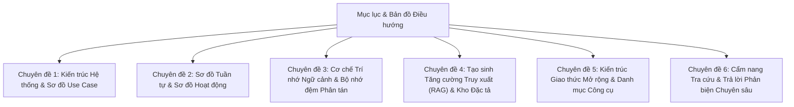

# CẨM NANG TOÀN DIỆN VỀ MODULE AI AGENT & MCP SERVER
> **Hệ thống Quản lý Dự án Scrum Agile Enterprise tích hợp AI**  
> *Dành cho Kỹ sư Phát triển, Kiến trúc sư Hệ thống, Scrum Master, Giảng viên và Hội đồng Phản biện*

---

## 1. Lời nói đầu & Mục đích tài liệu

Bộ tài liệu này được biên soạn nhằm cung cấp **bức tranh toàn cảnh chi tiết từ cấp độ kiến trúc hệ thống (High-Level Architecture) đến từng dòng mã nguồn cụ thể (Low-Level Implementation)** của toàn bộ **Module AI Agent** trong hệ thống Quản lý Dự án.

Tài liệu được thiết kế theo tiêu chí **"Đọc một lần - Nắm trọn toàn bộ"**:
- **Người quản lý / Khách hàng**: Hiểu được AI mang lại giá trị gì cho Scrum Sprint, độ chính xác đến đâu và dữ liệu được bảo vệ thế nào.
- **Kỹ sư phát triển / Bảo trì**: Biết chính xác code nằm ở tệp nào, hàm nào xử lý, luồng dữ liệu đi qua đâu, cách debug và mở rộng model mới.
- **Hội đồng chấm thi / Phản biện**: Có đầy đủ chứng minh thực tế (Proof-of-Concept), sơ đồ chuẩn UML (Use Case, Sequence, Activity), cơ chế lưu trữ phân tán Redis, cơ chế RAG đa định dạng và chuẩn giao thức Model Context Protocol (MCP).

---

## 2. Bản đồ Cấu trúc Tài liệu (Documentation Index)

Bộ tài liệu được tổ chức thành 7 chuyên đề chuyên sâu, liền mạch và có liên kết chéo:

### Danh mục các chuyên đề chi tiết:

1. [**Chuyên đề 1: Kiến trúc Tổng quan & Sơ đồ Use Case**](file:///c:/Users/hoang/Downloads/ProjectMgmt/docs/ai/01-kien-truc-tong-quan-va-use-case.md)
   - Khái niệm & Bài toán cốt lõi trong Scrum Agile; nâng cấp thành **Trợ Lý AI** hội thoại có trạng thái (Stateful Multi-turn Agent).
   - Clean Architecture & Modular Monolith kết hợp Module AI; **Rào chắn Phạm vi Nghiệp vụ** (từ chối yêu cầu ngoài luồng).
   - Sơ đồ Use Case tổng quát (Mermaid) gồm lập kế hoạch Sprint/Backlog, hỏi đáp dự án, xuất Excel qua hội thoại và đẩy trực tiếp vào Kho Backlog.
   - Kiến trúc Đa nhà cung cấp (Multi-Provider Model Client): Gemini 3.6/3.5 Flash, Claude 3.7 Sonnet, OpenAI GPT-4o, Local Ollama.
   - Quy chuẩn Bảo mật Tuyệt đối: Zero-Secret-Leakage & Project Scope Guard.

2. [**Chuyên đề 2: Sơ đồ Tuần tự & Sơ đồ Hoạt động**](file:///c:/Users/hoang/Downloads/ProjectMgmt/docs/ai/02-so-do-tuan-tu-va-hoat-dong.md)
   - Bộ định tuyến Ý định Hội thoại (Intent Classification): Phân tách Sprint/Backlog, Tinh chỉnh Đề xuất, Hỏi đáp Dự án, Xuất Excel, Đẩy Backlog/Sprint và Từ chối Ngoài luồng.
   - Sơ đồ Tuần tự (Sequence Diagram) & Sơ đồ Hoạt động (Activity Diagram) quy trình Agentic Workflow 5 bước đa lượt.
   - Luồng truyền dữ liệu thời gian thực Server-Sent Events (SSE) kèm `sessionId` phiên hội thoại.
   - Cơ chế tự động làm mới JWT Access Token khi phiên làm việc hết hạn (HTTP 401).

3. [**Chuyên đề 3: Cơ chế Trí nhớ & Bộ nhớ đệm phân tán Redis**](file:///c:/Users/hoang/Downloads/ProjectMgmt/docs/ai/03-co-che-tri-nho-redis-memory.md)
   - Phân loại Trí nhớ AI: Working Memory, Stateful Conversational & Staging Session Memory, Long-term Grounding Memory.
   - Sơ đồ hoạt động của Chức năng Trí nhớ Redis (Memory Context Flowchart) hỗ trợ hội thoại nhiều lượt (`ConversationHistory`) trên cùng `sessionId`.
   - State Staging phân tán (`ResilientStateStagingService` + `StackExchangeRedisStagingProvider`).
   - Cấu trúc khóa Redis (`ProjectMgmt:Ai:...`), TTL, cập nhật sau commit Backlog/Sprint và cơ chế In-Memory Fallback an toàn.
   - Hướng dẫn kiểm tra và chứng minh thực tế trên Redis CLI.

4. [**Chuyên đề 4: Cơ chế RAG & Grounding với Spec Hub**](file:///c:/Users/hoang/Downloads/ProjectMgmt/docs/ai/04-rag-va-spec-hub-grounding.md)
   - Khái niệm RAG (Retrieval-Augmented Generation) & Giải quyết triệt để Hallucination.
   - Bộ trích xuất văn bản vạn năng `AiDocumentTextExtractor` (.docx, .pdf, .xlsx, .md, .txt).
   - Vector Search, Embedding (`gemini-embedding-001`, Qdrant) và Fallback Keyword Search.
   - Trích dẫn chính xác nguồn gốc (`documentCitations`) & Ngăn kéo xem tài liệu không làm mất đoạn chat.

5. [**Chuyên đề 5: Kiến trúc MCP Server & Hệ thống MCP Tools**](file:///c:/Users/hoang/Downloads/ProjectMgmt/docs/ai/05-mcp-server-va-tools.md)
   - Khái niệm chuẩn Model Context Protocol (MCP) JSON-RPC 2.0.
   - 2 hình thái MCP trong dự án: In-Process Tools vs Standalone Stdio Server.
   - Danh mục đầy đủ 8 công cụ (`spec_hub_list_documents`, `spec_hub_read_document`, `spec_hub_search`, `project_get_active_config`, `backlog_get_stories`, `sprint_get_history_and_velocity`, `team_get_dev_capacities`, `ai_sprint_plan_propose`).
   - Cấu hình kết nối cho Claude Desktop, Cursor, Roo Code, Gemini CLI.

6. [**Chuyên đề 6: Cẩm nang Tra cứu & Trả lời Phản biện (Q&A Master Guide)**](file:///c:/Users/hoang/Downloads/ProjectMgmt/docs/ai/06-huong-dan-tra-cuu-chung-minh-phan-bien.md)
   - "Cái này là gì? Làm thế nào? Nằm ở file nào?"
   - "Dữ liệu được lưu trữ ở đâu? Kiểm tra câu lệnh gì để thấy?"
   - "Làm thế nào chứng minh hệ thống đang gọi AI thật 100% chứ không phải mock data?"
   - "Làm thế nào chứng minh Redis đang hoạt động?"
   - "Phân quyền Scrum 5 cấp ngăn chặn vượt cấp ra sao?"

---

## 3. Bảng Tra cứu Nhanh Thành phần Mã nguồn (Quick Code Locator)

| Tên Thành Phần | Vai Trò Chuyên Trách | Đường Dẫn Mã Nguồn |
| :--- | :--- | :--- |
| **AiAgentController** | API Controller phục vụ SSE stream theo `sessionId`, staging, tái tạo và commit Sprint/Backlog | [`AiAgentController.cs`](file:///c:/Users/hoang/Downloads/ProjectMgmt/ProjectMgmt.Solution/Controllers/AiAgentController.cs) |
| **AiSprintDecompositionService** | Trợ Lý AI hội thoại có trạng thái Redis: phân loại ý định, rào chắn ngoài luồng, pipeline 5 bước & RAG/MCP | [`AiSprintDecompositionService.cs`](file:///c:/Users/hoang/Downloads/ProjectMgmt/ProjectMgmt.Solution/Services/Ai/AiSprintDecompositionService.cs) |
| **ProjectActiveConfigResolver** | Phân giải cấu hình thực tế đang áp dụng của dự án (Workflow, Priorities, IssueTypes, Labels) | [`ProjectActiveConfigResolver.cs`](file:///c:/Users/hoang/Downloads/ProjectMgmt/ProjectMgmt.Solution/Services/Ai/ProjectActiveConfigResolver.cs) |
| **AiSprintCommitCoordinator** | Ghi nhận Sprint, **đẩy trực tiếp vào Kho Backlog (`SprintId = null`)**, di chuyển Backlog không trùng lặp & xử lý Rollover | [`AiSprintCommitCoordinator.cs`](file:///c:/Users/hoang/Downloads/ProjectMgmt/ProjectMgmt.Solution/Services/Ai/AiSprintCommitCoordinator.cs) |
| **AiTokenUsageTracker** | Theo dõi tiêu thụ Token AI, thống kê chi phí & lịch sử phiên | [`AiTokenUsageTracker.cs`](file:///c:/Users/hoang/Downloads/ProjectMgmt/ProjectMgmt.Solution/Services/Ai/AiTokenUsageTracker.cs) |
| **MultiProviderAiModelClient** | Router gọi đa mô hình (Gemini, Claude, OpenAI, Ollama) | [`MultiProviderAiModelClient.cs`](file:///c:/Users/hoang/Downloads/ProjectMgmt/ProjectMgmt.Solution/Services/Ai/MultiProviderAiModelClient.cs) |
| **AiDocumentTextExtractor** | Trích xuất văn bản từ file Word, Excel, PDF, Markdown, Text | [`AiDocumentTextExtractor.cs`](file:///c:/Users/hoang/Downloads/ProjectMgmt/ProjectMgmt.Solution/Services/Ai/AiDocumentTextExtractor.cs) |
| **StackExchangeRedisStagingProvider** | Bộ nhớ đệm phân tán Redis lưu trạng thái đề xuất staging & lịch sử hội thoại đa lượt | [`StackExchangeRedisStagingProvider.cs`](file:///c:/Users/hoang/Downloads/ProjectMgmt/ProjectMgmt.Solution/Services/Ai/Adapters/StackExchangeRedisStagingProvider.cs) |
| **ResilientStateStagingService** | Cơ chế bọc chống sập bộ nhớ: ưu tiên Redis, fallback In-Memory | [`ResilientStateStagingService.cs`](file:///c:/Users/hoang/Downloads/ProjectMgmt/ProjectMgmt.Core/Staging/ResilientStateStagingService.cs) |
| **ProjectScopeGuard** | Rào chắn bảo mật cách ly dữ liệu giữa các Project & Org | [`ProjectScopeGuard.cs`](file:///c:/Users/hoang/Downloads/ProjectMgmt/ProjectMgmt.Core/Security/ProjectScopeGuard.cs) |
| **SpecHubTools** | MCP Tool truy xuất kho tài liệu đặc tả Spec Hub | [`SpecHubTools.cs`](file:///c:/Users/hoang/Downloads/ProjectMgmt/ProjectMgmt.Solution/McpServers/SpecHubTools.cs) |
| **BacklogTools** | MCP Tool đọc danh sách User Story và độ ưu tiên Backlog | [`BacklogTools.cs`](file:///c:/Users/hoang/Downloads/ProjectMgmt/ProjectMgmt.Solution/McpServers/BacklogTools.cs) |
| **SprintTools** | MCP Tool tính toán vận tốc (Velocity) và rollover items | [`SprintTools.cs`](file:///c:/Users/hoang/Downloads/ProjectMgmt/ProjectMgmt.Solution/McpServers/SprintTools.cs) |
| **TeamTools** | MCP Tool thống kê kỹ năng và giờ làm việc khả dụng | [`TeamTools.cs`](file:///c:/Users/hoang/Downloads/ProjectMgmt/ProjectMgmt.Solution/McpServers/TeamTools.cs) |
| **ProjectMgmt.McpServer** | Ứng dụng Console Stdio JSON-RPC phục vụ Agent ngoài | [`Program.cs`](file:///c:/Users/hoang/Downloads/ProjectMgmt/ProjectMgmt.McpServer/Program.cs) |
| **ai-agent.service.ts** | Service Angular kết nối SSE stream (truyền `sessionId`), áp dụng Sprint / đẩy Backlog & 401 refresh | [`ai-agent.service.ts`](file:///c:/Users/hoang/Downloads/ProjectMgmt/frontend/projectmgmt-web/src/app/core/services/ai-agent.service.ts) |
| **ai-decompose-modal.ts** | Component giao diện **Trợ Lý AI** hội thoại 2 phía có trạng thái, xuất Excel, đẩy Kho Backlog & xem tài liệu | [`ai-decompose-modal.ts`](file:///c:/Users/hoang/Downloads/ProjectMgmt/frontend/projectmgmt-web/src/app/features/backlog/components/ai-decompose-modal/ai-decompose-modal.ts) |
| **ai-decompose-modal.html** | Template đoạn hội thoại Trợ Lý AI (trái) & Tôi (phải) liền mạch, bảng đề xuất tích hợp & các ngăn kéo | [`ai-decompose-modal.html`](file:///c:/Users/hoang/Downloads/ProjectMgmt/frontend/projectmgmt-web/src/app/features/backlog/components/ai-decompose-modal/ai-decompose-modal.html) |
| **profile-page.html** | Dashboard quản lý mức tiêu thụ Token AI và chi phí vận hành | [`profile-page.html`](file:///c:/Users/hoang/Downloads/ProjectMgmt/frontend/projectmgmt-web/src/app/features/identity/profile-page.html) |
| **spec-hub-page.ts** | Giao diện Spec Hub hỗ trợ mở đúng vị trí phân đoạn trích dẫn | [`spec-hub-page.ts`](file:///c:/Users/hoang/Downloads/ProjectMgmt/frontend/projectmgmt-web/src/app/features/spec-hub/spec-hub-page.ts) |

